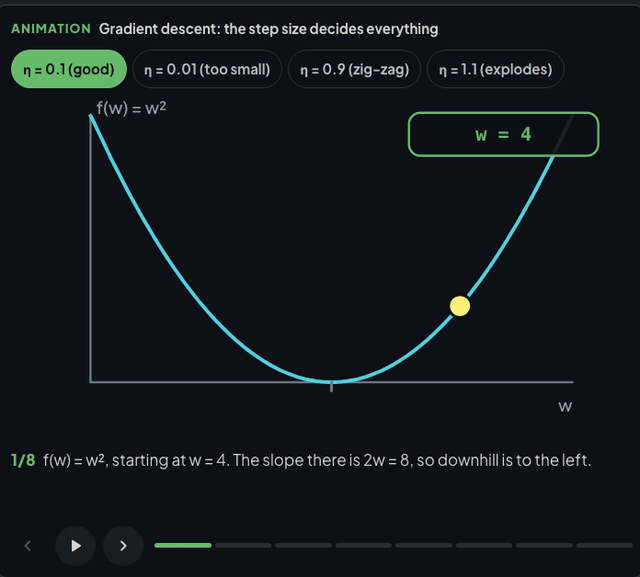
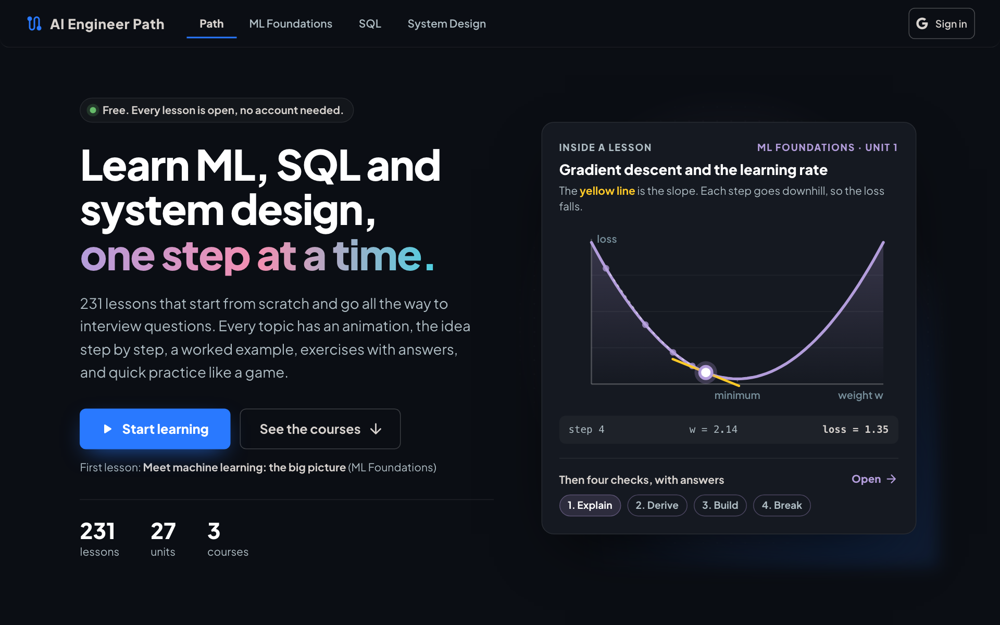
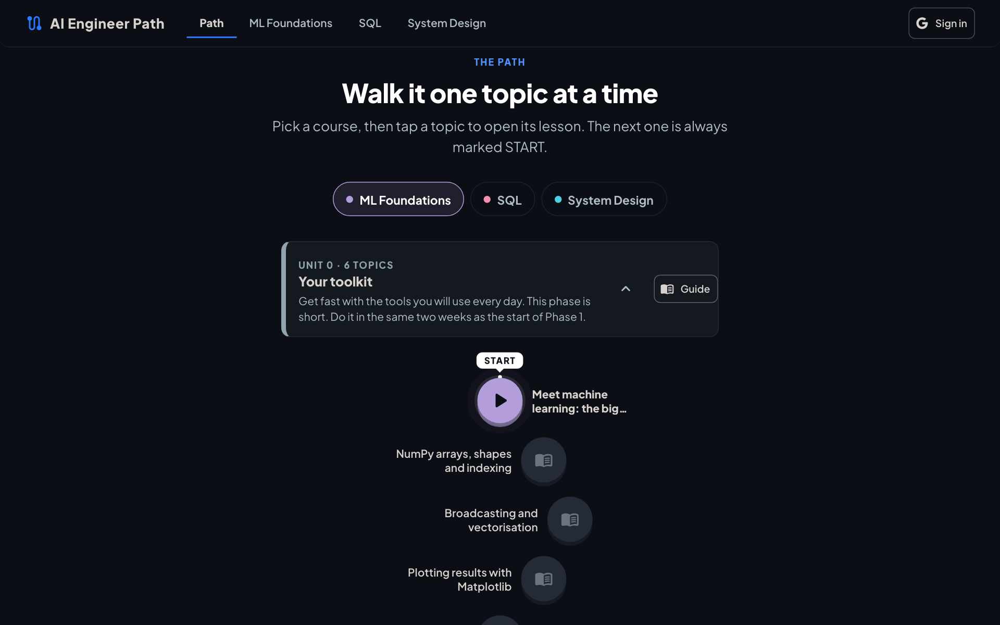
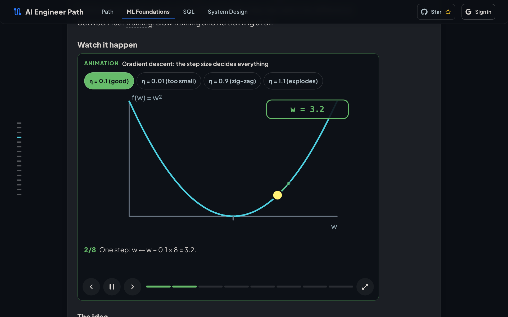
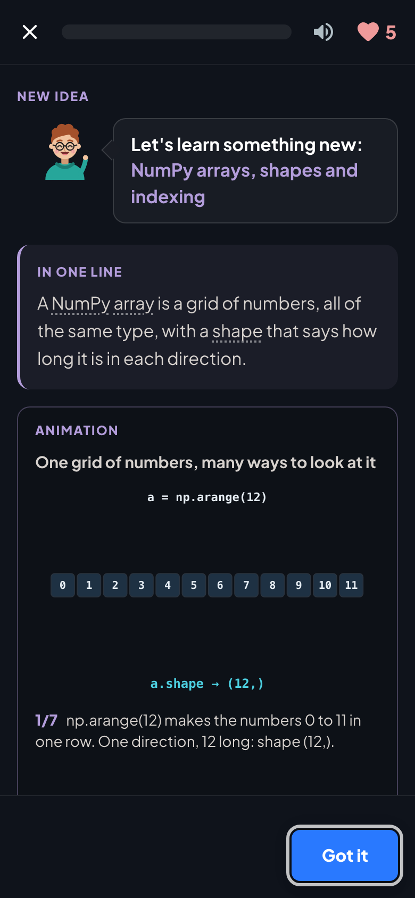
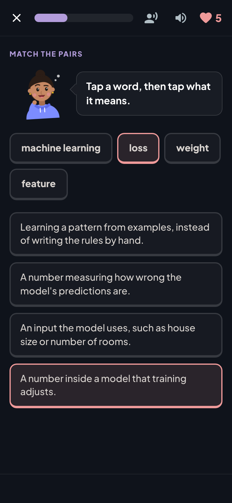
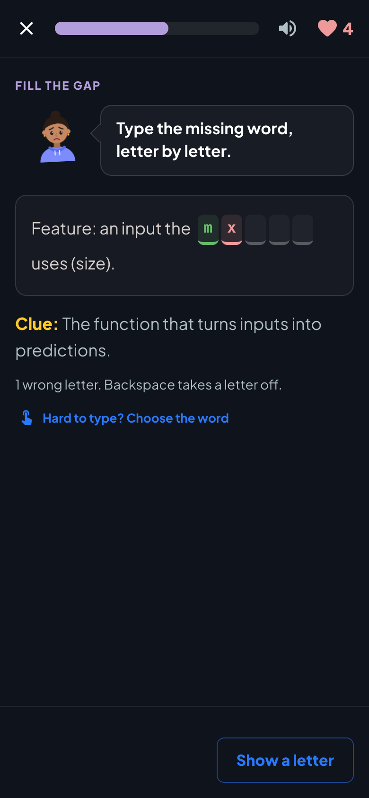
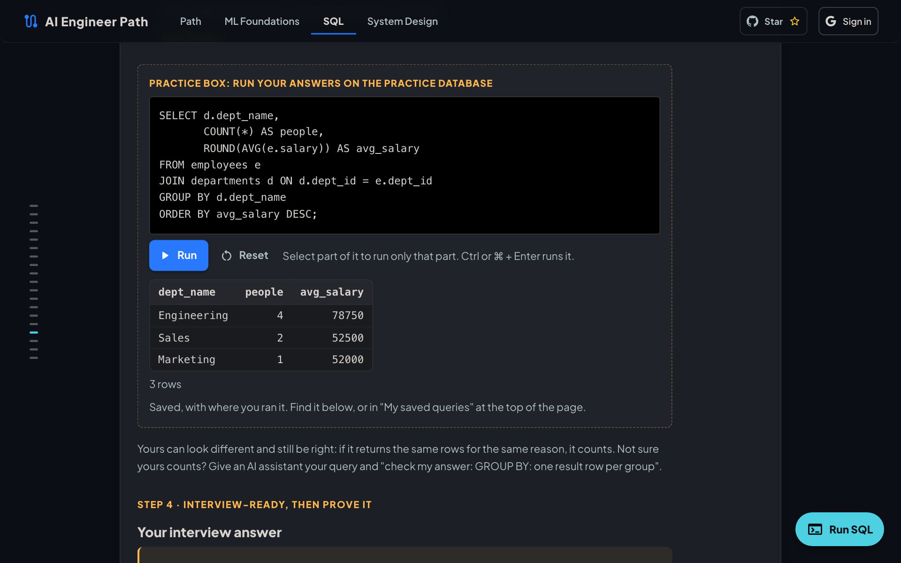
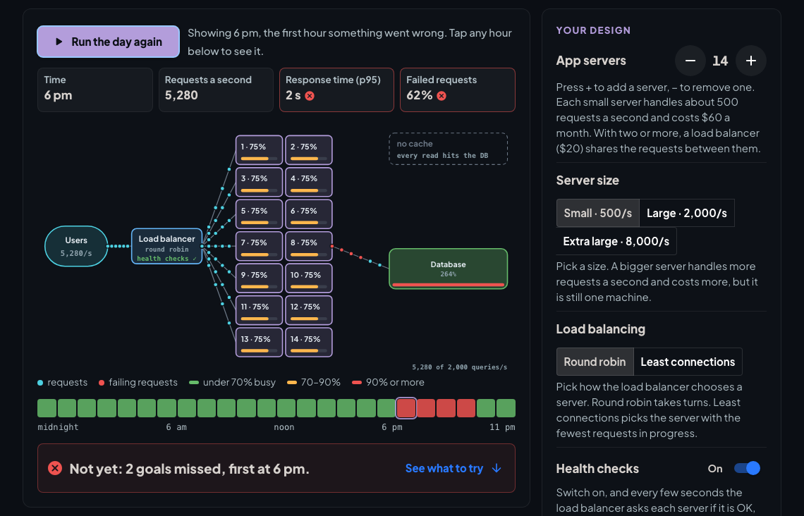
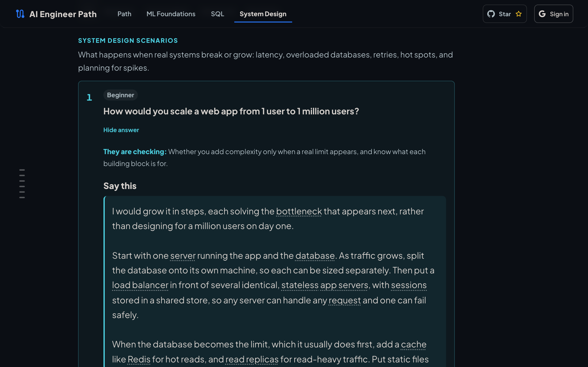

# AI Engineer Path

### Learn machine learning, SQL and system design, from zero to interview-ready. Free.

234 complete lessons, not a list of links. Every lesson has an animation, the idea step by step, 
code that has been run, exercises with full answers, and a five-minute practice game.

### [Start learning at learn.hamropedia.com →](https://learn.hamropedia.com)

Free · No sign-up needed to read · Works on your phone

If it helps you, a ⭐ helps the next learner find it.

 

  
   
  Every lesson has an animation you can step through. This one is <a href="https://learn.hamropedia.com/foundations/gradient-descent-and-the-learning-rate/">gradient descent</a>: a good learning rate, then one that is too big.

> **Prefer to read here?** Every lesson is also a Markdown page in this repository: **[browse all 234 lessons →](lessons/README.md)**

## Why this path is different

| Most roadmaps | AI Engineer Path |
|---|---|
| A list of links to other people's courses | Every lesson is written in full, here. The linked extras are optional. |
| Text and static pictures | An animation you can play, pause and step through in every lesson |
| "The exercise is left to the reader" | Four exercises in every lesson, each with a worked answer |
| Symbols and jargon you have to look up | Tap any technical word or maths symbol (Σ, ∇, ᵀ, η) for a plain-English meaning |
| The proof is "beyond the scope" | An optional **Go deeper** on the core lessons: the derivation, one small step at a time |
| Code you hope still works | Every code example has been run, and a test runs every SQL query and checks the rows it returns |
| You read it, then forget it | Practice from memory after each lesson, then reviews after 1, 3, 7, 14, 30 and 60 days |
| Theory, or interview prep | Both: every course has interview questions with a spoken answer, the traps and the follow-ups |
| Diagrams you can only look at | A **System Design Lab**: build a system, run a whole day of traffic through it, and see which part breaks and why |

## Who it is for

- **New to the field.** Each course starts from zero. Every technical word can be tapped for a plain-English meaning, and the next lesson is always marked **START**.
- **Getting ready for interviews.** Learn the idea, then answer the questions interviewers ask about it, out loud, and compare with a model answer.
- **Aiming at research or a PhD.** The checks go past "I read it": **Derive** the maths from memory, **Build** it from scratch, then **Break** it and explain why it fails. The core lessons add a **Go deeper** section with the full derivation.

## What you get

- **One clear next step.** Each course is a path of units, with lessons in the order they are meant to be taken. The next lesson is always marked **START**.
- **Every lesson in full.** An animation, the idea step by step, a worked example, and exercises with answers.
- **Practice that feels like a game.** Five-minute sessions after each lesson, with hearts, XP, a streak and two friendly coaches, Ada and Alan, who read each question aloud.
- **SQL that runs in your browser.** A real SQLite engine and six practice tables, with nothing to install.
- **A System Design Lab.** Nine missions: build a system, run a day of traffic through it, with a crash or a spike on the way, and find the part that breaks.
- **Ready for interviews.** Every course has interview questions with full spoken answers, the traps, and the follow-ups.

## Choose your course

| Course | Take it if you want to… | Size |
|---|---|---|
| **[ML Foundations](https://learn.hamropedia.com/foundations/)** | understand machine learning from the maths up, through deep learning and LLMs, and build it yourself | 8 units · 101 lessons |
| **[SQL](https://learn.hamropedia.com/sql/)** | get answers from data, from your first `SELECT` to window functions and interview problems | 9 units · 61 lessons |
| **[System Design](https://learn.hamropedia.com/system-design/)** | design real systems and answer high-level, low-level and AI/ML design interviews | 10 units · 72 lessons |

Not sure? If your goal is AI engineering, start with **ML Foundations** and take **SQL** alongside it. Add **System Design** when you start preparing for interviews.

## How it works

### Follow the path

Each course is drawn as a winding path. Tap a lesson to read it or practise it. Each unit also has a **Guide** with its big picture and extra practice.

### Learn each lesson in full

Every lesson teaches one idea all the way through:

1. **An animation** you can play, pause and step through. It waits long enough for you to read each step, and one tap opens it full-screen (on a phone it turns sideways, so the picture is nearly twice the size).
2. **The idea, step by step:** why it exists, how it works, and the mistakes people make. Each lesson ends that part with one or two statements that sound right and are wrong, each marked **Not true**, with what is true straight under it.
3. **A worked example** with code that has been run.
4. **Four checks with answers.** In ML Foundations they are Explain, Derive, Build and Break. Pass all four without notes and the lesson is mastered.

### Practise with Ada and Alan

  
  
  
  

Tap any lesson on the path and choose:

- **Learn it step by step** (about 15 minutes): the whole lesson inside practice. It teaches each part of the lesson (why it matters, the idea, how it works one step at a time, a worked example, what to remember, the common mistakes), and asks a question after each part. Nothing is asked before it has been taught.
- **Quick practice** (5 minutes): for a lesson you have already learned.

A 📖 button inside practice opens the lesson notes, with a link to the full lesson page. In both, the lesson's coach then asks quick questions made from the lesson itself, reading each one aloud:

- **Match the pairs:** each word to what it means.
- **Fill the gap:** type the missing word, checked letter by letter, or choose it from four words if typing is hard.
- **Put the steps in order:** how it works, step by step.
- **Spot the mistake:** three true statements and one false one. "Which one is false?" The false one is written like the true ones, so you have to know the lesson to find it. The answer then says what is true.
- **SQL:** predict how many rows a query returns, write a query that is checked against the answer's rows, and fix a query with one small bug.

A right answer chimes. A wrong one costs a heart, and the card comes back at the end so it sticks. Finishing earns XP and keeps your streak. The voice and the sounds each have their own on/off button.

### Learn it so it lasts

The site follows what learning research shows works best:

1. **Learn it first.** An animation, the idea step by step, and a worked example. You are never asked about something the lesson has not taught yet.
2. **A question after each part.** Learning in small parts, with a question after each, works better than reading it all and testing at the end.
3. **Practise from memory.** Answering from memory beats rereading. In one well-known study, students who tested themselves remembered 61% a week later, against 40% for rereading (Roediger and Karpicke, 2006).
4. **Review just before you forget.** Each lesson you practise comes back for a five-minute mixed review after 1, 3, 7, 14, 30 and 60 days, with the cards you missed first. Spacing and mixing are what make learning last.
5. **Harder each time.** Reviews move from recognising, to recalling from memory, to the interview question about the lesson. You go from beginner to interview level.

### Run SQL in the page

Write a query, press **Run**, and see the rows straight away.

### Build it, break it, fix it: the System Design Lab

Reading about a cache is not the same as watching one save your database at 8 pm. In the **[System Design Lab](https://learn.hamropedia.com/system-design/lab/)** you change a design (servers, load balancing, health checks, a cache, replicas, shards, a queue, a CDN, a rate limit), then run 24 hours of traffic through it. The diagram shows how busy every part is, hour by hour, and the Lab tells you the first hour that broke, which part was the bottleneck, the numbers that show it, and what to try next.

- **Nine missions, no lessons needed to start:** each one explains the idea it needs, then links to the full lessons. They are one server for tonight's traffic, a server that dies at lunchtime, an old machine in the pool, a database drowning in reads, too many writes for one database, photo uploads that freeze the site, customers on the other side of the world, a client's runaway script, and Black Friday.
- **Traps on purpose:** read replicas for a write problem, more servers for a slow network. They fail, and the Lab says why.
- **Real numbers, not a script:** waiting times come from queueing theory (Erlang C), so a server at 90% busy is slower than one at 60%, and above 100% requests fail. The same model gives the numbers above each System Design lesson's animation.

### Practise for interviews

Each course has an **Interview questions** mode. Say your answer out loud, then open the full spoken answer, see what the interviewer is checking, and work through the follow-ups.

### Save your progress (optional)

Every lesson is free to read without an account. Sign in with Google to:

- keep your **XP** from every practice and every check,
- keep a **daily streak** and set a **daily goal**,
- see the **same progress on your phone and your laptop**.

Your progress is private: no other learner can see it. When you sign in, you get one welcome email. Reminder emails are off unless you turn them on in the account menu: then a short nudge comes when you haven't learned for a week (at most four in a row). You can delete your account, and everything in it, at any time from the account menu.

## The full curriculum

Every unit and lesson has its own page. Open a course's list to jump straight to any lesson.

### ML Foundations

Maths, machine learning, deep learning and LLMs, from scratch. **8 units · 101 lessons** · [Open the course →](https://learn.hamropedia.com/foundations/)

| Unit | What you will learn | Lessons |
|---|---|:-:|
| [0 · Your toolkit](https://learn.hamropedia.com/foundations/unit/toolkit/) | Get fast with the tools you will use every day. This unit is short: do it alongside the start of Unit 1. | 7 |
| [1 · Math foundations](https://learn.hamropedia.com/foundations/unit/math/) | The language of ML. You will see matrices as movements of space, gradients as directions, and loss functions as probabilities. | 16 |
| [2 · Classical ML, built by you](https://learn.hamropedia.com/foundations/unit/classical-ml/) | Build every classic algorithm yourself in NumPy. After this unit, a library is only a shortcut for something you already understand. | 17 |
| [3 · Deep learning foundations](https://learn.hamropedia.com/foundations/unit/deep-learning/) | Build neural networks from a single neuron up. Write backprop by hand first. | 16 |
| [4 · Transformers and LLMs](https://learn.hamropedia.com/foundations/unit/llms/) | Build a small GPT from scratch: tokenizer, attention, training and fine-tuning. | 14 |
| [5 · AI engineering](https://learn.hamropedia.com/foundations/unit/ai-engineering/) | Turn foundation models into real products: retrieval, evaluation, agents and deployment. | 16 |
| [6 · Systems and scale](https://learn.hamropedia.com/foundations/unit/systems/) | Make models fast and cheap. Understand what limits speed and memory on a GPU, and how training works across many GPUs. | 9 |
| [7 · Generative models and reinforcement learning](https://learn.hamropedia.com/foundations/unit/generative-rl/) | Models that create new data, and models that learn by trial and error. | 6 |

<b>All 101 ML Foundations lessons</b>

**Unit 0 · [Your toolkit](https://learn.hamropedia.com/foundations/unit/toolkit/)**

1. [Meet machine learning: the big picture](https://learn.hamropedia.com/foundations/meet-machine-learning-the-big-picture/)
2. [Python basics: variables, lists, loops and functions](https://learn.hamropedia.com/foundations/python-basics-variables-lists-loops-and-functions/)
3. [NumPy arrays, shapes and indexing](https://learn.hamropedia.com/foundations/numpy-arrays-shapes-and-indexing/)
4. [Broadcasting and vectorisation](https://learn.hamropedia.com/foundations/broadcasting-and-vectorisation/)
5. [Plotting results with Matplotlib](https://learn.hamropedia.com/foundations/plotting-results-with-matplotlib/)
6. [Git and GitHub for your projects](https://learn.hamropedia.com/foundations/git-and-github-for-your-projects/)
7. [Testing numerical code (np.allclose, pytest)](https://learn.hamropedia.com/foundations/testing-numerical-code-np-allclose-pytest/)

**Unit 1 · [Math foundations](https://learn.hamropedia.com/foundations/unit/math/)**

1. [Vectors, span and basis](https://learn.hamropedia.com/foundations/vectors-span-and-basis/)
2. [Matrices as transformations; matrix multiplication](https://learn.hamropedia.com/foundations/matrices-as-transformations-matrix-multiplication/)
3. [Determinants](https://learn.hamropedia.com/foundations/determinants/)
4. [Inverse, rank and solving Ax = b](https://learn.hamropedia.com/foundations/inverse-rank-and-solving-ax-b/)
5. [Dot product, projection and orthogonality](https://learn.hamropedia.com/foundations/dot-product-projection-and-orthogonality/)
6. [Eigenvalues and eigenvectors](https://learn.hamropedia.com/foundations/eigenvalues-and-eigenvectors/)
7. [SVD, and the maths behind PCA](https://learn.hamropedia.com/foundations/svd-and-the-maths-behind-pca/)
8. [Derivatives and the chain rule](https://learn.hamropedia.com/foundations/derivatives-and-the-chain-rule/)
9. [Partial derivatives, gradients and Jacobians](https://learn.hamropedia.com/foundations/partial-derivatives-gradients-and-jacobians/)
10. [Gradient descent and the learning rate](https://learn.hamropedia.com/foundations/gradient-descent-and-the-learning-rate/)
11. [Random variables, distributions, expectation and variance](https://learn.hamropedia.com/foundations/random-variables-distributions-expectation-and-variance/)
12. [Conditional probability and Bayes’ rule](https://learn.hamropedia.com/foundations/conditional-probability-and-bayes-rule/)
13. [Maximum likelihood estimation](https://learn.hamropedia.com/foundations/maximum-likelihood-estimation/)
14. [Statistics: sampling, confidence intervals, hypothesis tests](https://learn.hamropedia.com/foundations/statistics-sampling-confidence-intervals-hypothesis-tests/)
15. [Entropy, cross-entropy and KL divergence](https://learn.hamropedia.com/foundations/entropy-cross-entropy-and-kl-divergence/)
16. [Convex optimisation: constraints, Lagrange multipliers and duality](https://learn.hamropedia.com/foundations/convex-optimisation-constraints-lagrange-multipliers-and-duality/)

**Unit 2 · [Classical ML, built by you](https://learn.hamropedia.com/foundations/unit/classical-ml/)**

1. [The ML setup: features, labels, loss, train/validation/test](https://learn.hamropedia.com/foundations/the-ml-setup-features-labels-loss-train-validation-test/)
2. [Linear regression: normal equation and gradient descent](https://learn.hamropedia.com/foundations/linear-regression-normal-equation-and-gradient-descent/)
3. [Logistic regression and the sigmoid](https://learn.hamropedia.com/foundations/logistic-regression-and-the-sigmoid/)
4. [Regularisation: L1 and L2](https://learn.hamropedia.com/foundations/regularisation-l1-and-l2/)
5. [Bias–variance trade-off and overfitting](https://learn.hamropedia.com/foundations/bias-variance-trade-off-and-overfitting/)
6. [Metrics: precision, recall, F1, ROC-AUC, confusion matrix](https://learn.hamropedia.com/foundations/metrics-precision-recall-f1-roc-auc-confusion-matrix/)
7. [Cross-validation and data leakage](https://learn.hamropedia.com/foundations/cross-validation-and-data-leakage/)
8. [Feature scaling and encoding](https://learn.hamropedia.com/foundations/feature-scaling-and-encoding/)
9. [k-nearest neighbours](https://learn.hamropedia.com/foundations/k-nearest-neighbours/)
10. [Decision trees: entropy and Gini](https://learn.hamropedia.com/foundations/decision-trees-entropy-and-gini/)
11. [Ensembles: bagging, random forests, gradient boosting](https://learn.hamropedia.com/foundations/ensembles-bagging-random-forests-gradient-boosting/)
12. [Support vector machines: margin and hinge loss](https://learn.hamropedia.com/foundations/support-vector-machines-margin-and-hinge-loss/)
13. [Naive Bayes](https://learn.hamropedia.com/foundations/naive-bayes/)
14. [k-means clustering](https://learn.hamropedia.com/foundations/k-means-clustering/)
15. [PCA in practice](https://learn.hamropedia.com/foundations/pca-in-practice/)
16. [Gaussian mixture models and EM](https://learn.hamropedia.com/foundations/gaussian-mixture-models-and-em/)
17. [Generalisation: VC dimension and double descent](https://learn.hamropedia.com/foundations/generalisation-vc-dimension-and-double-descent/)

**Unit 3 · [Deep learning foundations](https://learn.hamropedia.com/foundations/unit/deep-learning/)**

1. [The neuron and the multi-layer perceptron](https://learn.hamropedia.com/foundations/the-neuron-and-the-multi-layer-perceptron/)
2. [Activation functions, and why non-linearity matters](https://learn.hamropedia.com/foundations/activation-functions-and-why-non-linearity-matters/)
3. [Backpropagation by hand](https://learn.hamropedia.com/foundations/backpropagation-by-hand/)
4. [Autograd and computational graphs](https://learn.hamropedia.com/foundations/autograd-and-computational-graphs/)
5. [Softmax and cross-entropy loss](https://learn.hamropedia.com/foundations/softmax-and-cross-entropy-loss/)
6. [Optimisers: SGD, momentum, Adam; learning-rate schedules](https://learn.hamropedia.com/foundations/optimisers-sgd-momentum-adam-learning-rate-schedules/)
7. [Weight initialisation; vanishing and exploding gradients](https://learn.hamropedia.com/foundations/weight-initialisation-vanishing-and-exploding-gradients/)
8. [Batch norm and layer norm](https://learn.hamropedia.com/foundations/batch-norm-and-layer-norm/)
9. [Regularisation: dropout, weight decay, augmentation, early stopping](https://learn.hamropedia.com/foundations/regularisation-dropout-weight-decay-augmentation-early-stopping/)
10. [PyTorch: nn.Module, DataLoader and the training loop](https://learn.hamropedia.com/foundations/pytorch-nn-module-dataloader-and-the-training-loop/)
11. [Convolutional networks: convolution, pooling, receptive field](https://learn.hamropedia.com/foundations/convolutional-networks-convolution-pooling-receptive-field/)
12. [Residual connections (ResNet)](https://learn.hamropedia.com/foundations/residual-connections-resnet/)
13. [RNNs, and why long sequences are hard](https://learn.hamropedia.com/foundations/rnns-and-why-long-sequences-are-hard/)
14. [Embeddings: representing things as vectors](https://learn.hamropedia.com/foundations/embeddings-representing-things-as-vectors/)
15. [Debugging training: overfit one batch, read loss curves](https://learn.hamropedia.com/foundations/debugging-training-overfit-one-batch-read-loss-curves/)
16. [LSTMs and GRUs: gates for long memory](https://learn.hamropedia.com/foundations/lstms-and-grus-gates-for-long-memory/)

**Unit 4 · [Transformers and LLMs](https://learn.hamropedia.com/foundations/unit/llms/)**

1. [Tokenisation and byte-pair encoding (BPE)](https://learn.hamropedia.com/foundations/tokenisation-and-byte-pair-encoding-bpe/)
2. [Token embeddings and positional encoding](https://learn.hamropedia.com/foundations/token-embeddings-and-positional-encoding/)
3. [Self-attention: queries, keys and values](https://learn.hamropedia.com/foundations/self-attention-queries-keys-and-values/)
4. [Multi-head attention and the transformer block](https://learn.hamropedia.com/foundations/multi-head-attention-and-the-transformer-block/)
5. [GPT-style models and next-token prediction](https://learn.hamropedia.com/foundations/gpt-style-models-and-next-token-prediction/)
6. [Encoder models (BERT) vs decoder models (GPT)](https://learn.hamropedia.com/foundations/encoder-models-bert-vs-decoder-models-gpt/)
7. [Vision transformers and CLIP](https://learn.hamropedia.com/foundations/vision-transformers-and-clip/)
8. [Sampling: greedy, temperature, top-k, top-p](https://learn.hamropedia.com/foundations/sampling-greedy-temperature-top-k-top-p/)
9. [KV cache and the cost of generation](https://learn.hamropedia.com/foundations/kv-cache-and-the-cost-of-generation/)
10. [Pretraining data and scaling laws](https://learn.hamropedia.com/foundations/pretraining-data-and-scaling-laws/)
11. [Mixture of experts](https://learn.hamropedia.com/foundations/mixture-of-experts/)
12. [Fine-tuning and LoRA](https://learn.hamropedia.com/foundations/fine-tuning-and-lora/)
13. [Instruction tuning and preference tuning (RLHF, DPO)](https://learn.hamropedia.com/foundations/instruction-tuning-and-preference-tuning-rlhf-dpo/)
14. [Reasoning models and test-time compute](https://learn.hamropedia.com/foundations/reasoning-models-and-test-time-compute/)

**Unit 5 · [AI engineering](https://learn.hamropedia.com/foundations/unit/ai-engineering/)**

1. [Prompting: clear instructions, examples, structured output](https://learn.hamropedia.com/foundations/prompting-clear-instructions-examples-structured-output/)
2. [Structured outputs and function calling](https://learn.hamropedia.com/foundations/structured-outputs-and-function-calling/)
3. [Embeddings and semantic search](https://learn.hamropedia.com/foundations/embeddings-and-semantic-search/)
4. [Vector databases and approximate nearest-neighbour search](https://learn.hamropedia.com/foundations/vector-databases-and-approximate-nearest-neighbour-search/)
5. [RAG: chunking, retrieval and re-ranking](https://learn.hamropedia.com/foundations/rag-chunking-retrieval-and-re-ranking/)
6. [Context engineering: long context and memory](https://learn.hamropedia.com/foundations/context-engineering-long-context-and-memory/)
7. [Evaluation: test sets, LLM-as-judge, error analysis](https://learn.hamropedia.com/foundations/evaluation-test-sets-llm-as-judge-error-analysis/)
8. [Agents and tool use](https://learn.hamropedia.com/foundations/agents-and-tool-use/)
9. [MCP: connecting models to tools and data](https://learn.hamropedia.com/foundations/mcp-connecting-models-to-tools-and-data/)
10. [Choosing between prompting, RAG and fine-tuning](https://learn.hamropedia.com/foundations/choosing-between-prompting-rag-and-fine-tuning/)
11. [Dataset engineering for fine-tuning](https://learn.hamropedia.com/foundations/dataset-engineering-for-fine-tuning/)
12. [Serving: APIs, Docker, latency and cost](https://learn.hamropedia.com/foundations/serving-apis-docker-latency-and-cost/)
13. [Caching, model routing and cost control](https://learn.hamropedia.com/foundations/caching-model-routing-and-cost-control/)
14. [Observability: tracing and debugging LLM apps](https://learn.hamropedia.com/foundations/observability-tracing-and-debugging-llm-apps/)
15. [Safety: guardrails and prompt injection](https://learn.hamropedia.com/foundations/safety-guardrails-and-prompt-injection/)
16. [ML system design: pipelines, training vs serving, drift](https://learn.hamropedia.com/foundations/ml-system-design-pipelines-training-vs-serving-drift/)

**Unit 6 · [Systems and scale](https://learn.hamropedia.com/foundations/unit/systems/)**

1. [How a GPU works: compute vs memory](https://learn.hamropedia.com/foundations/how-a-gpu-works-compute-vs-memory/)
2. [Mixed precision: fp16 and bf16](https://learn.hamropedia.com/foundations/mixed-precision-fp16-and-bf16/)
3. [Training memory: weights, gradients, optimiser states, activations](https://learn.hamropedia.com/foundations/training-memory-weights-gradients-optimiser-states-activations/)
4. [Parallelism: data, tensor and pipeline (the ideas)](https://learn.hamropedia.com/foundations/parallelism-data-tensor-and-pipeline-the-ideas/)
5. [Inference speed: batching, quantisation, FlashAttention](https://learn.hamropedia.com/foundations/inference-speed-batching-quantisation-flashattention/)
6. [Profiling PyTorch code](https://learn.hamropedia.com/foundations/profiling-pytorch-code/)
7. [GPU kernels with Triton](https://learn.hamropedia.com/foundations/gpu-kernels-with-triton/)
8. [Pruning and distillation](https://learn.hamropedia.com/foundations/pruning-and-distillation/)
9. [Speculative decoding](https://learn.hamropedia.com/foundations/speculative-decoding/)

**Unit 7 · [Generative models and reinforcement learning](https://learn.hamropedia.com/foundations/unit/generative-rl/)**

1. [Autoencoders and VAEs (the ELBO)](https://learn.hamropedia.com/foundations/autoencoders-and-vaes-the-elbo/)
2. [GANs: a generator against a discriminator](https://learn.hamropedia.com/foundations/gans-a-generator-against-a-discriminator/)
3. [Diffusion models](https://learn.hamropedia.com/foundations/diffusion-models/)
4. [Reinforcement learning basics: states, actions, rewards, values](https://learn.hamropedia.com/foundations/reinforcement-learning-basics-states-actions-rewards-values/)
5. [Deep Q-networks (DQN): Q-learning with a neural network](https://learn.hamropedia.com/foundations/deep-q-networks-dqn-q-learning-with-a-neural-network/)
6. [Policy gradients and PPO](https://learn.hamropedia.com/foundations/policy-gradients-and-ppo/)

### SQL

From your first SELECT to window functions and interview problems. **9 units · 61 lessons** · [Open the course →](https://learn.hamropedia.com/sql/)

Every example runs in the page on one small practice database. Each interview problem keeps its solution hidden until you have tried it; when you open it, a step-by-step walk-through shows the solution working on the real rows.

| Unit | What you will learn | Lessons |
|---|---|:-:|
| [0 · Start here: databases, tables and SQL](https://learn.hamropedia.com/sql/unit/start-here/) | Know what a database is, what a table, a row and a key are, and the six practice tables you will use in every lesson. | 4 |
| [1 · Reading data: SELECT, WHERE and sorting](https://learn.hamropedia.com/sql/unit/reading-data/) | Pick the columns you want, keep only the rows you want, sort them, and handle the missing values that trip everyone up. | 8 |
| [2 · Summarising data: aggregates, GROUP BY and HAVING](https://learn.hamropedia.com/sql/unit/summarising/) | Turn many rows into answers — totals, averages, counts per group — and know exactly which rows each number is built from. | 5 |
| [3 · Joins: combining tables](https://learn.hamropedia.com/sql/unit/joins/) | Put rows from two or more tables side by side, keep or drop the rows that have no match on purpose, and spot the joins that quietly double your totals. | 7 |
| [4 · Subqueries, CTEs and set operations](https://learn.hamropedia.com/sql/unit/subqueries/) | Use the result of one query inside another, break hard questions into named steps with WITH, walk trees with recursion, and stack results with UNION. | 5 |
| [5 · Window functions: ranking, running totals and comparing rows](https://learn.hamropedia.com/sql/unit/window-functions/) | Calculate across related rows — rank them, compare each with the one before, keep running totals — without losing the individual rows the way GROUP BY does. | 5 |
| [6 · Building tables and changing data](https://learn.hamropedia.com/sql/unit/changing-data/) | Create tables with the right rules, add, change and remove rows safely, group changes into transactions, and design tables that don't contradict themselves. | 7 |
| [7 · Performance: indexes and query plans](https://learn.hamropedia.com/sql/unit/performance/) | Know why a query is slow, read the plan the database chose, and write queries and indexes that let it find rows without reading the whole table. | 4 |
| [8 · SQL interview problems, from easy to hard](https://learn.hamropedia.com/sql/unit/interview-problems/) | Solve the classic SQL interview questions from a blank page, explain your approach while you write, and name the edge cases before the interviewer does. | 16 |

<b>All 61 SQL lessons</b>

**Unit 0 · [Start here: databases, tables and SQL](https://learn.hamropedia.com/sql/unit/start-here/)**

1. [What a database, a table and SQL are](https://learn.hamropedia.com/sql/what-a-database-a-table-and-sql-are/)
2. [Meet the practice database](https://learn.hamropedia.com/sql/meet-the-practice-database/)
3. [Keys and relationships: primary keys, foreign keys, one-to-many, many-to-many](https://learn.hamropedia.com/sql/keys-and-relationships-primary-keys-foreign-keys-one-to-many/)
4. [Data types: numbers, text, dates and true/false](https://learn.hamropedia.com/sql/data-types-numbers-text-dates-and-true-false/)

**Unit 1 · [Reading data: SELECT, WHERE and sorting](https://learn.hamropedia.com/sql/unit/reading-data/)**

1. [SELECT and FROM: choosing columns](https://learn.hamropedia.com/sql/select-and-from-choosing-columns/)
2. [WHERE: keeping only the rows you want](https://learn.hamropedia.com/sql/where-keeping-only-the-rows-you-want/)
3. [IN, BETWEEN and LIKE: shorter conditions](https://learn.hamropedia.com/sql/in-between-and-like-shorter-conditions/)
4. [NULL: the missing value](https://learn.hamropedia.com/sql/null-the-missing-value/)
5. [ORDER BY, LIMIT and OFFSET: sorting and top N](https://learn.hamropedia.com/sql/order-by-limit-and-offset-sorting-and-top-n/)
6. [DISTINCT: removing duplicate rows](https://learn.hamropedia.com/sql/distinct-removing-duplicate-rows/)
7. [CASE WHEN: if-then logic inside a query](https://learn.hamropedia.com/sql/case-when-if-then-logic-inside-a-query/)
8. [Built-in functions for text, numbers and dates](https://learn.hamropedia.com/sql/built-in-functions-for-text-numbers-and-dates/)

**Unit 2 · [Summarising data: aggregates, GROUP BY and HAVING](https://learn.hamropedia.com/sql/unit/summarising/)**

1. [Aggregate functions: COUNT, SUM, AVG, MIN and MAX](https://learn.hamropedia.com/sql/aggregate-functions-count-sum-avg-min-and-max/)
2. [GROUP BY: one result row per group](https://learn.hamropedia.com/sql/group-by-one-result-row-per-group/)
3. [HAVING: filtering groups, and how it differs from WHERE](https://learn.hamropedia.com/sql/having-filtering-groups-and-how-it-differs-from-where/)
4. [Conditional aggregation: counting several things at once](https://learn.hamropedia.com/sql/conditional-aggregation-counting-several-things-at-once/)
5. [The order a query really runs in](https://learn.hamropedia.com/sql/the-order-a-query-really-runs-in/)

**Unit 3 · [Joins: combining tables](https://learn.hamropedia.com/sql/unit/joins/)**

1. [Joins, and INNER JOIN](https://learn.hamropedia.com/sql/joins-and-inner-join/)
2. [LEFT JOIN: keep every row from one side](https://learn.hamropedia.com/sql/left-join-keep-every-row-from-one-side/)
3. [Finding what is missing: anti-joins](https://learn.hamropedia.com/sql/finding-what-is-missing-anti-joins/)
4. [Self joins: a table joined to itself](https://learn.hamropedia.com/sql/self-joins-a-table-joined-to-itself/)
5. [Joining three or more tables](https://learn.hamropedia.com/sql/joining-three-or-more-tables/)
6. [FULL OUTER JOIN and CROSS JOIN](https://learn.hamropedia.com/sql/full-outer-join-and-cross-join/)
7. [Join traps: double counting, and ON versus WHERE](https://learn.hamropedia.com/sql/join-traps-double-counting-and-on-versus-where/)

**Unit 4 · [Subqueries, CTEs and set operations](https://learn.hamropedia.com/sql/unit/subqueries/)**

1. [Subqueries: a query inside a query](https://learn.hamropedia.com/sql/subqueries-a-query-inside-a-query/)
2. [Correlated subqueries, EXISTS, and the NOT IN trap](https://learn.hamropedia.com/sql/correlated-subqueries-exists-and-the-not-in-trap/)
3. [CTEs: naming each step with WITH](https://learn.hamropedia.com/sql/ctes-naming-each-step-with-with/)
4. [Recursive CTEs: walking trees and filling in dates](https://learn.hamropedia.com/sql/recursive-ctes-walking-trees-and-filling-in-dates/)
5. [UNION, UNION ALL, INTERSECT and EXCEPT](https://learn.hamropedia.com/sql/union-union-all-intersect-and-except/)

**Unit 5 · [Window functions: ranking, running totals and comparing rows](https://learn.hamropedia.com/sql/unit/window-functions/)**

1. [What a window function is: OVER and PARTITION BY](https://learn.hamropedia.com/sql/what-a-window-function-is-over-and-partition-by/)
2. [Ranking: ROW\_NUMBER, RANK and DENSE\_RANK](https://learn.hamropedia.com/sql/ranking-row-number-rank-and-dense-rank/)
3. [LAG and LEAD: comparing with the previous or next row](https://learn.hamropedia.com/sql/lag-and-lead-comparing-with-the-previous-or-next-row/)
4. [Running totals and moving averages: window frames](https://learn.hamropedia.com/sql/running-totals-and-moving-averages-window-frames/)
5. [Share of total, NTILE and FIRST\_VALUE](https://learn.hamropedia.com/sql/share-of-total-ntile-and-first-value/)

**Unit 6 · [Building tables and changing data](https://learn.hamropedia.com/sql/unit/changing-data/)**

1. [CREATE TABLE and ALTER TABLE](https://learn.hamropedia.com/sql/create-table-and-alter-table/)
2. [Constraints: the rules that keep bad data out](https://learn.hamropedia.com/sql/constraints-the-rules-that-keep-bad-data-out/)
3. [INSERT, UPDATE and DELETE](https://learn.hamropedia.com/sql/insert-update-and-delete/)
4. [Transactions and ACID](https://learn.hamropedia.com/sql/transactions-and-acid/)
5. [Normalisation: designing tables that don't contradict themselves](https://learn.hamropedia.com/sql/normalisation-designing-tables-that-dont-contradict-themselves/)
6. [Views: saved queries you can use like tables](https://learn.hamropedia.com/sql/views-saved-queries-you-can-use-like-tables/)
7. [DDL, DML, DCL, TCL — and DELETE versus TRUNCATE versus DROP](https://learn.hamropedia.com/sql/ddl-dml-dcl-tcl-and-delete-versus-truncate-versus-drop/)

**Unit 7 · [Performance: indexes and query plans](https://learn.hamropedia.com/sql/unit/performance/)**

1. [Indexes: how a B-tree makes lookups fast](https://learn.hamropedia.com/sql/indexes-how-a-b-tree-makes-lookups-fast/)
2. [Reading a query plan with EXPLAIN](https://learn.hamropedia.com/sql/reading-a-query-plan-with-explain/)
3. [Index-friendly queries: sargable filters and composite indexes](https://learn.hamropedia.com/sql/index-friendly-queries-sargable-filters-and-composite-indexes/)
4. [How a database runs a join: nested loop, hash join, merge join](https://learn.hamropedia.com/sql/how-a-database-runs-a-join-nested-loop-hash-join-merge-join/)

**Unit 8 · [SQL interview problems, from easy to hard](https://learn.hamropedia.com/sql/unit/interview-problems/)**

1. [How to answer any SQL interview question](https://learn.hamropedia.com/sql/how-to-answer-any-sql-interview-question/)
2. [Quick-fire SQL theory questions](https://learn.hamropedia.com/sql/quick-fire-sql-theory-questions/)
3. [The second highest salary (and the Nth)](https://learn.hamropedia.com/sql/the-second-highest-salary-and-the-nth/)
4. [Employees who earn more than their manager](https://learn.hamropedia.com/sql/employees-who-earn-more-than-their-manager/)
5. [Customers who have never had an order delivered](https://learn.hamropedia.com/sql/customers-who-have-never-had-an-order-delivered/)
6. [Find duplicate emails, then remove the duplicates](https://learn.hamropedia.com/sql/find-duplicate-emails-then-remove-the-duplicates/)
7. [The highest-paid employee in each department](https://learn.hamropedia.com/sql/the-highest-paid-employee-in-each-department/)
8. [Employees paid above their department's average](https://learn.hamropedia.com/sql/employees-paid-above-their-departments-average/)
9. [Month-over-month revenue growth](https://learn.hamropedia.com/sql/month-over-month-revenue-growth/)
10. [Each customer's first order](https://learn.hamropedia.com/sql/each-customers-first-order/)
11. [Streaks: orders on consecutive days (gaps and islands)](https://learn.hamropedia.com/sql/streaks-orders-on-consecutive-days-gaps-and-islands/)
12. [Products bought together](https://learn.hamropedia.com/sql/products-bought-together/)
13. [Which products make up 80% of revenue? (share of total)](https://learn.hamropedia.com/sql/which-products-make-up-80-of-revenue-share-of-total/)
14. [Retention: who came back within 30 days?](https://learn.hamropedia.com/sql/retention-who-came-back-within-30-days/)
15. [The median salary](https://learn.hamropedia.com/sql/the-median-salary/)
16. [Customers who bought every product in a category](https://learn.hamropedia.com/sql/customers-who-bought-every-product-in-a-category/)

### System Design

The building blocks, then real designs, the way interviews ask them. **10 units · 72 lessons** · [Open the course →](https://learn.hamropedia.com/system-design/)

| Unit | What you will learn | Lessons |
|---|---|:-:|
| [0 · How system design interviews work](https://learn.hamropedia.com/system-design/unit/interview-basics/) | Learn the step-by-step way to answer any design question before you learn the parts. | 4 |
| [1 · Networking and APIs](https://learn.hamropedia.com/system-design/unit/networking/) | Understand how a request travels from a phone or browser to your servers and back, and how to design the API it calls. | 5 |
| [2 · Core concepts: scale, reliability and speed](https://learn.hamropedia.com/system-design/unit/core-concepts/) | The ten ideas every high-level design uses: scalability, availability, fault tolerance, load balancing, caching, consistency and CAP, rate limiting, asynchronous processing, and observability. | 9 |
| [3 · Data: databases, storage and scaling data](https://learn.hamropedia.com/system-design/unit/data/) | Choose the right database, keep data correct with transactions, make queries fast with indexes, and scale data with replication and sharding. | 9 |
| [4 · Distributed systems and security](https://learn.hamropedia.com/system-design/unit/distributed/) | How services split up and stay correct across a network, how machines agree, and how to keep users and data secure. | 4 |
| [5 · Low-level design: OOP and SOLID](https://learn.hamropedia.com/system-design/unit/oop-solid/) | The building blocks of good class design: the four pillars of OOP, composition over inheritance, the five SOLID principles, class diagrams, and the concurrency basics LLD questions expect. | 9 |
| [6 · Design patterns](https://learn.hamropedia.com/system-design/unit/patterns/) | Ten patterns that come up again and again in LLD interviews and real code: three for creating objects, three for structuring them, and four for behaviour. | 10 |
| [7 · Low-level design questions](https://learn.hamropedia.com/system-design/unit/lld-practice/) | Practise the classic LLD questions end to end: requirements, classes, patterns, the key code and concurrency. | 6 |
| [8 · High-level design questions](https://learn.hamropedia.com/system-design/unit/hld-practice/) | Practise the classic HLD questions with the full framework: requirements, estimates, API, data model, design, deep dives and trade-offs. | 11 |
| [9 · AI and ML system design](https://learn.hamropedia.com/system-design/unit/ai-ml-design/) | The design questions AI and ML engineer interviews ask: RAG assistants, recommendations, fraud detection, LLM serving, and the pipeline that trains and ships models. | 5 |

<b>All 72 System Design lessons</b>

**Unit 0 · [How system design interviews work](https://learn.hamropedia.com/system-design/unit/interview-basics/)**

1. [Meet the building blocks: a map of a typical web system](https://learn.hamropedia.com/system-design/meet-the-building-blocks-a-map-of-a-typical-web-system/)
2. [The high-level design interview: a step-by-step answer framework](https://learn.hamropedia.com/system-design/the-high-level-design-interview-a-step-by-step-answer-framework/)
3. [Back-of-the-envelope estimation](https://learn.hamropedia.com/system-design/back-of-the-envelope-estimation/)
4. [The low-level design interview: a step-by-step approach](https://learn.hamropedia.com/system-design/the-low-level-design-interview-a-step-by-step-approach/)

**Unit 1 · [Networking and APIs](https://learn.hamropedia.com/system-design/unit/networking/)**

1. [Client–server, DNS, and what happens when you type a URL](https://learn.hamropedia.com/system-design/client-server-dns-and-what-happens-when-you-type-a-url/)
2. [HTTP and REST API design](https://learn.hamropedia.com/system-design/http-and-rest-api-design/)
3. [Real-time communication: polling, long polling, WebSockets, SSE](https://learn.hamropedia.com/system-design/real-time-communication-polling-long-polling-websockets-sse/)
4. [CDN (content delivery network)](https://learn.hamropedia.com/system-design/cdn-content-delivery-network/)
5. [Proxies, reverse proxies and API gateways](https://learn.hamropedia.com/system-design/proxies-reverse-proxies-and-api-gateways/)

**Unit 2 · [Core concepts: scale, reliability and speed](https://learn.hamropedia.com/system-design/unit/core-concepts/)**

1. [Scalability: vertical vs horizontal](https://learn.hamropedia.com/system-design/scalability-vertical-vs-horizontal/)
2. [Availability: nines, SLAs and redundancy](https://learn.hamropedia.com/system-design/availability-nines-slas-and-redundancy/)
3. [Fault tolerance: timeouts, retries, circuit breakers](https://learn.hamropedia.com/system-design/fault-tolerance-timeouts-retries-circuit-breakers/)
4. [Load balancing](https://learn.hamropedia.com/system-design/load-balancing/)
5. [Caching](https://learn.hamropedia.com/system-design/caching/)
6. [Consistency, CAP and PACELC](https://learn.hamropedia.com/system-design/consistency-cap-and-pacelc/)
7. [Rate limiting and backpressure](https://learn.hamropedia.com/system-design/rate-limiting-and-backpressure/)
8. [Asynchronous processing and message queues (Kafka, SQS)](https://learn.hamropedia.com/system-design/asynchronous-processing-and-message-queues-kafka-sqs/)
9. [Observability: logs, metrics and traces](https://learn.hamropedia.com/system-design/observability-logs-metrics-and-traces/)

**Unit 3 · [Data: databases, storage and scaling data](https://learn.hamropedia.com/system-design/unit/data/)**

1. [SQL vs NoSQL: choosing a database](https://learn.hamropedia.com/system-design/sql-vs-nosql-choosing-a-database/)
2. [ACID transactions and isolation levels](https://learn.hamropedia.com/system-design/acid-transactions-and-isolation-levels/)
3. [Database indexing](https://learn.hamropedia.com/system-design/database-indexing/)
4. [Replication](https://learn.hamropedia.com/system-design/replication/)
5. [Partitioning and sharding](https://learn.hamropedia.com/system-design/partitioning-and-sharding/)
6. [Consistent hashing](https://learn.hamropedia.com/system-design/consistent-hashing/)
7. [Object storage (S3) for files and media](https://learn.hamropedia.com/system-design/object-storage-s3-for-files-and-media/)
8. [Search: inverted indexes and Elasticsearch](https://learn.hamropedia.com/system-design/search-inverted-indexes-and-elasticsearch/)
9. [Unique ID generation](https://learn.hamropedia.com/system-design/unique-id-generation/)

**Unit 4 · [Distributed systems and security](https://learn.hamropedia.com/system-design/unit/distributed/)**

1. [Monolith vs microservices](https://learn.hamropedia.com/system-design/monolith-vs-microservices/)
2. [Distributed transactions: sagas and the outbox pattern](https://learn.hamropedia.com/system-design/distributed-transactions-sagas-and-the-outbox-pattern/)
3. [Consensus and leader election (Raft)](https://learn.hamropedia.com/system-design/consensus-and-leader-election-raft/)
4. [Security basics: authentication, authorisation, OAuth and JWT](https://learn.hamropedia.com/system-design/security-basics-authentication-authorisation-oauth-and-jwt/)

**Unit 5 · [Low-level design: OOP and SOLID](https://learn.hamropedia.com/system-design/unit/oop-solid/)**

1. [OOP: the four pillars](https://learn.hamropedia.com/system-design/oop-the-four-pillars/)
2. [Composition over inheritance, and interfaces](https://learn.hamropedia.com/system-design/composition-over-inheritance-and-interfaces/)
3. [SOLID: S — Single Responsibility Principle](https://learn.hamropedia.com/system-design/solid-s-single-responsibility-principle/)
4. [SOLID: O — Open/Closed Principle](https://learn.hamropedia.com/system-design/solid-o-open-closed-principle/)
5. [SOLID: L — Liskov Substitution Principle](https://learn.hamropedia.com/system-design/solid-l-liskov-substitution-principle/)
6. [SOLID: I — Interface Segregation Principle](https://learn.hamropedia.com/system-design/solid-i-interface-segregation-principle/)
7. [SOLID: D — Dependency Inversion Principle](https://learn.hamropedia.com/system-design/solid-d-dependency-inversion-principle/)
8. [UML class diagrams and relationships](https://learn.hamropedia.com/system-design/uml-class-diagrams-and-relationships/)
9. [Concurrency basics: threads, locks and race conditions](https://learn.hamropedia.com/system-design/concurrency-basics-threads-locks-and-race-conditions/)

**Unit 6 · [Design patterns](https://learn.hamropedia.com/system-design/unit/patterns/)**

1. [Singleton](https://learn.hamropedia.com/system-design/singleton/)
2. [Factory: Factory Method and Abstract Factory](https://learn.hamropedia.com/system-design/factory-factory-method-and-abstract-factory/)
3. [Builder](https://learn.hamropedia.com/system-design/builder/)
4. [Adapter](https://learn.hamropedia.com/system-design/adapter/)
5. [Decorator](https://learn.hamropedia.com/system-design/decorator/)
6. [Facade](https://learn.hamropedia.com/system-design/facade/)
7. [Strategy](https://learn.hamropedia.com/system-design/strategy/)
8. [Observer](https://learn.hamropedia.com/system-design/observer/)
9. [Chain of Responsibility](https://learn.hamropedia.com/system-design/chain-of-responsibility/)
10. [State](https://learn.hamropedia.com/system-design/state/)

**Unit 7 · [Low-level design questions](https://learn.hamropedia.com/system-design/unit/lld-practice/)**

1. [Design a parking lot](https://learn.hamropedia.com/system-design/design-a-parking-lot/)
2. [Design an elevator system](https://learn.hamropedia.com/system-design/design-an-elevator-system/)
3. [Design Splitwise (expense sharing)](https://learn.hamropedia.com/system-design/design-splitwise-expense-sharing/)
4. [Design a vending machine](https://learn.hamropedia.com/system-design/design-a-vending-machine/)
5. [Design an LRU cache](https://learn.hamropedia.com/system-design/design-an-lru-cache/)
6. [Design an order-matching engine (stock exchange)](https://learn.hamropedia.com/system-design/design-an-order-matching-engine-stock-exchange/)

**Unit 8 · [High-level design questions](https://learn.hamropedia.com/system-design/unit/hld-practice/)**

1. [Design a URL shortener (like bit.ly)](https://learn.hamropedia.com/system-design/design-a-url-shortener-like-bit-ly/)
2. [Design a distributed rate limiter](https://learn.hamropedia.com/system-design/design-a-distributed-rate-limiter/)
3. [Design a notification system](https://learn.hamropedia.com/system-design/design-a-notification-system/)
4. [Design a chat app (like WhatsApp)](https://learn.hamropedia.com/system-design/design-a-chat-app-like-whatsapp/)
5. [Design a news feed (like Twitter or Instagram)](https://learn.hamropedia.com/system-design/design-a-news-feed-like-twitter-or-instagram/)
6. [Design a video streaming platform (like YouTube or Netflix)](https://learn.hamropedia.com/system-design/design-a-video-streaming-platform-like-youtube-or-netflix/)
7. [Design a ride-hailing app (like Uber)](https://learn.hamropedia.com/system-design/design-a-ride-hailing-app-like-uber/)
8. [Design a payment system](https://learn.hamropedia.com/system-design/design-a-payment-system/)
9. [Design search autocomplete](https://learn.hamropedia.com/system-design/design-search-autocomplete/)
10. [Design a real-time leaderboard](https://learn.hamropedia.com/system-design/design-a-real-time-leaderboard/)
11. [Design a distributed cache](https://learn.hamropedia.com/system-design/design-a-distributed-cache/)

**Unit 9 · [AI and ML system design](https://learn.hamropedia.com/system-design/unit/ai-ml-design/)**

1. [Design a RAG assistant over company documents](https://learn.hamropedia.com/system-design/design-a-rag-assistant-over-company-documents/)
2. [Design a recommendation system](https://learn.hamropedia.com/system-design/design-a-recommendation-system/)
3. [Design a real-time fraud detection system](https://learn.hamropedia.com/system-design/design-a-real-time-fraud-detection-system/)
4. [Design an LLM serving platform](https://learn.hamropedia.com/system-design/design-an-llm-serving-platform/)
5. [Design an ML training and feature pipeline](https://learn.hamropedia.com/system-design/design-an-ml-training-and-feature-pipeline/)

## Questions

**Is it really free?** 
Yes. Every lesson is open to read, with no account and no paywall.

**Do I need to know maths or coding first?** 
No. ML Foundations teaches the maths it needs in Unit 1, and its second lesson teaches the Python it uses, in a free notebook with nothing to install. SQL and System Design start from zero.

**Does it work on my phone?** 
Yes. The lessons and the practice are made for phone screens too. Every animation has a **Bigger picture** button that opens it full-screen and turns it sideways, so the labels are easy to read.

**Is my progress private?** 
Yes. No other learner can see it, and you can delete it with your account at any time.

**Will you email me?** 
Only if you sign in: one welcome email. Weekly reminders are off unless you turn them on in the account menu.

**I found a mistake in a lesson.** 
Thank you! [Open an issue](https://github.com/iammanoj807/ai-engineer-path/issues/new/choose), or fix it yourself: see [CONTRIBUTING.md](CONTRIBUTING.md).

## Help make it better

The lessons are plain text files, so you can improve one without knowing the code.

- **Tell us where a lesson lost you.** [Open an issue](https://github.com/iammanoj807/ai-engineer-path/issues/new/choose) and say which sentence. That is the most useful report there is.
- **Fix a mistake**, a broken link or an unclear sentence, and open a pull request.
- **Add a missing word** to a course's glossary, so the next learner can tap it.

[CONTRIBUTING.md](CONTRIBUTING.md) shows where every lesson lives and the checks that run on each change.

## Support the project

- **Star this repository** so other learners can find it.
- **Share a lesson** with a friend who is learning too.
- **[Buy me a coffee](https://buymeacoffee.com/manojthapa)** if the site helps you.

## Licence

The code is under the [MIT License](LICENSE). The lessons are under [CC BY-SA 4.0](LICENSE-CONTENT.md): share and adapt them freely, with credit, under the same licence.

Running the site yourself or forking it? See the [developer notes](docs/DEVELOPMENT.md).
