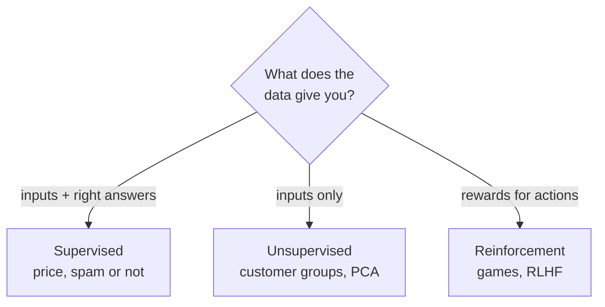
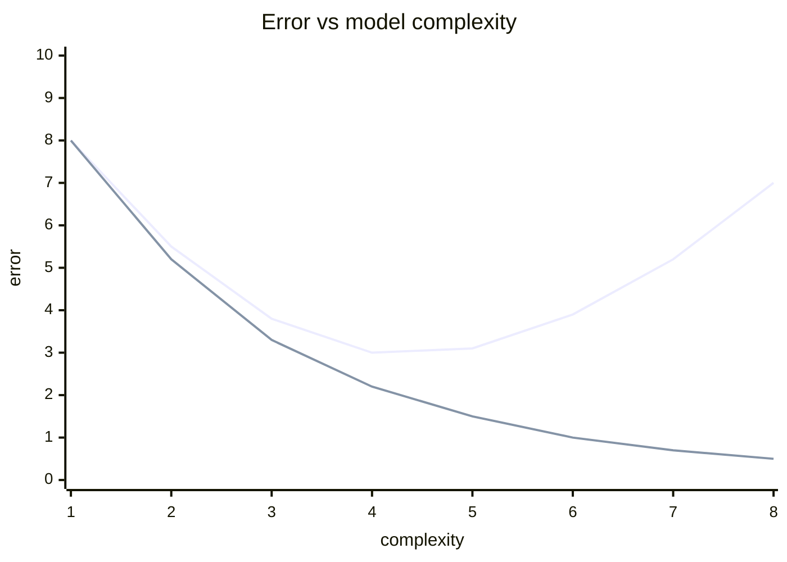
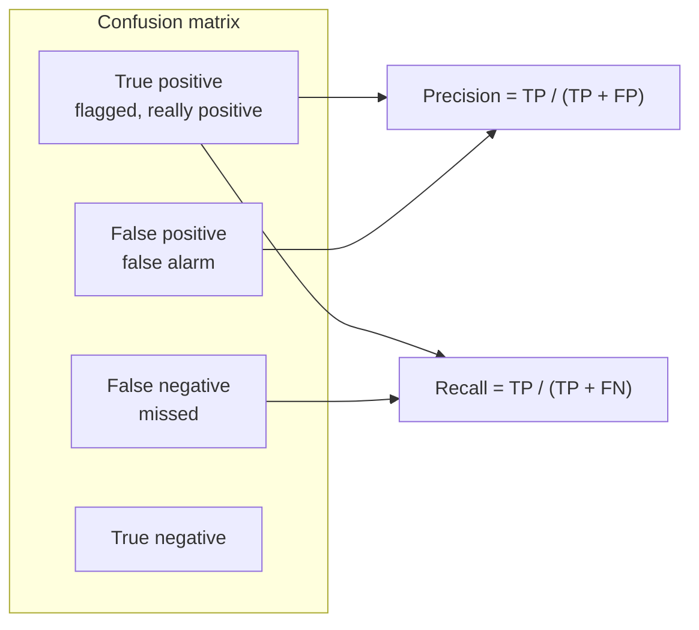
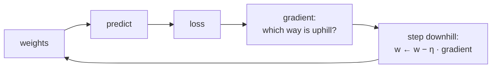
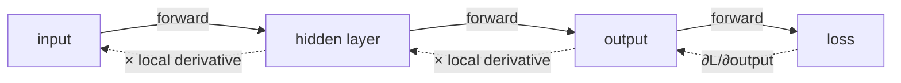
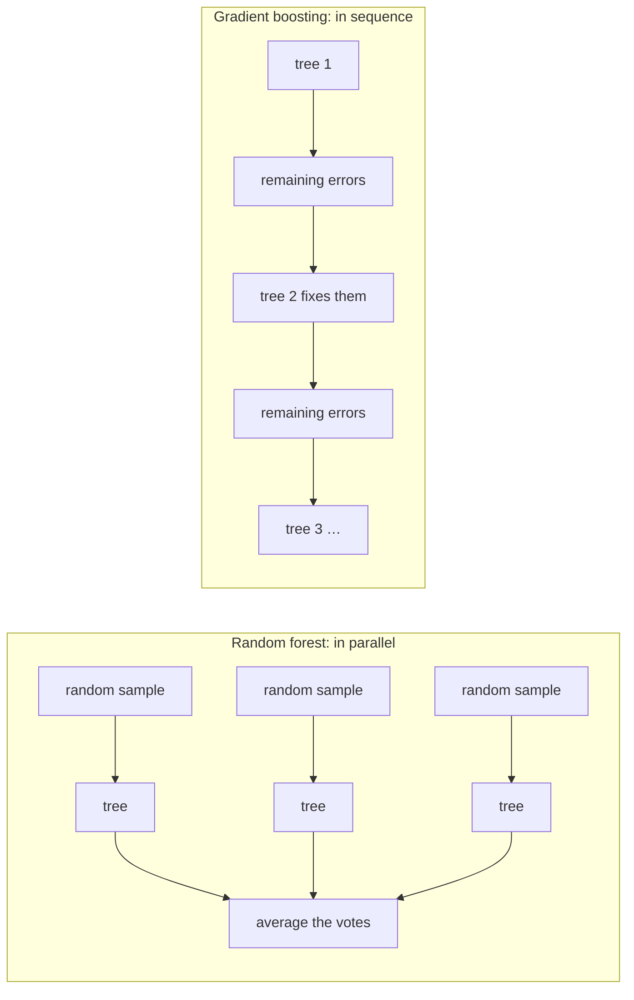
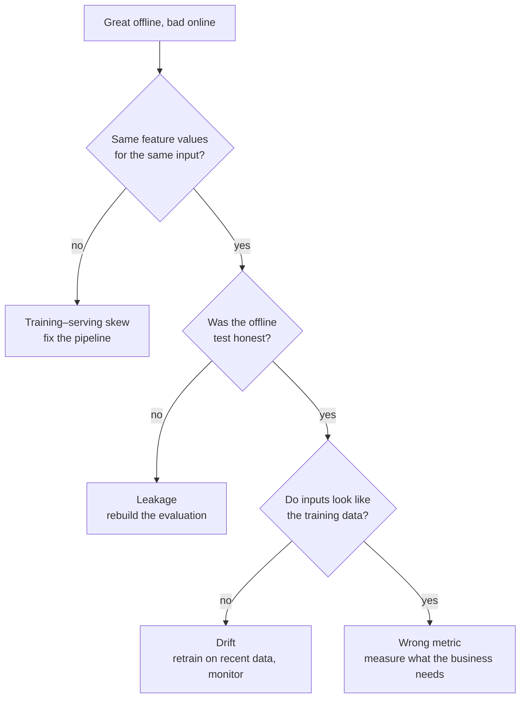
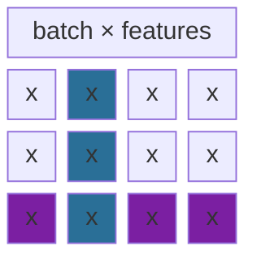

<!-- Written by `npm run lessons` from the lesson data in src/data. Edit the lesson there, not this page. -->

# Interview questions: Machine learning and deep learning

The fundamentals behind every ML and AI role: how models learn, how they fail, and how you know they work.

Say your answer out loud first, then open the answer. 21 questions. [All lessons](../README.md)

## 1. What is the difference between supervised, unsupervised and reinforcement learning? Give an example of each.

**Beginner** · Concept

**They are checking:** That you know the three basic settings and can tell which one a real problem belongs to.

Show the answer

**Say this**

The difference is what the model learns from.

In supervised learning, every example comes with the right answer, a label. The model learns to map inputs to labels: predicting a house price from its size, or whether an email is spam.

In unsupervised learning there are no labels. The model finds structure on its own, such as groups of similar customers (clustering) or a smaller set of features that keeps most of the information (PCA).

In reinforcement learning, an agent takes actions in an environment and gets rewards, and learns which actions lead to the most reward over time, like a program learning to play a game, or the fine-tuning step that teaches a chatbot to give answers people prefer.

**In everyday words.** Learning to cook. Supervised: a teacher tastes every dish and tells you the right answer. Unsupervised: you're given a pile of ingredients and sort them into groups yourself. Reinforcement: you cook, guests clap or don't, and you slowly learn what earns applause.

*Ask what the data gives you. Labels mean supervised, none means unsupervised, and rewards for actions mean reinforcement learning.*

**What makes it a strong answer**

- Defines each by what the data contains.
- Gives a concrete example of each, including a modern one (RLHF).
- Mentions self-supervised learning: LLM pretraining makes its own labels from text (the next word).

**What weak answers say**

- Vague definitions with no examples.
- Calling clustering "classification without labels". There are no classes given.

**Follow-up questions**

&lt;b>Which one is LLM pretraining?&lt;/b>

Self-supervised: a form of supervised learning where the labels come from the data itself. The next word in the text is the label, so no human labelling is needed.

&lt;b>Is predicting tomorrow's temperature regression or classification?&lt;/b>

Regression, because the answer is a number. "Will it rain, yes or no?" would be classification.

Learn it first: [Meet machine learning: the big picture](../ml-foundations/unit-0-toolkit/meet-machine-learning-the-big-picture.md) · [The ML setup: features, labels, loss, train/validation/test](../ml-foundations/unit-2-classical-ml/the-ml-setup-features-labels-loss-train-validation-test.md) · [k-means clustering](../ml-foundations/unit-2-classical-ml/k-means-clustering.md) · [Reinforcement learning basics: states, actions, rewards, values](../ml-foundations/unit-7-generative-rl/reinforcement-learning-basics-states-actions-rewards-values.md)

---

## 2. Explain the bias–variance trade-off.

**Beginner** · Concept

**They are checking:** Whether you understand underfitting and overfitting as two sides of one trade-off, and what to do about each.

Show the answer

**Say this**

A model's error on new data comes from two main sources.

Bias is error from a model that is too simple to capture the real pattern, like fitting a straight line to a curve. It is wrong in the same way on training and test data: that is underfitting.

Variance is error from a model that is so flexible it fits the noise in its particular training set. It does very well on training data and badly on new data, and it would change a lot if you trained it on a different sample: that is overfitting.

Making a model more complex lowers bias but raises variance, so test error follows a U shape and the best model is at the bottom. In practice: high training error means high bias, so use a bigger model or better features; a big gap between training and validation error means high variance, so add data, regularise or simplify.

**In everyday words.** Darts. High bias: all your darts land close together, but in the wrong place. High variance: they're centred on the bullseye on average, but scattered all over the board. You want them tight and centred.

*Training error (lower line) keeps falling as the model grows. Validation error (upper line) falls, then rises again: the best model is at the bottom of that U.*

**What makes it a strong answer**

- Links bias to underfitting and variance to overfitting.
- Says how to diagnose each from training and validation error.
- Gives fixes for each side.
- Bonus: very large networks can show "double descent", where test error falls again past the U.

**What weak answers say**

- Reciting the decomposition formula without the intuition.
- Saying "more data fixes everything". It mainly reduces variance, not bias.

**Follow-up questions**

&lt;b>Your training error is 2% and validation error is 15%. What is the problem?&lt;/b>

High variance: overfitting. The model fits the training set much better than new data. Get more data, add regularisation (dropout, weight decay), augment the data, use early stopping, or use a simpler model.

&lt;b>Training error is 20% and validation is 21%. What now?&lt;/b>

High bias: underfitting. Both are bad and close together. Use a bigger model, better features, train longer, or reduce regularisation.

Learn it first: [Bias–variance trade-off and overfitting](../ml-foundations/unit-2-classical-ml/bias-variance-trade-off-and-overfitting.md) · [Regularisation: L1 and L2](../ml-foundations/unit-2-classical-ml/regularisation-l1-and-l2.md) · [Regularisation: dropout, weight decay, augmentation, early stopping](../ml-foundations/unit-3-deep-learning/regularisation-dropout-weight-decay-augmentation-early-stopping.md) · [Generalisation: VC dimension and double descent](../ml-foundations/unit-2-classical-ml/generalisation-vc-dimension-and-double-descent.md)

---

## 3. How do you detect overfitting, and how do you prevent it?

**Beginner** · Concept

**They are checking:** Practical habits: held-out data, reading curves, and the standard toolbox of fixes.

Show the answer

**Say this**

I detect it by keeping data the model never trains on. If training loss keeps falling while validation loss stops falling and starts to rise, the model is memorising the training set instead of learning the pattern. A big gap between training and validation accuracy says the same thing.

To prevent it, roughly in order of how often I reach for them: get more or more varied data, including data augmentation; add regularisation, such as weight decay or dropout; stop training at the lowest validation loss, called early stopping; and use a simpler model or fewer features. For small datasets, cross-validation gives a more reliable estimate than one split.

And the test set stays locked away until the very end, so the final number is honest.

**In everyday words.** A student who memorises last year's exam answers. They score 100% on that paper and fail a new one. You catch it with a practice paper they've never seen, and prevent it by giving them many different questions, not the same few.

**What makes it a strong answer**

- Uses validation data, and describes the curve shape.
- Several fixes, with data first.
- Keeps the test set separate from tuning.

**What weak answers say**

- Tuning on the test set, so the "held-out" number is no longer honest.
- Only one fix, or "use dropout" for everything, including models that have no dropout.

**Follow-up questions**

&lt;b>What is the difference between the validation set and the test set?&lt;/b>

You use the validation set again and again to choose settings and stop training. The test set is used once at the end, for an honest estimate of performance on new data.

&lt;b>How does dropout reduce overfitting?&lt;/b>

During training it switches off a random fraction of neurons each step, so the network can't rely on any single one and learns several redundant ways to get the answer, like training many smaller networks that share weights.

Learn it first: [Bias–variance trade-off and overfitting](../ml-foundations/unit-2-classical-ml/bias-variance-trade-off-and-overfitting.md) · [Regularisation: dropout, weight decay, augmentation, early stopping](../ml-foundations/unit-3-deep-learning/regularisation-dropout-weight-decay-augmentation-early-stopping.md) · [Cross-validation and data leakage](../ml-foundations/unit-2-classical-ml/cross-validation-and-data-leakage.md) · [Plotting results with Matplotlib](../ml-foundations/unit-0-toolkit/plotting-results-with-matplotlib.md)

---

## 4. What are precision and recall? When would you care more about one than the other?

**Beginner** · Concept

**They are checking:** Whether you can choose a metric from the cost of each kind of mistake, and why accuracy misleads on imbalanced data.

Show the answer

**Say this**

Both look at the positive class.

Precision: of everything the model flagged as positive, how many really were? It is about false alarms.

Recall: of all the real positives, how many did the model find? It is about misses.

Which matters more depends on what each mistake costs. For cancer screening or fraud detection, a miss is very costly, so I want high recall and accept more false alarms that a person double-checks. For a spam filter, a false alarm hides a real email, so I want high precision.

You trade one for the other by moving the decision threshold. F1 combines them when both matter. And on imbalanced data, accuracy misleads: if 1% of transactions are fraud, a model that always says "not fraud" is 99% accurate and useless.

**In everyday words.** A fishing net. Recall: how many of the fish in the lake did you catch? Precision: how much of what's in your net is actually fish, and not old boots? A huge net catches every fish but plenty of boots; a tiny careful net catches only fish, but misses most of them.

*Precision is spoilt by false alarms, recall by misses. Both share the true positives on top.*

**What makes it a strong answer**

- Defines both in words before formulas.
- Chooses based on the cost of each mistake, with a real example.
- Mentions the threshold as the lever, and why accuracy fails on imbalanced data.

**What weak answers say**

- Mixing the two up. Precision's bottom line is "what I flagged"; recall's is "what was really there".
- Reporting accuracy on a dataset that is 99% one class.

**Follow-up questions**

&lt;b>What does ROC-AUC measure?&lt;/b>

How well the model ranks positives above negatives across every threshold: the chance that a random positive gets a higher score than a random negative. 0.5 is random, 1.0 is perfect. On very imbalanced data, the precision–recall curve is often more informative.

&lt;b>A model flags 100 transactions; 80 are fraud. There were 200 frauds in total. Precision and recall?&lt;/b>

Precision = 80 / 100 = 0.8. Recall = 80 / 200 = 0.4. It is usually right when it flags something, but misses most fraud.

Learn it first: [Metrics: precision, recall, F1, ROC-AUC, confusion matrix](../ml-foundations/unit-2-classical-ml/metrics-precision-recall-f1-roc-auc-confusion-matrix.md) · [Logistic regression and the sigmoid](../ml-foundations/unit-2-classical-ml/logistic-regression-and-the-sigmoid.md)

---

## 5. Why do we split data into train, validation and test sets? What is data leakage?

**Beginner** · Concept

**They are checking:** Whether you protect evaluation from the subtle mistakes that make a model look better than it is.

Show the answer

**Say this**

We split so we can measure performance on data the model hasn't seen, because that is what matters in real use. The training set fits the weights, the validation set is for choosing settings and when to stop, and the test set is used once at the end for an honest number.

Data leakage is when information that won't be available at prediction time sneaks into training, so the model looks great in testing and fails in production. Common causes: computing scaling or other preprocessing on the full dataset before splitting; a feature that is really a consequence of the label, like "refund issued" when predicting fraud; random splits on time-series data, so the model trains on the future; and the same customer or patient in both training and test sets.

The fixes: split first, fit preprocessing on the training set only, split by time or by group when the data needs it, and ask of every feature, "would I really have this at the moment of prediction?"

**In everyday words.** A student who saw the exam paper the night before. Their score is real, but it tells you nothing about what they know. Leakage is the model peeking at the answers.

**What makes it a strong answer**

- Gives the purpose of each split.
- Several concrete leakage examples, especially preprocessing before splitting and time leakage.
- The question to ask of every feature: available at prediction time?

**What weak answers say**

- Normalising the whole dataset, then splitting.
- Random splits for time series, or with the same person in train and test.

**Follow-up questions**

&lt;b>Your model scores 99% accuracy on a hard problem. What do you suspect?&lt;/b>

Leakage first. Check which features matter most: one that is suspiciously strong often encodes the answer. Check the split for duplicates, shared people or future data.

&lt;b>How do you split time-series data?&lt;/b>

By time: train on the past, validate and test on later periods. Rolling or expanding windows give several honest evaluations, without ever training on the future.

Learn it first: [Cross-validation and data leakage](../ml-foundations/unit-2-classical-ml/cross-validation-and-data-leakage.md) · [The ML setup: features, labels, loss, train/validation/test](../ml-foundations/unit-2-classical-ml/the-ml-setup-features-labels-loss-train-validation-test.md) · [Feature scaling and encoding](../ml-foundations/unit-2-classical-ml/feature-scaling-and-encoding.md)

---

## 6. How does gradient descent work, and what does the learning rate do?

**Beginner** · Concept

**They are checking:** That you understand the core training algorithm and can recognise learning-rate problems.

Show the answer

**Say this**

Training means finding weights that make the loss small. Gradient descent does it a step at a time. The gradient of the loss with respect to the weights tells you which way is uphill, so you take a small step the opposite way: w becomes w minus the learning rate times the gradient. Repeat many times and the loss goes down.

The learning rate is the step size. Too small and training is very slow, or stalls. Too large and each step jumps over the minimum, so the loss bounces around or explodes into NaN. In practice we use mini-batches, computing the gradient on a small random batch instead of all the data, which is much faster and adds helpful noise, and optimisers like Adam, plus a schedule that starts with a warm-up and lowers the rate over time.

**In everyday words.** Walking down a foggy hill. You can't see the bottom, but you can feel which way the ground slopes under your feet, so you step downhill. Tiny steps take forever; giant leaps can take you right over the valley and up the other side.

*The training loop. The learning rate η sets how big each step downhill is.*

**What makes it a strong answer**

- Gives the update rule in words and symbols.
- Describes what too small and too large look like on a loss curve.
- Mentions mini-batches, Adam and learning-rate schedules.

**What weak answers say**

- Saying the gradient points downhill. It points uphill, which is why we subtract it.
- Not knowing what an exploding loss usually means.

**Follow-up questions**

&lt;b>Why mini-batches instead of the full dataset?&lt;/b>

A batch gives a good-enough gradient estimate at a fraction of the cost, so you get many more updates per second, it fits in GPU memory, and the noise can help escape poor flat regions.

&lt;b>Your loss becomes NaN after 200 steps. First thing you try?&lt;/b>

Lower the learning rate (or add warm-up and gradient clipping), then check for bad inputs such as NaNs or huge values, and for unsafe operations like log(0).

Learn it first: [Gradient descent and the learning rate](../ml-foundations/unit-1-math/gradient-descent-and-the-learning-rate.md) · [Optimisers: SGD, momentum, Adam; learning-rate schedules](../ml-foundations/unit-3-deep-learning/optimisers-sgd-momentum-adam-learning-rate-schedules.md) · [Meet machine learning: the big picture](../ml-foundations/unit-0-toolkit/meet-machine-learning-the-big-picture.md)

---

## 7. Explain backpropagation simply.

**Intermediate** · Concept

**They are checking:** Whether you understand how gradients are computed in a network, not only that PyTorch does it for you.

Show the answer

**Say this**

Backpropagation is how a neural network works out the gradient of the loss with respect to every weight, efficiently. It is the chain rule from calculus, applied backwards through the network.

The forward pass runs the input through the layers and computes the loss, keeping the intermediate values. The backward pass starts at the loss and moves back one layer at a time. Each layer receives "how much does the loss change if my output changes?", multiplies it by its own local derivative, and passes the result back to the layer before. Along the way, each layer also computes the gradient for its own weights.

Because every intermediate result is reused, the cost of the backward pass is about the same as the forward pass, instead of re-computing the whole network once per weight. Then the optimiser uses those gradients to update the weights.

**In everyday words.** A factory makes a faulty product. The complaint goes back down the line, station by station. Each station works out how much of the fault came from its own work and passes the rest of the blame back to the station before it. Everyone learns how to adjust, in one trip back down the line.

*Solid arrows: the forward pass computes the loss. Dotted arrows: the backward pass sends the gradient back, multiplying by each layer's local derivative (the chain rule).*

**What makes it a strong answer**

- Names the chain rule and the two passes.
- Explains why it is efficient: reusing intermediate values.
- Links it to vanishing gradients: many small factors multiplied together.

**What weak answers say**

- Confusing backpropagation (computing gradients) with gradient descent (using them).
- Being unable to do a two-weight example by hand.

**Follow-up questions**

&lt;b>Why do gradients vanish in deep networks?&lt;/b>

The backward pass multiplies many local derivatives together. If they are mostly below 1, as with saturated sigmoids, the product shrinks towards zero, so early layers barely learn. ReLU, good initialisation, normalisation and residual connections all help.

&lt;b>Why does training use more memory than inference?&lt;/b>

The backward pass needs the intermediate activations saved from the forward pass, plus gradients and optimiser state for every weight. Inference keeps none of that.

Learn it first: [Backpropagation by hand](../ml-foundations/unit-3-deep-learning/backpropagation-by-hand.md) · [Autograd and computational graphs](../ml-foundations/unit-3-deep-learning/autograd-and-computational-graphs.md) · [Derivatives and the chain rule](../ml-foundations/unit-1-math/derivatives-and-the-chain-rule.md) · [Weight initialisation; vanishing and exploding gradients](../ml-foundations/unit-3-deep-learning/weight-initialisation-vanishing-and-exploding-gradients.md)

---

## 8. Why do neural networks need non-linear activation functions?

**Intermediate** · Concept

**They are checking:** A precise reason, and practical knowledge of which activations are used and why.

Show the answer

**Say this**

Without them, a deep network is no more powerful than a single linear layer. A linear layer computes W·x + b, and stacking linear layers just gives another linear function: W2(W1·x) is the same as (W2·W1)·x. So a hundred layers could still only draw straight lines, or flat planes, between classes.

Putting a non-linear function between the layers, such as ReLU, which is max(0, x), breaks that. Each layer can bend and fold the space, and with enough of them the network can approximate almost any function.

ReLU is the common default because it is cheap and its gradient doesn't shrink for positive inputs, unlike sigmoid and tanh, which saturate. Transformers often use smoother versions such as GELU.

**In everyday words.** Folding paper. With straight, parallel moves only, you just slide the sheet around. Each fold (a non-linearity) creates new shapes, and many folds can make an origami crane.

**What makes it a strong answer**

- Shows the collapse: W2·W1 is one matrix.
- Explains why ReLU over sigmoid: no saturation for positive inputs.
- Mentions universal approximation without overclaiming.

**What weak answers say**

- Saying "it adds complexity" with no reason.
- Not knowing the dead-ReLU problem, when a unit outputs 0 for every input and stops learning.

**Follow-up questions**

&lt;b>What is a dead ReLU?&lt;/b>

A unit whose input is negative for every example, so it always outputs 0 and gets zero gradient, so it never recovers. Too high a learning rate can cause it; Leaky ReLU or GELU avoid it.

&lt;b>Why is sigmoid still used on the output layer?&lt;/b>

Its output is between 0 and 1, so it reads as a probability for binary classification. It is the hidden layers where saturation hurts.

Learn it first: [Activation functions, and why non-linearity matters](../ml-foundations/unit-3-deep-learning/activation-functions-and-why-non-linearity-matters.md) · [The neuron and the multi-layer perceptron](../ml-foundations/unit-3-deep-learning/the-neuron-and-the-multi-layer-perceptron.md) · [Matrices as transformations; matrix multiplication](../ml-foundations/unit-1-math/matrices-as-transformations-matrix-multiplication.md)

---

## 9. Random forest or gradient boosting: what is the difference, and which would you use?

**Intermediate** · Concept

**They are checking:** Whether you understand bagging versus boosting, and the strong baselines for tabular data.

Show the answer

**Say this**

Both combine many decision trees, but in opposite ways.

A random forest uses bagging. It trains many deep trees independently, each on a random sample of rows and with random subsets of features, then averages their votes. Each tree overfits differently, so averaging cancels much of the noise: it mainly reduces variance. It is hard to get badly wrong and needs little tuning.

Gradient boosting builds trees one after another. Each new, usually shallow, tree is trained to fix the errors the ensemble still makes, and is added with a small learning rate. It mainly reduces bias, and it is usually the most accurate choice for tabular data, as in XGBoost, LightGBM and CatBoost, but it needs more tuning and can overfit if you add too many trees.

I would start with a random forest as a quick, robust baseline, then try gradient boosting with early stopping on a validation set for the best accuracy.

**In everyday words.** A random forest is asking 500 people for their guess independently and averaging. Gradient boosting is a team where each new member studies only the mistakes the team is still making, and fixes a little of them.

*Forests train trees side by side and average them. Boosting trains them in a chain, each one fixing what is still wrong.*

**What makes it a strong answer**

- Bagging reduces variance; boosting reduces bias.
- Knows these are the default strong models for tabular data, often beating neural networks there.
- Mentions early stopping for boosting and feature importance caveats.

**What weak answers say**

- Saying they are the same "because both use many trees".
- Reaching for deep learning first on a small table of data.

**Follow-up questions**

&lt;b>Why does a random forest pick a random subset of features at each split?&lt;/b>

So the trees are less alike. If one feature is very strong, every tree would split on it first and they would make the same mistakes; averaging only helps when errors differ.

&lt;b>What is the learning rate in gradient boosting?&lt;/b>

How much of each new tree's correction is added. Smaller values need more trees but usually generalise better.

Learn it first: [Ensembles: bagging, random forests, gradient boosting](../ml-foundations/unit-2-classical-ml/ensembles-bagging-random-forests-gradient-boosting.md) · [Decision trees: entropy and Gini](../ml-foundations/unit-2-classical-ml/decision-trees-entropy-and-gini.md) · [Bias–variance trade-off and overfitting](../ml-foundations/unit-2-classical-ml/bias-variance-trade-off-and-overfitting.md)

---

## 10. How do you handle an imbalanced dataset, such as 1% fraud?

**Intermediate** · Scenario

**They are checking:** Whether you fix the evaluation first, then the training, and know the trade-offs of each technique.

Show the answer

**Say this**

First I fix the metric, because accuracy is useless here: always saying "not fraud" scores 99%. I would use precision and recall for the fraud class, the precision–recall curve or its area, and ideally a business cost, such as the cost of a missed fraud against the cost of a false alarm.

Then the training. Class weights, which make mistakes on the rare class cost more in the loss, are simple and often enough. Resampling, oversampling the rare class or undersampling the common one, can help too, but only on the training set, never the test set. And the decision threshold matters a lot: the default of 0.5 is rarely right, so I pick the threshold on the validation set that gives the precision and recall the business needs.

I also keep the split stratified, so every set has some fraud, and I check whether better features would help more than any of these tricks.

**In everyday words.** Finding a few gold coins in a beach of sand. Counting how much sand you correctly called "sand" proves nothing. You care how many coins you found, and how much sand you carried home by mistake.

**What to check, in order**

1. Change the metric: precision, recall and PR-AUC for the rare class, or expected cost.
2. Use a stratified split, so validation and test sets contain the rare class.
3. Weight the classes in the loss, or resample the training set only.
4. Tune the decision threshold on the validation set to meet the business target.
5. Look for better features: often the biggest real gain.

**What makes it a strong answer**

- Starts with the metric, not the model.
- Resamples only the training data.
- Treats the threshold as a business decision.

**What weak answers say**

- Reporting accuracy.
- Oversampling before splitting, so copies of the same row land in training and test.

**Follow-up questions**

&lt;b>What is SMOTE, and a risk with it?&lt;/b>

It creates synthetic rare-class examples by interpolating between real neighbours. Risks: it can create unrealistic points in overlapping regions, and it must only be applied to the training data.

&lt;b>Why does lowering the threshold raise recall?&lt;/b>

More cases score above a lower bar, so more true frauds are caught, but more normal cases are flagged too, so precision usually falls.

Learn it first: [Metrics: precision, recall, F1, ROC-AUC, confusion matrix](../ml-foundations/unit-2-classical-ml/metrics-precision-recall-f1-roc-auc-confusion-matrix.md) · [Cross-validation and data leakage](../ml-foundations/unit-2-classical-ml/cross-validation-and-data-leakage.md) · [Logistic regression and the sigmoid](../ml-foundations/unit-2-classical-ml/logistic-regression-and-the-sigmoid.md)

---

## 11. Your model had 95% accuracy in testing, but it performs badly in production. What do you check?

**Intermediate** · Scenario

**They are checking:** Whether you know the classic causes of the offline–online gap and can investigate them in order.

Show the answer

**Say this**

I would look for a difference between the data the model was tested on and the data it sees now. Four usual causes, in the order I check them.

First, a bug in the serving pipeline: features computed differently in production than in training, called training–serving skew. For example, a different unit, a missing value filled differently, or a feature that is only available later.

Second, leakage in the original evaluation: the 95% was never real, because a feature or the split leaked the answer.

Third, drift: the world changed. New kinds of users, new products, a seasonal pattern, so the input distribution or the relationship to the label has moved.

Fourth, the metric itself: maybe accuracy offline wasn't the thing that matters online.

To find out, I log production inputs and predictions, compare feature distributions with the training data, recompute a sample of production features with the training code, and score recent labelled production data.

**In everyday words.** A sat-nav tested perfectly on last year's map. In real traffic it keeps sending people into roads that have since closed (drift), or it was reading the speed in km/h while the car reports mph (training–serving skew).

*Check the cheap, common causes first: a pipeline bug, then a leaky evaluation, then drift.*

**What to check, in order**

1. Take recent production inputs and recompute their features with the training code. Any mismatch is training–serving skew.
2. Re-check the offline evaluation for leakage: feature importance, the split, duplicates.
3. Compare input distributions (training versus last week) and watch for new categories or missing values.
4. Get labels for recent production data and measure the model on it directly.
5. Fix the cause, then add monitoring: input distributions, prediction distribution, and the online metric over time.

**What makes it a strong answer**

- Names training–serving skew, leakage and drift as separate causes.
- Has a concrete way to test each one.
- Ends with monitoring and a retraining plan.

**What weak answers say**

- Retraining straight away without knowing why.
- Only saying "data drift" without checking for simpler bugs first.

**Follow-up questions**

&lt;b>What is the difference between data drift and concept drift?&lt;/b>

Data drift: the inputs change (new kinds of customers). Concept drift: the relationship between inputs and the label changes (the same behaviour now means something else, like fraudsters changing tactics). Concept drift needs new labels to detect.

&lt;b>How do you prevent training–serving skew?&lt;/b>

Compute features with the same code for training and serving, ideally through a feature store, and log the features actually used at prediction time so they can be compared.

Learn it first: [ML system design: pipelines, training vs serving, drift](../ml-foundations/unit-5-ai-engineering/ml-system-design-pipelines-training-vs-serving-drift.md) · [Cross-validation and data leakage](../ml-foundations/unit-2-classical-ml/cross-validation-and-data-leakage.md) · [The ML setup: features, labels, loss, train/validation/test](../ml-foundations/unit-2-classical-ml/the-ml-setup-features-labels-loss-train-validation-test.md)

---

## 12. Your neural network's training loss is not going down. How do you debug it?

**Intermediate** · Scenario

**They are checking:** Whether you have a systematic way to debug training, starting from the cheapest checks.

Show the answer

**Say this**

I go from the cheapest checks to the most expensive.

First, check the start: for a 10-class problem, the first loss should be about ln(10), which is 2.3. Far from that suggests a bug in the loss or the labels.

Then, the most useful test: try to overfit one small batch. A working model and training loop should drive the loss on, say, 32 examples almost to zero. If it can't, the bug is in the code, not the data size or the model's capacity.

Common culprits: the learning rate is too high or too low, so try a quick range of values. Forgetting optimizer.zero_grad(), so gradients pile up. Labels shuffled separately from inputs. Applying softmax before a loss that already includes it, such as PyTorch's CrossEntropyLoss. Inputs not normalised. Or the model left in eval mode.

I also print gradient norms per layer, to spot zero or exploding gradients.

**In everyday words.** A car that won't start. Check the obvious things first: fuel, battery, is it in park? Only then take the engine apart. Overfitting one batch is turning the key in a garage, with nothing else in the way.

**What to check, in order**

1. Check the first loss against its expected value (ln of the number of classes for classification).
2. Overfit one small batch. If that fails, it's a code bug.
3. Look at a few inputs and labels side by side: are they paired correctly and normalised?
4. Try a few learning rates across powers of 10.
5. Check the training loop: zero_grad, loss.backward, optimizer.step, model.train.
6. Print gradient norms per layer to find zero or exploding gradients.

**What makes it a strong answer**

- Overfit one batch: the single most useful test.
- Knows the expected starting loss.
- Lists the classic PyTorch bugs.

**What weak answers say**

- Making the model bigger first.
- Changing five things at once.

**Follow-up questions**

&lt;b>Loss falls on one batch, but not on the full dataset. What next?&lt;/b>

The code works, so look at the data and optimisation: label noise or mistakes, a learning rate that is too high for the full data, too much regularisation, or a model too small for the task.

&lt;b>The loss goes down, then suddenly spikes. Why?&lt;/b>

Often the learning rate is too high for that stage, or a bad batch (outliers, NaNs). Use warm-up, a decaying schedule, gradient clipping, and check the data at that step.

Learn it first: [Debugging training: overfit one batch, read loss curves](../ml-foundations/unit-3-deep-learning/debugging-training-overfit-one-batch-read-loss-curves.md) · [PyTorch: nn.Module, DataLoader and the training loop](../ml-foundations/unit-3-deep-learning/pytorch-nn-module-dataloader-and-the-training-loop.md) · [Softmax and cross-entropy loss](../ml-foundations/unit-3-deep-learning/softmax-and-cross-entropy-loss.md) · [Optimisers: SGD, momentum, Adam; learning-rate schedules](../ml-foundations/unit-3-deep-learning/optimisers-sgd-momentum-adam-learning-rate-schedules.md)

---

## 13. Why does Adam usually train faster than plain SGD?

**Intermediate** · Concept

**They are checking:** That you understand momentum and adaptive learning rates, the two ideas inside the default optimiser.

Show the answer

**Say this**

Adam combines two ideas.

Momentum: instead of following only this step's gradient, it keeps a running average of recent gradients. Noise from batch to batch cancels out, and steps build up speed in directions that stay consistent, like a ball rolling downhill.

Adaptive step sizes: it also keeps a running average of each weight's squared gradients, and divides the step by the square root of it. Weights with large, frequent gradients take smaller steps; weights with rare, small gradients take bigger ones. So one learning rate works across very different parts of the network.

That makes Adam fast and forgiving to tune. Plain SGD with momentum can still generalise slightly better on some vision tasks. And for large models people use AdamW, which applies weight decay correctly, separately from the adaptive step.

**In everyday words.** Hiking downhill on rough ground. Momentum is keeping your pace instead of stopping at every bump. Adaptive steps is taking small steps where the ground is steep and slippery, and longer strides where it is flat.

**What makes it a strong answer**

- Names both parts: momentum (first moment) and per-weight scaling (second moment).
- Mentions bias correction at the start, and AdamW.
- Notes the memory cost: two extra numbers per weight.

**What weak answers say**

- "Adam is just better." It is easier to tune, not always better.

**Follow-up questions**

&lt;b>Why does Adam use extra memory?&lt;/b>

It stores two running averages per weight (the mean and the mean of squares), so the optimiser state is twice the size of the model in fp32. That is a big part of training memory.

&lt;b>What is learning-rate warm-up for?&lt;/b>

Early on, Adam's running averages are based on few steps and the weights are random, so big steps can be unstable. Starting small and ramping up avoids early blow-ups, especially in transformers.

Learn it first: [Optimisers: SGD, momentum, Adam; learning-rate schedules](../ml-foundations/unit-3-deep-learning/optimisers-sgd-momentum-adam-learning-rate-schedules.md) · [Gradient descent and the learning rate](../ml-foundations/unit-1-math/gradient-descent-and-the-learning-rate.md) · [Training memory: weights, gradients, optimiser states, activations](../ml-foundations/unit-6-systems/training-memory-weights-gradients-optimiser-states-activations.md)

---

## 14. What is the difference between batch norm and layer norm? Why do transformers use layer norm?

**Advanced** · Concept

**They are checking:** Precise understanding of what each normalises over, and why that matters for sequences and small batches.

Show the answer

**Say this**

Both rescale activations to a mean of 0 and a variance of 1, then apply a learned scale and shift. The difference is what they average over.

Batch norm normalises each feature across the examples in the batch. So it depends on the batch: with small batches its statistics are noisy, it behaves differently in training and inference, where it uses running averages, and it is awkward for sequences of different lengths.

Layer norm normalises across the features within each single example, at each position. It doesn't depend on the batch at all, works the same in training and inference, and handles any sequence length.

That is why transformers use layer norm: they process variable-length sequences, often with small per-device batches, and generate one token at a time. Batch norm still works well in CNNs with large batches.

**In everyday words.** Grading on a curve. Batch norm compares each student with the rest of today's class: fair with a big class, odd if only two students turn up. Layer norm compares each student's scores across their own subjects, whoever else is in the room.

*Rows are examples, columns are features. Batch norm averages down a column (blue: one feature, every example). Layer norm averages along a row (purple: one example, every feature).*

**What makes it a strong answer**

- Says exactly which axis each one normalises over.
- Explains the batch dependence and the train/inference difference.
- Mentions pre-norm transformers and RMSNorm as common variants.

**What weak answers say**

- Saying they are the same with different names.
- Forgetting model.eval(), which matters for batch norm.

**Follow-up questions**

&lt;b>What is RMSNorm?&lt;/b>

A simpler layer norm that only divides by the root mean square of the features, without subtracting the mean. It is cheaper and works as well in many LLMs.

&lt;b>What is pre-norm versus post-norm?&lt;/b>

Where the norm sits relative to the residual connection. Pre-norm (normalise, then the sub-layer, then add the residual) trains more stably in deep transformers, so it is the usual choice.

Learn it first: [Batch norm and layer norm](../ml-foundations/unit-3-deep-learning/batch-norm-and-layer-norm.md) · [Multi-head attention and the transformer block](../ml-foundations/unit-4-llms/multi-head-attention-and-the-transformer-block.md) · [Residual connections (ResNet)](../ml-foundations/unit-3-deep-learning/residual-connections-resnet.md)

---

## 15. Derive the gradient of the cross-entropy loss with respect to the logits of a softmax. Why does the simple result matter?

**Advanced** · Concept

**They are checking:** Whether you can do the one derivation every classifier and language model rests on, and say what it means for training.

Show the answer

**Say this**

Call the logits z, the probabilities p = softmax(z), and the correct class y. The loss is L = −log p_y.

Write it out: L = −z_y + log Σ e^(z_j). The derivative of the log-sum-exp term with respect to z_k is e^(z_k) / Σ e^(z_j), which is exactly p_k. The first term gives −1 for the correct class and 0 for the others. So the gradient is p − y, with y as a one-hot vector: the prediction minus the target.

That matters for three reasons. The gradient is big when the model is confidently wrong and small when it is right, so learning never stalls on wrong answers. It is the same "error" form as linear regression, which is no accident: both come from maximum likelihood. And in code you compute the loss from the logits directly, with the log-sum-exp trick, because taking a softmax and then a log overflows or gives log(0).

**In everyday words.** A teacher marking a multiple-choice sheet. For every option she writes how much belief you put there, minus how much you should have: +0.7 on a wrong option you favoured, −0.9 on the right one you ignored. Those marks are the gradient.

**The answer, part by part**

1. Write L = −log p_y = −z_y + log Σ e^(z_j).
2. Differentiate log-sum-exp: ∂/∂z_k log Σ e^(z_j) = p_k.
3. Differentiate −z_y: −1 if k = y, else 0.
4. Combine: ∂L/∂z = p − y (y one-hot). For a batch, divide by the batch size.
5. Say what it means: bounded, largest when confidently wrong, and computed from logits for stability.

**What makes it a strong answer**

- Reaches p − y in a few lines, using log-sum-exp instead of the full softmax Jacobian.
- Contrasts it with squared error on a sigmoid, whose gradient has an extra p(1 − p) factor that vanishes when the model is confidently wrong.
- Mentions numerical stability: subtract the largest logit, and pass logits (not probabilities) to the loss.

**What weak answers say**

- Trying to multiply out the whole softmax Jacobian and getting lost.
- Applying softmax in the model and again inside the loss function.

**Follow-up questions**

&lt;b>Why not use squared error for classification?&lt;/b>

With a sigmoid or softmax output, its gradient is multiplied by p(1 − p). When the model is confidently wrong, p is near 0 or 1, so that factor is near 0 and learning stalls. Cross-entropy cancels the factor exactly, leaving p − y.

&lt;b>What is the log-sum-exp trick?&lt;/b>

Subtract the largest logit m before exponentiating: log Σ e^(z_j) = m + log Σ e^(z_j − m). Every exponent is then 0 or negative, so nothing overflows, and the largest term is exactly 1, so the log never sees 0.

&lt;b>What is the gradient at the very start of training, with 10 classes and random weights?&lt;/b>

The model predicts about 0.1 for every class, so the gradient is about +0.1 on each wrong class and −0.9 on the right one. The loss itself should be near log 10 ≈ 2.3, which is a useful check that the code is right.

Learn it first: [Softmax and cross-entropy loss](../ml-foundations/unit-3-deep-learning/softmax-and-cross-entropy-loss.md) · [Entropy, cross-entropy and KL divergence](../ml-foundations/unit-1-math/entropy-cross-entropy-and-kl-divergence.md) · [Backpropagation by hand](../ml-foundations/unit-3-deep-learning/backpropagation-by-hand.md)

---

## 16. Where do mean squared error and cross-entropy come from? Why those two losses and not others?

**Advanced** · Concept

**They are checking:** Whether you see a loss as a statement about the noise in the data (maximum likelihood), not as a formula to memorise.

Show the answer

**Say this**

Both come from maximum likelihood: choose the weights that make the observed data most probable. The loss is the negative log of that probability.

For regression, assume each target is the model's prediction plus Gaussian noise. The log of a Gaussian is minus the squared distance, up to constants, so maximising the likelihood is exactly minimising the squared error.

For classification, assume each label is drawn from the probabilities the model outputs. The probability of the observed label is p_y, so the negative log-likelihood is −log p_y: cross-entropy.

So choosing a loss means choosing a noise model. That explains their behaviour. Gaussians have thin tails, so squared error punishes outliers heavily; if your data has outliers, a Laplace noise model gives absolute error instead, which is more robust. And adding a prior over the weights turns maximum likelihood into MAP, which is where L2 regularisation comes from.

**In everyday words.** A detective choosing between stories. Each story (set of weights) says how likely the evidence was. The loss is how surprised each story is by the evidence, and training keeps the least surprised story.

**What makes it a strong answer**

- States the assumption behind each loss: Gaussian noise for squared error, a categorical distribution for cross-entropy.
- Links minimising cross-entropy to minimising the KL divergence between the data and the model.
- Connects priors to regularisation: a Gaussian prior gives L2, a Laplace prior gives L1.

**What weak answers say**

- "Squared error is used because it is easy to differentiate." True, but it is not the reason.
- Saying cross-entropy and log-likelihood are different things. Cross-entropy with one-hot labels is the average negative log-likelihood.

**Follow-up questions**

&lt;b>What does mean absolute error assume, and what does it estimate?&lt;/b>

Laplace noise, which has heavier tails than a Gaussian. Its best constant prediction is the median, not the mean, which is why it is robust to outliers.

&lt;b>Why is minimising cross-entropy the same as minimising KL divergence?&lt;/b>

Cross-entropy = entropy of the data + KL(data ‖ model). The entropy of the data does not depend on the weights, so lowering cross-entropy lowers only the KL term.

&lt;b>Your regression targets are counts (0, 1, 2, …). Is squared error still the natural choice?&lt;/b>

Not really. Counts are not Gaussian: they cannot be negative and their spread grows with their size. A Poisson likelihood fits better, which gives a different loss. The noise model should match the data.

Learn it first: [Maximum likelihood estimation](../ml-foundations/unit-1-math/maximum-likelihood-estimation.md) · [Entropy, cross-entropy and KL divergence](../ml-foundations/unit-1-math/entropy-cross-entropy-and-kl-divergence.md) · [Linear regression: normal equation and gradient descent](../ml-foundations/unit-2-classical-ml/linear-regression-normal-equation-and-gradient-descent.md) · [Logistic regression and the sigmoid](../ml-foundations/unit-2-classical-ml/logistic-regression-and-the-sigmoid.md)

---

## 17. Why does L1 regularisation push weights to exactly zero, while L2 only makes them small?

**Advanced** · Concept

**They are checking:** Whether you can explain sparsity from the shape of the penalty, not just state that it happens.

Show the answer

**Say this**

Look at how hard each penalty pulls a weight towards zero.

The L2 penalty is λw², so its pull is 2λw: proportional to the weight. As the weight shrinks, the pull shrinks too. The weight gets small but there is always a little left, so it never reaches exactly zero.

The L1 penalty is λ\|w\|, so its pull has the same size, λ, however small the weight is. If the data's pull on that weight is weaker than λ, nothing stops it: the weight goes all the way to zero and stays there. Features that help less than the price λ are switched off.

The picture is the same idea: the L1 region is a diamond with corners on the axes, and the loss contours usually touch it first at a corner, where some weights are zero. The L2 region is a circle with no corners.

So L1 selects features and gives a sparse model, while L2 spreads weight smoothly and is more stable when features are correlated.

**In everyday words.** Two taxes on employees. L2 is a tax on salary squared: big salaries are cut hard, small ones barely notice, so nobody is fired. L1 is the same flat fee per unit for everyone: staff who earn the company less than the fee are let go completely.

**What makes it a strong answer**

- Compares the gradients: 2λw fades near zero, λ·sign(w) does not.
- Draws or describes the diamond and the circle.
- Gives the Bayesian view: L1 is a Laplace prior, L2 a Gaussian prior.
- Mentions elastic net, which mixes both.

**What weak answers say**

- Saying "L1 makes weights smaller than L2 does". It is about exact zeros, not size.
- Forgetting that features must be on the same scale before either penalty is fair.

**Follow-up questions**

&lt;b>Two features are almost identical copies. What does each penalty do?&lt;/b>

L1 tends to keep one and set the other to zero, and which one is fairly arbitrary. L2 splits the weight between them. That is why L2 or elastic net is more stable with correlated features.

&lt;b>With Adam, why is weight decay not the same as adding an L2 term to the loss?&lt;/b>

Adam divides each gradient by its running size. An L2 term inside the gradient gets rescaled too, so weights with large gradients are decayed less. AdamW applies the decay directly to the weights, outside the adaptive step, so every weight shrinks by the same fraction.

Learn it first: [Regularisation: L1 and L2](../ml-foundations/unit-2-classical-ml/regularisation-l1-and-l2.md) · [Convex optimisation: constraints, Lagrange multipliers and duality](../ml-foundations/unit-1-math/convex-optimisation-constraints-lagrange-multipliers-and-duality.md) · [Maximum likelihood estimation](../ml-foundations/unit-1-math/maximum-likelihood-estimation.md)

---

## 18. What causes vanishing and exploding gradients, and how do modern networks avoid them?

**Advanced** · Concept

**They are checking:** Whether you understand backpropagation as a long product, and can match each fix to the part of the product it repairs.

Show the answer

**Say this**

Backpropagation multiplies the gradient by one factor per layer: the layer's weights times the slope of its activation. Through 50 layers that is a product of 50 factors. If they are mostly below 1 the gradient shrinks exponentially and the early layers stop learning: vanishing. If they are mostly above 1 it grows exponentially and the weights blow up: exploding.

Each modern fix repairs one part of that product. ReLU-like activations have slope 1 when active, where a sigmoid's slope is at most 0.25. He or Xavier initialisation sets the weight scale so signals keep the same variance from layer to layer. Normalisation layers reset the scale as training goes on. Residual connections add the input to the output, so the gradient always has a direct path back. And gradient clipping caps the rare huge gradient.

Recurrent networks are the hard case, because the same matrix is multiplied in at every time step; LSTM gates were invented for that, and transformers avoid the long chain altogether.

**In everyday words.** A message passed down a line of 50 people. If each one speaks a little quieter, the last person hears nothing. If each one speaks a little louder, the last one is deafened. A residual connection is a phone line straight from the first person to the last.

**What makes it a strong answer**

- Describes the gradient as a product of per-layer Jacobians.
- Pairs each fix with its cause: activations, initialisation, normalisation, residual paths, clipping.
- Says how to diagnose it: print the gradient norm of every layer.
- Notes that clipping helps exploding gradients only.

**What weak answers say**

- Blaming the learning rate alone.
- Saying gradient clipping fixes vanishing gradients.

**Follow-up questions**

&lt;b>Why exactly does a residual connection help?&lt;/b>

A block computes y = x + F(x), so the gradient passed back is (1 + F′) times the gradient from above. The 1 is a direct path that does not shrink, however small F′ is. Stacking many blocks keeps that path open.

&lt;b>Why are RNNs worse than deep feed-forward networks here?&lt;/b>

They reuse the same weight matrix at every time step, so the gradient is multiplied by nearly the same factor again and again. Powers of one matrix shrink or grow much faster than a product of different ones.

&lt;b>The loss becomes NaN after a few hundred steps. What do you try first?&lt;/b>

Lower the learning rate and add gradient clipping, then log the gradient norm per layer to see where it grows. Check the data for inf or NaN, and check for a log or division of zero in the loss.

Learn it first: [Weight initialisation; vanishing and exploding gradients](../ml-foundations/unit-3-deep-learning/weight-initialisation-vanishing-and-exploding-gradients.md) · [Residual connections (ResNet)](../ml-foundations/unit-3-deep-learning/residual-connections-resnet.md) · [RNNs, and why long sequences are hard](../ml-foundations/unit-3-deep-learning/rnns-and-why-long-sequences-are-hard.md) · [Batch norm and layer norm](../ml-foundations/unit-3-deep-learning/batch-norm-and-layer-norm.md)

---

## 19. A network has far more parameters than training examples and fits them perfectly. Why can it still generalise?

**Advanced** · Concept

**They are checking:** Whether you know where the classical bias–variance story stops, and can speak honestly about what is and is not understood.

Show the answer

**Say this**

The classical story says such a model must overfit. In practice large networks often do not, and there are three parts to why.

First, double descent. Test error rises as a model approaches the point where it can only just fit the training data, then falls again as the model grows past it. Just at that point there is one way to fit the data, and it is a contorted one. With many more parameters there are many ways, and some are smooth.

Second, the optimiser chooses among them. Gradient descent started from small weights tends to find small-norm, simple solutions; for linear models it provably finds the smallest-norm one. This is called implicit regularisation.

Third, we add explicit help: weight decay, dropout, data augmentation, early stopping, and architectures that match the data, such as convolutions for images.

It is still an active research area, and overfitting is still real with little or noisy data, so you always check on held-out data.

**In everyday words.** Joining dots on paper. With exactly enough pen strokes to hit every dot, you must draw a wild zig-zag. With far more freedom, there are countless curves through the dots, and a calm hand picks a smooth one.

**What makes it a strong answer**

- Names double descent and the interpolation threshold.
- Explains implicit regularisation, with the minimum-norm fact for linear models.
- Says plainly that the theory is incomplete, and that validation is still required.

**What weak answers say**

- "Big models don't overfit." They do, especially with noisy labels or small data.
- Quoting VC dimension as if it explained deep networks. Its bounds are far too loose for them.

**Follow-up questions**

&lt;b>What is the interpolation threshold?&lt;/b>

The model size at which it can just fit the training data exactly, roughly when parameters match examples. Test error peaks there, because the single fitting solution is very sensitive to noise.

&lt;b>Does this mean regularisation and early stopping are useless?&lt;/b>

No. They still improve results, and they matter most near the threshold and with noisy labels. Double descent is a reason not to fear large models, not a reason to stop checking.

Learn it first: [Generalisation: VC dimension and double descent](../ml-foundations/unit-2-classical-ml/generalisation-vc-dimension-and-double-descent.md) · [Bias–variance trade-off and overfitting](../ml-foundations/unit-2-classical-ml/bias-variance-trade-off-and-overfitting.md) · [Regularisation: dropout, weight decay, augmentation, early stopping](../ml-foundations/unit-3-deep-learning/regularisation-dropout-weight-decay-augmentation-early-stopping.md)

---

## 20. Your new model scores 0.5% higher than the old one on the test set. Is it really better? How do you decide?

**Advanced** · Scenario

**They are checking:** Whether you treat a metric as a noisy measurement, and know how to compare two models properly.

Show the answer

**Say this**

Not yet. A test score is an estimate, so first I ask how noisy it is.

Accuracy on n examples has a standard error of about √(p(1 − p)/n). With 1,000 examples at 90% accuracy that is about 1 percentage point, so a 0.5-point gain is well inside the noise. With 100,000 examples it is about 0.1 points, and the same gain is probably real.

Then I compare the models properly. Both are run on the same examples, so I use a paired comparison: look only at the examples where they disagree, with McNemar's test, or bootstrap the difference and read off a confidence interval. I also retrain with a few random seeds, because run-to-run variation can be as large as the gain.

Finally I check that the comparison is honest: the test set was not used for tuning, the gain holds on the slices that matter, and the metric matches what the product needs. If it still looks better, I confirm with an A/B test.

**In everyday words.** Two runners, one race, 0.05 seconds apart. One race does not tell you who is faster. You want more races, on the same track on the same day, before you pick the team.

**What to check, in order**

1. Size the noise: standard error ≈ √(p(1 − p)/n) for an accuracy.
2. Compare on the same examples: McNemar's test or a bootstrap of the difference.
3. Repeat training with several seeds and compare the spread with the gain.
4. Check for test-set reuse: many experiments tuned on one test set make it optimistic.
5. Check slices and the product metric, then confirm online with an A/B test.

**What makes it a strong answer**

- Computes the standard error from the test-set size instead of guessing.
- Uses a paired test, because the two models share the same examples.
- Separates three sources of noise: the test sample, the training seed, and repeated tuning on the test set.

**What weak answers say**

- "Higher is better, ship it."
- Comparing two single runs and calling the difference significant.
- Tuning on the test set until the new model wins.

**Follow-up questions**

&lt;b>Why is a paired comparison better here?&lt;/b>

Most examples are easy or hard for both models, so their scores move together. Pairing removes that shared variation and looks only at the examples where the models differ, which makes a small real gain much easier to detect.

&lt;b>What goes wrong if you evaluate hundreds of ideas on the same test set?&lt;/b>

Some will look better by luck alone, and you will pick those. The test score stops being an honest estimate. Keep a fresh hold-out set for the final check, and use the validation set for choosing.

Learn it first: [Statistics: sampling, confidence intervals, hypothesis tests](../ml-foundations/unit-1-math/statistics-sampling-confidence-intervals-hypothesis-tests.md) · [Cross-validation and data leakage](../ml-foundations/unit-2-classical-ml/cross-validation-and-data-leakage.md) · [Metrics: precision, recall, F1, ROC-AUC, confusion matrix](../ml-foundations/unit-2-classical-ml/metrics-precision-recall-f1-roc-auc-confusion-matrix.md)

---

## 21. What is the ELBO, and what does each of its terms do in a variational autoencoder?

**Advanced** · Concept

**They are checking:** Whether you understand the objective behind latent-variable generative models, including why it is a bound and how gradients get through sampling.

Show the answer

**Say this**

A VAE wants to maximise the probability of the data, log p(x). That needs an integral over every possible code z, which we cannot compute. So we bring in an encoder q(z \| x) and get a lower bound we can compute: the ELBO, the evidence lower bound.

ELBO = E_q[log p(x \| z)] − KL(q(z \| x) ‖ p(z)).

The first term is reconstruction: sample a code for this input, decode it, and reward rebuilding the input well. The second term keeps each input's code distribution close to the prior, a standard normal. That packs the codes into one smooth cloud with no gaps, which is what lets you sample a random code and decode something sensible.

The two terms pull against each other: too little KL leaves gaps, too much makes the decoder ignore the code. And because z is sampled, we write z = μ + σ·ε with ε random noise, the reparameterisation trick, so gradients flow back into the encoder.

**In everyday words.** A library with a shelving rule. The first term says every book must be findable from its shelf position. The second says shelves must be filled evenly from the middle outwards, with no empty aisles. Then any random position you walk to has a real book nearby.

**What makes it a strong answer**

- Says why a bound is needed: the integral over z is intractable.
- States that the gap between log p(x) and the ELBO is KL(q(z \| x) ‖ p(z \| x)), so a better encoder tightens the bound.
- Explains the reparameterisation trick and names posterior collapse.

**What weak answers say**

- Calling the KL term "just a regulariser" without saying it is what makes sampling possible.
- Saying the ELBO equals the log-likelihood. It is a lower bound.

**Follow-up questions**

&lt;b>Which inequality gives the bound?&lt;/b>

Jensen's inequality: log is concave, so the log of an average is at least the average of the logs. Applying it to log E_q[p(x, z) / q(z \| x)] gives the ELBO.

&lt;b>Why are VAE samples often blurry?&lt;/b>

Each input maps to a cloud of codes, and the decoder must give one output that works for all of them. Under its loss, the safest output when a detail is uncertain is the average of the possibilities, and an average of sharp images is a blurry one.

&lt;b>What does a β-VAE change?&lt;/b>

It multiplies the KL term by β. A larger β gives a tidier, more disentangled code space at the cost of blurrier reconstructions.

Learn it first: [Autoencoders and VAEs (the ELBO)](../ml-foundations/unit-7-generative-rl/autoencoders-and-vaes-the-elbo.md) · [Entropy, cross-entropy and KL divergence](../ml-foundations/unit-1-math/entropy-cross-entropy-and-kl-divergence.md)
