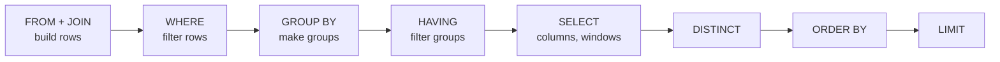
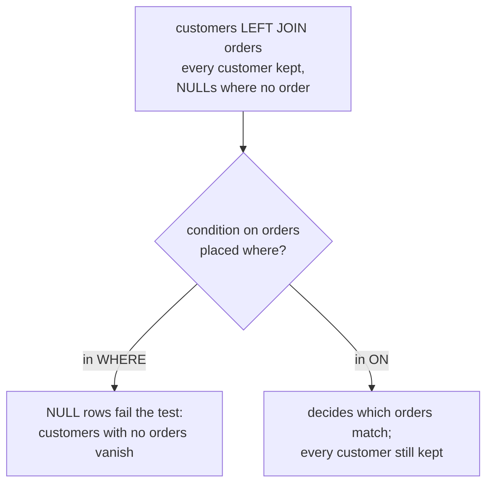
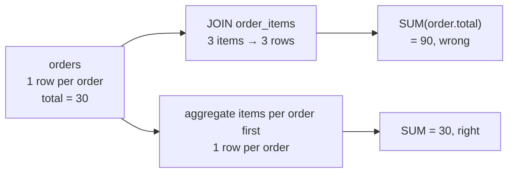
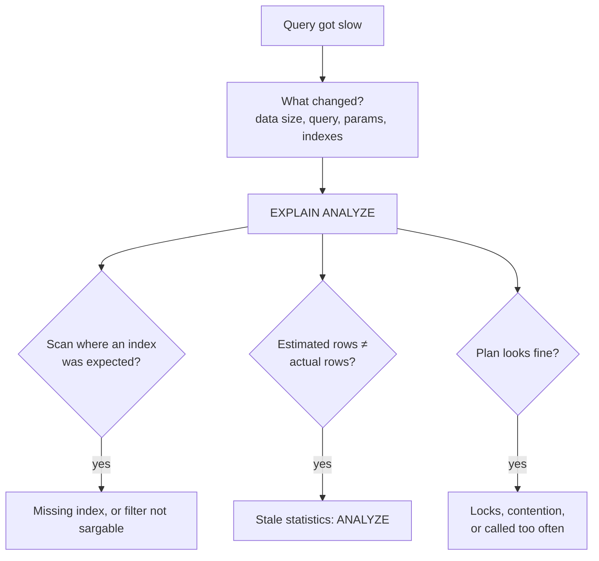
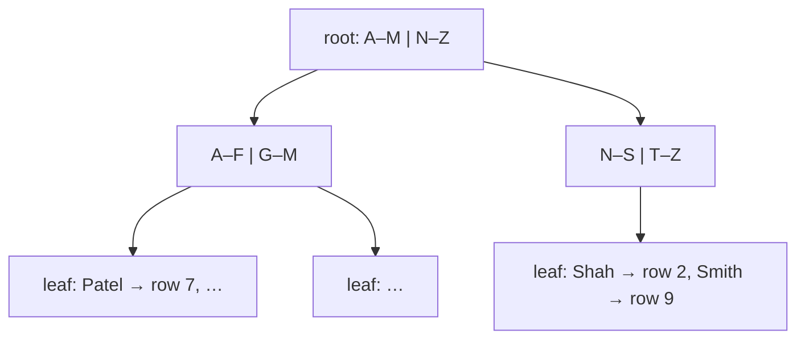
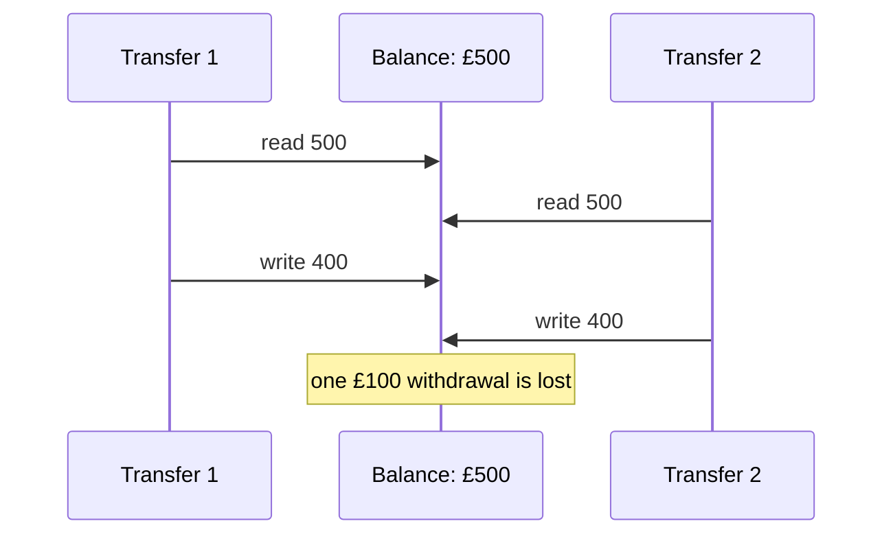
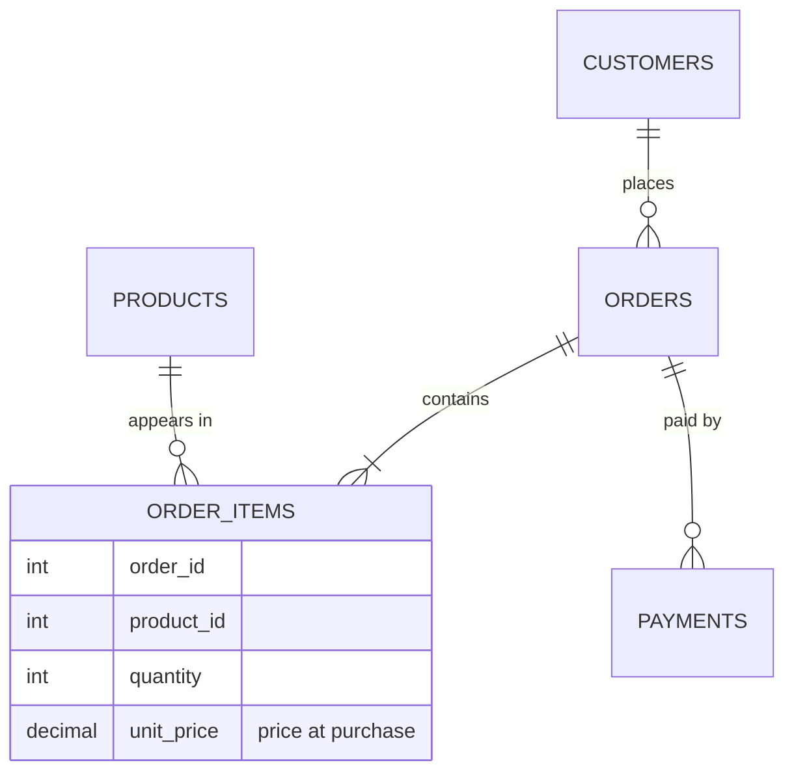

<!-- Written by `npm run lessons` from the lesson data in src/data. Edit the lesson there, not this page. -->

# Interview questions: SQL in interviews

Beyond writing a query: why a query is wrong, why it is slow, and how to trust the numbers it gives.

Say your answer out loud first, then open the answer. 11 questions. [All lessons](../README.md)

## 1. In what order does SQL actually run a query, and why does it matter?

**Beginner** · Concept

**They are checking:** Whether you understand SQL well enough to predict errors, instead of memorising rules like "you can't use an alias in WHERE".

Show the answer

**Say this**

We write SELECT first, but the database works in a different order: FROM and the JOINs first, to build the rows; then WHERE filters those rows; then GROUP BY forms the groups; HAVING filters the groups; then SELECT computes the output columns, including window functions; then DISTINCT, ORDER BY, and finally LIMIT.

It explains several rules at once. You can't use a SELECT alias in WHERE, because WHERE runs before SELECT has named it. You can't put an aggregate like SUM in WHERE, because the groups don't exist yet, which is what HAVING is for. You can't filter on a window function in WHERE either, so you wrap the query in a CTE and filter outside. And ORDER BY can use aliases, because it runs after SELECT.

**In everyday words.** Cooking from a recipe card that lists the plating first. The kitchen still has to fetch the ingredients (FROM), throw out the bad ones (WHERE), sort them into dishes (GROUP BY), drop the dishes that don't make the cut (HAVING), then plate (SELECT), arrange the plates (ORDER BY) and serve the first few (LIMIT).

*The logical order. Anything named or computed at a step can only be used by the steps after it.*

**What makes it a strong answer**

- Gives the order and then uses it to explain real errors.
- Mentions window functions run at the SELECT step, so they need a CTE or subquery to filter on.
- Notes this is the logical order; the optimiser may physically run things differently with the same result.

**What weak answers say**

- Reciting the order with no example of why it matters.
- Claiming the database literally executes in that order: the planner can reorder as long as results match.

**Follow-up questions**

&lt;b>Why does `SELECT name, COUNT(*) FROM employees` fail in most databases?&lt;/b>

Without GROUP BY, COUNT(\*) collapses everything into one row, but name has a different value on every row, so there is no single name to show. Add GROUP BY name, or drop name. (SQLite and old MySQL allow it and pick an arbitrary name, which is worse.)

&lt;b>How do you keep only the top-ranked row per group with ROW_NUMBER?&lt;/b>

Compute ROW_NUMBER() OVER (PARTITION BY group ORDER BY …) in a CTE, then filter WHERE rn = 1 in the outer query, because the window is computed after WHERE in the inner one.

Learn it first: [The order a query really runs in](../sql/unit-2-summarising/the-order-a-query-really-runs-in.md) · [HAVING: filtering groups, and how it differs from WHERE](../sql/unit-2-summarising/having-filtering-groups-and-how-it-differs-from-where.md) · [What a window function is: OVER and PARTITION BY](../sql/unit-5-window-functions/what-a-window-function-is-over-and-partition-by.md)

---

## 2. Your LEFT JOIN returns fewer rows than the left table has. Why?

**Intermediate** · Scenario

**They are checking:** Whether you understand NULLs from outer joins and the difference between conditions in ON and in WHERE.

Show the answer

**Say this**

The most common cause is a condition on the right-hand table in the WHERE clause. A LEFT JOIN keeps every left row, filling the right side with NULLs when there is no match. But WHERE runs afterwards, and a condition like WHERE orders.status = 'delivered' is not true for NULL, so it throws away exactly the unmatched rows the LEFT JOIN kept. The query has quietly become an inner join.

The fix is to move that condition into the ON clause, so it decides which right rows match, not which final rows survive: LEFT JOIN orders o ON o.customer_id = c.id AND o.status = 'delivered'. If you really want to filter on the right table, say so explicitly, and allow the NULLs: WHERE o.status = 'delivered' OR o.id IS NULL.

The other cause is a later INNER JOIN in the same query that drops rows with no match further down the chain.

**In everyday words.** You list every student and, next to each, their exam score if they sat it (a LEFT JOIN). Then someone says "only show scores above 50". If you apply that to the whole list, the students who never sat the exam disappear too, because "blank" isn't above 50. You meant: show every student, and only fill in scores above 50.

*ON decides which right-side rows join; WHERE decides which final rows survive, and NULL never passes an equality test.*

**What to check, in order**

1. Count the left table, then the result: confirm rows really are missing, not duplicated elsewhere.
2. Look for conditions on the right table in WHERE; move them into ON.
3. Look for INNER JOINs after the LEFT JOIN, and turn them into LEFT JOINs if the missing rows should stay.
4. Check with an anti-join which left rows are missing, and confirm they are exactly the ones with no match.

**What makes it a strong answer**

- Names the mechanism: WHERE runs after the join, and NULL comparisons are unknown, not false-but-kept.
- Gives both fixes: condition in ON, or an explicit IS NULL.
- Mentions later inner joins as a second cause.

**What weak answers say**

- Adding DISTINCT or changing the join type at random.
- Saying "LEFT JOIN is broken in this database".

**Follow-up questions**

&lt;b>Is a condition on the left table in ON also safe?&lt;/b>

It doesn't remove left rows in a LEFT JOIN: every left row is still returned, but rows that fail the condition get NULLs on the right. To filter the left table, put that condition in WHERE.

&lt;b>How do you find left rows with no match at all?&lt;/b>

An anti-join: LEFT JOIN and then WHERE right.id IS NULL, or WHERE NOT EXISTS (SELECT 1 FROM right WHERE …).

Learn it first: [LEFT JOIN: keep every row from one side](../sql/unit-3-joins/left-join-keep-every-row-from-one-side.md) · [Join traps: double counting, and ON versus WHERE](../sql/unit-3-joins/join-traps-double-counting-and-on-versus-where.md) · [Finding what is missing: anti-joins](../sql/unit-3-joins/finding-what-is-missing-anti-joins.md)

---

## 3. After joining orders to their order items, total revenue came out roughly doubled. What happened, and how do you fix it?

**Intermediate** · Scenario

**They are checking:** Whether you think about the grain of each table (what one row means) before you join and aggregate.

Show the answer

**Say this**

This is fan-out. An order has several items, so joining orders to order_items repeats each order once per item. If you then sum a column that lives on the order, such as order_total or shipping_fee, each order is counted as many times as it has items. An order with three items is counted three times.

The fix is to aggregate at the right grain before joining. Either sum the item-level amounts (quantity × price) instead of the order-level total, or first aggregate items per order in a CTE, so there is one row per order, and join that. COUNT(DISTINCT order_id) fixes counts, but not sums.

And I'd check it: the total from the joined query should equal the total from the orders table on its own. When they differ, a join has changed the grain.

**In everyday words.** Counting the money at a party by asking each guest how much the host spent. Ten guests, ten answers of £200: you report £2,000 spent, when it was £200. Each guest row repeated the host's total.

*A one-to-many join multiplies the "one" side. Aggregate to one row per order before joining, or sum item-level amounts.*

**What to check, in order**

1. State the grain of each table: one row per order, one row per order item.
2. Compare the total after the join with the total from the base table alone.
3. Sum item-level amounts, or aggregate the child table in a CTE first and join the result.
4. Add the comparison as a test, so a future join can't silently change the grain.

**What makes it a strong answer**

- Uses the word grain, and checks it before writing the query.
- Knows COUNT(DISTINCT) fixes counts but not sums.
- Verifies with an independent total.

**What weak answers say**

- Slapping DISTINCT on the SUM, which also merges legitimately equal amounts.
- Dividing by the number of items as a patch.

**Follow-up questions**

&lt;b>You join orders to both items and payments. What happens?&lt;/b>

Two independent one-to-many joins multiply: an order with 3 items and 2 payments becomes 6 rows, so both item and payment sums are inflated. Aggregate each child table to one row per order separately, then join the two results.

&lt;b>Why is SUM(DISTINCT amount) dangerous?&lt;/b>

It removes real duplicates too: two different orders that both cost £30 would only be counted once.

Learn it first: [Join traps: double counting, and ON versus WHERE](../sql/unit-3-joins/join-traps-double-counting-and-on-versus-where.md) · [CTEs: naming each step with WITH](../sql/unit-4-subqueries/ctes-naming-each-step-with-with.md) · [GROUP BY: one result row per group](../sql/unit-2-summarising/group-by-one-result-row-per-group.md)

---

## 4. A query that used to take 50 milliseconds now takes 30 seconds. How do you investigate?

**Advanced** · Scenario

**They are checking:** A methodical approach with the right tool (the query plan), and knowing the usual causes.

Show the answer

**Say this**

First, what changed: the data size, the query itself, the parameters, a migration that dropped or changed an index, or the server's load. A query that suddenly slows down usually has a plan that changed.

Then I read the plan with EXPLAIN, or EXPLAIN ANALYZE, which actually runs it and shows real row counts and timings. I look for a full table scan where I expected an index lookup, a join method that suits small inputs being used on large ones, and above all estimated rows far from actual rows, which means the statistics are stale and the planner is choosing badly.

Common fixes: refresh statistics with ANALYZE; add or fix an index, with the right column order for a composite index; and rewrite filters to be sargable, meaning no function on the indexed column, no leading wildcard in LIKE, and no type mismatch that forces a cast. If the plan is fine, I check for locks or contention, and for an application issue such as the same query being run thousands of times.

Then I measure again, and I keep the slow version's plan to compare with.

**In everyday words.** A delivery that took 10 minutes now takes an hour. Before buying a faster van, look at the route the driver took: maybe a road closed and the sat-nav, working from an old map, sent them on a detour. EXPLAIN shows you the route; stale statistics are the old map.

*The plan is the evidence. Compare estimates with actuals, and look for scans and join methods that don't fit the data size.*

**What to check, in order**

1. Reproduce it and record the exact query, parameters and timing.
2. Ask what changed: data growth, deploys, migrations, index changes, load.
3. Run EXPLAIN ANALYZE and compare estimated and actual rows at each step.
4. Fix the cause: statistics, indexes, sargable filters, join order, or the query shape.
5. Measure again, and add the query to performance monitoring.

**What makes it a strong answer**

- Starts with "what changed".
- Uses estimated versus actual rows, the most telling part of a plan.
- Knows sargability and composite index column order.
- Considers non-SQL causes: locks, load, application patterns.

**What weak answers say**

- Adding indexes on every column in the query.
- Throwing more hardware at it before reading the plan.

**Follow-up questions**

&lt;b>Why can `WHERE LOWER(email) = ?` ignore an index on email?&lt;/b>

The index stores email as written, so the database can't look up LOWER(email) in it and must compute the function on every row. Store a normalised column, or create an index on the expression LOWER(email).

&lt;b>Composite index on (country, city): which queries can use it?&lt;/b>

Queries filtering on country, or on country and city. A filter on city alone usually can't use it efficiently, because the index is sorted by country first, like a phone book sorted by surname, then first name.

Learn it first: [Reading a query plan with EXPLAIN](../sql/unit-7-performance/reading-a-query-plan-with-explain.md) · [Index-friendly queries: sargable filters and composite indexes](../sql/unit-7-performance/index-friendly-queries-sargable-filters-and-composite-indexes.md) · [Indexes: how a B-tree makes lookups fast](../sql/unit-7-performance/indexes-how-a-b-tree-makes-lookups-fast.md) · [How a database runs a join: nested loop, hash join, merge join](../sql/unit-7-performance/how-a-database-runs-a-join-nested-loop-hash-join-merge-join.md)

---

## 5. How does an index make a query faster, and when does it not help?

**Intermediate** · Concept

**They are checking:** A real mental model of a B-tree index, its costs, and its limits.

Show the answer

**Say this**

An index is a separate, sorted structure, usually a B-tree, that maps column values to the rows that hold them. Instead of reading every row, the database walks down a shallow tree, typically 3 or 4 levels even for millions of rows, to the matching entries, so a lookup costs about log(n) instead of n. Because it is sorted, it also speeds up range filters, ORDER BY, and joins on that column.

It doesn't help, or the planner won't use it, when: the filter matches a large share of the table, so a full scan is cheaper than millions of index jumps; the column is wrapped in a function or cast; LIKE starts with a wildcard; the table is tiny; or a composite index is used without its leading column.

And it isn't free: every insert, update and delete must update every index, and indexes take space. So you index the columns you actually filter, join and sort on, guided by the query plans.

**In everyday words.** The index at the back of a textbook. To find "photosynthesis" you don't read every page; you look it up alphabetically and jump to page 212. But if you want every page that mentions "the", the index is useless: you might as well read the book. And every time the book is edited, someone has to update the index too.

*A B-tree: a few steps from the root reach the leaf holding the value and a pointer to its row.*

**What makes it a strong answer**

- Explains the B-tree and log-time lookups.
- Names selectivity as the reason a planner sometimes skips the index.
- Mentions write and storage costs.
- Knows covering indexes and composite column order.

**What weak answers say**

- "Indexes always make queries faster."
- Not knowing why a function on a column defeats the index.

**Follow-up questions**

&lt;b>What is a covering index?&lt;/b>

One that contains every column a query needs, so the database can answer from the index alone without visiting the table rows.

&lt;b>Clustered versus non-clustered?&lt;/b>

A clustered index is the table itself stored in key order, so there is one per table. A non-clustered index is a separate sorted structure pointing to the rows.

Learn it first: [Indexes: how a B-tree makes lookups fast](../sql/unit-7-performance/indexes-how-a-b-tree-makes-lookups-fast.md) · [Index-friendly queries: sargable filters and composite indexes](../sql/unit-7-performance/index-friendly-queries-sargable-filters-and-composite-indexes.md) · [Reading a query plan with EXPLAIN](../sql/unit-7-performance/reading-a-query-plan-with-explain.md)

---

## 6. A NOT IN query returns no rows at all, although you know some customers have never ordered. Why?

**Intermediate** · Scenario

**They are checking:** Whether you understand SQL's three-valued logic, the most common source of silently wrong results.

Show the answer

**Say this**

The subquery returns at least one NULL, for example an order whose customer_id is NULL. In SQL, NULL means unknown, so comparisons with it are unknown too, not true or false.

x NOT IN (1, 2, NULL) means x ≠ 1 AND x ≠ 2 AND x ≠ NULL. The last part is unknown for every x, so the whole condition is never true, and every row is filtered out. One NULL in the list makes NOT IN return nothing.

The fix is NOT EXISTS, which tests "is there a matching row?" and handles NULLs the way you expect: WHERE NOT EXISTS (SELECT 1 FROM orders o WHERE o.customer_id = c.id). Or filter the NULLs out of the subquery. I use NOT EXISTS by default for anti-joins.

**In everyday words.** Checking a guest list for people who weren't invited. One name on the invitation list is smudged and unreadable. For every guest you ask "are you definitely not the smudged name?", and the honest answer is always "can't tell", so you can't declare anyone uninvited.

**What makes it a strong answer**

- Explains three-valued logic: TRUE, FALSE and UNKNOWN.
- Expands NOT IN into ANDs to show why one NULL ruins it.
- Recommends NOT EXISTS as the safe default.

**What weak answers say**

- "NOT IN is just slow; use a join." It is wrong, not just slow.
- Not knowing that IN with a NULL still works for the matches it finds.

**Follow-up questions**

&lt;b>Does `IN` have the same problem?&lt;/b>

Not in the same way: x IN (1, NULL) is true when x = 1, and unknown otherwise, so matching rows are still found. It is the NOT that turns "unknown" into "drop everything".

&lt;b>What does `NULL = NULL` return?&lt;/b>

NULL (unknown), not true. Test for missing values with IS NULL.

Learn it first: [Correlated subqueries, EXISTS, and the NOT IN trap](../sql/unit-4-subqueries/correlated-subqueries-exists-and-the-not-in-trap.md) · [NULL: the missing value](../sql/unit-1-reading-data/null-the-missing-value.md) · [Finding what is missing: anti-joins](../sql/unit-3-joins/finding-what-is-missing-anti-joins.md)

---

## 7. When would you use a window function instead of GROUP BY?

**Intermediate** · Concept

**They are checking:** Whether you understand that window functions keep every row, and can pick the right tool.

Show the answer

**Say this**

GROUP BY collapses each group into one row: one row per department with its average salary. A window function computes the same kind of value over a group but keeps every row, and adds the result as a new column.

So I use a window function whenever I need each row next to something about its group or its neighbours: each employee's salary next to their department's average, a rank within each category, a running total by date, or the change from the previous month with LAG.

For example: SELECT name, dept, salary, AVG(salary) OVER (PARTITION BY dept) AS dept_avg FROM employees. With GROUP BY you would need a subquery and a join back to get the same thing. And to filter on a window result, such as rank ≤ 3, you wrap it in a CTE, because windows are computed after WHERE.

**In everyday words.** GROUP BY is the class average written on the board: one number per class, and the individual results are gone. A window function is each student's report showing their own mark next to the class average and their position in the class: everyone keeps their own line.

**What makes it a strong answer**

- Says the key difference: rows are kept.
- Gives several uses: comparisons, ranking, running totals, LAG/LEAD.
- Knows the filter-in-a-CTE rule.

**What weak answers say**

- Thinking window functions are only for ranking.
- Using GROUP BY plus a self-join where one window function would do.

**Follow-up questions**

&lt;b>ROW_NUMBER, RANK or DENSE_RANK for "top 3 per category"?&lt;/b>

It depends on ties. ROW_NUMBER gives exactly 3 rows and breaks ties arbitrarily (add a tiebreaker to ORDER BY); RANK and DENSE_RANK keep tied rows, so you may get more than 3. Say which you chose and why.

&lt;b>What does the frame clause ROWS BETWEEN 6 PRECEDING AND CURRENT ROW do?&lt;/b>

It limits the window to the current row and the 6 before it, for example for a 7-day moving average.

Learn it first: [What a window function is: OVER and PARTITION BY](../sql/unit-5-window-functions/what-a-window-function-is-over-and-partition-by.md) · [Ranking: ROW_NUMBER, RANK and DENSE_RANK](../sql/unit-5-window-functions/ranking-row-number-rank-and-dense-rank.md) · [Running totals and moving averages: window frames](../sql/unit-5-window-functions/running-totals-and-moving-averages-window-frames.md) · [GROUP BY: one result row per group](../sql/unit-2-summarising/group-by-one-result-row-per-group.md)

---

## 8. Explain transactions and ACID with a bank transfer. What can go wrong without isolation?

**Intermediate** · Concept

**They are checking:** That you understand why transactions exist, not just the acronym, and know the classic concurrency problems.

Show the answer

**Say this**

Moving £100 from Alice to Bob is two updates: subtract from Alice, add to Bob. A transaction makes them one unit.

Atomicity: both happen or neither does. If the server crashes in between, the first update is rolled back, so money never disappears.  
Consistency: the rules you declared, such as "a balance can't be negative", hold before and after.  
Isolation: concurrent transactions don't see each other's half-finished work.  
Durability: once committed, the change survives a crash, because it is written to the log on disk.

Without enough isolation, concurrency causes anomalies. A dirty read: seeing another transaction's uncommitted change that is later rolled back. A non-repeatable read: reading the same row twice and getting different values. Phantoms: re-running a query and getting new rows. And a lost update: two transfers both read a balance of £500, both subtract £100, and both write £400, so one withdrawal vanishes. Isolation levels, from Read Committed up to Serializable, trade more protection for less concurrency; for a lost update I would use SELECT … FOR UPDATE, an atomic UPDATE balance = balance − 100, or Serializable.

**In everyday words.** Moving furniture between two rooms with the door closed. Either the sofa ends up in the new room or it stays in the old one, never halfway through the door (atomicity). Nobody walks in mid-move and counts a room with no sofa (isolation). Once the door opens, the move is done, even if the lights go out (durability).

*A lost update: both transactions read the same starting balance, so the second write overwrites the first.*

**What makes it a strong answer**

- Uses one concrete example for all four letters.
- Names the anomalies, and gives a fix for the lost update.
- Knows higher isolation costs concurrency and can cause retries.

**What weak answers say**

- Just expanding the acronym.
- Assuming the default isolation level protects against everything.

**Follow-up questions**

&lt;b>What isolation level do most databases use by default?&lt;/b>

Read Committed in PostgreSQL, Oracle and SQL Server; Repeatable Read in MySQL's InnoDB. Neither is fully Serializable.

&lt;b>How does `UPDATE accounts SET balance = balance - 100 WHERE id = 1` avoid the lost update?&lt;/b>

The read and the write happen in one statement, which locks the row, so a second transfer waits and then sees the new balance.

Learn it first: [Transactions and ACID](../sql/unit-6-changing-data/transactions-and-acid.md) · [Constraints: the rules that keep bad data out](../sql/unit-6-changing-data/constraints-the-rules-that-keep-bad-data-out.md)

---

## 9. How would you design the tables for an online shop? When would you denormalise?

**Intermediate** · Concept

**They are checking:** Data modelling: entities, keys, relationships, normalisation, and judging the trade-offs.

Show the answer

**Say this**

I start from the entities and how they relate. Customers; products; orders, which belong to one customer; and order_items, one row per product in an order, which resolves the many-to-many between orders and products. Plus payments, and addresses if a customer can have several.

Each table has a primary key, and foreign keys link them: orders.customer_id, order_items.order_id and order_items.product_id. One important detail: order_items stores the price at the time of purchase, not just a link to the product's current price, because prices change and an old invoice must not.

That is normalised, roughly to third normal form: each fact lives in one place, so updates can't contradict each other. I would denormalise for read-heavy needs, such as an orders summary table for a dashboard, a cached order total, or a product's average rating stored on the product, accepting that the copy must be kept in sync, by a trigger, a job or the application, and could briefly be stale.

**In everyday words.** Normalising is keeping one address book and referring to it, instead of writing a friend's address on every letter: when they move, you change it once. Denormalising is writing the address on the envelope anyway, because you post to them every day and don't want to look it up each time, knowing you must remember to update the envelopes when they move.

*order_items is the junction between orders and products, and keeps the price paid at the time.*

**What makes it a strong answer**

- Uses a junction table for orders and products.
- Stores the price at purchase time.
- Explains normalisation by its benefit, then denormalises only with a reason and a sync plan.
- Mentions constraints: NOT NULL, UNIQUE, CHECK (quantity > 0).

**What weak answers say**

- A comma-separated list of product ids in the orders table.
- Denormalising everything "for speed" with no plan to keep copies in sync.

**Follow-up questions**

&lt;b>Why not just store the product's current price in order_items via a join?&lt;/b>

Because the product's price will change, and every past order would then show a price nobody paid. The order must record the facts as they were.

&lt;b>How would you store an order's status history?&lt;/b>

A separate order_status_events table (order_id, status, changed_at), keeping the current status on the order if it is read often. That keeps the full history without overwriting it.

Learn it first: [Normalisation: designing tables that don't contradict themselves](../sql/unit-6-changing-data/normalisation-designing-tables-that-dont-contradict-themselves.md) · [Keys and relationships: primary keys, foreign keys, one-to-many, many-to-many](../sql/unit-0-start-here/keys-and-relationships-primary-keys-foreign-keys-one-to-many.md) · [Constraints: the rules that keep bad data out](../sql/unit-6-changing-data/constraints-the-rules-that-keep-bad-data-out.md) · [CREATE TABLE and ALTER TABLE](../sql/unit-6-changing-data/create-table-and-alter-table.md)

---

## 10. Your dashboard says revenue was £1.20m last month; finance says £1.14m. How do you find out why?

**Advanced** · Scenario

**They are checking:** Analytical rigour: defining metrics, reconciling data, and knowing the usual ways numbers drift apart.

Show the answer

**Say this**

First I would agree the definition, because most mismatches are about meaning, not bugs: gross or net of refunds, with or without tax and shipping, by order date or by payment date, which currency rate, and whether test or cancelled orders count.

Then I would narrow it down instead of staring at the total: compare day by day to find the days that differ, then pick one day and compare at row level, order by order, against finance's source. The first order that differs usually explains the pattern.

The usual technical causes: time zones and date boundaries (a UTC midnight versus a UK midnight moves orders between days or months); a join that duplicates rows; NULL handling, such as refunds with a NULL amount dropping out of a sum; late-arriving data, such as refunds processed after the dashboard's snapshot; and filters that differ, like excluding internal accounts.

I would finish by writing the agreed definition down and adding a reconciliation check that runs every day, so the next difference is caught early.

**In everyday words.** Two people count the money in a till and get different totals. Don't argue about the totals: first agree whether the float and the card receipts count, then lay out the notes in the same order and compare them pile by pile until you find the pile that differs.

**What to check, in order**

1. Agree the exact definition: gross or net, tax, dates, currency, exclusions.
2. Compare by day to find where the difference appears.
3. Take one differing day and compare row by row with the other source.
4. Check the usual causes: time zones, duplicating joins, NULLs, late data, filters.
5. Document the definition and add a daily reconciliation check.

**What makes it a strong answer**

- Starts with the definition, not the SQL.
- Bisects: total, then day, then row.
- Names time zones and late-arriving data, the two most common real causes.
- Leaves a check behind.

**What weak answers say**

- Assuming finance is wrong.
- Hunting for the bug in one big query without narrowing it down.

**Follow-up questions**

&lt;b>How do time zones move revenue between months?&lt;/b>

An order placed at 00:30 on 1 March in London is 23:30 on 28 February in some American time zones and 00:30 in UTC (in winter). If one system groups by UTC and the other by local time, orders near midnight land in different days or months.

&lt;b>How would you stop this happening again?&lt;/b>

One documented metric definition used by both, ideally computed once in a shared table, and an automated daily comparison with the finance system that alerts when they differ by more than a small tolerance.

Learn it first: [Join traps: double counting, and ON versus WHERE](../sql/unit-3-joins/join-traps-double-counting-and-on-versus-where.md) · [NULL: the missing value](../sql/unit-1-reading-data/null-the-missing-value.md) · [Aggregate functions: COUNT, SUM, AVG, MIN and MAX](../sql/unit-2-summarising/aggregate-functions-count-sum-avg-min-and-max.md) · [Built-in functions for text, numbers and dates](../sql/unit-1-reading-data/built-in-functions-for-text-numbers-and-dates.md)

---

## 11. How do you get the top 3 products by revenue in each category?

**Intermediate** · Concept

**They are checking:** The most common SQL interview pattern, and whether you think about ties.

Show the answer

**Say this**

This is "top N per group", and the clean way is a window function in a CTE. First compute revenue per product, then rank within each category, then filter:

WITH revenue AS (SELECT p.category, p.name, SUM(oi.quantity \* oi.unit_price) AS revenue FROM order_items oi JOIN products p ON p.id = oi.product_id GROUP BY p.category, p.name), ranked AS (SELECT \*, DENSE_RANK() OVER (PARTITION BY category ORDER BY revenue DESC) AS rnk FROM revenue) SELECT \* FROM ranked WHERE rnk &lt;= 3;

The filter has to be outside, because window functions are computed after WHERE. Then I say how I handle ties: DENSE_RANK keeps every product tied for a place, so a category can return more than 3; ROW_NUMBER returns exactly 3 but must break ties with a second ORDER BY column, so the result is deterministic.

**In everyday words.** Picking the top 3 runners in every age group: line each age group up by finishing time, number them 1, 2, 3 within their group, then keep everyone numbered 3 or less. You must decide in advance what happens if two people cross the line together.

**What makes it a strong answer**

- Builds it in clear steps with CTEs.
- Explains why the filter is in the outer query.
- Raises ties unprompted and chooses deliberately.

**What weak answers say**

- ORDER BY revenue LIMIT 3, which gives the top 3 overall, not per category.
- ROW_NUMBER with no tiebreaker, giving a different answer on each run.

**Follow-up questions**

&lt;b>How would you do it without window functions?&lt;/b>

A correlated subquery: keep a product if fewer than 3 products in the same category have higher revenue. It works, but it is harder to read and usually slower.

&lt;b>What if a category has only 2 products?&lt;/b>

The query simply returns 2 for that category. That is usually right, but say it, because the interviewer may be testing whether you noticed.

Learn it first: [Ranking: ROW_NUMBER, RANK and DENSE_RANK](../sql/unit-5-window-functions/ranking-row-number-rank-and-dense-rank.md) · [CTEs: naming each step with WITH](../sql/unit-4-subqueries/ctes-naming-each-step-with-with.md) · [The highest-paid employee in each department](../sql/unit-8-interview-problems/the-highest-paid-employee-in-each-department.md)
