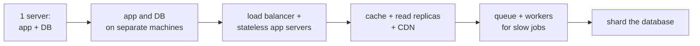
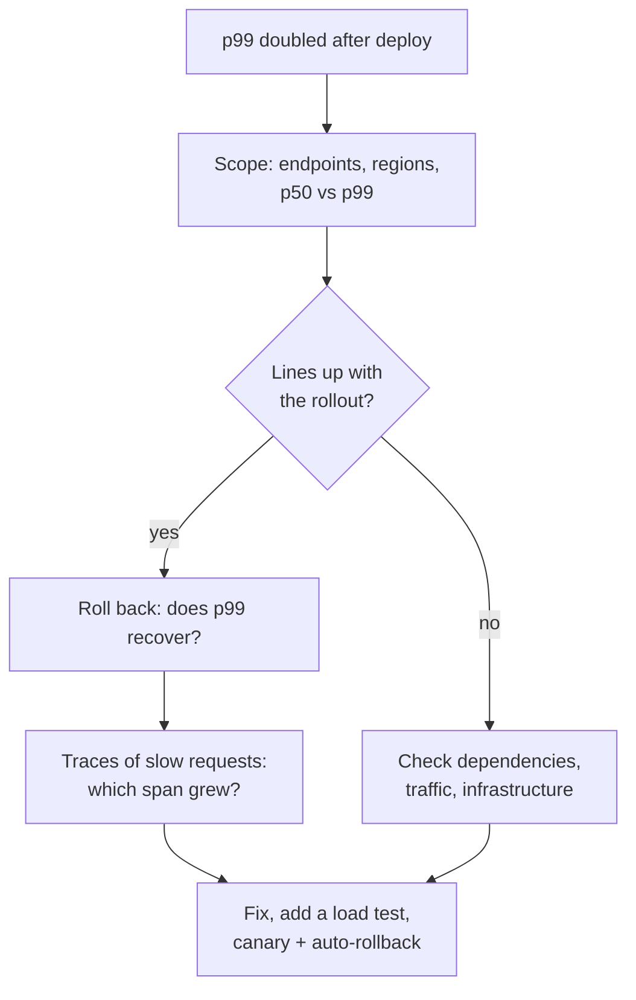
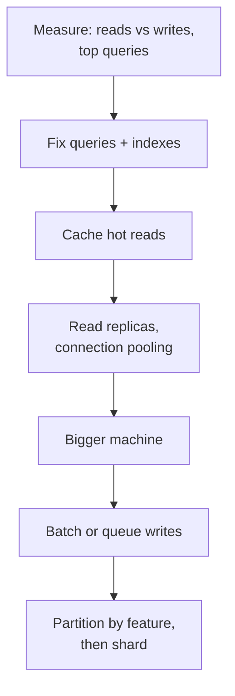
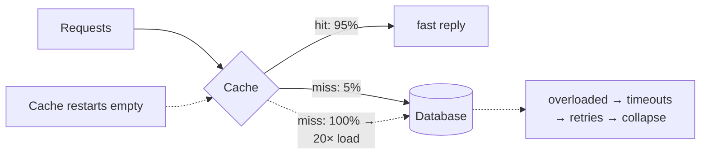
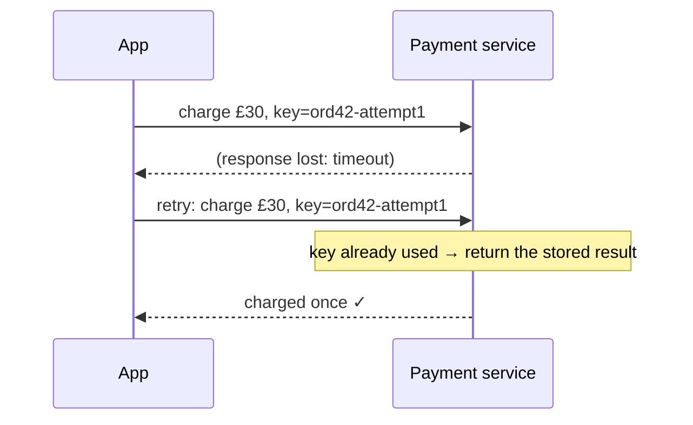
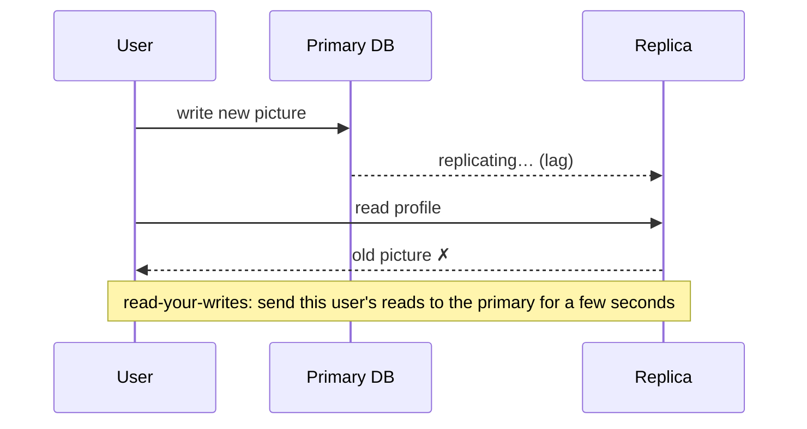
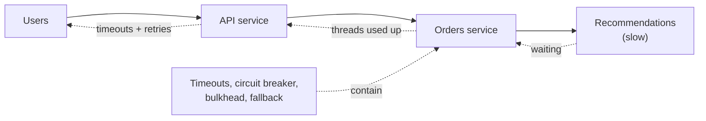
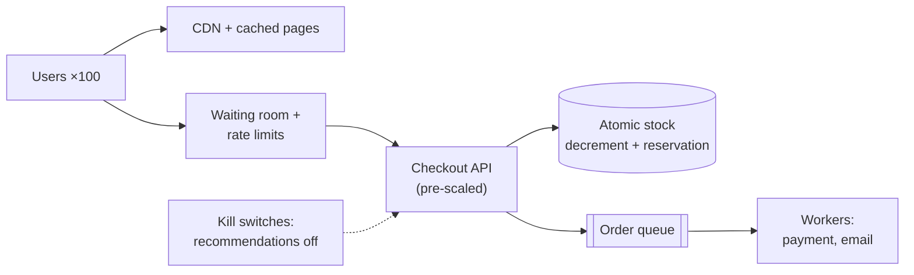

<!-- Written by `npm run lessons` from the lesson data in src/data. Edit the lesson there, not this page. -->

# Interview questions: System design scenarios

What happens when real systems break or grow: latency, overloaded databases, retries, hot spots, and planning for spikes.

Say your answer out loud first, then open the answer. 11 questions. [All lessons](../README.md)

## 1. How would you scale a web app from 1 user to 1 million users?

**Beginner** · Concept

**They are checking:** Whether you add complexity only when a real limit appears, and know what each building block is for.

Show the answer

**Say this**

I would grow it in steps, each solving the bottleneck that appears next, rather than designing for a million users on day one.

Start with one server running the app and the database. As traffic grows, split the database onto its own machine, so each can be sized separately. Then put a load balancer in front of several identical, stateless app servers, with sessions stored in a shared store, so any server can handle any request and one can fail safely.

When the database becomes the limit, which it usually does first, add a cache like Redis for hot reads, and read replicas for read-heavy traffic. Put static files and images on a CDN, close to users. Move slow work, such as emails, thumbnails and reports, onto a queue with background workers, so requests return quickly. Only at large scale, when one database can't handle the writes, shard it.

At every step I would measure first and add monitoring, because the next bottleneck is found from data, not guessed.

**In everyday words.** A café that becomes popular. First the owner does everything. Then they hire a cook so the counter and kitchen can grow separately. Then more servers at the counter (the load balancer sends customers to whoever is free). Pre-made sandwiches by the till for the most common orders (the cache). A takeaway window down the street (the CDN). And catering orders taken now and cooked later (the queue). Only when one kitchen truly can't keep up do they open a second kitchen across town (sharding).

*Each step fixes the bottleneck the previous one hit. Most apps never need the last step.*

**What makes it a strong answer**

- Grows step by step, each step justified by a bottleneck.
- Stateless app servers as the key to horizontal scaling.
- Knows the database is usually the first hard limit.
- Measures and monitors at every stage.

**What weak answers say**

- Starting with microservices and sharding for a new product.
- Listing technologies without saying what problem each solves.

**Follow-up questions**

&lt;b>Why must app servers be stateless to scale horizontally?&lt;/b>

If a server keeps a user's session in its own memory, that user must always reach the same server, and losing the server loses the session. With state in a shared store, any server can handle any request, so you can add, remove or replace servers freely.

&lt;b>Read replicas or a cache first?&lt;/b>

Usually a cache for a small set of very hot reads (it is far faster and cheaper), and replicas when reads are broad and varied. Both bring stale data, so decide which features can tolerate it.

Learn it first: [Meet the building blocks: a map of a typical web system](../system-design/unit-0-interview-basics/meet-the-building-blocks-a-map-of-a-typical-web-system.md) · [Scalability: vertical vs horizontal](../system-design/unit-2-core-concepts/scalability-vertical-vs-horizontal.md) · [Load balancing](../system-design/unit-2-core-concepts/load-balancing.md) · [Caching](../system-design/unit-2-core-concepts/caching.md) · [Replication](../system-design/unit-3-data/replication.md) · [CDN (content delivery network)](../system-design/unit-1-networking/cdn-content-delivery-network.md) · [Asynchronous processing and message queues (Kafka, SQS)](../system-design/unit-2-core-concepts/asynchronous-processing-and-message-queues-kafka-sqs.md)

---

## 2. After yesterday's deploy, p99 latency doubled. How do you investigate?

**Intermediate** · Scenario

**They are checking:** A calm, evidence-driven debugging process in production, and knowing the usual causes of slow tails.

Show the answer

**Say this**

First I would size it: which endpoints, which regions, which percentiles. If only p99 moved and the median didn't, something affects a minority of requests, which points at a particular code path, a dependency, or contention.

The deploy is the prime suspect, so I would compare before and after: the code and configuration diff, and whether the change lines up exactly with the rollout. If it does, the fastest proof and the safest fix is to roll back and watch p99 return. Then I find the cause calmly.

To find it, I open traces of slow requests and look for the span that grew: a new database query, an N+1 pattern, a lower cache hit rate, a new call to another service, or a retry. I also check resources: CPU, garbage-collection pauses, and exhausted connection or thread pools, which add waiting time only under load.

Afterwards: a regression test or load test for that path, and a canary deploy with automatic rollback on latency, so a deploy like this reaches 5% of users, not all of them.

**In everyday words.** A shop's queues got longer the day after a new till system was installed. You check whether it is all tills or one, all day or only at lunchtime. You can switch back to the old system and see if the queues shrink, then study the new one in peace: maybe it asks for a signature that takes ten extra seconds, but only for card payments.

*Narrow the scope, correlate with the change, roll back to prove it, then use traces to find the slow step.*

**What to check, in order**

1. Scope it: endpoints, regions, percentiles, and whether traffic changed too.
2. Correlate with the deploy: the diff, the config, the exact rollout time.
3. Roll back to restore service and confirm the cause.
4. Use traces to find which span grew; check the database, cache hit rate, downstream calls and retries.
5. Check resources: CPU, GC pauses, connection and thread pools.
6. Prevent it: a load test for the path, canary releases, alerts on p99.

**What makes it a strong answer**

- Separates the median from the tail, and knows what that implies.
- Rolls back first to restore service, then investigates.
- Uses distributed tracing to find the slow step.
- Ends with prevention: canaries and automatic rollback.

**What weak answers say**

- Adding servers before knowing the cause.
- Debugging in production for hours while users suffer, instead of rolling back.

**Follow-up questions**

&lt;b>Why look at p99 rather than the average?&lt;/b>

The average hides the slow tail. If 1% of requests take 5 seconds, the average barely moves, but a page that makes 50 calls will hit at least one slow one most of the time, so users feel the tail.

&lt;b>The rollback didn't help. What next?&lt;/b>

It probably wasn't the deploy. Look at what else changed: traffic shape, a dependency's performance, database growth or a slow query plan, infrastructure events, a noisy neighbour, or a cache that was flushed.

Learn it first: [Observability: logs, metrics and traces](../system-design/unit-2-core-concepts/observability-logs-metrics-and-traces.md) · [Caching](../system-design/unit-2-core-concepts/caching.md) · [Fault tolerance: timeouts, retries, circuit breakers](../system-design/unit-2-core-concepts/fault-tolerance-timeouts-retries-circuit-breakers.md) · [Database indexing](../system-design/unit-3-data/database-indexing.md)

---

## 3. Traffic grew 10 times and the database is now the bottleneck. What do you do, and in what order?

**Intermediate** · Scenario

**They are checking:** Whether you start with cheap, low-risk fixes and only reach for sharding when you must.

Show the answer

**Say this**

I would go from cheap and safe to expensive and complex, measuring at each step.

First, understand the load: reads or writes, and which queries. Usually a few queries dominate. Fixing them, with the right indexes, removing N+1 patterns and not selecting more than needed, can buy a lot for almost nothing.

Next, reduce reads reaching the database: a cache for hot data, and read replicas for the rest of the read traffic, accepting slightly stale reads where that is fine. Use connection pooling, so thousands of app connections don't overwhelm it. A bigger machine is a perfectly good step too: it is simple and often buys a year.

For writes: batch them, or move non-urgent ones behind a queue so they are smoothed out over time. Only when one primary can't take the writes, or the data no longer fits, would I partition: first by moving whole features to separate databases, then by sharding a big table on a key that spreads load evenly.

Sharding is last because it makes everything harder: cross-shard queries, transactions and rebalancing.

**In everyday words.** A popular library with one librarian. First make the common requests quicker (better shelving: indexes). Put the most-borrowed books on a display table by the door (cache). Add assistants who can answer questions but not change the records (read replicas). Collect returns in a box and process them in batches (a queue). Only when one building can't cope do you open branches across the city, each with its own share of the books (sharding), and accept that some requests now need a trip between branches.

*Cheapest and safest first. Each step is measured before taking the next.*

**What to check, in order**

1. Measure: reads versus writes, the top queries, locks, connections.
2. Fix the heaviest queries and indexes.
3. Cache hot reads; add read replicas; pool connections.
4. Scale up the machine if that is the quickest win.
5. Batch or queue writes that don't need to be synchronous.
6. Partition by feature, then shard with a well-chosen key, as the last resort.

**What makes it a strong answer**

- Measures before acting.
- Treats a bigger machine as a legitimate option.
- Knows replicas help reads, not writes, and bring staleness.
- Explains why sharding comes last.

**What weak answers say**

- "Switch to NoSQL" as the first answer.
- Sharding before trying indexes, caching and replicas.

**Follow-up questions**

&lt;b>How do you choose a shard key?&lt;/b>

One that spreads both data and traffic evenly and matches how you query: most queries should touch one shard. User id is common for user-centred apps. Avoid keys that create hot spots, such as a timestamp (all new writes hit one shard) or a celebrity account.

&lt;b>What problem do read replicas create?&lt;/b>

Replication lag: a user may write something and then read an older copy from a replica. Fix it with read-your-writes, routing a user's reads to the primary for a short time after they write.

Learn it first: [Database indexing](../system-design/unit-3-data/database-indexing.md) · [Caching](../system-design/unit-2-core-concepts/caching.md) · [Replication](../system-design/unit-3-data/replication.md) · [Partitioning and sharding](../system-design/unit-3-data/partitioning-and-sharding.md) · [Scalability: vertical vs horizontal](../system-design/unit-2-core-concepts/scalability-vertical-vs-horizontal.md) · [Asynchronous processing and message queues (Kafka, SQS)](../system-design/unit-2-core-concepts/asynchronous-processing-and-message-queues-kafka-sqs.md)

---

## 4. Your cache cluster restarted, and moments later the database fell over. What happened, and how do you prevent it?

**Advanced** · Scenario

**They are checking:** Whether you understand how caches hide load, and the failure modes when they suddenly stop hiding it.

Show the answer

**Say this**

The cache was absorbing most of the reads, say 95%. When it restarted empty, every request became a miss, so the database suddenly received 20 times its normal read load, all at once and often for the same popular keys. That is a cache stampede, or thundering herd. The database slowed down, requests timed out and were retried, which added even more load, and it collapsed.

Prevention works in layers. Request coalescing: when many requests miss the same key, only one goes to the database and the rest wait for its result. Warming: pre-load the hottest keys before sending traffic to a fresh cache. Jittered expiry times, so many keys don't expire at the same moment. Serving a stale value while one request refreshes it in the background. And protecting the database itself: a cap on concurrent queries, load shedding, and a circuit breaker, so that when it struggles, some requests fail fast instead of everyone waiting and retrying.

The design lesson: if the system can't survive without the cache, the cache is not just an optimisation, so plan and test for it being empty.

**In everyday words.** A busy shop has one person at the door answering "where's the milk?" for everyone. They go on a break, and a hundred customers all walk to the manager's office at once to ask the same question. The manager is overwhelmed and nobody gets served. The fix: have the first customer ask and tell the others, keep a sign up by the door, and don't let everyone into the office at once.

*A cold cache turns every hit into a database query at once. Retries then make the overload worse.*

**What to check, in order**

1. Recognise the pattern: load on the database jumped the instant the cache lost its data.
2. Coalesce misses per key, so one request fetches and the others wait for it.
3. Warm the cache before taking traffic; add jitter to expiry times.
4. Serve stale values while refreshing in the background.
5. Protect the database: concurrency limits, load shedding, a circuit breaker, and retries with backoff and a budget.
6. Test it: run a game day where the cache is emptied on purpose.

**What makes it a strong answer**

- Does the arithmetic: a 95% hit rate means the database normally sees 5% of reads, so a cold cache means 20 times that.
- Names coalescing, warming, jitter and stale-while-revalidate.
- Protects the database, not just the cache.
- Points out that retries amplify the overload.

**What weak answers say**

- "Make the cache more reliable" as the whole answer.
- Ignoring the retry storm.

**Follow-up questions**

&lt;b>What is the difference between a cache stampede and a hot key?&lt;/b>

A stampede is many requests missing at the same moment, often after expiry or a restart. A hot key is one key so popular that the single cache node holding it is overloaded even when it is cached. Fixes for a hot key include replicating it across nodes or keeping a small local cache in each app server.

&lt;b>Why add jitter to expiry times?&lt;/b>

If thousands of keys were cached at the same moment with the same TTL, they all expire together and cause a mini-stampede. Random variation spreads the expiries out.

Learn it first: [Caching](../system-design/unit-2-core-concepts/caching.md) · [Fault tolerance: timeouts, retries, circuit breakers](../system-design/unit-2-core-concepts/fault-tolerance-timeouts-retries-circuit-breakers.md) · [Rate limiting and backpressure](../system-design/unit-2-core-concepts/rate-limiting-and-backpressure.md) · [Design a distributed cache](../system-design/unit-8-hld-practice/design-a-distributed-cache.md)

---

## 5. A customer was charged twice for one order. Why might that happen, and how do you prevent it?

**Advanced** · Scenario

**They are checking:** Whether you understand that networks fail ambiguously, and design idempotent operations.

Show the answer

**Say this**

The classic cause is a retry after an ambiguous failure. The app calls the payment service, the charge succeeds, but the response is lost or times out. The app can't tell "failed" from "succeeded but I didn't hear", so it retries, and the customer is charged again. Other causes: a double click on "Pay", or a message queue that delivers the same "charge order 42" message twice, which at-least-once queues are allowed to do.

The fix is to make the operation idempotent: doing it twice has the same effect as doing it once. The client creates an idempotency key, a unique id for this payment attempt, and sends it with every retry. The payment service stores the key with the result; if the same key arrives again, it returns the stored result instead of charging again. A unique constraint on the key in the database guarantees this even under races.

Around that: queue consumers that check whether a message was already processed, a disabled Pay button after the first click, and the outbox pattern so the database and messages stay consistent. "Exactly once" is really at-least-once delivery plus idempotent processing.

**In everyday words.** You post a cheque and the postman doesn't confirm delivery, so you post another. If both arrive, you have paid twice. If you write the same cheque number on both, the bank cashes the first and rejects the second as a duplicate. The idempotency key is the cheque number.

*The retry carries the same key, so the second request returns the first result instead of charging again.*

**What to check, in order**

1. Find which path duplicated: client retry, user double-submit, or duplicate message delivery.
2. Add an idempotency key per payment attempt, stored with its result under a unique constraint.
3. Make queue consumers idempotent: record processed message ids.
4. Use the outbox pattern so state changes and messages can't drift apart.
5. Refund the duplicate, and add an alert for two charges on one order.

**What makes it a strong answer**

- Explains the ambiguous timeout: success with a lost response.
- Idempotency keys with a unique constraint, not just a check in code.
- Knows "exactly once" means at-least-once plus idempotency.

**What weak answers say**

- "Just don't retry." Then real failures lose payments.
- Checking for duplicates with a read-then-write that races.

**Follow-up questions**

&lt;b>Why isn't "check whether we already charged, then charge" enough?&lt;/b>

Two retries can both check at the same moment, both see "not charged", and both charge. The guarantee must be atomic, for example inserting the idempotency key under a unique constraint before charging.

&lt;b>What is the outbox pattern?&lt;/b>

Write the business change and the message to send into the same database transaction (the message into an "outbox" table). A separate process publishes from the outbox. Either both happen or neither, so you never update an order without its event, or send an event for an order that was rolled back.

Learn it first: [Fault tolerance: timeouts, retries, circuit breakers](../system-design/unit-2-core-concepts/fault-tolerance-timeouts-retries-circuit-breakers.md) · [Design a payment system](../system-design/unit-8-hld-practice/design-a-payment-system.md) · [Distributed transactions: sagas and the outbox pattern](../system-design/unit-4-distributed/distributed-transactions-sagas-and-the-outbox-pattern.md) · [Asynchronous processing and message queues (Kafka, SQS)](../system-design/unit-2-core-concepts/asynchronous-processing-and-message-queues-kafka-sqs.md)

---

## 6. One database shard is at 90% CPU while the others are at 20%. What's wrong, and how do you fix it?

**Advanced** · Scenario

**They are checking:** Understanding of partitioning, skew, and the trade-offs of shard keys.

Show the answer

**Say this**

The load isn't spread evenly, so either the data or the traffic is skewed. Two usual causes.

A hot key: one entity gets a huge share of the traffic, such as a celebrity's account, a viral post or a big customer, and all of it lands on the shard that owns that key.

A poor shard key: for example sharding by date or by a sequential id, so all new writes go to the newest shard; or by country, so the largest country's shard is overloaded.

First I would confirm which by looking at per-key traffic on that shard. For a hot key: cache its reads aggressively, replicate it, or split it, for example by spreading a celebrity's followers or counters over several sub-keys and combining them when reading. For a bad key: re-shard on a key that spreads evenly, typically a hash of the user id, and use consistent hashing with virtual nodes so data can be rebalanced gradually, moving only a fraction of keys. Then I would monitor load per shard, so skew is caught before it hurts.

**In everyday words.** Supermarket tills assigned by surname: A to F at till 1, G to M at till 2, and so on. If a coach of the Smith family arrives, the S till has a huge queue while the others are idle. You either serve the Smiths at several tills (split the hot key) or assign customers to tills by a random ticket number instead of their name (a hashed key).

**What makes it a strong answer**

- Separates hot keys from bad shard keys.
- Confirms with per-key metrics before acting.
- Knows hash-based keys and consistent hashing with virtual nodes.
- Mentions splitting hot keys and caching them.

**What weak answers say**

- "Add more shards" without fixing the key: the hot one is still hot.
- Re-sharding everything in one go, with no gradual plan.

**Follow-up questions**

&lt;b>Why does consistent hashing help when adding a shard?&lt;/b>

With hash mod N, changing N moves almost every key. With consistent hashing, each new node takes over only its slice of the ring, so roughly 1/N of the keys move. Virtual nodes give each machine many small slices, which evens out the load.

&lt;b>What do you lose when you shard?&lt;/b>

Easy cross-shard joins and transactions, global uniqueness checks, and simple operations: rebalancing, backups and schema changes all get harder.

Learn it first: [Partitioning and sharding](../system-design/unit-3-data/partitioning-and-sharding.md) · [Consistent hashing](../system-design/unit-3-data/consistent-hashing.md) · [Caching](../system-design/unit-2-core-concepts/caching.md)

---

## 7. A user updates their profile picture, refreshes the page, and sees the old one. Why?

**Intermediate** · Scenario

**They are checking:** Practical understanding of replication lag, caching and consistency guarantees.

Show the answer

**Say this**

The write went to the primary database, but the next read was served from a copy that hadn't caught up. Usually one of three: a read replica behind on replication, by a few hundred milliseconds or more under load; a cache that still holds the old value because it wasn't invalidated; or a CDN serving the old image file under the same URL.

The guarantee the user expects is read-your-writes: after you change something, you see your change. Fixes for each: route a user's reads to the primary for a short window after they write, or remember the version they wrote and only accept a replica that has reached it; update or delete the cache entry when the data changes; and give changed files a new URL (for example with a version number in the name), so the CDN can never serve the old one.

Other users seeing the old picture for a second or two is usually fine: that is eventual consistency, and it buys a lot of scale. The important thing is the user's own experience.

**In everyday words.** You change your address at the bank's head office, then ring your local branch, and they read you the old one: their copy of the records hasn't been updated yet. The fix is for the branch to check with head office for anything you changed today.

*The read raced ahead of replication. Routing the writer's own reads to the primary for a moment fixes it.*

**What makes it a strong answer**

- Lists all three layers: replica, cache, CDN.
- Names read-your-writes and how to implement it.
- Distinguishes the writer's experience from everyone else's.

**What weak answers say**

- "Use strong consistency everywhere", which gives up the scale replicas provide.
- Forgetting the CDN and browser caches for files.

**Follow-up questions**

&lt;b>Delete the cache entry or update it on a write?&lt;/b>

Deleting is usually safer: updating can race with a concurrent stale write and leave the wrong value cached. Delete it after the database write, and let the next read repopulate it.

&lt;b>What is eventual consistency?&lt;/b>

If no new writes happen, all copies will eventually agree, but for a short time different readers can see different values. It is fine for likes and profile pictures, not for bank balances.

Learn it first: [Replication](../system-design/unit-3-data/replication.md) · [Consistency, CAP and PACELC](../system-design/unit-2-core-concepts/consistency-cap-and-pacelc.md) · [Caching](../system-design/unit-2-core-concepts/caching.md) · [CDN (content delivery network)](../system-design/unit-1-networking/cdn-content-delivery-network.md)

---

## 8. A downstream service became slow, and now your whole system is down. How did that happen, and how do you contain it?

**Advanced** · Scenario

**They are checking:** Resilience patterns, and understanding how one slow dependency spreads into a full outage.

Show the answer

**Say this**

Slow is often worse than down. When a dependency is slow, every request that calls it waits, holding a thread, a connection and memory while it waits. Request handlers fill up, new requests queue, and soon the service can't answer anything, including requests that don't even need the slow dependency. Callers of that service start timing out and retrying, which multiplies the load, and the failure spreads upstream until everything is stuck.

Containment, in layers. Timeouts on every remote call, shorter than the caller's own timeout, so nothing waits forever. Circuit breakers: after repeated failures, stop calling the dependency for a while and fail fast, giving it room to recover. Bulkheads: separate thread or connection pools per dependency, so one slow service can't use up the capacity everything else needs. Retries only with exponential backoff, jitter and a retry budget. Load shedding: reject excess requests early. And fallbacks: a cached or default answer, such as showing a page without recommendations rather than no page.

**In everyday words.** A busy call centre where one department starts taking ten minutes to answer transfers. Agents who transfer a call sit on hold, so soon every agent is on hold to that department and no one is free to answer new calls, even about completely different things. The fix: give up on a transfer after a minute (timeout), stop transferring to that department for a while (circuit breaker), and keep only a few agents for its calls (bulkhead).

*Waiting threads pile up at each layer and the slowdown travels upstream. Timeouts and circuit breakers stop it at the source.*

**What to check, in order**

1. Find the slow dependency from traces and the saturation of pools.
2. Add timeouts on every outgoing call.
3. Add circuit breakers that fail fast when a dependency is unhealthy.
4. Isolate pools per dependency (bulkheads).
5. Retry with exponential backoff, jitter and a budget; shed excess load.
6. Provide fallbacks, so the core feature works without the optional one.

**What makes it a strong answer**

- Explains why slow is worse than down: resources held while waiting.
- Names timeouts, circuit breakers, bulkheads, backoff and load shedding.
- Mentions graceful degradation with fallbacks.

**What weak answers say**

- More retries, which amplify the overload.
- Very long timeouts "to be safe".

**Follow-up questions**

&lt;b>How does a circuit breaker work?&lt;/b>

It counts failures. Above a threshold it "opens" and rejects calls immediately for a cool-down period. Then it lets a few trial calls through ("half-open"); if they succeed it closes again, otherwise it stays open.

&lt;b>What is a retry budget?&lt;/b>

A cap on retries, for example retries may add at most 10% extra traffic. When the budget is used up, requests fail instead of retrying, so retries can't multiply the load during an outage.

Learn it first: [Fault tolerance: timeouts, retries, circuit breakers](../system-design/unit-2-core-concepts/fault-tolerance-timeouts-retries-circuit-breakers.md) · [Rate limiting and backpressure](../system-design/unit-2-core-concepts/rate-limiting-and-backpressure.md) · [Availability: nines, SLAs and redundancy](../system-design/unit-2-core-concepts/availability-nines-slas-and-redundancy.md) · [Observability: logs, metrics and traces](../system-design/unit-2-core-concepts/observability-logs-metrics-and-traces.md)

---

## 9. Strong or eventual consistency: how do you decide, feature by feature?

**Intermediate** · Concept

**They are checking:** Whether you can apply CAP-style trade-offs to real features instead of reciting the theorem.

Show the answer

**Say this**

I decide per feature, by asking what a stale or conflicting read would cost.

Strong consistency where being wrong costs money, safety or trust: account balances and payments, stock at the moment of checkout, so you don't sell the last item twice, unique usernames, and permissions, since a revoked access must stop now. There I accept the costs: more latency, and less availability during network problems, because the system may refuse to answer rather than answer wrongly.

Eventual consistency where a little delay is harmless: like and view counts, news feeds, follower counts, search indexes, analytics, recommendations. Everyone sees the update within seconds, and in exchange the system is faster, cheaper and stays available.

This is the CAP and PACELC idea in practice: during a network partition you choose consistency or availability, and even without one you trade consistency against latency. Most real systems mix both, often within one product, and the skill is drawing the line per feature.

**In everyday words.** Your bank balance must be exactly right before you spend it: the bank would rather make you wait a second than show the wrong figure. The number of likes on a photo can be a few seconds behind and nobody minds.

**What makes it a strong answer**

- Decides per feature by the cost of a wrong read.
- Gives concrete examples on both sides.
- Knows PACELC: the latency trade-off exists even without partitions.

**What weak answers say**

- Reciting "pick two of three" with no application.
- Choosing one model for the whole system.

**Follow-up questions**

&lt;b>How can you sell the last item in stock exactly once?&lt;/b>

Make the decrement atomic and conditional, for example UPDATE stock SET qty = qty − 1 WHERE id = ? AND qty > 0, and check that one row changed. Or reserve the item in a transaction at checkout, with a timeout.

&lt;b>What does CAP actually say?&lt;/b>

When a network partition separates nodes, a distributed system must choose between staying consistent (refusing some requests) and staying available (answering, possibly with stale data). Without a partition, you can have both.

Learn it first: [Consistency, CAP and PACELC](../system-design/unit-2-core-concepts/consistency-cap-and-pacelc.md) · [ACID transactions and isolation levels](../system-design/unit-3-data/acid-transactions-and-isolation-levels.md) · [Replication](../system-design/unit-3-data/replication.md)

---

## 10. Your message queue's backlog keeps growing. What do you check, and what do you do?

**Intermediate** · Scenario

**They are checking:** Understanding of producer/consumer throughput, and practical queue operations.

Show the answer

**Say this**

A growing backlog means messages arrive faster than they are processed, so I would check both sides.

The producers: did the incoming rate jump, from a traffic spike, a batch job, or a bug that sends duplicates?

The consumers: is the processing rate down? Look for errors and retries, especially a poison message, one that always fails and keeps being retried, blocking or slowing everything behind it; a slow downstream dependency, such as a database or API the consumers call; or consumers that crashed or are stuck.

What to do: fix the cause first. Move poison messages to a dead-letter queue after a few attempts. Then add capacity: scale out consumers, noting that with partitioned queues like Kafka you can't usefully have more consumers than partitions. Process in batches where possible. If producers are the problem, apply backpressure or rate limits. And prioritise: urgent messages on their own queue, so a backlog of reports doesn't delay password-reset emails.

Then alert on queue age, how long the oldest message has waited, not just on its length.

**In everyday words.** A post office sorting room. Letters piling up means either a lot more post arrived, or the sorters slowed down: maybe one parcel won't fit through the machine and keeps jamming it (the poison message), or the van that takes sorted post away is late (a slow dependency). Set the jammed parcel aside, call in extra sorters, and sort first-class post first.

**What to check, in order**

1. Compare the producer rate with the consumer rate over time.
2. Check consumer errors, retries and crashes; look for a poison message.
3. Check the downstream systems the consumers depend on.
4. Dead-letter failing messages; scale consumers up to the partition count; batch.
5. Apply backpressure or rate limits if producers are flooding it.
6. Alert on the age of the oldest message, with separate queues by priority.

**What makes it a strong answer**

- Checks both sides of the queue.
- Names poison messages and dead-letter queues.
- Knows the partition limit on consumer scaling.
- Alerts on message age, not just length.

**What weak answers say**

- Only adding consumers, which doesn't help when a poison message or a slow database is the cause.
- Purging the queue and losing work.

**Follow-up questions**

&lt;b>Why alert on the age of the oldest message rather than the queue length?&lt;/b>

Length depends on traffic: 10,000 messages might be normal at peak. Age says directly how late the work is, which is what users feel.

&lt;b>How do you keep the order of messages while scaling consumers?&lt;/b>

Partition by a key that needs ordering, such as the user id, so one user's messages always go to the same partition and consumer, in order, while different users are processed in parallel.

Learn it first: [Asynchronous processing and message queues (Kafka, SQS)](../system-design/unit-2-core-concepts/asynchronous-processing-and-message-queues-kafka-sqs.md) · [Rate limiting and backpressure](../system-design/unit-2-core-concepts/rate-limiting-and-backpressure.md) · [Observability: logs, metrics and traces](../system-design/unit-2-core-concepts/observability-logs-metrics-and-traces.md)

---

## 11. How would you prepare for a flash sale with 100 times the normal traffic for 10 minutes?

**Advanced** · Scenario

**They are checking:** Capacity planning, protecting critical paths, and correctness under extreme concurrency.

Show the answer

**Say this**

Two goals: stay up, and never sell more stock than exists.

Before the sale: load-test at the expected peak to find the bottlenecks. Pre-scale, because autoscaling reacts too slowly for a 10-minute spike. Put product pages and images on a CDN and cache them, since most traffic is people refreshing the same few pages.

At the front door: a virtual waiting room or queue that admits users at a rate the system can handle, and rate limiting per user and IP to stop bots.

For stock, the critical correctness problem: decrement atomically and conditionally, in one operation that only succeeds if stock remains, often in a fast in-memory store, then reserve the item for that user for a few minutes while they pay. Orders and payments can then be processed asynchronously through a queue, so the checkout returns quickly.

Degrade everything that isn't essential: turn off recommendations and reviews, behind feature flags or kill switches. And have a plan: dashboards, alerts, people on call, and a rehearsed rollback.

**In everyday words.** A concert ticket release. You don't let a million people storm the box office at once: everyone waits in an online queue and is let in a few thousand at a time. Each seat can be held by only one person at a time, for a few minutes while they pay. The venue's café and merchandise stand close during the release, so all staff focus on tickets.

*Absorb reads at the edge, admit users at a safe rate, protect stock with atomic reservations, and process the rest asynchronously.*

**What to check, in order**

1. Load-test at the expected peak; pre-scale servers and databases.
2. Serve product pages from the CDN and cache.
3. Add a waiting room and per-user rate limits; block bots.
4. Make the stock decrement atomic and conditional; reserve with a timeout.
5. Process orders and payments through a queue.
6. Switch off non-essential features; watch dashboards with people on call.

**What makes it a strong answer**

- Separates availability from correctness (overselling).
- Pre-scales rather than relying on autoscaling.
- Uses a waiting room to control admission.
- Atomic conditional decrement plus reservations for stock.

**What weak answers say**

- Reading the stock, then writing it, which oversells under concurrency.
- Assuming autoscaling will react in time.

**Follow-up questions**

&lt;b>Why can't you just check stock and then decrement?&lt;/b>

Hundreds of requests can read "1 left" at the same moment and all decrement, selling the item many times. The check and the decrement must be one atomic operation.

&lt;b>What happens to reservations that are never paid?&lt;/b>

They expire after a few minutes and the stock is released, so abandoned carts don't lock items forever.

Learn it first: [Rate limiting and backpressure](../system-design/unit-2-core-concepts/rate-limiting-and-backpressure.md) · [Asynchronous processing and message queues (Kafka, SQS)](../system-design/unit-2-core-concepts/asynchronous-processing-and-message-queues-kafka-sqs.md) · [Caching](../system-design/unit-2-core-concepts/caching.md) · [CDN (content delivery network)](../system-design/unit-1-networking/cdn-content-delivery-network.md) · [ACID transactions and isolation levels](../system-design/unit-3-data/acid-transactions-and-isolation-levels.md)
