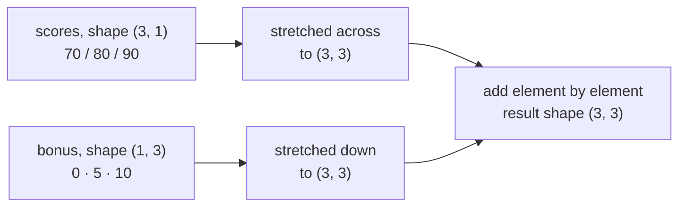

<!-- Written by `npm run lessons` from the lesson data in src/data. Edit the lesson there, not this page. -->

# Broadcasting and vectorisation

**ML Foundations · Unit 0: Your toolkit · Lesson 4 of 7**

> **In one line.** Vectorisation means doing maths on whole arrays in one operation; broadcasting is NumPy's rule for combining arrays of different shapes by stretching any direction of size 1.

[Open this lesson on the site](https://learn.hamropedia.com/foundations/broadcasting-and-vectorisation/) for its animation, the practice game and tap-to-explain words.

## The problem it solves

Python loops are slow, because the interpreter handles one number at a time. ML needs the same operation on millions of numbers, such as adding a bias to every row of a batch. Vectorised NumPy runs the whole operation in compiled code instead, and broadcasting saves you from building big copies by hand just to make shapes match.

## The idea

Vectorisation means one operation works on a whole array at once, instead of a Python loop. Broadcasting lets arrays with different shapes work together, by stretching dimensions of size 1.

## How it works, step by step

1. Write the two shapes one above the other, lined up on the right: (3, 1) and (1, 3).
2. Compare each pair of sizes, starting from the right. A pair fits if the sizes are equal or one of them is 1. Here 1 fits 3, and 3 fits 1.
3. If one array has fewer axes, its shape is padded with 1s on the left: (3,) is treated as (1, 3). That is why a 1-D array acts like a row.
4. Each size-1 direction is stretched to match the other array. scores is stretched across to 3 columns and bonus is stretched down to 3 rows. Nothing is really copied in memory.
5. The operation then runs cell by cell: result[i, j] = scores[i, 0] + bonus[0, j]. The result takes the larger size in each position, so it is (3, 3).
6. If any pair is unequal and neither is 1, such as (3,) and (4,), NumPy stops with "operands could not be broadcast together".

## Picture it



*Broadcasting stretches each direction of size 1 to match the other array, then adds number by number — with no Python loop.*

## Analogy

A teacher says once: 'everyone add 5 to your score'. She does not walk to each student.

**Where the analogy breaks.** A teacher can talk to any group. Broadcasting only works when the shapes match from the right, or one of them is 1. Otherwise you get an error, or worse, a silent wrong result.

## Worked example

scores has shape (3, 1) and bonus has shape (1, 3). Compared from the right, 1 fits 3 and 3 fits 1, so both stretch to (3, 3) and every score gets every bonus. In a quick timing test, doubling a million numbers with x \* 2 + 1 was about 77 times faster than a Python loop doing the same.

```python
scores = np.array([[70], [80], [90]])   # shape (3, 1)
bonus  = np.array([[0, 5, 10]])         # shape (1, 3)
scores + bonus                          # shape (3, 3)
# [[70, 75,  80],
#  [80, 85,  90],
#  [90, 95, 100]]
```

## Must know

- The rule: line the shapes up from the right; each pair must be equal or contain a 1.
- Missing leading axes count as 1, so (3,) behaves like (1, 3).
- Vectorised code is usually 10 to 100 times faster than a Python loop, and shorter.
- x[:, None] (or x.reshape(-1, 1)) turns a shape (n,) array into a column (n, 1); x[None, :] turns it into a row (1, n).
- Everyday ML uses: X - X.mean(axis=0) subtracts each feature's mean from every row; adding a bias to every row of a batch; all pairwise distances in one line.
- keepdims=True keeps the summed axis with size 1, so the result broadcasts back: X / X.sum(axis=1, keepdims=True) makes every row sum to 1.

## Common mistakes

- The silent bug: adding shapes (n,) and (n, 1) gives an (n, n) result and no error. Assert the shapes you expect.
- Forgetting keepdims=True. X.sum(axis=1) has shape (n,), which lines up with the columns, not the rows: an error, or for a square X, a silently wrong answer.
- Copying data with np.tile or np.repeat just to make shapes match. Broadcasting does this without using the memory.
- Writing a Python loop over rows for something one array expression can do.

> **Not true:** Shapes (n,) + (n, 1): NumPy raises an error.  
> **In fact:** It raises no error: broadcasting quietly produces an (n, n) grid. That is why you should assert the shapes you expect.

> **Not true:** Adding a row to every row of a matrix: copy the row first with np.tile.  
> **In fact:** Broadcasting adds the row to every row without copying anything. np.tile would only use up memory.

## Practise

Try each one yourself first: on paper, in code or out loud. Then open the answer and compare.

### 1. Derive

Predict the result shape, or 'error', for: (3, 1) + (4,); (2, 3) + (3,); (2, 3) + (2,); (5, 1, 4) + (3, 1). Then check in NumPy.

<details>
<summary>Show one good answer</summary>

Line the shapes up from the right, pad the shorter one with 1s on the left, and check each pair: equal, or one of them is 1.

(3, 1) + (4,) → (3, 4). (4,) becomes (1, 4). Right pair: 1 and 4 → 4. Left pair: 3 and 1 → 3.  
(2, 3) + (3,) → (2, 3). (3,) becomes (1, 3), and it is added to every row.  
(2, 3) + (2,) → error. (2,) becomes (1, 2). Right pair: 3 and 2 are unequal and neither is 1.  
(5, 1, 4) + (3, 1) → (5, 3, 4). (3, 1) becomes (1, 3, 1). Pairs from the right: 4 and 1 → 4; 1 and 3 → 3; 5 and 1 → 5.

```python
import numpy as np
for a, b in [((3, 1), (4,)), ((2, 3), (3,)), ((2, 3), (2,)), ((5, 1, 4), (3, 1))]:
    try:
        print(a, "+", b, "->", (np.zeros(a) + np.zeros(b)).shape)
    except ValueError:
        print(a, "+", b, "-> error")
```

</details>

### 2. Build

Compute pairwise squared distances between the rows of X (n, d) and Y (m, d) with no loops. Compare with a double loop for small n, then time both for n = m = 1,000.

<details>
<summary>Show one good answer</summary>

Expand the square: ‖x − y‖² = ‖x‖² + ‖y‖² − 2·x·y. Then all n × m distances come from one matrix product:

D = (X²).sum(axis=1)[:, None] + (Y²).sum(axis=1)[None, :] − 2·X @ Y.T

The first term is a column (n, 1), the second a row (1, m), and X @ Y.T is (n, m), so broadcasting gives the full (n, m) table.

Check it against a slow double loop on small inputs with np.allclose. Then time both at n = m = 1,000: the vectorised version takes a few milliseconds and the loop most of a second: over 100 times faster on a laptop. Rounding can make a distance that should be 0 come out as a tiny negative number, so clip it with np.maximum(D, 0).

```python
import time
import numpy as np

def pairwise_sq(X, Y):
    D = (X**2).sum(axis=1)[:, None] + (Y**2).sum(axis=1)[None, :] - 2 * X @ Y.T
    return np.maximum(D, 0)          # rounding can give tiny negatives

def pairwise_loop(X, Y):
    D = np.zeros((len(X), len(Y)))
    for i in range(len(X)):
        for j in range(len(Y)):
            D[i, j] = ((X[i] - Y[j]) ** 2).sum()
    return D

rng = np.random.default_rng(0)
Xs, Ys = rng.normal(size=(5, 3)), rng.normal(size=(4, 3))
assert np.allclose(pairwise_sq(Xs, Ys), pairwise_loop(Xs, Ys))

X, Y = rng.normal(size=(1000, 3)), rng.normal(size=(1000, 3))
t = time.perf_counter(); pairwise_sq(X, Y); fast = time.perf_counter() - t
t = time.perf_counter(); pairwise_loop(X, Y); slow = time.perf_counter() - t
print(f"vectorised {fast*1000:.1f} ms, loop {slow:.1f} s, {slow/fast:.0f}x faster")
```

</details>

### 3. Break

Add a (3,) array to a (3, 1) array by mistake. You get a (3, 3) result and no error. Write a test that would catch this silent bug.

<details>
<summary>Show one good answer</summary>

a has shape (3,) and b has shape (3, 1). (3,) acts like a row, b is a column, so a + b broadcasts to (3, 3): nine numbers instead of three, and no error.

The test that catches it checks the shape of the result, not just that it runs. Assert the shape you expect inside the function, and test it:

• assert out.shape == a.shape in the function itself, so the bug fails loudly the moment it happens;  
• a pytest test that feeds a column by mistake and expects the error.

The fix in the caller is to make the shapes match on purpose: b.ravel() or b[:, 0] turns (3, 1) into (3,).

```python
import numpy as np
import pytest

def add_bias(x, bias):
    out = x + bias
    assert out.shape == x.shape, f"shape changed: {x.shape} -> {out.shape}"
    return out

def test_add_bias_keeps_shape():
    x = np.array([1.0, 2.0, 3.0])
    assert add_bias(x, np.ones(3)).shape == (3,)

def test_column_bias_is_caught():
    x = np.array([1.0, 2.0, 3.0])
    with pytest.raises(AssertionError):
        add_bias(x, np.ones((3, 1)))      # would silently be (3, 3)

print((np.ones(3) + np.ones((3, 1))).shape)   # (3, 3): the silent bug
```

</details>

### 4. Explain

Explain the broadcasting rule in two sentences, using the (3, 1) + (1, 3) example.

<details>
<summary>Show one good answer</summary>

Line the two shapes up from the right: each pair of sizes must be equal, or one of them must be 1, and a size of 1 is stretched to match the other. So (3, 1) + (1, 3) works: the column of 3 is stretched across 3 columns and the row of 3 is stretched down 3 rows, giving a (3, 3) grid where every value of the first meets every value of the second, with no copying and no loop.

</details>

## Check you understood

Answer in your head first, then open each one.

<details>
<summary>&lt;b>What shape is (4, 1) + (3,)? Use the rule.&lt;/b></summary>

(3,) is padded to (1, 3). From the right: 1 fits 3, and 4 fits 1. The result is (4, 3).

</details>

<details>
<summary>&lt;b>Does (4, 3) + (4,) work?&lt;/b></summary>

No. (4,) becomes (1, 4). From the right, 3 and 4 are unequal and neither is 1, so NumPy raises an error. Make it a column first: b[:, None] has shape (4, 1), which fits.

</details>

<details>
<summary>&lt;b>How do you subtract each column's mean from X with shape (100, 5)?&lt;/b></summary>

X - X.mean(axis=0). The mean has shape (5,), which acts as (1, 5) and is stretched across all 100 rows.

</details>

<details>
<summary>&lt;b>Why is a vectorised operation faster than a Python loop?&lt;/b></summary>

It runs one compiled loop over numbers packed together in memory, instead of the Python interpreter handling each number on its own.

</details>

## Go further (optional)

The lesson above is enough on its own. These free extras give a second explanation.

- READ · [Broadcasting](https://numpy.org/doc/stable/user/basics.broadcasting.html) · numpy.org · with diagrams
- READ · [From Python to NumPy: the vectorisation chapters](https://www.labri.fr/perso/nrougier/from-python-to-numpy/) · Nicolas Rougier · free book
- CODE · [100 NumPy exercises](https://github.com/rougier/numpy-100) · Nicolas Rougier · GitHub

---

[← NumPy arrays, shapes and indexing](numpy-arrays-shapes-and-indexing.md) · [All lessons](../../README.md) · [Plotting results with Matplotlib →](plotting-results-with-matplotlib.md)
