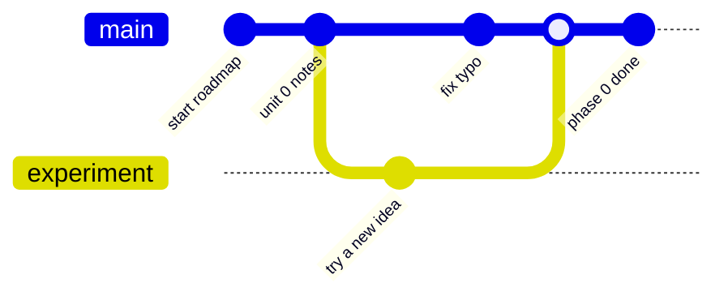

<!-- Written by `npm run lessons` from the lesson data in src/data. Edit the lesson there, not this page. -->

# Git and GitHub for your projects

**ML Foundations · Unit 0: Your toolkit · Lesson 6 of 7**

> **In one line.** Git saves snapshots of your project, called commits, so you can go back, branch off and merge; GitHub stores those repositories online.

[Open this lesson on the site](https://learn.hamropedia.com/foundations/git-and-github-for-your-projects/) for its animation, the practice game and tap-to-explain words.

## The problem it solves

Without version control you end up with files like model_final_v3_REALLY_final.py, and no idea which version gave your best result. One bad edit can break working code with no way back. Git records every change with a message, lets you try ideas safely on a branch, and GitHub backs it all up and shows employers your work.

## The idea

Git saves snapshots of your project, called commits, so you can go back in time. GitHub stores them online and shows your work to employers.

## How it works, step by step

1. git init turns a folder into a repository (a repo). From now on, Git tracks changes in it.
2. You edit model.py. git status shows it as modified: the change exists only in your working folder.
3. git add model.py puts the change in the staging area: the list of changes for your next snapshot.
4. git commit -m "Add training loop" saves the snapshot, with its message, in your local repository. Each commit gets a unique id (a hash) and points back to the one before.
5. git switch -c experiment creates a branch: a separate line of commits for a risky idea. main stays untouched.
6. git switch main, then git merge experiment, brings the idea back. If both lines changed the same lines, Git stops and asks you to fix a merge conflict by hand.
7. git push sends your commits to GitHub; git pull brings down commits made somewhere else.

## Picture it



*Each dot is a commit (a saved snapshot). The experiment branch lets you try an idea safely, then merge it back into main.*

## Analogy

Save points in a video game. You can try something risky, and reload if it goes wrong.

**Where the analogy breaks.** Game saves are for one player. Branches let you, or a team, try several ideas side by side and then merge the good ones.

## Worked example

You edit linear_regression.py, stage it with git add, save a snapshot with git commit and a clear message, then git push it to GitHub. To try a new optimiser safely, make a branch, commit there, and merge it into main only if it works.

```bash
git add linear_regression.py
git commit -m "Add gradient descent for linear regression"
git push
```

## Must know

- Four places: working folder → (git add) → staging area → (git commit) → local repo → (git push) → GitHub.
- A commit is a snapshot of the whole project plus a message saying why. Small, focused commits are the easiest to understand and undo.
- A branch is only a movable label on a commit, so making one is instant.
- git log --oneline shows the history; git diff shows changes you have not staged yet.
- A .gitignore file lists what Git must never track: datasets, model checkpoints, .venv, __pycache__ and secrets such as API keys.
- GitHub is not Git. Git runs on your computer; GitHub is a website that keeps copies of repos and adds pull requests and issues.

## Common mistakes

- Committing large data files or model weights. They stay in the history forever and bloat the repo. Ignore them with .gitignore.
- Committing secrets such as API keys or .env files. Deleting them later does not remove them from the history, so change the key.
- Messages like "update" or "fix". Say what changed and why.
- Doing every experiment directly on main, so one broken idea breaks everything.

> **Not true:** A leaked secret key: deleting it in a later commit removes it from the history.  
> **In fact:** The earlier commit still contains it, and anyone with the repository can read it. A leaked key must be changed, not just deleted.

> **Not true:** Experiments: do each one directly on main; branches are for finished work.  
> **In fact:** One broken idea then breaks everything. Try each idea on its own branch, and merge it into main only when it works.

## Practise

Try each one yourself first: on paper, in code or out loud. Then open the answer and compare.

### 1. Derive

Write from memory the commands to: start a repo, save a change, create a branch, switch back, and push to GitHub.

<details>
<summary>Show one good answer</summary>

git init                      # start a repo in this folder  
git add model.py              # stage the change (or git add . for everything)  
git commit -m "Add model"     # save a snapshot with a message  
git switch -c experiment      # create a branch and move to it (older: git checkout -b)  
git switch main               # switch back  
git remote add origin &lt;url>   # once: connect the repo to GitHub  
git push -u origin main       # upload; after the first time, just git push

Check yours has the two-step save: add, then commit. git status at any point shows what is staged and what is not.

</details>

### 2. Build

Create your roadmap repo. Commit each build separately with a clear message. Add a .gitignore for data files and notebook checkpoints.

<details>
<summary>Show one good answer</summary>

1. Make the repo on GitHub (empty, no README), then on your machine: git init, add the remote, and push.  
2. One commit per build, with a message that says what changed and why, such as "Add NumPy linear regression with gradient descent". Not "update" or "stuff".  
3. Add a .gitignore before your first data file, so nothing big or private is ever committed.

A good starting .gitignore is below. Commit the .gitignore itself. If a data file was already committed, remove it from tracking with git rm --cached &lt;file>; the .gitignore alone won't do it.

```text
# data and model files: too big for Git
data/
*.csv
*.npy
*.pt
# notebook and Python clutter
.ipynb_checkpoints/
__pycache__/
.venv/
# secrets: never commit these
.env
```

</details>

### 3. Break

On a branch, change the same line in two different ways and merge. Resolve the merge conflict by hand.

<details>
<summary>Show one good answer</summary>

Make the conflict: on main, commit a line such as lr = 0.01. Create a branch, change it to lr = 0.1, and commit. Switch back to main, change the same line to lr = 0.001, and commit. Now git merge experiment stops with "CONFLICT (content)".

Git marks the file like the block below. Everything between &lt;&lt;&lt;&lt;&lt;&lt;&lt; and ======= is your side (main); between ======= and >>>>>>> is the branch.

Resolve it by hand: edit the file to the version you really want, delete all three marker lines, then git add the file and git commit to finish the merge. git status tells you which files still have conflicts.

The lesson: Git merges automatically unless two people changed the same lines. Then a human has to decide.

```text
<<<<<<< HEAD
lr = 0.001
=======
lr = 0.1
>>>>>>> experiment
```

</details>

### 4. Explain

Explain the difference between a commit, a branch and a push.

<details>
<summary>Show one good answer</summary>

A commit is a saved snapshot of your project with a message, on your own machine; it is a point you can always go back to. A branch is just a name that points at a line of commits, so you can try an idea without touching your main work, and a new commit moves the name forward. A push uploads your commits to the copy on GitHub. Until you push, nobody else can see them, and they are not backed up.

</details>

## Check you understood

Answer in your head first, then open each one.

<details>
<summary>&lt;b>What is the difference between git add and git commit?&lt;/b></summary>

git add stages a change: it chooses it for the next snapshot. git commit saves everything staged as a snapshot in your local repo.

</details>

<details>
<summary>&lt;b>You committed, but your friend can't see it on GitHub. Why?&lt;/b></summary>

Commits stay on your computer until you git push them to GitHub.

</details>

<details>
<summary>&lt;b>What is a merge conflict?&lt;/b></summary>

Both branches changed the same lines in different ways, so Git can't choose. You edit the file to keep the right version, then add and commit it.

</details>

<details>
<summary>&lt;b>Why put datasets and checkpoints in .gitignore?&lt;/b></summary>

They are large and change often. Git keeps every version forever, so the repo would become huge and slow. Store them somewhere else.

</details>

## Go further (optional)

The lesson above is enough on its own. These free extras give a second explanation.

- PLAY · [Learn Git Branching](https://learngitbranching.js.org/) · interactive, in the browser  
  **Worth it:** You type real Git commands and watch the branch picture redraw itself. The fastest way to make branches and merges click.
- READ · [Pro Git, Chapters 1–3](https://git-scm.com/book/en/v2) · Scott Chacon · free book
- WATCH · [Version Control (Git)](https://missing.csail.mit.edu/2020/version-control/) · The Missing Semester (MIT)

---

[← Plotting results with Matplotlib](plotting-results-with-matplotlib.md) · [All lessons](../../README.md) · [Testing numerical code (np.allclose, pytest) →](testing-numerical-code-np-allclose-pytest.md)
