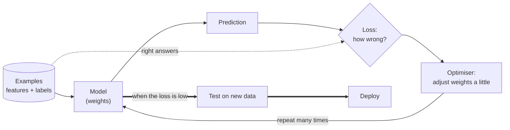

<!-- Written by `npm run lessons` from the lesson data in src/data. Edit the lesson there, not this page. -->

# Meet machine learning: the big picture

**ML Foundations · Unit 0: Your toolkit · Lesson 1 of 7**

> **In one line.** Machine learning is getting a computer to learn a pattern from examples, instead of a person writing the rules by hand.

[Open this lesson on the site](https://learn.hamropedia.com/foundations/meet-machine-learning-the-big-picture/) for its animation, the practice game and tap-to-explain words.

## The problem it solves

Some rules are too hard to write down. Try writing exact rules for "is this email spam?" or "what is this house worth?": there are too many cases and exceptions. But examples are easy to collect: thousands of emails already marked as spam or not, thousands of houses with their sale prices. Machine learning turns those examples into a working rule.

## The idea

Machine learning means learning a pattern from examples instead of writing the rules by hand.

You give a model inputs (features) and the right answers (labels). The model makes a guess, a loss function measures how wrong it is, and an optimiser nudges the model's numbers (its weights) to make the loss smaller. Repeat that many times and the model learns.

Then you test it on data it has never seen, and if it's good, you deploy it.

## How it works, step by step

1. Collect examples. Each example has features (the inputs; here, the size in m²) and a label (the right answer; here, the price).
2. Choose a model: a formula with adjustable numbers called weights. Here it is ŷ = w·size + b, a straight line. w and b start at 0, so the model knows nothing yet.
3. Predict: run every example through the model. With w = 0, it predicts £0 for every house.
4. Measure the loss: one number that says how wrong the predictions are. Mean squared error squares each error and takes the average. At the start it is 69,900.
5. Adjust: the gradient of the loss says which way to move each weight to make the loss smaller. The optimiser moves each weight a small step that way, and the learning rate sets the size of the step. After one step, w = 4.66.
6. Repeat predict → loss → adjust. w swings 4.66, 2.08, 3.51, 2.72… and each swing is smaller. After 1,000 loops w ≈ 3.0 and the loss is almost 0: each m² adds about £3,000.
7. Test the model on data it never saw while training. Only if it does well there do you trust it and deploy it, so it can make predictions on new data in the real world.

## Picture it



*The loop in the middle is training: predict, measure the loss, adjust the weights, repeat. Only when it's good on new data does the model go live.*

## Analogy

Learning to throw darts. You throw (a prediction), see how far you landed from the bullseye (the loss), adjust your arm a little (an optimiser update), and throw again. After hundreds of throws, you're accurate.

**Where the analogy breaks.** A person can feel why a throw missed. A model only gets one number, the loss; the gradient then tells it which way to adjust every weight at once — sometimes millions of them.

## Worked example

Predicting house prices. The feature is the size, the label is the price, the model is ŷ = w·size + b, the loss is the squared error, and gradient descent adjusts w and b. The code below learns that each square metre adds about £3,000.

```python
import numpy as np

X = np.array([50., 80., 120.])        # feature: size in m²
y = np.array([150., 240., 360.])      # label: price in £1,000s
w, b, lr = 0.0, 0.0, 0.0001

for step in range(1000):
    pred = w * X + b                   # 1. predict
    loss = np.mean((pred - y) ** 2)    # 2. measure how wrong
    grad_w = np.mean(2 * (pred - y) * X)
    grad_b = np.mean(2 * (pred - y))
    w, b = w - lr * grad_w, b - lr * grad_b   # 3. adjust, then repeat

print(round(w, 2))                     # about 3.0: £3,000 per m²
```

## Must know

- Feature: an input the model uses (size). Label: the right answer it learns to predict (price). One example is one row of both.
- Weights (also called parameters) are the numbers the model learns. Training means finding good weights.
- The loss is a single number for "how wrong". Training is nothing more than making that number smaller.
- Gradient descent: work out which way makes the loss smaller (the gradient), take a small step that way, and repeat.
- The learning rate is the step size. Too small and training is very slow; too big and the loss explodes.
- Always judge a model on data it was not trained on. Doing well on its own training data proves very little.
- Regression predicts a number (a price). Classification predicts a category (spam or not spam).
- This is supervised learning: every example has a label. Unsupervised learning finds structure without labels, such as grouping similar customers.

## Common mistakes

- Thinking the model "understands" houses. It only found the numbers that make the loss small on these examples.
- Testing on the training data. A model can memorise its examples and still fail on new ones.
- Believing that more training always helps. After a point the model starts fitting noise; Unit 2 calls this overfitting.
- Mixing up the model and training. The model is the formula with weights; training is the loop that sets the weights.

> **Not true:** A model that gets every training example right is certain to do well on new examples too.  
> **In fact:** A model can memorise its training examples and still fail on new ones. Only data it has never seen shows how good it is.

> **Not true:** The longer a model trains, the better it gets on new data.  
> **In fact:** After a point, more training makes the model fit the noise in its examples, and it gets worse on new data. Unit 2 calls this overfitting.

## Practise

Try each one yourself first: on paper, in code or out loud. Then open the answer and compare.

### 1. Derive

For the model ŷ = w·x + b and the loss (ŷ − y)², write the gradients with respect to w and b on paper.

<details>
<summary>Show one good answer</summary>

Call the error e = ŷ − y, so the loss is L = e². Use the chain rule: first how L changes with e, then how e changes with each weight.

dL/de = 2e.  
Since ŷ = w·x + b, a small change in w changes e by x, and a small change in b changes e by 1.

So:  
∂L/∂w = 2(ŷ − y) · x  
∂L/∂b = 2(ŷ − y)

For many examples, the loss is the mean, so the gradients are means too: ∂L/∂w = mean(2(ŷ − y)·x) and ∂L/∂b = mean(2(ŷ − y)). These are exactly grad_w and grad_b in the lesson's code.

Read it in words: if the prediction is too high (ŷ − y > 0), both gradients are positive, so gradient descent makes w and b smaller. The x in ∂L/∂w means big houses push w harder than small ones.

</details>

### 2. Build

Run the training loop above and print the loss every 100 steps. Then plot the loss with Matplotlib. The answer shows a free way to run it with nothing installed, and the plotting code; the next lessons teach the Python and the plotting.

<details>
<summary>Show one good answer</summary>

Where to run it: open colab.research.google.com, choose New notebook, paste the code into the first cell and press Shift+Enter. Colab is a free Python notebook that runs in your browser, with NumPy and Matplotlib already installed, so there is nothing to set up. (Later you can install Python on your own computer and run the same code there.)

Keep a list, append the loss every step, print every 100 steps, then plot the list. The loss falls very fast at first and then flattens: a healthy curve.

The numbers fall from 69,900 at step 0 to almost 0 by step 100, because this data fits a straight line exactly. The loss falls so far that a log y-axis is the only way to see the end of training.

```python
import numpy as np
import matplotlib.pyplot as plt

X = np.array([50., 80., 120.])
y = np.array([150., 240., 360.])
w, b, lr = 0.0, 0.0, 0.0001
losses = []

for step in range(1000):
    pred = w * X + b
    loss = np.mean((pred - y) ** 2)
    losses.append(loss)
    if step % 100 == 0:
        print(step, round(loss, 4))
    grad_w = np.mean(2 * (pred - y) * X)
    grad_b = np.mean(2 * (pred - y))
    w, b = w - lr * grad_w, b - lr * grad_b

plt.plot(losses)
plt.yscale("log")          # the loss falls by many powers of 10
plt.xlabel("step")
plt.ylabel("loss")
plt.title("Training loss")
plt.show()
# 0 69900.0
# 100 0.0001
# 200 0.0001  ... flat from here: w ≈ 3.0
```

</details>

### 3. Break

Make the learning rate 10 times bigger and run it again. What happens to the loss, and why?

<details>
<summary>Show one good answer</summary>

With lr = 0.001 the loss explodes instead of shrinking: 69,900 at step 0, about 14.8 million after one step, and it keeps growing until it becomes inf, then nan.

Why: the step size is the learning rate times the gradient. Here the step is so big that w jumps right over the best value (3.0) and lands further away on the other side: 0 → 46.6 → −630.7 → 9,214 … Each jump overshoots by more than the last, so the error grows every step.

The fix is a smaller learning rate, or scaling the feature (sizes like 120 make the gradients big). The lesson: a loss that rises or turns into nan very often means the learning rate is too high.

```python
import numpy as np

X = np.array([50., 80., 120.])
y = np.array([150., 240., 360.])
w, b, lr = 0.0, 0.0, 0.001          # 10 times bigger

for step in range(4):
    pred = w * X + b
    print(step, round(np.mean((pred - y) ** 2)), round(w, 1))
    grad_w = np.mean(2 * (pred - y) * X)
    grad_b = np.mean(2 * (pred - y))
    w, b = w - lr * grad_w, b - lr * grad_b
# 0 69900 0.0
# 1 14767756 46.6
# 2 3119980329 -630.7
# 3 659157497506 9214.4
```

</details>

### 4. Explain

Explain the learning loop — predict, measure the loss, adjust, repeat — with the dart-throwing picture.

<details>
<summary>Show one good answer</summary>

Training a model is like learning to throw darts. You throw (the model makes a prediction), you look at how far the dart landed from the bullseye (the loss: one number for how wrong it was), and you adjust your arm a little in the direction that would have helped (the optimiser changes the weights, using the gradient). Then you throw again. Each throw gets a bit closer, and after hundreds of throws you hit the middle.

The size of each arm adjustment is the learning rate: too small and you need forever, too big and you over-correct and miss by more each time. And you only trust your aim once you can hit a board you've never practised on: that's testing on new data.

</details>

## Check you understood

Answer in your head first, then open each one.

<details>
<summary>&lt;b>What is the difference between a feature and a label?&lt;/b></summary>

A feature is an input the model sees, such as house size. The label is the right answer it should predict, such as the price. When the model is used for real, you only have the features.

</details>

<details>
<summary>&lt;b>What does the loss tell you, and what does training do with it?&lt;/b></summary>

The loss is one number for how wrong the model is on the examples. Training changes the weights again and again to make that number smaller.

</details>

<details>
<summary>&lt;b>Why test on data the model has never seen?&lt;/b></summary>

Because the goal is to work on new cases. A model can memorise its training examples and get a low loss on them, yet do badly on anything new.

</details>

<details>
<summary>&lt;b>With a learning rate 10 times bigger, the loss went from 69,900 to 14.8 million in one step. Why?&lt;/b></summary>

The step was so big that it jumped right past the best weight and landed further away on the other side. Every step overshoots by more, so the loss explodes instead of shrinking.

</details>

<details>
<summary>&lt;b>Is predicting tomorrow's temperature regression or classification?&lt;/b></summary>

Regression, because the answer is a number. "Will it rain tomorrow, yes or no?" would be classification.

</details>

## Go further (optional)

The lesson above is enough on its own. These free extras give a second explanation.

- WATCH · [Neural Networks, Ch 1–2: what a neural network is, and how it learns](https://www.3blue1brown.com/topics/neural-networks) · 3Blue1Brown  
  **Worth it:** Beautiful moving pictures of a model adjusting its weights to lower the loss. It makes the learning loop feel real in a way text can't.
- WATCH · [A Gentle Introduction to Machine Learning](https://www.youtube.com/results?search_query=StatQuest+A+Gentle+Introduction+to+Machine+Learning) · StatQuest (Josh Starmer)
- PLAY · [A Visual Introduction to Machine Learning](https://r2d3.us/visual-intro-to-machine-learning-part-1/) · R2D3 · an animated story you scroll through
- READ · [Machine Learning Crash Course: introduction and linear regression](https://developers.google.com/machine-learning/crash-course) · Google, free

---

[All lessons](../../README.md) · [Python basics: variables, lists, loops and functions →](python-basics-variables-lists-loops-and-functions.md)
