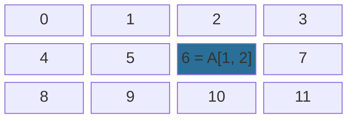

<!-- Written by `npm run lessons` from the lesson data in src/data. Edit the lesson there, not this page. -->

# NumPy arrays, shapes and indexing

**ML Foundations · Unit 0: Your toolkit · Lesson 3 of 7**

> **In one line.** A NumPy array is a grid of numbers, all of the same type, with a shape that says how long it is in each direction.

[Open this lesson on the site](https://learn.hamropedia.com/foundations/numpy-arrays-shapes-and-indexing/) for its animation, the practice game and tap-to-explain words.

## The problem it solves

ML is arithmetic on huge piles of numbers: a dataset is a table, an image is a grid of pixels, and a batch of images is a stack of grids. Python lists are slow for this and have no idea of rows and columns.

NumPy arrays keep the numbers packed together in memory, and run maths on all of them at once in fast compiled code. They also let you pick out any row, column or block with one short expression.

## The idea

An array is a grid of numbers of the same type. Its shape tells you how many numbers there are along each direction. Shape (3, 4) means 3 rows and 4 columns.

## How it works, step by step

1. np.arange(12) makes the numbers 0 to 11 as a one-dimensional (1-D) array. Its shape is (12,): one direction, 12 long. The trailing comma just means "a tuple with one entry".
2. reshape(3, 4) shows the same 12 numbers as 3 rows of 4. The total has to stay the same: 3 × 4 = 12. A.ndim is 2 (the number of directions, called axes) and A.size is 12.
3. Index with one number per axis, counting from 0: A[1, 2] is row 1, column 2, which is 6. Negative numbers count from the end, so A[-1, -1] is 11.
4. Slice with start:stop, where the stop is not included: A[0, 1:3] is [1, 2]. A colon on its own means "all of this axis", so A[:, 0] is the whole first column, [0, 4, 8].
5. Leave out the later indexes and you get whole rows: A[1] is [4, 5, 6, 7].
6. Keep only the values that pass a test with a boolean mask. A > 6 is a grid of True and False the same shape as A, and A[A > 6] is [7, 8, 9, 10, 11].
7. Slices are views: B = A[0] shares memory with A, so changing B changes A as well. Call .copy() when you need a separate array. Masks always make a copy.

## Picture it



*A = np.arange(12).reshape(3, 4): 3 rows and 4 columns. A[1, 2] means row 1, column 2 (counting from 0).*

## Analogy

A spreadsheet. The shape is the number of rows and columns. Indexing means picking one cell, a whole row or a whole column.

**Where the analogy breaks.** A spreadsheet has only two directions. An array can have three or more, like a stack of spreadsheets. A batch of colour images has shape (batch, height, width, 3).

## Worked example

Take A = np.arange(12).reshape(3, 4). A[1, 2] is 6. A[:, 0] is the first column, [0, 4, 8]. A[1] is the row [4, 5, 6, 7]. A[A > 6] is [7, 8, 9, 10, 11]. A.sum(axis=0) adds down each column to give [12, 15, 18, 21].

```python
A = np.arange(12).reshape(3, 4)
A.shape      # (3, 4)
A[1, 2]      # 6   (row 1, column 2)
A[:, 0]      # array([0, 4, 8])   the first column
```

## Must know

- shape is a tuple: (12,) is 1-D, (3, 4) is 2-D. The number of entries in the shape is ndim, the number of axes.
- Axis 0 runs down the rows; axis 1 runs across the columns. A.sum(axis=0) adds down each column and has shape (4,).
- Indexing counts from 0, and a slice leaves out its stop value: 1:3 means positions 1 and 2.
- Basic slices return views that share memory. Boolean masks and lists of indexes return copies.
- Every value has the same dtype, such as float64 or int64. Put one decimal into a list of whole numbers and the whole array becomes float64.
- Shapes to recognise in ML: a table of data is (n_samples, n_features); a batch of colour images is (batch, height, width, 3).

## Common mistakes

- Confusing (3,) with (3, 1) or (1, 3). They hold the same three numbers but behave differently in maths and broadcasting.
- Off-by-one slices: A[0:2] gives two rows, not three.
- Changing a slice and being surprised that the original changed too. Slices are views.
- Looping over array elements in Python. One array operation is often 10 to 100 times faster.

> **Not true:** Changing a slice of a NumPy array leaves the original array untouched.  
> **In fact:** A slice is a view: it shares memory with the original, so changing it changes the original too. Call .copy() when you need a separate array.

> **Not true:** A[0:2] selects three rows: rows 0, 1 and 2.  
> **In fact:** The end of a slice is left out, so A[0:2] gives two rows: row 0 and row 1.

## Practise

Try each one yourself first: on paper, in code or out loud. Then open the answer and compare.

### 1. Derive

Without running code: for A = np.arange(24).reshape(2, 3, 4), write down A.shape, A[1].shape, A[:, 0].shape and A[1, 2, 3]. Then check.

<details>
<summary>Show one good answer</summary>

A = np.arange(24).reshape(2, 3, 4) is 2 blocks, each with 3 rows of 4 numbers.

A.shape → (2, 3, 4)  
A[1].shape → (3, 4). One index picks block 1, and a whole 3 × 4 block is left.  
A[:, 0].shape → (2, 4). Every block, row 0 of each: 2 rows of 4.  
A[1, 2, 3] → 23. Block 1 starts at 12; row 2 adds 2 × 4 = 8; column 3 adds 3. So 12 + 8 + 3 = 23. It is the very last number, which makes sense: every index is the last one on its axis.

</details>

### 2. Build

Make a (5, 4) array of random numbers. Select the last row, the first two columns, every value above 0.5 (with a boolean mask), and the diagonal of its top-left 4 × 4 block.

<details>
<summary>Show one good answer</summary>

Use a fixed seed so the numbers are the same each run. Each selection is one short expression:

• last row: X[-1] (shape (4,))  
• first two columns: X[:, :2] (shape (5, 2))  
• every value above 0.5: X[X > 0.5] (a 1-D array; its length depends on the data)  
• diagonal of the top-left 4 × 4: np.diag(X[:4, :4]), or X[np.arange(4), np.arange(4)]

Check the shapes, not just the numbers: shape mistakes are the most common bug.

```python
import numpy as np

rng = np.random.default_rng(0)
X = rng.random((5, 4))            # values between 0 and 1

last_row = X[-1]                  # (4,)
first_two = X[:, :2]              # (5, 2)
big = X[X > 0.5]                  # 1-D: only the values that pass
diag = np.diag(X[:4, :4])         # (4,)

print(last_row.shape, first_two.shape, big.shape, diag.shape)
# (4,) (5, 2) (12,) (4,)
assert np.allclose(diag, [X[i, i] for i in range(4)])
```

</details>

### 3. Break

Try reshaping a 24-element array to (5, 5) and read the error. Then change a slice B = A[0] and check whether A changed too. Find out what a 'view' is.

<details>
<summary>Show one good answer</summary>

The reshape fails with: "cannot reshape array of size 24 into shape (5,5)". A reshape only rearranges the numbers you already have, and 5 × 5 = 25 is not 24.

The slice B = A[0] is a view: a new window onto the same memory, not a copy. So B[0] = 99 also changes A[0, 0]. np.shares_memory(A, B) is True, and B.base is A.

Why NumPy does this: copying is slow and uses memory, so basic slices share. When you need an independent array, write B = A[0].copy(). Boolean masks and lists of indexes always make copies.

```python
import numpy as np

a = np.arange(24)
try:
    a.reshape(5, 5)
except ValueError as e:
    print(e)        # cannot reshape array of size 24 into shape (5,5)

A = np.arange(12).reshape(3, 4)
B = A[0]
B[0] = 99
print(A[0, 0], np.shares_memory(A, B))   # 99 True

C = A[1].copy()
C[0] = -1
print(A[1, 0])                            # 4: the copy didn't touch A
```

</details>

### 4. Explain

Explain the difference between shapes (3,), (3, 1) and (1, 3) to a friend, with a drawing.

<details>
<summary>Show one good answer</summary>

All three hold three numbers. The difference is how many directions (axes) they have.

(3,) is a plain list: one axis, no idea of rows or columns.  
(3, 1) is a column: 3 rows, 1 column.  
(1, 3) is a row: 1 row, 3 columns.

Why it matters: in maths they behave differently. A column plus a row broadcasts to a 3 × 3 grid, and (3,) acts like a row, so (3,) + (3, 1) silently gives a (3, 3) result instead of 3 numbers.

```text
(3,)       [ a  b  c ]          one axis
(3, 1)     [ a ]                3 rows, 1 column
           [ b ]
           [ c ]
(1, 3)     [[ a  b  c ]]        1 row, 3 columns
```

</details>

## Check you understood

Answer in your head first, then open each one.

<details>
<summary>&lt;b>A has shape (3, 4). What are A.ndim and A.size?&lt;/b></summary>

2 and 12: two axes (rows and columns), and 3 × 4 = 12 numbers in total.

</details>

<details>
<summary>&lt;b>What does A[:, 1] return for A = np.arange(12).reshape(3, 4)?&lt;/b></summary>

Column 1 of every row: [1, 5, 9], with shape (3,).

</details>

<details>
<summary>&lt;b>What is the shape of A.sum(axis=0), and why?&lt;/b></summary>

(4,). Summing along axis 0 collapses the rows, leaving one total for each of the 4 columns.

</details>

<details>
<summary>&lt;b>B = A[0]; B[0] = 99. Does A change?&lt;/b></summary>

Yes. A basic slice is a view of the same memory, so A[0, 0] becomes 99 too. Use A[0].copy() to avoid this.

</details>

## Go further (optional)

The lesson above is enough on its own. These free extras give a second explanation.

- READ · [A Visual Intro to NumPy and Data Representation](https://jalammar.github.io/visual-numpy/) · Jay Alammar · illustrated, free  
  **Worth it:** Colourful pictures of arrays, slicing and reshaping, and of how tables, images and text become arrays. The best picture-book companion to this lesson.
- READ · [NumPy: the absolute basics for beginners](https://numpy.org/doc/stable/user/absolute_beginners.html) · numpy.org
- READ · [Indexing on ndarrays](https://numpy.org/doc/stable/user/basics.indexing.html) · numpy.org
- WATCH · [Complete Python NumPy Tutorial](https://www.youtube.com/results?search_query=Keith+Galli+complete+python+numpy+tutorial) · Keith Galli

---

[← Python basics: variables, lists, loops and functions](python-basics-variables-lists-loops-and-functions.md) · [All lessons](../../README.md) · [Broadcasting and vectorisation →](broadcasting-and-vectorisation.md)
