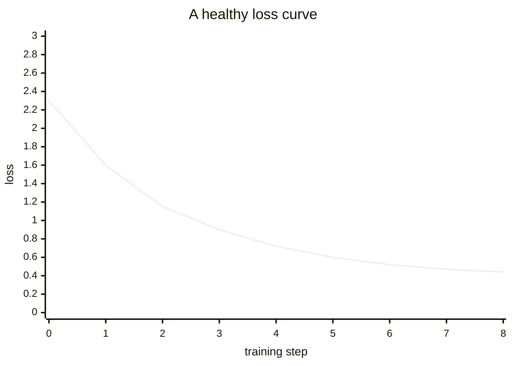

<!-- Written by `npm run lessons` from the lesson data in src/data. Edit the lesson there, not this page. -->

# Plotting results with Matplotlib

**ML Foundations · Unit 0: Your toolkit · Lesson 5 of 7**

> **In one line.** Matplotlib is the standard Python library for drawing charts; in ML you use it mostly to see loss curves, data and predictions.

[Open this lesson on the site](https://learn.hamropedia.com/foundations/plotting-results-with-matplotlib/) for its animation, the practice game and tap-to-explain words.

## The problem it solves

Training prints thousands of numbers, and you can't spot a trend by reading them. Is the loss still falling? Did it jump to a huge value at step 400? Is the model overfitting? A picture answers those questions in a second. Many training bugs are found by looking at a plot, not by reading the code.

## The idea

A plot turns numbers into a picture, so you can see patterns and bugs. In ML, the most important plot is the loss curve.

## How it works, step by step

1. Keep a list during training: losses.append(loss) once per step, or once per epoch.
2. plt.plot(losses) draws a line: the position in the list goes on the x-axis and the value on the y-axis.
3. Label it: plt.xlabel("step"), plt.ylabel("loss") and a title. An unlabelled plot is easy to misread a week later.
4. For training and validation curves, call plt.plot twice with label="train" and label="validation", then plt.legend() to add the key.
5. If the loss spans several powers of 10, call plt.yscale("log") so the late progress is visible.
6. plt.show() opens the window; plt.savefig("loss.png", dpi=150) saves it for your README or report.
7. For several charts side by side, fig, axes = plt.subplots(1, 2) gives you two drawing areas: axes[0].plot(...) and axes[1].plot(...).

## Picture it



*Loss falls fast at first, then flattens. Plotting it is the quickest way to see whether training is working.*

## Analogy

A car dashboard. You don't read engine data line by line. You glance at the gauges.

**Where the analogy breaks.** A dashboard shows only the present. A loss curve shows the whole history of training, and that history is where the clues are.

## Worked example

There are four shapes to recognise. Healthy: a fast fall, then a slow level. Overfitting: training loss keeps falling while validation loss turns up. A learning rate that is too high: spiky, then NaN. Flat from the start: nothing is being learned.

```python
import matplotlib.pyplot as plt
plt.plot(losses)
plt.xlabel("step"); plt.ylabel("loss")
plt.yscale("log")   # makes small changes visible
plt.show()
```

## Must know

- The loss curve is the main health check for any training run. Plot it every time.
- Healthy: falls fast, then flattens. Spiky or rising: the learning rate is too high, or there is a bug. Flat from the start: nothing is being learned.
- Training loss falling while validation loss rises means overfitting. Keep the model from the lowest validation point.
- Use a log scale for anything that spans powers of 10: losses, learning rates, dataset sizes.
- plt.scatter for data points, plt.hist for how values are spread, plt.imshow for images and matrices.
- Always label the axes, and add a legend whenever there is more than one line.

## Common mistakes

- Plotting every step of a noisy loss and seeing only noise. Smooth it with a moving average, or plot once per epoch.
- Comparing two runs drawn with different y-axis ranges. Fix the range with plt.ylim.
- A normal y-axis that hides late improvement. Try a log scale.
- Passing a PyTorch tensor straight to Matplotlib. Convert it first with loss.item() or tensor.detach().cpu().numpy().

> **Not true:** A normal, evenly spaced y-axis is the clearest way to see late improvements in a loss.  
> **In fact:** On a normal axis, a loss that falls from 1,000 to 0.01 looks flat at the end. A log scale makes the late progress visible.

> **Not true:** Two runs can be compared fairly even when their plots use different y-axis ranges.  
> **In fact:** Different ranges make the same curve look steeper or flatter. Fix the range with plt.ylim, or draw both runs on the same axes.

## Practise

Try each one yourself first: on paper, in code or out loud. Then open the answer and compare.

### 1. Derive

Before plotting anything, sketch by hand: a healthy loss curve, an overfitting pair of train and validation curves, and a learning rate that is too high.

<details>
<summary>Show one good answer</summary>

Loss goes up the side, steps along the bottom. Your three sketches should show these shapes:

1. Healthy: starts high, drops steeply in the first steps, then bends and flattens into a slow, almost level tail. It never climbs back up.

2. Overfitting: two curves. Both fall at first. Then the training curve keeps falling, but the validation curve reaches a lowest point and turns upward, so the gap between them grows. Mark that lowest validation point: that is where you would stop (early stopping).

3. Learning rate too high: jagged and jumpy, swinging up and down instead of falling smoothly. Often it creeps upward and finally shoots off the top (the loss becomes nan).

The code below draws all three, so you can hold your sketch next to it.

```python
import numpy as np
import matplotlib.pyplot as plt

t = np.arange(100)
rng = np.random.default_rng(1)
healthy = 0.4 + 2.0 * np.exp(-t / 12)
train = 0.1 + 2.0 * np.exp(-t / 15)
val = 0.6 + 1.6 * np.exp(-t / 12) + 0.0004 * np.maximum(t - 30, 0) ** 2
too_high = 1.5 + 0.03 * t + rng.normal(0, 0.6, 100)

fig, axes = plt.subplots(1, 3, figsize=(12, 3.5))
axes[0].plot(t, healthy); axes[0].set_title("healthy")
axes[1].plot(t, train, label="train"); axes[1].plot(t, val, label="validation")
axes[1].axvline(np.argmin(val), linestyle=":", color="grey")   # stop here
axes[1].legend(); axes[1].set_title("overfitting")
axes[2].plot(t, too_high); axes[2].set_title("learning rate too high")
for ax in axes:
    ax.set_xlabel("step"); ax.set_ylabel("loss")
plt.tight_layout()
plt.show()
```

</details>

### 2. Build

Plot y = x², the line 2x (its slope, which Unit 1 calls the derivative), and 50 noisy samples of y on one figure, with a legend and axis titles. Save it as a PNG.

<details>
<summary>Show one good answer</summary>

One figure, three things on it: the curve y = x², its derivative 2x as a dashed line, and 50 noisy dots scattered around the curve. Check that yours has:

• label= on every plot call, then plt.legend(). That is what makes the key.  
• plt.xlabel, plt.ylabel and plt.title.  
• plt.savefig(...) called BEFORE plt.show(). Once the figure has been shown and closed it is gone, so saving afterwards gives a blank PNG.  
• a fixed random seed, so the noisy dots are the same on every run.

What to notice: the derivative line crosses 0 exactly where the parabola is lowest (x = 0). It is negative on the left, where the curve slopes down, and positive on the right, where it slopes up. That is the idea gradient descent uses: the sign of the derivative says which way is downhill.

```python
import numpy as np
import matplotlib.pyplot as plt

x = np.linspace(-3, 3, 200)              # smooth x values for the two lines
rng = np.random.default_rng(0)           # fixed seed: same noise every run
xs = rng.uniform(-3, 3, 50)              # 50 random x positions
ys = xs**2 + rng.normal(0, 0.8, 50)      # y = x² plus noise

plt.figure(figsize=(7, 4))
plt.plot(x, x**2, label="y = x²")
plt.plot(x, 2 * x, "--", label="derivative: 2x")
plt.scatter(xs, ys, s=15, alpha=0.7, label="50 noisy samples of y")
plt.axhline(0, color="grey", linewidth=0.5)
plt.xlabel("x")
plt.ylabel("value")
plt.title("y = x², its derivative, and noisy samples")
plt.legend()
plt.savefig("parabola.png", dpi=150)     # save BEFORE plt.show()
plt.show()
```

</details>

### 3. Break

Plot a loss that falls from 1,000 to 0.01, first on a normal y-axis, then on a log y-axis. Which one hides the late progress, and why?

<details>
<summary>Show one good answer</summary>

The normal y-axis hides the late progress.

Why: the axis has to reach 1,000 to fit the start, so every loss below about 10 is squashed into the bottom 1% of the chart. In the run below, the loss drops under 10 at step 80 of 200, and from then on the line looks as if it is lying flat on the floor. Yet it still falls another 1,000 times, from 10 to 0.01. You would wrongly think training had stopped.

The log y-axis gives every tenfold drop the same height: 1,000 → 100 takes as much space as 0.1 → 0.01. So late progress is as easy to see as early progress. This loss shrinks by the same percentage every step, and on a log axis that shows as a straight line.

```python
import numpy as np
import matplotlib.pyplot as plt

steps = np.arange(200)
loss = np.geomspace(1000, 0.01, 200)     # 1,000 → 0.01, the same % each step

fig, axes = plt.subplots(1, 2, figsize=(10, 4))
axes[0].plot(steps, loss)
axes[0].set_title("normal y-axis")
axes[1].plot(steps, loss)
axes[1].set_yscale("log")
axes[1].set_title("log y-axis")
for ax in axes:
    ax.set_xlabel("step")
    ax.set_ylabel("loss")
plt.tight_layout()
plt.show()

print(np.argmax(loss < 10))              # 80: the first step below 10
```

</details>

### 4. Explain

Explain in two sentences why loss curves are often drawn on a log scale.

<details>
<summary>Show one good answer</summary>

A training loss often falls by several powers of ten, say from 1,000 to 0.01, and on a normal axis the big early values squash the small late ones flat, so it looks as if training stopped. A log scale gives each tenfold drop the same height, so late progress, plateaus and spikes stay visible, and steady exponential decay shows as a straight line.

</details>

## Check you understood

Answer in your head first, then open each one.

<details>
<summary>&lt;b>Your loss curve is flat from the very first step. What might be wrong?&lt;/b></summary>

Nothing is being learned. The learning rate may be far too small, the gradients may be zero (for example, a missing loss.backward()), or the weights are never updated.

</details>

<details>
<summary>&lt;b>Training loss keeps falling, but validation loss started rising at epoch 20. What is happening, and what do you do?&lt;/b></summary>

Overfitting: the model is memorising the training data. Keep the model from epoch 20 (early stopping), or add regularisation or more data.

</details>

<details>
<summary>&lt;b>When should you use a log y-axis?&lt;/b></summary>

When the values span several powers of 10, such as a loss going from 1,000 to 0.01. On a normal axis the small late changes look flat.

</details>

<details>
<summary>&lt;b>How do you put training and validation loss on one chart, with a key?&lt;/b></summary>

Call plt.plot twice, each with a label= argument, then call plt.legend().

</details>

## Go further (optional)

The lesson above is enough on its own. These free extras give a second explanation.

- READ · [Quick start guide](https://matplotlib.org/stable/users/explain/quick_start.html) · matplotlib.org
- WATCH · [Matplotlib Tutorial (Part 1)](https://www.youtube.com/results?search_query=Corey+Schafer+Matplotlib+Tutorial+Part+1) · Corey Schafer

---

[← Broadcasting and vectorisation](broadcasting-and-vectorisation.md) · [All lessons](../../README.md) · [Git and GitHub for your projects →](git-and-github-for-your-projects.md)
