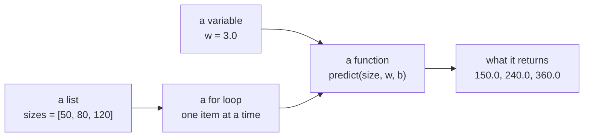

<!-- Written by `npm run lessons` from the lesson data in src/data. Edit the lesson there, not this page. -->

# Python basics: variables, lists, loops and functions

**ML Foundations · Unit 0: Your toolkit · Lesson 2 of 7**

> **In one line.** Python is the programming language of machine learning. You store values in variables, keep many values in a list, repeat work with a loop, and package steps into a function you can reuse.

[Open this lesson on the site](https://learn.hamropedia.com/foundations/python-basics-variables-lists-loops-and-functions/) for its animation, the practice game and tap-to-explain words.

## The problem it solves

Every lesson after this one asks you to run code and change it. You don't need to be a programmer first, but you do need four ideas: variables, lists, loops and functions. With those you can read every example in this course. NumPy and PyTorch are then just faster tools built on the same four ideas.

## The idea

Four ideas run through all the code in this course. A variable names a value. A list holds many values in order. A loop repeats work for each item. A function packages steps so you can use them again.

## How it works, step by step

1. Open a notebook: go to colab.research.google.com and choose New notebook. Type print(2 + 3) in the first cell and press Shift+Enter. Python runs it and shows 5. There is nothing to install.
2. A variable is a name for a value: w = 3.0 stores the number 3.0 under the name w. Use the name later and Python fills in the value: w \* 50 gives 150.0.
3. A list keeps several values in order: sizes = [50, 80, 120]. Positions count from 0, so sizes[0] is 50 and sizes[2] is 120, and len(sizes) is 3.
4. A for loop runs the indented lines once for each item. "for s in sizes:" followed by an indented "print(w \* s)" prints 150.0, then 240.0, then 360.0. The 4 spaces of indentation are how Python knows which lines are inside the loop.
5. An if runs its indented lines only when a test is true: "if s > 100:" lets through only the 120. A test such as s > 100 or s == 80 gives True or False.
6. A function packages steps under a name. "def predict(size, w, b):" followed by an indented "return w \* size + b" defines it; predict(80, 3.0, 0.0) calls it and gets back 240.0.
7. Put them together: loop over the houses, call predict for each one, and add up the squared errors. That is the loss from the first lesson, written in plain Python.

## Picture it



*A list holds the data, a loop walks through it, and a function does the same calculation for each item.*

## Analogy

A kitchen. Variables are labelled jars. A list is a shelf of jars in a fixed order. A loop is "do this for every jar on the shelf". A function is a recipe card: hand it ingredients and it hands back a dish.

**Where the analogy breaks.** A jar keeps what you put in it. A variable can be given a new value at any time. Two names can also point at the same list: change the list through one name, and the other name sees the change too.

## Worked example

Three houses have sizes [50, 80, 120] m² and prices [150, 240, 360], in £1,000s. With w = 3.0 and b = 0.0, predict gives exactly the prices, so the loss is 0.0. With w = 2.0 the predictions are 100, 160 and 240, and the loss, the average squared error, is 7,766.67.

```python
sizes = [50, 80, 120]                 # a list: the size of each house in m²
prices = [150, 240, 360]              # the price of each house in £1,000s

def predict(size, w, b):              # a function: the model from the first lesson
    return w * size + b

def loss(w, b):
    total = 0.0
    for size, price in zip(sizes, prices):    # a loop over both lists, side by side
        error = predict(size, w, b) - price
        total = total + error ** 2            # ** means "to the power of"
    return total / len(sizes)

print(loss(3.0, 0.0))                 # 0.0
print(round(loss(2.0, 0.0), 2))       # 7766.67
```

## Must know

- A variable is a name pointing at a value. A single = stores a value; a double == compares two values.
- Lists are ordered and count from 0: the last item of a list of 3 is at position 2.
- Indentation is part of the language: the lines inside a loop, an if or a function are indented by 4 spaces.
- A function takes inputs (its arguments) and hands back a result with return. With no return line, it hands back None.
- range(n) counts 0, 1, …, n − 1, so "for i in range(3):" runs three times.
- Read an error message from the bottom up: the last line names the error, and the lines above it say where it happened.

## Common mistakes

- Writing = where == is needed. "if x = 3:" is an error; "if x == 3:" is a test.
- Asking for sizes[3] in a list of 3 items. Counting starts at 0, so the last position is 2.
- Printing a result inside a function instead of returning it, then getting None where a number was expected.
- Indenting lines unevenly, or mixing tabs with spaces, which gives an IndentationError.

> **Not true:** A function that prints its result also hands that result back to the code that called it.  
> **In fact:** Printing only shows a value on the screen. To hand it back, the function needs return; without it the caller gets None.

> **Not true:** A list of 3 items: the last item is at position 3.  
> **In fact:** Counting starts at 0, so the three positions are 0, 1 and 2. Asking for position 3 is an error.

## Practise

Try each one yourself first: on paper, in code or out loud. Then open the answer and compare.

### 1. Derive

On paper, follow this code line by line: total = 0, then "for x in [2, 5, 3]:" with the indented line "total = total + x \* x". Write the value of total after each pass of the loop.

<details>
<summary>Show one good answer</summary>

Go through the loop one pass at a time. The line total = total + x \* x means: work out the right-hand side with the old total, then store the result as the new total.

Before the loop: total = 0.  
Pass 1, x = 2: total = 0 + 2 × 2 = 4.  
Pass 2, x = 5: total = 4 + 5 × 5 = 29.  
Pass 3, x = 3: total = 29 + 3 × 3 = 38.

The list has run out, so the loop ends with total = 38: the sum of the squares. Tracing code by hand like this is the fastest way to find out why a program gives the wrong answer.

```python
total = 0
for x in [2, 5, 3]:
    total = total + x * x
    print(x, total)
# 2 4
# 5 29
# 3 38
```

</details>

### 2. Build

Write mean(values) with a loop, using no sum() and no NumPy, and print the mean of [150, 240, 360]. Then write largest(values), which returns the biggest value in a list.

<details>
<summary>Show one good answer</summary>

mean: start a running total at 0, add every value to it in a loop, then divide by how many values there are. For [150, 240, 360] that is 750 / 3 = 250.0.

largest: remember the best value seen so far. Start with the first item, then look at each value in turn, and replace the best whenever a bigger one comes along.

Start largest from the first item, not from 0: with a list of negative numbers, 0 would wrongly win. That is why the last line tests it on [-5, -2, -9].

```python
def mean(values):
    total = 0
    for v in values:
        total = total + v
    return total / len(values)

def largest(values):
    best = values[0]                  # start with the first value
    for v in values:
        if v > best:                  # found a bigger one: remember it
            best = v
    return best

prices = [150, 240, 360]
print(mean(prices))                   # 250.0
print(largest(prices))                # 360
print(largest([-5, -2, -9]))          # -2: works for negative numbers too
```

</details>

### 3. Break

Cause three errors on purpose and read each message: ask for sizes[3], write "if x = 3:", and add 1 to the result of a function that prints instead of returning. What does each message say, and what does it mean?

<details>
<summary>Show one good answer</summary>

1. sizes[3] on a list of 3 items gives "IndexError: list index out of range". Positions run from 0 to 2, so there is no position 3. The fix is sizes[2], or sizes[-1] for "the last one".

2. "if x = 3:" gives "SyntaxError: invalid syntax. Maybe you meant '==' or ':=' instead of '='?". A single = stores a value and can't be used as a test. Python even suggests the fix: ==.

3. A function that prints its answer but has no return hands back None. Adding 1 to that gives "TypeError: unsupported operand type(s) for +: 'NoneType' and 'int'". The message means "you tried to add nothing and a number". The fix is to write return x \* 2 instead of print(x \* 2).

Each message names the kind of error first, then says what went wrong. Read the last line first: it is nearly always enough to find the problem.

```python
# Run each part in its own cell: an error stops the cell it happens in.

# Cell 1
sizes = [50, 80, 120]
sizes[3]              # IndexError: list index out of range

# Cell 2
x = 3
if x = 3:             # SyntaxError: invalid syntax. Maybe you meant '==' or ':=' instead of '='?
    print("three")

# Cell 3
def double(x):
    print(x * 2)      # prints 8, but returns nothing

double(4) + 1         # TypeError: unsupported operand type(s) for +: 'NoneType' and 'int'
```

</details>

### 4. Explain

Explain a variable, a list, a loop and a function with the kitchen picture.

<details>
<summary>Show one good answer</summary>

Think of a kitchen. A variable is a labelled jar: the label is the name, and what is inside is the value. Write w = 3.0 and the jar labelled w now holds 3.0.

A list is a shelf of jars in a fixed order. You can ask for the first one, the second one, and so on, and Python counts them from 0.

A loop is the instruction "do this for every jar on the shelf, one after another". You write the steps once, and Python repeats them for each item.

A function is a recipe card. You hand it ingredients (the arguments), it follows its steps, and it hands a dish back (the return value). Once the card is written you can use it as often as you like, with different ingredients each time.

</details>

## Check you understood

Answer in your head first, then open each one.

<details>
<summary>&lt;b>What does sizes[1] give for sizes = [50, 80, 120]?&lt;/b></summary>

80. Counting starts at 0, so position 1 is the second item.

</details>

<details>
<summary>&lt;b>What is the difference between = and ==?&lt;/b></summary>

A single = stores a value under a name, as in w = 3. A double == asks whether two values are equal, and gives True or False.

</details>

<details>
<summary>&lt;b>What does a function hand back if it has no return line?&lt;/b></summary>

None, Python's value for "nothing". If you see None where you expected a number, look for a missing return.

</details>

<details>
<summary>&lt;b>How many times do the lines inside "for i in range(4):" run, and with which values of i?&lt;/b></summary>

Four times, with i = 0, 1, 2 and 3. range(4) stops before 4.

</details>

## Go further (optional)

The lesson above is enough on its own. These free extras give a second explanation.

- PLAY · [Google Colab: a free Python notebook in your browser](https://colab.research.google.com/) · Google  
  **Worth it:** Nothing to install: open it, type code and press Shift+Enter. Use it for every example in this course until you set Python up on your own computer.
- READ · [The Python Tutorial, chapters 3 to 5](https://docs.python.org/3/tutorial/) · python.org · official
- WATCH · [Python for Everybody](https://www.py4e.com/) · Charles Severance · free

---

[← Meet machine learning: the big picture](meet-machine-learning-the-big-picture.md) · [All lessons](../../README.md) · [NumPy arrays, shapes and indexing →](numpy-arrays-shapes-and-indexing.md)
