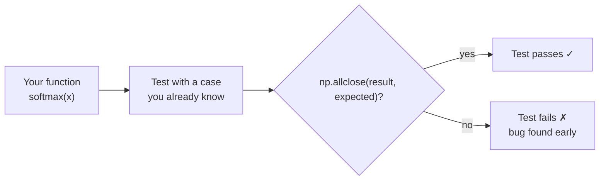

<!-- Written by `npm run lessons` from the lesson data in src/data. Edit the lesson there, not this page. -->

# Testing numerical code (np.allclose, pytest)

**ML Foundations · Unit 0: Your toolkit · Lesson 7 of 7**

> **In one line.** A test is a small program that runs your code on a case where you already know the answer, and fails loudly when the result is wrong. Decimals are compared with a small tolerance.

[Open this lesson on the site](https://learn.hamropedia.com/foundations/testing-numerical-code-np-allclose-pytest/) for its animation, the practice game and tap-to-explain words.

## The problem it solves

ML code fails quietly. A wrong axis, a sign error or a broadcasting slip still runs and still prints a loss. It just learns worse, and you may never notice. Tests catch these bugs the moment you make them, when they are cheap to fix. And because computers round decimals, the tests have to allow tiny differences.

## The idea

A test runs your code on a case where you already know the answer. With decimals, compare with a small tolerance, because computers round numbers.

## How it works, step by step

1. Pick cases where you know the answer: softmax of [0, 0] must be [0.5, 0.5], and any softmax output must sum to 1.
2. Write a function whose name starts with test_, in a file whose name starts with test_, such as test_softmax.py.
3. Inside, run your code and check the result with assert. For decimals, use np.allclose(result, expected), or np.testing.assert_allclose, which also prints the values that differed.
4. Run pytest in the terminal. It finds every test, runs them all, and lists any that fail.
5. Add edge cases: very large inputs such as [1000, 1001, 1002], negative numbers, a batch with shape (batch, classes), a single element.
6. When you find a bug, first write a test that fails because of it, then fix the code. The test stays, so the bug can never come back unnoticed.

## Picture it



*A test runs your code on a known case and compares with a small tolerance, because decimals are never exact.*

## Analogy

Checking a calculator with 2 + 2 before you trust it with your taxes.

**Where the analogy breaks.** Passing easy tests does not prove the code is right. Also test edge cases: zeros, one sample, very large numbers.

## Worked example

In Python, 0.1 + 0.2 == 0.3 is False, but np.allclose(0.1 + 0.2, 0.3) is True. And softmax of [1000, 1001, 1002] gives NaN unless you subtract the largest value first; after that it gives [0.090, 0.245, 0.665].

```python
def test_softmax_sums_to_one():
    p = softmax(np.array([1.0, 2.0, 3.0]))
    assert np.allclose(p.sum(), 1.0)
```

## Must know

- Never compare decimals with ==. Use np.allclose (returns True or False) or np.testing.assert_allclose (fails with a helpful message).
- np.allclose checks \|a − b\| ≤ atol + rtol·\|b\| for every pair. By default atol = 1e-8 and rtol = 1e-5.
- Good tests check properties as well as values: probabilities sum to 1, shapes are right, the order of values is kept.
- Compare a fast vectorised version with a slow, obvious loop version on small random inputs.
- A gradient check (Unit 1) is a test too: compare your gradient with an estimate from tiny nudges.
- Fix the random seed in tests, for example rng = np.random.default_rng(0), so a failure can be repeated.

## Common mistakes

- Testing only the easy case. Bugs live in edge cases: zeros, huge values, one sample, empty input.
- A tolerance so loose that wrong answers pass.
- Writing tests after the code "works", and so only testing what you already know works.
- Working out the expected value with the same code you are testing, so the test repeats the bug.

> **Not true:** A good way to get a test's expected value is to compute it with the function you are testing.  
> **In fact:** Then the test repeats any bug the function has, and still passes. Work the expected value out by hand, or in a different way.

> **Not true:** What to test: the typical case; edge cases such as zeros or empty input can be left out.  
> **In fact:** Bugs live in the edge cases: zeros, huge values, a single sample, empty input. Test those too.

## Practise

Try each one yourself first: on paper, in code or out loud. Then open the answer and compare.

### 1. Derive

Before writing any test, list five edge cases for a softmax function.

<details>
<summary>Show one good answer</summary>

Good edge cases are the inputs most likely to break it. Five:

1. Very large values, such as [1000, 1001, 1002]: exp overflows to inf, and inf / inf gives nan.  
2. Very negative values, such as [−1000, −1001]: exp underflows to 0, and 0 / 0 gives nan.  
3. All values equal, such as [5, 5, 5]: the answer must be exactly uniform, [1/3, 1/3, 1/3].  
4. A single value, [7.0]: the answer must be [1.0].  
5. A 2-D batch of shape (batch, classes): each row must sum to 1 on its own, not the whole array.

Also worth adding: a shift test (adding the same number to every input must not change the output) and integer input.

</details>

### 2. Build

Write pytest tests for your softmax: it sums to 1, keeps the order of values, handles a (batch, classes) input, and matches a slow loop version.

<details>
<summary>Show one good answer</summary>

Write a stable softmax that works along the last axis, then one test per property. Each test checks one thing, so a failure tells you exactly what broke. Compare decimals with np.allclose, never ==.

Run with pytest test_softmax.py. All four tests pass.

```python
import numpy as np

def softmax(x, axis=-1):
    x = np.asarray(x, dtype=float)
    z = x - x.max(axis=axis, keepdims=True)    # stable: largest becomes 0
    e = np.exp(z)
    return e / e.sum(axis=axis, keepdims=True)

def softmax_loop(row):
    exps = [np.exp(v - max(row)) for v in row]
    return [e / sum(exps) for e in exps]

def test_sums_to_one():
    assert np.isclose(softmax([1.0, 2.0, 3.0]).sum(), 1.0)

def test_keeps_order():
    x = np.array([0.5, -1.0, 3.0])
    assert (np.argsort(softmax(x)) == np.argsort(x)).all()

def test_batch_rows_each_sum_to_one():
    p = softmax(np.random.default_rng(0).normal(size=(4, 5)))
    assert p.shape == (4, 5)
    assert np.allclose(p.sum(axis=1), 1.0)

def test_matches_slow_loop():
    x = [0.2, 1.5, -0.3]
    assert np.allclose(softmax(x), softmax_loop(x))
```

</details>

### 3. Break

Call your softmax on [1000, 1001, 1002]. Do you get NaN? Fix it, and add a test so the bug can never come back.

<details>
<summary>Show one good answer</summary>

The naive version, np.exp(x) / np.exp(x).sum(), gives [nan, nan, nan] with an "overflow encountered in exp" warning. exp(1000) is far bigger than the largest float64 (about 1.8 × 10³⁰⁸), so it becomes inf, and inf / inf is nan.

The fix: subtract the largest value first. Softmax doesn't change when you shift every input by the same amount, because the extra factor exp(−c) appears on the top and the bottom and cancels. After the shift, the largest exponent is exp(0) = 1, so nothing can overflow. The answer is [0.090, 0.245, 0.665].

The regression test feeds the exact input that broke it, and checks there is no nan and the right answer comes back.

```python
import numpy as np

x = np.array([1000.0, 1001.0, 1002.0])
with np.errstate(over="ignore", invalid="ignore"):
    print(np.exp(x) / np.exp(x).sum())          # [nan nan nan]

def softmax(x):
    e = np.exp(x - x.max())
    return e / e.sum()

print(softmax(x).round(3))                       # [0.09  0.245 0.665]

def test_large_inputs_do_not_overflow():
    p = softmax(np.array([1000.0, 1001.0, 1002.0]))
    assert not np.isnan(p).any()
    assert np.allclose(p, softmax(np.array([0.0, 1.0, 2.0])))
```

</details>

### 4. Explain

Explain why == is dangerous for decimal numbers, and what np.allclose does instead.

<details>
<summary>Show one good answer</summary>

Computers store decimals in binary, and most decimals, such as 0.1, can't be stored exactly, so tiny rounding errors creep in: 0.1 + 0.2 is really 0.30000000000000004, and 0.1 + 0.2 == 0.3 is False. == demands every last digit to match, so a test using it fails on correct code, or passes only by luck.

np.allclose(a, b) instead asks "are these close enough?". For every element it checks \|a − b\| ≤ atol + rtol·\|b\|, where by default rtol = 1e-5 (a relative error of 0.001%) and atol = 1e-8 (for values near zero). It returns one True only if every element passes.

</details>

## Check you understood

Answer in your head first, then open each one.

<details>
<summary>&lt;b>Why does 0.1 + 0.2 == 0.3 return False?&lt;/b></summary>

0.1 and 0.2 can't be stored exactly in binary, so their sum comes out as 0.30000000000000004. == demands exact equality.

</details>

<details>
<summary>&lt;b>What does np.allclose check?&lt;/b></summary>

That every pair of values is within a small tolerance: \|a − b\| ≤ atol + rtol·\|b\|, with atol = 1e-8 and rtol = 1e-5 by default.

</details>

<details>
<summary>&lt;b>Name three edge cases for a function that returns the mean of an array.&lt;/b></summary>

Any three of: an empty array (division by zero), a single element, very large values that could overflow, NaN values in the input, a 2-D input.

</details>

<details>
<summary>&lt;b>You just fixed a bug. What should you do before moving on?&lt;/b></summary>

Add a test that fails without the fix, so the bug can't return unnoticed.

</details>

## Go further (optional)

The lesson above is enough on its own. These free extras give a second explanation.

- READ · [Get Started](https://docs.pytest.org/en/stable/getting-started.html) · pytest docs
- READ · [numpy.testing.assert_allclose](https://numpy.org/doc/stable/reference/generated/numpy.testing.assert_allclose.html) · numpy.org
- READ · [Floating Point Arithmetic: Issues and Limitations](https://docs.python.org/3/tutorial/floatingpoint.html) · Python docs

---

[← Git and GitHub for your projects](git-and-github-for-your-projects.md) · [All lessons](../../README.md) · [Vectors, span and basis →](../unit-1-math/vectors-span-and-basis.md)
