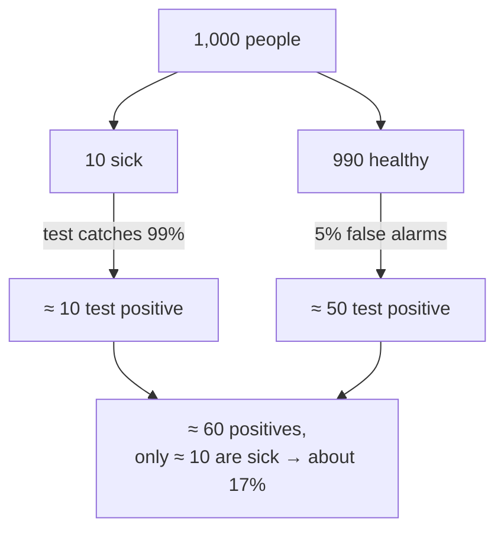

<!-- Written by `npm run lessons` from the lesson data in src/data. Edit the lesson there, not this page. -->

# Conditional probability and Bayes’ rule

**ML Foundations · Unit 1: Math foundations · Lesson 12 of 16**

> **In one line.** Conditional probability is the chance of A once you know that B happened. Bayes' rule flips it round: from the chance of B given A, it gives the chance of A given B, using how common A was to begin with.

[Open this lesson on the site](https://learn.hamropedia.com/foundations/conditional-probability-and-bayes-rule/) for its animation, the practice game and tap-to-explain words.

## The problem it solves

People and models constantly update beliefs from evidence: is this email spam given these words, is this patient sick given a positive test?

The probability you know (how often the test is positive for sick people) is usually not the one you want (how likely you are sick given a positive test). Bayes' rule converts one into the other, and ignoring the starting rate is one of the most common reasoning errors there is.

## The idea

P(A \| B) is the probability of A when you already know B happened. Bayes' rule flips it around: P(A \| B) = P(B \| A) · P(A) / P(B).

## How it works, step by step

1. Start with counts, not formulas. Imagine 1,000 people; 1% are sick, so 10 are sick and 990 are healthy.
2. The test catches 99% of sick people: about 9.9 of the 10 test positive.
3. It also raises a false alarm for 5% of healthy people: 0.05 × 990 = 49.5 test positive.
4. Of all 59.4 positives, only 9.9 are sick. So P(sick \| positive) = 9.9 / 59.4 ≈ 0.17.
5. That is Bayes' rule: P(sick \| +) = P(+ \| sick)·P(sick) / P(+), where P(+) adds up both ways of testing positive.
6. The starting rate (the prior) matters enormously. If 5% were sick, the same test would give P(sick \| +) ≈ 0.51.

## Picture it



*Counting people instead of using formulas: most positive results come from the big healthy group, so a positive test is usually a false alarm.*

## Analogy

A smoke alarm beeps. Is there a fire? The alarm is good at detecting fires, but fires are rare, and burnt toast is common.

**Where the analogy breaks.** From experience, you roughly know how rare fires are. In real problems the starting probability P(A), the prior, is often unknown, and the answer depends on it.

## Worked example

A disease affects 1% of people. The test catches 99% of sick people, but also says 'positive' for 5% of healthy people. You test positive. P(sick \| positive) = 0.99·0.01 / (0.99·0.01 + 0.05·0.99) ≈ 0.17. Only about 17%!

## Must know

- Conditional probability: P(A \| B) = P(A and B) / P(B), the share of the B cases in which A happens too.
- Bayes: posterior = likelihood × prior / evidence.
- P(A \| B) ≠ P(B \| A). The test is 99% sensitive, yet a positive result means only a 17% chance of being sick.
- Natural frequencies (counting 1,000 people) make Bayes problems far easier to get right.
- Independence means P(A \| B) = P(A): knowing B tells you nothing about A.
- Naive Bayes classifiers (Unit 2) and Bayesian reasoning about uncertainty are built on this rule.

## Common mistakes

- Confusing P(positive \| sick) with P(sick \| positive).
- Ignoring the base rate (the prior). Rare things stay fairly unlikely even after quite strong evidence.
- Forgetting that P(B) must count every way B can happen.

> **Not true:** Once the evidence is strong, how rare something was to begin with no longer matters.  
> **In fact:** The starting rate still matters a great deal: a rare disease stays fairly unlikely even after a positive result from a good test.

> **Not true:** P(positive \| sick) and P(sick \| positive) are the same number.  
> **In fact:** They answer different questions and can be far apart: most sick people can test positive while most positive tests come from healthy people. Bayes' rule turns one into the other.

## Practise

Try each one yourself first: on paper, in code or out loud. Then open the answer and compare.

### 1. Derive

Redo the disease example with 10% of people sick instead of 1%. How does P(sick \| positive) change, and why?

<details>
<summary>Show one good answer</summary>

Same test as before: it catches 99% of sick people, and says "positive" for 5% of healthy people. Now 10% are sick.

P(sick \| positive) = P(positive \| sick)·P(sick) / P(positive)  
= 0.99·0.10 / (0.99·0.10 + 0.05·0.90)  
= 0.099 / (0.099 + 0.045)  
= 0.099 / 0.144 ≈ 0.69.

It rises from about 17% to about 69%.

Why: the test didn't change, but the prior did. Think of 1,000 people. Before, 10 were sick (about 10 true positives) and 990 healthy (about 50 false positives), so most positives were false. Now 100 are sick (99 true positives) and 900 healthy (45 false positives), so most positives are real. How common the disease is matters as much as how good the test is.

</details>

### 2. Build

Write bayes(prior, sensitivity, false_positive_rate). Then simulate 1,000,000 people and check the simulation matches the formula.

<details>
<summary>Show one good answer</summary>

bayes() applies the formula. The simulation makes a million people, decides who is sick using the prior, gives each a test result with the right error rates, and counts how many of the positives are really sick. The two agree to about 2 decimal places: 0.167 for a 1% prior and 0.688 for 10%.

```python
import numpy as np

def bayes(prior, sensitivity, false_positive_rate):
    true_pos = sensitivity * prior
    false_pos = false_positive_rate * (1 - prior)
    return true_pos / (true_pos + false_pos)

rng = np.random.default_rng(0)
n = 1_000_000
for prior in [0.01, 0.10]:
    sick = rng.random(n) < prior
    positive = np.where(sick, rng.random(n) < 0.99, rng.random(n) < 0.05)
    simulated = sick[positive].mean()
    print(prior, round(bayes(prior, 0.99, 0.05), 3), round(simulated, 3))
```

</details>

### 3. Break

Set the prior to 0 in your function. What happens, whatever the test says? Why is a prior of exactly 0 dangerous in real models?

<details>
<summary>Show one good answer</summary>

With a prior of 0, the answer is always 0, whatever the test says. The top of the formula is sensitivity × prior = 0, so no amount of evidence can ever move it. A prior of exactly 1 is stuck in the same way at 1.

Why that is dangerous in real models: a model that gives something a probability of exactly 0 can never learn that it happens. In Naive Bayes, a word never seen with a class gets probability 0, and because probabilities are multiplied, one unseen word makes the whole class impossible. In a loss, log(0) is −infinity. The fix is to never allow exactly 0: smoothing (add a small count to everything), or clipping probabilities to a tiny minimum such as 1e-7.

```python
def bayes(prior, sensitivity, false_positive_rate):
    true_pos = sensitivity * prior
    return true_pos / (true_pos + false_positive_rate * (1 - prior))

print(bayes(0.0, 0.99, 0.05))    # 0.0
print(bayes(0.0, 1.0, 0.0001))   # still 0.0: no evidence can move it
```

</details>

### 4. Explain

Explain why a positive test can still mean you are probably healthy, using the smoke-alarm picture.

<details>
<summary>Show one good answer</summary>

A smoke alarm beeps. Is your house on fire? The alarm is very good at noticing fires, but fires are rare, and burnt toast happens all the time. So most beeps are toast, not fire.

A medical test is the same. If a disease is rare, the few sick people produce a few true positives, but the huge number of healthy people, even with a small false-alarm rate, produce many more false positives. So among everyone who tests positive, most can still be healthy. To judge the result, you need both how good the test is and how common the disease is: that is Bayes' rule.

</details>

## Check you understood

Answer in your head first, then open each one.

<details>
<summary>&lt;b>P(rain) = 0.2, P(clouds | rain) = 0.9 and P(clouds) = 0.45. What is P(rain | clouds)?&lt;/b></summary>

0.9 × 0.2 / 0.45 = 0.4.

</details>

<details>
<summary>&lt;b>Why does a 99%-sensitive test give only a 17% chance of disease after a positive result?&lt;/b></summary>

The disease is rare, so the 5% false alarms among the many healthy people outnumber the true positives among the few sick ones.

</details>

<details>
<summary>&lt;b>What is a prior?&lt;/b></summary>

Your probability for something before you see the new evidence, such as 1% of people being sick.

</details>

<details>
<summary>&lt;b>If A and B are independent, what is P(A | B)?&lt;/b></summary>

Simply P(A): knowing B changes nothing.

</details>

## Go further (optional)

The lesson above is enough on its own. These free extras give a second explanation.

- WATCH · [Bayes' theorem, the geometry of changing beliefs](https://www.3blue1brown.com/lessons/bayes-theorem) · 3Blue1Brown  
  **Worth it:** Shows Bayes' rule as areas of a square and as counts of people. After it, the 17% answer feels obvious instead of strange.
- WATCH · [The medical test paradox](https://www.youtube.com/results?search_query=3Blue1Brown+medical+test+paradox) · 3Blue1Brown
- PLAY · [Conditional probability, explained visually](https://setosa.io/conditional/) · Setosa · interactive
- READ · [Mathematics for Machine Learning, Ch 6 (sum rule, product rule, Bayes' theorem)](https://mml-book.github.io/) · Deisenroth, Faisal, Ong · free

---

[← Random variables, distributions, expectation and variance](random-variables-distributions-expectation-and-variance.md) · [All lessons](../../README.md) · [Maximum likelihood estimation →](maximum-likelihood-estimation.md)
