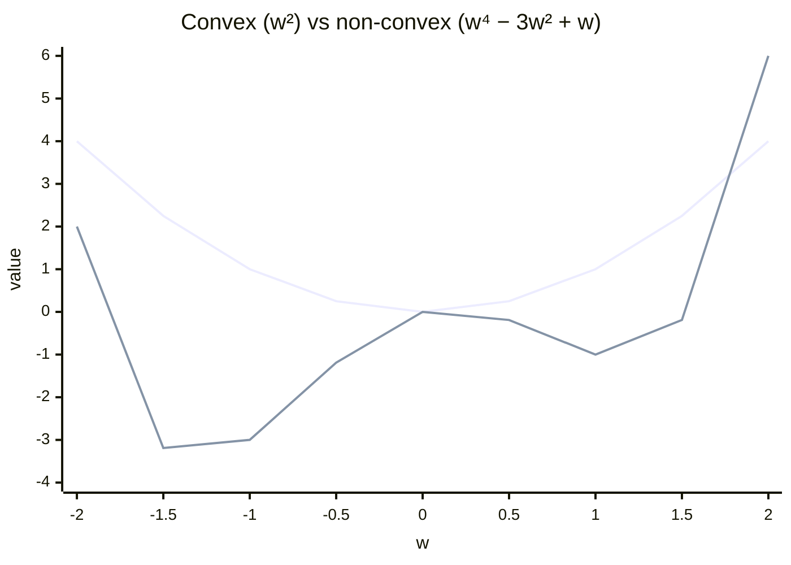

<!-- Written by `npm run lessons` from the lesson data in src/data. Edit the lesson there, not this page. -->

# Convex optimisation: constraints, Lagrange multipliers and duality

**ML Foundations · Unit 1: Math foundations · Lesson 16 of 16**

> **In one line.** A convex function is bowl-shaped, so any local minimum is the global one. A problem with a constraint is solved by adding the constraint with a Lagrange multiplier, and duality looks at the same problem from the constraint's side.

[Open this lesson on the site](https://learn.hamropedia.com/foundations/convex-optimisation-constraints-lagrange-multipliers-and-duality/) for its animation, the practice game and tap-to-explain words.

## The problem it solves

Gradient descent only promises a local minimum. For convex problems that is enough: the answer is the best possible and doesn't depend on where you start. Knowing which models are convex (linear and logistic regression, SVMs) tells you when to trust the optimiser.

Constraints like "weights must add up to 1" or "every point on the right side of the margin" need Lagrange multipliers, and SVMs are usually trained through their dual problem.

## The idea

A convex function is shaped like a bowl, so any local minimum is the global minimum and gradient descent cannot get stuck in a wrong valley.

Constrained problems ('minimise this, but keep that true') are solved with Lagrange multipliers, which add the constraint to the objective as an extra term. Duality looks at the same problem from the constraint's side, and it is how SVMs are usually solved.

## How it works, step by step

1. Test convexity with the chord rule: the straight line between any two points on the curve lies on or above the curve. w² passes; w⁴ − 3w² + w fails.
2. For a smooth function, convex means the second derivative is never negative. In many dimensions: the Hessian matrix has no negative eigenvalues.
3. Convex ⇒ every local minimum is the global one. Gradient descent from any start reaches the same lowest value.
4. Now add a constraint: minimise x² + y² subject to x + y = 1.
5. At the best point, the contour of the objective just touches the constraint line, so their gradients are parallel: ∇f = λ∇g.
6. Write the Lagrangian L = x² + y² − λ(x + y − 1) and set all its derivatives to 0: 2x = λ, 2y = λ and x + y = 1. So x = y = 0.5 and λ = 1.
7. λ says how much the best value would change if you loosened the constraint a little: here about 1 per unit.

## Picture it



*The bowl (w²) has one bottom, so gradient descent always finds it. The wavy curve has two valleys, so where you end up depends on where you start.*

## Analogy

A bowl versus a mountain range. Drop a marble into a bowl and it always ends at the same bottom. In a mountain range it can stop in any valley.

**Where the analogy breaks.** Real bowls are simple 3D shapes. Neural network losses are not convex at all, yet gradient descent still works well on them. Convexity is a guarantee we only get for simpler models, like linear regression, logistic regression and SVMs.

## Worked example

Minimise x² + y² subject to x + y = 1. The Lagrangian is x² + y² − λ(x + y − 1). Setting its gradient to zero gives 2x = λ and 2y = λ, so x = y = 0.5.

```python
# convex means the straight line between two points lies above the curve
f = lambda w: w**2
a, b, t = -1.0, 3.0, 0.3
f(t*a + (1-t)*b) <= t*f(a) + (1-t)*f(b)   # True for every a, b and t in [0, 1]
```

## Must know

- Convex: the chord lies above the curve; the second derivative is ≥ 0; there is one valley.
- A sum of convex functions is convex, so loss + an L2 penalty stays convex.
- Convex models: linear regression with squared error, logistic regression, SVMs. Neural networks are not convex.
- At the best point under a constraint, the gradient of the objective is parallel to the gradient of the constraint: ∇f = λ∇g.
- The multiplier λ is the "price" of the constraint: how fast the best value changes as the constraint is relaxed.
- Duality turns a constrained problem into a different one, often easier to solve. SVMs and their kernels come from the dual.

## Common mistakes

- Assuming deep-learning losses are convex. They are not, which is why initialisation and learning-rate schedules matter.
- Forgetting that a convex function can have a flat bottom with many minimisers, all with the same value.
- Dropping the constraint equation itself when solving the Lagrange conditions.

> **Not true:** A convex function always has exactly one point where it is lowest.  
> **In fact:** It has one lowest value, but that value can be reached along a whole flat stretch: many minimisers, all equally good.

> **Not true:** The loss of a deep neural network is convex.  
> **In fact:** Deep-learning losses are not convex: they have many valleys. That is why initialisation and learning-rate schedules matter.

## Go deeper (optional): Why a local minimum of a convex function is the global one

1. Write the chord rule from the lesson as a formula. For a convex f and any t between 0 and 1: f(t·v + (1 − t)·w) ≤ t·f(v) + (1 − t)·f(w). The left side is a point on the line between w and v; the right side is the chord above it.
2. Suppose w is a local minimum: no point close to w is lower. Suppose also, hoping for a contradiction, that some far-away point v is lower: f(v) &lt; f(w).
3. Walk a tiny way from w towards v: the point t·v + (1 − t)·w, with t small, is as close to w as you like.
4. By the chord rule, f at that point is at most t·f(v) + (1 − t)·f(w). Because f(v) &lt; f(w), that is strictly less than f(w).
5. So there are points right next to w that are lower than w, which contradicts "w is a local minimum". The assumption was wrong: no lower point v exists.

**The result.** For a convex function, every local minimum is a global minimum. That is why gradient descent cannot get stuck in a bad valley on linear regression, logistic regression or an SVM.

## Practise

Try each one yourself first: on paper, in code or out loud. Then open the answer and compare.

### 1. Derive

Minimise x² + 2y² subject to x + y = 3 with a Lagrange multiplier, by hand.

<details>
<summary>Show one good answer</summary>

Minimise x² + 2y² subject to x + y = 3.

Lagrangian: L = x² + 2y² − λ(x + y − 3).  
Set every partial derivative to 0:  
∂L/∂x = 2x − λ = 0, so x = λ/2.  
∂L/∂y = 4y − λ = 0, so y = λ/4.  
∂L/∂λ = −(x + y − 3) = 0, so x + y = 3.

From the first two, x = 2y. Put that in the constraint: 3y = 3, so y = 1, x = 2 and λ = 4.  
The minimum is 2² + 2·1² = 6.

What λ means: if the constraint were relaxed to x + y = 3 + ε, the best value would rise by about 4ε. λ is the price of the constraint. And it makes sense that x > y: y is twice as expensive in the objective, so the solution uses less of it.

</details>

### 2. Build

Write a convexity checker that tests the line-above-the-curve rule at 10,000 random points. Run it on w², \|w\|, eʷ, sin(w) and w³.

<details>
<summary>Show one good answer</summary>

A function is convex when the straight line between any two points on its graph lies on or above the curve: f(t·a + (1 − t)·b) ≤ t·f(a) + (1 − t)·f(b) for every a, b and t between 0 and 1.

Test that at 10,000 random choices of a, b and t, with a tiny tolerance for rounding. w², \|w\| and eʷ never break it. sin(w) and w³ break it quickly. Remember the test can only prove a function is not convex; passing it is strong evidence, not proof.

```python
import numpy as np

def looks_convex(f, trials=10_000, low=-5, high=5, seed=0):
    rng = np.random.default_rng(seed)
    a, b = rng.uniform(low, high, trials), rng.uniform(low, high, trials)
    t = rng.random(trials)
    return bool(np.all(f(t * a + (1 - t) * b) <= t * f(a) + (1 - t) * f(b) + 1e-9))

for name, f in [("w²", np.square), ("|w|", np.abs), ("eʷ", np.exp), ("sin w", np.sin), ("w³", lambda w: w**3)]:
    print(name, looks_convex(f))
# w² True, |w| True, eʷ True, sin w False, w³ False
```

</details>

### 3. Break

Run gradient descent on the non-convex f(w) = w⁴ − 3w² + w from 20 random starts. Where does it end each time? Compare with the convex f(w) = w².

<details>
<summary>Show one good answer</summary>

f(w) = w⁴ − 3w² + w has two valleys. Gradient descent ends in whichever valley it starts above: starts left of about w = 0.17 (the hump between them) end near w ≈ −1.30, the deeper valley with f ≈ −3.51; starts to the right end near w ≈ 1.13, a shallower valley with f ≈ −1.07. Same algorithm, same learning rate, different answers, and half the time it misses the best one.

On the convex f(w) = w², every start ends at w = 0. A convex function has only one valley, so there is nowhere else to get stuck.

Neural network losses are non-convex like the first one, which is why the starting weights, the random seed and the optimiser affect where training ends.

```python
import numpy as np

f = lambda w: w**4 - 3 * w**2 + w
grad = lambda w: 4 * w**3 - 6 * w + 1

rng = np.random.default_rng(0)
ends = []
for start in rng.uniform(-2, 2, 20):
    w = start
    for _ in range(2000):
        w -= 0.01 * grad(w)
    ends.append(round(float(w), 2))
print(sorted(set(ends)))                         # [-1.3, 1.13]
print(round(f(-1.30), 2), round(f(1.13), 2))     # -3.51 -1.07
```

</details>

### 4. Explain

Explain why convexity is a guarantee, with the bowl-and-mountains picture.

<details>
<summary>Show one good answer</summary>

Drop a marble into a bowl. Wherever you drop it, it rolls to the same bottom point: there is only one lowest point, and nothing to get stuck on. A convex function is a bowl. Any point that is lowest nearby is also the lowest overall, so gradient descent is guaranteed to find the true minimum.

Drop the same marble into a mountain range and it stops in whichever valley is below it, which may not be the deepest one. Non-convex functions, like neural network losses, are mountain ranges: there is no such guarantee, and where you end up depends on where you start.

</details>

## Check you understood

Answer in your head first, then open each one.

<details>
<summary>&lt;b>Is f(w) = |w| convex?&lt;/b></summary>

Yes. The chord between any two points lies on or above the V shape, even though it has a corner at 0.

</details>

<details>
<summary>&lt;b>Why can gradient descent end in different places on w⁴ − 3w² + w?&lt;/b></summary>

It isn't convex: it has two valleys, and each start rolls into the valley it begins above.

</details>

<details>
<summary>&lt;b>Minimise x² + y² subject to x + y = 2.&lt;/b></summary>

x = y = 1, minimum value 2, with λ = 2.

</details>

<details>
<summary>&lt;b>Name two convex ML problems.&lt;/b></summary>

Linear regression with squared error, and logistic regression. SVMs are convex too.

</details>

## Go further (optional)

The lesson above is enough on its own. These free extras give a second explanation.

- READ · [Mathematics for Machine Learning, Ch 7 (Lagrange multipliers, convex optimisation)](https://mml-book.github.io/) · Deisenroth, Faisal, Ong · free
- READ · [Convex Optimization, Ch 2–5](https://web.stanford.edu/~boyd/cvxbook/) · Boyd and Vandenberghe · free
- WATCH · [EE364A Convex Optimization, lecture 1](https://www.youtube.com/results?search_query=Stanford+EE364A+convex+optimization+Boyd+lecture+1) · Stephen Boyd (Stanford)

---

[← Entropy, cross-entropy and KL divergence](entropy-cross-entropy-and-kl-divergence.md) · [All lessons](../../README.md) · [The ML setup: features, labels, loss, train/validation/test →](../unit-2-classical-ml/the-ml-setup-features-labels-loss-train-validation-test.md)
