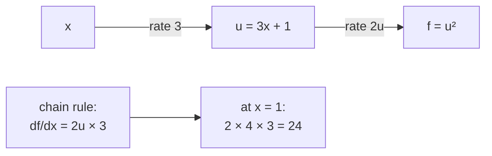

<!-- Written by `npm run lessons` from the lesson data in src/data. Edit the lesson there, not this page. -->

# Derivatives and the chain rule

**ML Foundations · Unit 1: Math foundations · Lesson 8 of 16**

> **In one line.** A derivative is the rate at which an output changes when you nudge the input; the chain rule says that for a function inside a function, you multiply the rates.

[Open this lesson on the site](https://learn.hamropedia.com/foundations/derivatives-and-the-chain-rule/) for its animation, the practice game and tap-to-explain words.

## The problem it solves

Training needs to know, for every weight: "if I nudge this a little, does the loss go up or down, and how fast?" That is a derivative. A network is functions nested inside functions, many layers deep, so the chain rule is what turns one loss into a derivative for every weight. Backpropagation is the chain rule, organised efficiently.

## The idea

A derivative is a rate of change: how much the output moves when the input moves a tiny bit. The chain rule: for a function inside a function, multiply the rates.

## How it works, step by step

1. Nudge the input and watch the output. For f(x) = (3x + 1)²: at x = 1, f = 16; at x = 1.01, f = 16.2409. The output moved 0.2409 for a 0.01 nudge, a rate of about 24.
2. The derivative is that rate as the nudge shrinks towards zero. On a graph, it is the slope of the tangent line at that point.
3. Split the function into a chain: u = 3x + 1 on the inside, then f = u² on the outside.
4. Find the rate of each link: du/dx = 3 and df/du = 2u. At x = 1, u = 4, so df/du = 8.
5. Multiply the rates along the chain: df/dx = df/du · du/dx = 8 · 3 = 24. A 0.01 nudge in x moves u by 0.03, which moves f by 0.24.
6. Check numerically: (f(x + h) − f(x − h)) / 2h with h = 1e-5 gives 24.0000. Always check hand-derived gradients this way.

## Picture it



*Follow the arrows: each step has its own rate of change, and the chain rule multiplies them.*

## Analogy

Gears. If gear A turns gear B 3 times faster, and B turns C 2 times faster, then A turns C 3 × 2 = 6 times faster.

**Where the analogy breaks.** Gear ratios are fixed. Derivatives change from point to point, so you calculate them at the current value.

## Worked example

f(x) = (3x + 1)². The inside is u = 3x + 1, with rate 3. The outside is u², with rate 2u. So f′(x) = 2(3x + 1)·3. At x = 1, that is 2·4·3 = 24. Backprop is just the chain rule, used many times.

```python
f = lambda x: (3*x + 1)**2
h = 1e-5
(f(1 + h) - f(1 - h)) / (2*h)   # ≈ 24.0, a numerical check
```

## Must know

- Rules to know: d/dx xⁿ = n·xⁿ⁻¹; d/dx eˣ = eˣ; d/dx ln x = 1/x; constants multiply through.
- Chain rule: d/dx f(g(x)) = f′(g(x))·g′(x). Multiply the rates along the chain.
- Positive derivative: the output rises when the input rises. Negative: it falls. Zero: flat, where a minimum can be.
- The sigmoid σ(x) = 1/(1 + e⁻ˣ) has derivative σ(x)(1 − σ(x)), never more than 0.25. Chain many of them and the product shrinks: vanishing gradients.
- Central differences are a cheap, reliable check of any derivative you work out by hand.

## Common mistakes

- Forgetting the inner rate: the derivative of (3x + 1)² is not just 2(3x + 1).
- Using the wrong values in the chain. Each rate is worked out at the current point (u = 4 here).
- Numerical derivatives with h far too small, like 1e-15: rounding errors swamp the answer.

> **Not true:** Numerical derivative: the smaller the step h, the more accurate the answer.  
> **In fact:** Only up to a point. With h as small as 1e-15, rounding errors swamp the tiny difference and the answer becomes wrong.

> **Not true:** d/dx (3x + 1)² = 2(3x + 1).  
> **In fact:** The chain rule also multiplies by the inner rate, which is 3. The derivative is 2(3x + 1) × 3 = 6(3x + 1).

## Practise

Try each one yourself first: on paper, in code or out loud. Then open the answer and compare.

### 1. Derive

Differentiate by hand: sin(x²), e^(3x + 1), log(1 + eˣ) and (2x + 1)³. Write the inner and outer rate for each.

<details>
<summary>Show one good answer</summary>

Chain rule: derivative = outer rate (at the inside) × inner rate.

sin(x²): inner x², rate 2x; outer sin, rate cos. Answer: cos(x²)·2x.

e^(3x + 1): inner 3x + 1, rate 3; outer eᵘ, rate eᵘ. Answer: 3e^(3x + 1).

log(1 + eˣ): inner 1 + eˣ, rate eˣ; outer log u, rate 1/u. Answer: eˣ / (1 + eˣ). That is the sigmoid function: the derivative of softplus is the sigmoid.

(2x + 1)³: inner 2x + 1, rate 2; outer u³, rate 3u². Answer: 3(2x + 1)²·2 = 6(2x + 1)².

At x = 0.5 these are about 0.969, 36.547, 0.622 and 24.

</details>

### 2. Build

Write a numerical derivative with the central difference, and check all four answers at x = 0.5.

<details>
<summary>Show one good answer</summary>

The central difference looks a little to both sides: f′(x) ≈ (f(x + h) − f(x − h)) / 2h. Its error shrinks with h², much faster than the one-sided (f(x + h) − f(x)) / h.

At x = 0.5, with h = 1e-5, all four numerical answers match the hand-derived formulas to about 8 or more digits.

```python
import numpy as np

def numerical_derivative(f, x, h=1e-5):
    return (f(x + h) - f(x - h)) / (2 * h)

cases = [
    (lambda x: np.sin(x**2),        lambda x: np.cos(x**2) * 2 * x),
    (lambda x: np.exp(3 * x + 1),   lambda x: 3 * np.exp(3 * x + 1)),
    (lambda x: np.log(1 + np.exp(x)), lambda x: np.exp(x) / (1 + np.exp(x))),
    (lambda x: (2 * x + 1) ** 3,    lambda x: 6 * (2 * x + 1) ** 2),
]
for f, df in cases:
    approx, exact = numerical_derivative(f, 0.5), df(0.5)
    print(round(exact, 6), f"{abs(approx - exact):.1e}")
    assert np.isclose(approx, exact, rtol=1e-6)
```

</details>

### 3. Break

Try step sizes h = 1e-1, 1e-5 and 1e-12 in your numerical derivative. Which is most accurate? Why do both too-big and too-small steps fail?

<details>
<summary>Show one good answer</summary>

h = 1e-5 is the most accurate, with an error around 1e-10 or smaller. Both extremes fail, for opposite reasons.

h = 1e-1 is too big: the formula assumes the curve is nearly straight between x − h and x + h. Over a wide step it isn't, so you get a truncation error, around 1e-3 to 1e-2 here.

h = 1e-12 is too small: f(x + h) and f(x − h) are now almost the same number, and floats keep only about 16 significant digits. Subtracting two nearly equal numbers wipes out most of those digits (catastrophic cancellation), and dividing by the tiny 2h magnifies what is left. The error comes back up, to about 1e-5: a million times worse than h = 1e-5.

The sweet spot for the central difference is roughly h ≈ 1e-5 to 1e-6, about the cube root of the float precision.

```python
import numpy as np

f = lambda x: np.sin(x**2)
exact = np.cos(0.25) * 2 * 0.5
for h in [1e-1, 1e-5, 1e-12]:
    approx = (f(0.5 + h) - f(0.5 - h)) / (2 * h)
    print(h, f"{abs(approx - exact):.1e}")
```

</details>

### 4. Explain

Explain the chain rule with the gears picture.

<details>
<summary>Show one good answer</summary>

Think of gears. If gear A turns gear B 3 times as fast, and B turns gear C 2 times as fast, then A turns C 3 × 2 = 6 times as fast. You multiply the rates along the chain.

The chain rule is the same: for f(g(x)), how fast the output changes with x is (how fast f changes with g) × (how fast g changes with x). Each function in the chain is one gear, and the overall rate is all the gear ratios multiplied together. Backpropagation is this rule applied through every layer of a network.

</details>

## Check you understood

Answer in your head first, then open each one.

<details>
<summary>&lt;b>What is the derivative of x³ at x = 2?&lt;/b></summary>

3x² = 12.

</details>

<details>
<summary>&lt;b>Differentiate e^(2x).&lt;/b></summary>

Outer rate e^u, inner rate 2, so 2e^(2x).

</details>

<details>
<summary>&lt;b>Why is backpropagation "just the chain rule"?&lt;/b></summary>

A network is a long chain of simple functions. The gradient of the loss with respect to an early weight is the product of the local rates along the chain from that weight to the loss.

</details>

<details>
<summary>&lt;b>What is the largest value of the sigmoid's derivative, and why does it matter?&lt;/b></summary>

0.25, at x = 0. Multiplying many factors of at most 0.25 through deep layers makes gradients vanish.

</details>

## Go further (optional)

The lesson above is enough on its own. These free extras give a second explanation.

- WATCH · [Essence of Calculus, Ch 2: The paradox of the derivative](https://www.3blue1brown.com/lessons/derivatives) · 3Blue1Brown
- WATCH · [Essence of Calculus, Ch 4: Visualizing the chain rule and product rule](https://www.3blue1brown.com/lessons/chain-rule-and-product-rule) · 3Blue1Brown
- READ · [Mathematics for Machine Learning, Ch 5 (differentiation, the chain rule)](https://mml-book.github.io/) · Deisenroth, Faisal, Ong · free

---

[← SVD, and the maths behind PCA](svd-and-the-maths-behind-pca.md) · [All lessons](../../README.md) · [Partial derivatives, gradients and Jacobians →](partial-derivatives-gradients-and-jacobians.md)
