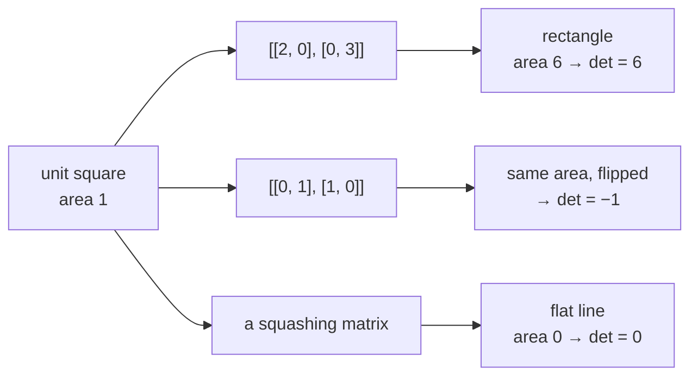

<!-- Written by `npm run lessons` from the lesson data in src/data. Edit the lesson there, not this page. -->

# Determinants

**ML Foundations · Unit 1: Math foundations · Lesson 3 of 16**

> **In one line.** The determinant of a square matrix is one number: how much the matrix scales area (or volume), with a minus sign if it flips space over.

[Open this lesson on the site](https://learn.hamropedia.com/foundations/determinants/) for its animation, the practice game and tap-to-explain words.

## The problem it solves

You often need to know at a glance whether a matrix squashes space flat, because then it can't be undone and Ax = b has no unique answer. The determinant tells you: zero means squashed. It also appears whenever probabilities are moved through a transformation, as in the formula for a multivariate Gaussian and in normalising flows.

## The idea

The determinant has two parts. Its size tells you how much the matrix scales area (or volume in 3D). Its sign tells you whether space gets flipped over.

## How it works, step by step

1. Start with the unit square: sides [1, 0] and [0, 1], area 1.
2. Apply the matrix. The square becomes a parallelogram whose sides are the matrix's two columns.
3. The determinant is that parallelogram's area, with a sign. For [[a, b], [c, d]] it is ad − bc.
4. [[2, 0], [0, 3]] gives 2·3 − 0·0 = 6, so every area grows 6 times.
5. A shear like [[1, 1], [0, 1]] gives 1·1 − 1·0 = 1. The square leans over but keeps its area.
6. [[0, 1], [1, 0]] swaps x and y: 0·0 − 1·1 = −1. Same area, but space is flipped like a mirror image.
7. [[2, 4], [1, 2]] gives 2·2 − 4·1 = 0. Both columns lie on one line, so the square is squashed flat, and the matrix has no inverse.

## Picture it



*The size of the determinant says how much area grows; a minus sign means space was flipped; zero means it was squashed flat.*

## Analogy

Stretching a rubber sheet with a square drawn on it. The determinant says how much bigger the square becomes.

**Where the analogy breaks.** A rubber sheet cannot pass through itself. A negative determinant does exactly that: it is like seeing the sheet in a mirror.

## Worked example

[[2, 0], [0, 3]] has det = 6: a 1×1 square becomes a 2×3 rectangle, area 6. [[0, 1], [1, 0]] has det = −1: the area stays the same, but x and y swap, so space is flipped. det = 0 means space is squashed flat, onto a line or a point.

```python
np.linalg.det(np.array([[2, 0], [0, 3]]))   # ≈ 6.0
```

## Must know

- \|det\| is how much areas (in 2-D) or volumes (in 3-D) are scaled.
- det &lt; 0 means space is flipped; det = 0 means space is squashed into fewer dimensions.
- det = 0 ⇔ no inverse ⇔ the columns are dependent ⇔ the rank is not full.
- For a 2 × 2 matrix [[a, b], [c, d]], the determinant is ad − bc.
- det(AB) = det(A)·det(B): when you chain movements, their scale factors multiply.
- For big matrices use np.linalg.slogdet, which returns the log, because determinants can be astronomically large or small.

## Common mistakes

- Using "the determinant is tiny" as a test for "nearly impossible to invert". 0.1 × the 100 × 100 identity has det 10⁻¹⁰⁰ but is trivial to invert. The condition number is the right measure.
- Treating a negative determinant as an error. It just means a flip.
- Asking for the determinant of a non-square matrix. It only exists for square ones.

> **Not true:** \|det\| tiny (say 10⁻¹⁰⁰) = a matrix that is very hard to invert.  
> **In fact:** Not always: 0.1 times the 100 × 100 identity has a determinant of 10⁻¹⁰⁰, yet it is trivial to invert. The condition number is the right test.

> **Not true:** Determinant of a 2 × 3 matrix: the product of its diagonal entries.  
> **In fact:** A determinant exists only for square matrices. A 2 × 3 matrix has none.

## Practise

Try each one yourself first: on paper, in code or out loud. Then open the answer and compare.

### 1. Derive

By hand, compute the determinants of [[3, 1], [2, 4]], [[1, 2], [2, 4]] and [[0, 1], [1, 0]]. For each, say what happens to the unit square: its size, and whether it flips.

<details>
<summary>Show one good answer</summary>

For a 2 × 2 matrix [[a, b], [c, d]], the determinant is a·d − b·c.

[[3, 1], [2, 4]]: 3·4 − 1·2 = 10. The unit square becomes a shape 10 times bigger in area. Positive, so no flip.

[[1, 2], [2, 4]]: 1·4 − 2·2 = 0. The square is squashed flat onto a line, with area 0. The two columns, [1, 2] and [2, 4], point the same way, so they only reach one line.

[[0, 1], [1, 0]]: 0·0 − 1·1 = −1. Same area, but negative: space is flipped like a mirror image, with x and y swapped (a reflection across the line y = x).

</details>

### 2. Build

Write det2(A) for 2 × 2 matrices and det3(A) with cofactor expansion. Check them against np.linalg.det, then check numerically that det(AB) = det(A) · det(B).

<details>
<summary>Show one good answer</summary>

det2 is a·d − b·c. det3 expands along the first row: each entry times the determinant of the 2 × 2 matrix left when you cross out its row and column, with signs +, −, +.

Both match np.linalg.det on random matrices, and det(A·B) equals det(A)·det(B): scaling area by one, then the other, multiplies the scalings.

```python
import numpy as np

def det2(A):
    return A[0, 0] * A[1, 1] - A[0, 1] * A[1, 0]

def det3(A):
    total = 0.0
    for j in range(3):
        minor = np.delete(np.delete(A, 0, axis=0), j, axis=1)   # cross out row 0, column j
        total += (-1) ** j * A[0, j] * det2(minor)
    return total

rng = np.random.default_rng(0)
A2, A3, B3 = rng.normal(size=(2, 2)), rng.normal(size=(3, 3)), rng.normal(size=(3, 3))
assert np.isclose(det2(A2), np.linalg.det(A2))
assert np.isclose(det3(A3), np.linalg.det(A3))
assert np.isclose(det3(A3 @ B3), det3(A3) * det3(B3))
print(det2(np.array([[3, 1], [2, 4]])))     # 10
```

</details>

### 3. Break

Take a 3 × 3 matrix whose third row is the sum of the first two, and add tiny noise (about 1e-10). Is its determinant exactly 0? What does that mean for testing 'is it invertible?' in code?

<details>
<summary>Show one good answer</summary>

It is not exactly 0. With noise of 1e-10 you get a tiny number instead, and even with no noise at all, rounding usually leaves something around 1e-16 instead of a perfect 0.

So never test "is it invertible?" with det(A) == 0. A tiny but non-zero determinant looks invertible, yet the matrix is almost flat, and solving with it amplifies errors enormously.

The determinant is also a poor measure of "almost flat", because it depends on scale: 0.1 times the 10 × 10 identity has a determinant of 1e-10, yet it is perfectly well behaved. Use np.linalg.matrix_rank, which uses a sensible tolerance, or np.linalg.cond: a huge condition number means "close to singular".

```python
import numpy as np

rng = np.random.default_rng(0)
r1, r2 = rng.normal(size=3), rng.normal(size=3)
A = np.array([r1, r2, r1 + r2])
print(np.linalg.det(A))                                # tiny, not exactly 0
noisy = A + rng.normal(scale=1e-10, size=(3, 3))
print(np.linalg.det(noisy))                            # still tiny, not 0
print(np.linalg.matrix_rank(A), f"{np.linalg.cond(noisy):.0e}")   # 2, huge
print(np.linalg.det(0.1 * np.eye(10)))                 # 1e-10, yet perfectly invertible
```

</details>

### 4. Explain

Explain both parts of the determinant, size and sign, with the rubber-sheet picture.

<details>
<summary>Show one good answer</summary>

Draw a square on a rubber sheet and stretch the sheet with the matrix.

The size of the determinant says how much the square's area is multiplied: 3 means three times the area, 0.5 means half, and 0 means the sheet was squashed flat onto a line, so no area is left.

The sign says whether the sheet was flipped over. Positive: it still faces up. Negative: it was turned over like a mirror image, so the order of the corners, clockwise or anticlockwise, is reversed.

</details>

## Check you understood

Answer in your head first, then open each one.

<details>
<summary>&lt;b>What is det [[4, 2], [1, 3]]?&lt;/b></summary>

4·3 − 2·1 = 10. Areas grow 10 times, with no flip.

</details>

<details>
<summary>&lt;b>A matrix has determinant 0. What does that tell you?&lt;/b></summary>

It squashes space onto a line or a point, so its columns are dependent and it has no inverse.

</details>

<details>
<summary>&lt;b>det(A) = 2 and det(B) = −3. What is det(AB)?&lt;/b></summary>

−6. Scale factors multiply, and one flip makes the result flipped.

</details>

<details>
<summary>&lt;b>Why is "det(A) is close to 0" a poor test for "A is nearly singular"?&lt;/b></summary>

The determinant changes hugely just by rescaling: 0.1 × the identity in 100 dimensions has det 10⁻¹⁰⁰ yet is perfectly easy to invert.

</details>

## Go further (optional)

The lesson above is enough on its own. These free extras give a second explanation.

- WATCH · [Essence of Linear Algebra, Ch 6: The determinant](https://www.3blue1brown.com/lessons/determinant) · 3Blue1Brown  
  **Worth it:** Areas growing, shrinking and flipping as the matrix moves space. After this the determinant stops being a formula and becomes a picture.
- READ · [Mathematics for Machine Learning, Ch 4 (determinant and trace)](https://mml-book.github.io/) · Deisenroth, Faisal, Ong · free

---

[← Matrices as transformations; matrix multiplication](matrices-as-transformations-matrix-multiplication.md) · [All lessons](../../README.md) · [Inverse, rank and solving Ax = b →](inverse-rank-and-solving-ax-b.md)
