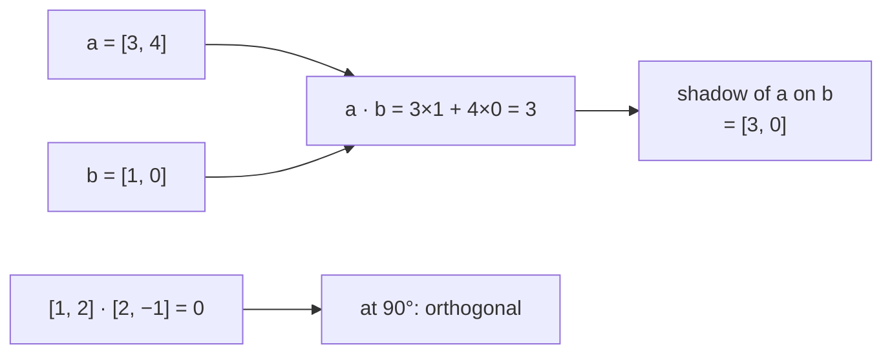

<!-- Written by `npm run lessons` from the lesson data in src/data. Edit the lesson there, not this page. -->

# Dot product, projection and orthogonality

**ML Foundations · Unit 1: Math foundations · Lesson 5 of 16**

> **In one line.** The dot product multiplies two vectors entry by entry and adds the results. It measures how much they point the same way, and it gives the length of one vector's shadow on another.

[Open this lesson on the site](https://learn.hamropedia.com/foundations/dot-product-projection-and-orthogonality/) for its animation, the practice game and tap-to-explain words.

## The problem it solves

ML constantly asks "how similar are these two things?": two documents in search, a query and a key in attention, an input and a neuron's weights. The dot product answers with one cheap number. Projection, built from the dot product, keeps only the part of a vector that lies along a direction, which is the idea behind least squares and PCA.

## The idea

The dot product multiplies matching entries and adds them up. It measures how much two vectors point the same way. A dot product of 0 means they are at 90° (orthogonal). A projection is the 'shadow' of one vector on another.

## How it works, step by step

1. Multiply matching entries and add: for a = [3, 4] and b = [1, 0], a·b = 3·1 + 4·0 = 3.
2. The same number in geometry: a·b = \|a\|·\|b\|·cos θ, where θ is the angle between them. \|a\| = 5 and \|b\| = 1, so cos θ = 3/5 and θ ≈ 53°.
3. The sign gives the direction: positive means the angle is under 90°, zero means exactly 90° (orthogonal), negative means over 90°.
4. The projection of a onto b is a's shadow on the line through b: (a·b / b·b)·b = (3/1)·[1, 0] = [3, 0].
5. What is left over, a − projection = [0, 4], is orthogonal to b: [0, 4]·[1, 0] = 0. Projection splits a vector into "along b" plus "at right angles to b".
6. Cosine similarity divides out the lengths: cos θ = a·b / (\|a\|\|b\|). It runs from −1 (opposite) to 1 (same direction) and ignores length, which is why search uses it.

## Picture it



*The dot product measures how much two vectors point the same way. Zero means they're at right angles.*

## Analogy

Pulling a box with a rope at an angle. Only the part of your pull along the floor moves the box. That part is the projection.

**Where the analogy breaks.** Your pull is a physical force in 2D or 3D. A dot product works for any vectors, even word embeddings with 768 numbers.

## Worked example

a = [3, 4], b = [1, 0]: a·b = 3, and the shadow of a on b is [3, 0]. [1, 2]·[2, −1] = 2 − 2 = 0, so these two are orthogonal. Cosine similarity, used in search, is the dot product of two vectors after scaling them to length 1.

```python
a = np.array([3., 4.]); b = np.array([1., 0.])
proj = (a @ b) / (b @ b) * b    # [3., 0.]
```

## Must know

- The dot product two ways: a·b = Σ aᵢbᵢ (multiply matching entries and add) = \|a\|\|b\| cos θ (the two lengths times the cosine of the angle between them).
- A dot product of 0 means the two vectors are orthogonal: at 90° to each other.
- A vector dotted with itself gives its length squared: a·a = \|a\|², so its length is √(a·a).
- Projection of a onto b: (a·b / b·b)·b. The leftover part is orthogonal to b.
- Cosine similarity is the dot product after scaling both vectors to length 1.
- A matrix–vector product is a list of dot products: each output is one row of the matrix dotted with the vector.

## Common mistakes

- Comparing similarity with the raw dot product when lengths differ a lot. Long vectors win just for being long; use cosine similarity.
- Forgetting to divide by b·b in the projection when b is not length 1.
- Dividing by a zero-length vector in cosine similarity.

> **Not true:** Similarity of two vectors: the raw dot product a·b, whether they are long or short.  
> **In fact:** A long vector gets a large dot product just for being long. Cosine similarity divides by both lengths, so only the direction counts.

> **Not true:** Cosine similarity with a zero-length vector: 0.  
> **In fact:** A zero-length vector makes the formula divide by 0, so the cosine has no value at all. Check for zero vectors before dividing.

## Practise

Try each one yourself first: on paper, in code or out loud. Then open the answer and compare.

### 1. Derive

By hand, project a = [2, 3] onto b = [1, 1]. Then show that a minus its projection is orthogonal to b.

<details>
<summary>Show one good answer</summary>

The projection of a onto b is (a·b / b·b)·b.

a·b = 2·1 + 3·1 = 5 and b·b = 1 + 1 = 2, so proj = (5/2)·[1, 1] = [2.5, 2.5].

What is left over: a − proj = [2 − 2.5, 3 − 2.5] = [−0.5, 0.5].

Is it orthogonal to b? [−0.5, 0.5]·[1, 1] = −0.5 + 0.5 = 0 ✓. That is the point of a projection: it splits a into a part along b and a part at right angles to b.

</details>

### 2. Build

Write cosine_similarity(u, v) and project(a, b). Use them to find the most similar pair among five small word vectors you make up.

<details>
<summary>Show one good answer</summary>

cosine_similarity(u, v) = u·v / (\|u\|·\|v\|): 1 means the same direction, 0 means at right angles, −1 means opposite. project(a, b) = (a·b / b·b)·b.

With made-up vectors whose three numbers mean roughly "royalty, food, vehicle", the most similar pair is king and queen, and apple and banana come next. That is exactly how semantic search ranks results, with real embeddings instead of three hand-written numbers.

```python
import itertools
import numpy as np

def cosine_similarity(u, v):
    return u @ v / (np.linalg.norm(u) * np.linalg.norm(v))

def project(a, b):
    return (a @ b) / (b @ b) * b

words = {                       # made-up: royalty, food, vehicle
    "king":   np.array([0.9, 0.1, 0.0]),
    "queen":  np.array([0.85, 0.15, 0.05]),
    "apple":  np.array([0.0, 0.9, 0.1]),
    "banana": np.array([0.05, 0.95, 0.0]),
    "car":    np.array([0.1, 0.0, 0.95]),
}
pairs = sorted(itertools.combinations(words, 2),
               key=lambda p: -cosine_similarity(words[p[0]], words[p[1]]))
for a, b in pairs[:2]:
    print(a, b, round(cosine_similarity(words[a], words[b]), 3))
print(project(np.array([2., 3.]), np.array([1., 1.])))   # [2.5 2.5]
```

</details>

### 3. Break

Call cosine_similarity with a zero vector. What happens? Handle it properly and add a test.

<details>
<summary>Show one good answer</summary>

With a zero vector, the bottom of the fraction is 0, so NumPy returns nan with a "invalid value encountered" warning. A zero vector has no direction, so "the angle between them" means nothing.

Handle it on purpose rather than letting nan spread silently through your results. Two reasonable choices: raise an error (best when a zero vector means a bug upstream), or return 0.0, "not similar to anything" (common in search, where an empty document shouldn't crash anything). Pick one and test it.

```python
import numpy as np
import pytest

def cosine_similarity(u, v):
    nu, nv = np.linalg.norm(u), np.linalg.norm(v)
    if nu == 0 or nv == 0:
        raise ValueError("cosine similarity is undefined for a zero vector")
    return u @ v / (nu * nv)

def test_zero_vector_raises():
    with pytest.raises(ValueError):
        cosine_similarity(np.zeros(3), np.ones(3))

def test_same_direction_is_one():
    assert np.isclose(cosine_similarity(np.array([1., 2.]), np.array([2., 4.])), 1.0)
```

</details>

### 4. Explain

Explain why two vectors at 90° have a dot product of 0, using the rope-and-box picture.

<details>
<summary>Show one good answer</summary>

The dot product measures how much of one vector goes along the other: a·b = \|a\|·\|b\|·cos(angle).

Pull a box with a rope. If the rope is flat along the floor, all your pull moves the box. Raise the rope and less of the pull goes along the floor. Pull straight up, at 90° to the floor, and none of the pull goes along the floor: the box doesn't slide at all. That "along the floor" part is the projection, and at 90° it is 0, because cos 90° = 0. So two vectors at right angles have a dot product of 0: neither has any part along the other.

</details>

## Check you understood

Answer in your head first, then open each one.

<details>
<summary>&lt;b>Compute [2, −1, 3]·[4, 5, 0].&lt;/b></summary>

8 − 5 + 0 = 3.

</details>

<details>
<summary>&lt;b>Are [1, 1] and [1, −1] orthogonal?&lt;/b></summary>

Yes: 1·1 + 1·(−1) = 0.

</details>

<details>
<summary>&lt;b>Two embeddings have cosine similarity 0.95. What does that mean?&lt;/b></summary>

They point in almost the same direction, about 18° apart, so the model treats the two things as very similar.

</details>

<details>
<summary>&lt;b>Project [2, 3] onto [1, 0].&lt;/b></summary>

(2/1)·[1, 0] = [2, 0]: its shadow on the x-axis.

</details>

## Go further (optional)

The lesson above is enough on its own. These free extras give a second explanation.

- WATCH · [Essence of Linear Algebra, Ch 9: Dot products and duality](https://www.3blue1brown.com/lessons/dot-products) · 3Blue1Brown
- READ · [Mathematics for Machine Learning, Ch 3 (inner products, orthogonality, projections)](https://mml-book.github.io/) · Deisenroth, Faisal, Ong · free
- WATCH · [18.06 lecture: Projections onto subspaces](https://www.youtube.com/results?search_query=Gilbert+Strang+18.06+projections+onto+subspaces) · Gilbert Strang (MIT)

---

[← Inverse, rank and solving Ax = b](inverse-rank-and-solving-ax-b.md) · [All lessons](../../README.md) · [Eigenvalues and eigenvectors →](eigenvalues-and-eigenvectors.md)
