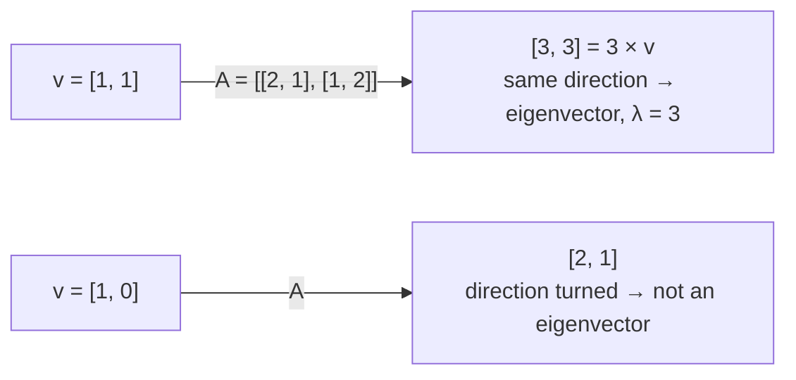

<!-- Written by `npm run lessons` from the lesson data in src/data. Edit the lesson there, not this page. -->

# Eigenvalues and eigenvectors

**ML Foundations · Unit 1: Math foundations · Lesson 6 of 16**

> **In one line.** An eigenvector of a matrix is a direction the matrix does not turn, only stretches. Its eigenvalue is how much it is stretched.

[Open this lesson on the site](https://learn.hamropedia.com/foundations/eigenvalues-and-eigenvectors/) for its animation, the practice game and tap-to-explain words.

## The problem it solves

A matrix moves vectors in a confusing mix of turning and stretching. Eigenvectors find the special directions where it acts like plain multiplication, which makes the matrix easy to understand. They give the main directions of variation in data (PCA), tell you whether repeated multiplication explodes or fades (RNNs, Markov chains), and explain how fast gradient descent converges.

## The idea

An eigenvector is a direction that a matrix does not turn. It only stretches or shrinks it. The eigenvalue is the stretch factor: Av = λv.

## How it works, step by step

1. Apply A = [[2, 1], [1, 2]] to many directions and see which ones stay on their own line. Most are knocked off: [1, 0] becomes [2, 1], a different direction.
2. [1, 1] becomes [3, 3] = 3·[1, 1]: same direction, 3 times longer. That is an eigenvector with eigenvalue 3.
3. [1, −1] becomes [1, −1]: unchanged. An eigenvector with eigenvalue 1.
4. To find them by hand, solve det(A − λI) = 0. Here (2 − λ)² − 1 = 0, so λ = 3 or λ = 1.
5. For each λ, solve (A − λI)v = 0 to get its direction. Any non-zero multiple of v is also an eigenvector.
6. In the eigenvector directions, A just stretches: 3× along [1, 1] and 1× along [1, −1]. Applying A ten times stretches by 3¹⁰ and 1¹⁰, so repeated use is easy to predict.

## Picture it



*An eigenvector keeps its direction under the matrix and is only stretched; the stretch factor is its eigenvalue.*

## Analogy

A spinning globe. Every point moves, except the points on the axis. The axis is an eigenvector, with λ = 1.

**Where the analogy breaks.** A 2D rotation has no real eigenvectors at all: it turns every direction.

## Worked example

A = [[2, 1], [1, 2]]. For v = [1, 1], Av = [3, 3] = 3v, so λ = 3. For v = [1, −1], Av = [1, −1], so λ = 1. In PCA, the main directions of the data are the eigenvectors of the covariance matrix.

```python
A = np.array([[2., 1.], [1., 2.]])
vals, vecs = np.linalg.eigh(A)   # eigh is for symmetric matrices
vals                              # [1., 3.]
```

## Must know

- Av = λv: the direction is unchanged and the length is multiplied by λ (a negative λ flips it).
- Find λ from det(A − λI) = 0, then v from (A − λI)v = 0.
- Symmetric matrices, like covariance matrices, have real eigenvalues and orthogonal eigenvectors. Use np.linalg.eigh for them.
- The eigenvalues multiply to the determinant and add up to the trace (the sum of the diagonal).
- Repeated multiplication: \|λ\| > 1 grows, \|λ\| &lt; 1 fades. This is the root of exploding and vanishing gradients.
- PCA's main directions are the eigenvectors of the data's covariance matrix, ordered by eigenvalue.

## Common mistakes

- Expecting every matrix to have real eigenvectors. A 2-D rotation turns every direction, so its eigenvalues are complex.
- Expecting eigenvectors to have a particular length. Any multiple works; libraries return length 1.
- Using np.linalg.eig on a symmetric matrix. eigh is faster, more accurate, and returns real, sorted values.

> **Not true:** Every matrix has at least one real direction that it only stretches.  
> **In fact:** A rotation in 2-D turns every direction, so it has no real eigenvector: its eigenvalues are complex numbers.

> **Not true:** An eigenvector has length 1, and a longer copy of it is not an eigenvector.  
> **In fact:** Any multiple of an eigenvector is an eigenvector too. Libraries return length 1 only as a convention.

## Go deeper (optional): Why multiplying by A again and again finds the biggest eigenvector

1. Take a matrix with eigenvectors v₁ and v₂ and eigenvalues λ₁ and λ₂, where \|λ₁\| is the bigger one. In the lesson's example, v₁ = [1, 1] with λ₁ = 3, and v₂ = [1, −1] with λ₂ = 1.
2. Any starting vector is a mix of the two: x = c₁v₁ + c₂v₂. For example [1, 0] = 0.5·[1, 1] + 0.5·[1, −1].
3. Apply A once. Each eigenvector is only stretched, so Ax = c₁λ₁v₁ + c₂λ₂v₂.
4. Apply it k times: Aᵏx = c₁λ₁ᵏv₁ + c₂λ₂ᵏv₂ = λ₁ᵏ·(c₁v₁ + c₂(λ₂/λ₁)ᵏv₂).
5. Because \|λ₂/λ₁\| &lt; 1, the second part shrinks every round: here by a factor of 3 each time. After 10 rounds it is 59,049 times smaller.
6. Rescale the vector to length 1 after each round, so the numbers don't overflow. What is left points along v₁. This method is called power iteration.

**The result.** Aᵏx lines up with the eigenvector of the largest \|λ\|, and the error shrinks by \|λ₂/λ₁\| each round. It needs c₁ ≠ 0 and one eigenvalue that is strictly the largest.

## Practise

Try each one yourself first: on paper, in code or out loud. Then open the answer and compare.

### 1. Derive

By hand, find the eigenvalues and eigenvectors of [[4, 1], [2, 3]], using det(A − λI) = 0.

<details>
<summary>Show one good answer</summary>

Solve det(A − λI) = 0:  
(4 − λ)(3 − λ) − 1·2 = λ² − 7λ + 12 − 2 = λ² − 7λ + 10 = (λ − 5)(λ − 2) = 0.  
So the eigenvalues are λ = 5 and λ = 2.

For λ = 5: A − 5I = [[−1, 1], [2, −2]]. The first row says −x + y = 0, so y = x. Eigenvector [1, 1]. Check: A·[1, 1] = [5, 5] = 5·[1, 1] ✓.

For λ = 2: A − 2I = [[2, 1], [2, 1]], so 2x + y = 0 and y = −2x. Eigenvector [1, −2]. Check: A·[1, −2] = [4 − 2, 2 − 6] = [2, −4] = 2·[1, −2] ✓.

Any multiple of an eigenvector is also an eigenvector, so [2, 2] or [0.707, 0.707] are equally right.

</details>

### 2. Build

Write power iteration to find the largest eigenvalue and its eigenvector. Compare with np.linalg.eig.

<details>
<summary>Show one good answer</summary>

Power iteration: start with a random vector, multiply by A, rescale to length 1, and repeat. Each multiplication stretches the part along the biggest eigenvector the most, so after a few dozen steps only that direction is left. The eigenvalue is then v·Av (the Rayleigh quotient).

For [[4, 1], [2, 3]] it finds 5 and [0.707, 0.707], the same as np.linalg.eig.

```python
import numpy as np

def power_iteration(A, steps=100, seed=0):
    v = np.random.default_rng(seed).normal(size=A.shape[0])
    for _ in range(steps):
        v = A @ v
        v = v / np.linalg.norm(v)
    return v @ A @ v, v

A = np.array([[4., 1.], [2., 3.]])
value, vector = power_iteration(A)
print(round(value, 6), vector.round(3))        # 5.0 [0.707 0.707]
values, vectors = np.linalg.eig(A)
print(values, vectors[:, np.argmax(values)].round(3))
```

</details>

### 3. Break

Run power iteration on the rotation matrix [[0, −1], [1, 0]]. What happens, and why does it never settle?

<details>
<summary>Show one good answer</summary>

It never settles. Each multiplication turns the vector by another 90°, so it goes round and round and comes back to where it started every 4 steps.

Why: a rotation leaves no direction unchanged, so it has no real eigenvectors. Its eigenvalues are the complex numbers i and −i. Power iteration also needs one eigenvalue that is strictly bigger in size than all the others, so one direction can win. Here both have size 1, so neither wins.

The lesson: power iteration only works when there is a single dominant eigenvalue, and it slows down when the top two are close in size.

```python
import numpy as np

R = np.array([[0., -1.], [1., 0.]])
v = np.array([1., 0.])
for step in range(5):
    print(step, v)
    v = R @ v                    # [1,0] → [0,1] → [-1,0] → [0,-1] → [1,0]
print(np.linalg.eig(R)[0])       # [0.+1.j 0.-1.j]: complex, both size 1
```

</details>

### 4. Explain

Explain eigenvectors with the spinning-globe picture, then say where the picture breaks.

<details>
<summary>Show one good answer</summary>

Spin a globe. Every point on the surface moves, except the points on the axis, which stay exactly where they are. The axis is an eigenvector: a direction the transformation doesn't turn. Its eigenvalue says how much things along it are stretched; for a spin, that is 1, no stretch at all.

Where the picture breaks: most matrices don't spin, they stretch. For them, an eigenvector stays on its own line but gets longer or shorter (λ = 3 triples it, λ = 0.5 halves it), and a negative λ flips it to point the other way. Also, a flat 2D rotation has no axis at all, so it has no real eigenvectors. And a matrix can have several eigenvectors that aren't at right angles to each other, unlike the one axis of a globe.

</details>

## Check you understood

Answer in your head first, then open each one.

<details>
<summary>&lt;b>Is [1, 0] an eigenvector of [[3, 0], [0, 5]]? With what eigenvalue?&lt;/b></summary>

Yes, with eigenvalue 3: the matrix sends it to [3, 0].

</details>

<details>
<summary>&lt;b>What are the eigenvalues of a diagonal matrix?&lt;/b></summary>

The numbers on its diagonal; the axes are its eigenvectors.

</details>

<details>
<summary>&lt;b>A matrix has eigenvalues 0.5 and 0.9. What happens if you apply it 100 times?&lt;/b></summary>

Everything shrinks towards zero, because 0.5¹⁰⁰ and 0.9¹⁰⁰ are tiny. The 0.9 direction fades slowest.

</details>

<details>
<summary>&lt;b>Why does a 90° rotation have no real eigenvectors?&lt;/b></summary>

It turns every direction by 90°, so no direction stays on its own line.

</details>

## Go further (optional)

The lesson above is enough on its own. These free extras give a second explanation.

- WATCH · [Essence of Linear Algebra, Ch 14: Eigenvectors and eigenvalues](https://www.3blue1brown.com/lessons/eigenvalues) · 3Blue1Brown  
  **Worth it:** Watching vectors get knocked off their lines while the eigenvectors stay put is the moment eigenvectors make sense. Worth it before PCA.
- PLAY · [Eigenvectors and Eigenvalues, explained visually](https://setosa.io/ev/eigenvectors-and-eigenvalues/) · Setosa · drag the vectors yourself
- READ · [Mathematics for Machine Learning, Ch 4 (eigenvalues, eigendecomposition)](https://mml-book.github.io/) · Deisenroth, Faisal, Ong · free

---

[← Dot product, projection and orthogonality](dot-product-projection-and-orthogonality.md) · [All lessons](../../README.md) · [SVD, and the maths behind PCA →](svd-and-the-maths-behind-pca.md)
