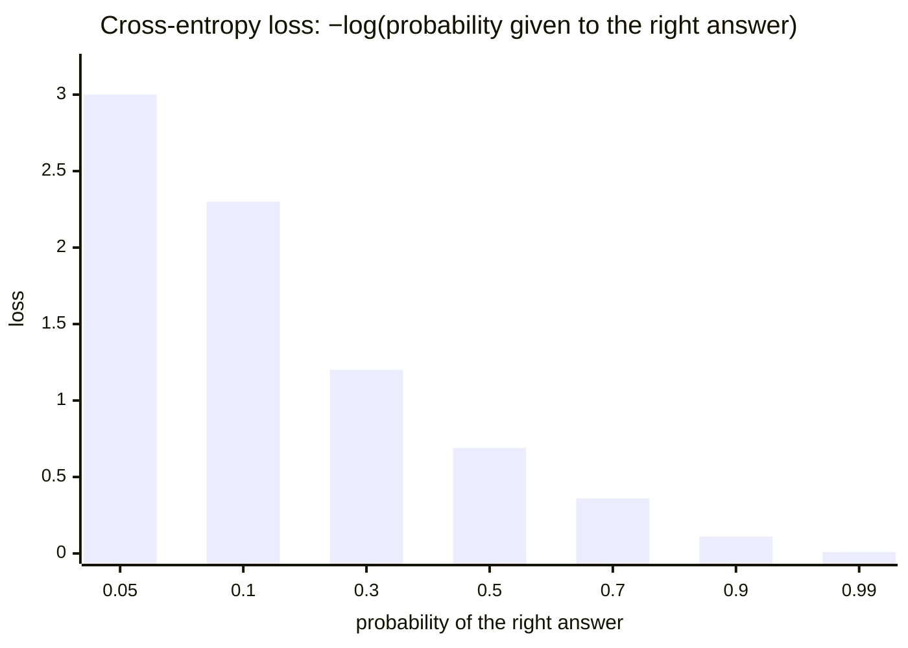

<!-- Written by `npm run lessons` from the lesson data in src/data. Edit the lesson there, not this page. -->

# Entropy, cross-entropy and KL divergence

**ML Foundations · Unit 1: Math foundations · Lesson 15 of 16**

> **In one line.** Entropy measures how uncertain a distribution is. Cross-entropy measures how surprised a model is by the real data, and KL divergence is the extra surprise that comes from the model being wrong.

[Open this lesson on the site](https://learn.hamropedia.com/foundations/entropy-cross-entropy-and-kl-divergence/) for its animation, the practice game and tap-to-explain words.

## The problem it solves

A classifier outputs probabilities, and you need a loss that rewards putting high probability on the right answer and punishes confident mistakes hard. Cross-entropy is that loss, and nearly every classifier and every language model is trained on it. KL divergence measures how far apart two distributions are, and it shows up in VAEs, knowledge distillation and RLHF.

## The idea

Entropy measures uncertainty, or 'surprise', in a distribution. Cross-entropy measures your surprise when you use your model q to predict data that really comes from p. KL divergence is the extra surprise: KL(p‖q) = cross-entropy − entropy.

## How it works, step by step

1. The surprise of an event with probability q is −log q. Certain events (q = 1) cost 0; rare ones cost a lot.
2. Entropy is the average surprise under the true distribution: H(p) = −Σ p log p. A coin that lands heads 70% of the time has about 0.88 bits; a certain outcome has 0.
3. Cross-entropy uses the model's probabilities for the surprise but the true distribution for the averaging: H(p, q) = −Σ p log q.
4. With a one-hot true label, every term but one vanishes: the loss is −log of the probability the model gave the right class. For 0.7 that is 0.357.
5. If the model had said 0.99, the loss would be about 0.01; if it had said 0.05, about 3.0. Confident mistakes are punished hardest.
6. KL(p ‖ q) = H(p, q) − H(p). It is never negative, and it is 0 only when q = p. H(p) doesn't depend on the model, so minimising cross-entropy also minimises KL.

## Picture it



*Being confidently wrong is punished hard; being confidently right costs almost nothing. That's the loss classifiers are trained on.*

## Analogy

Packing for a trip. With the true weather forecast (p), you pack exactly right. With a wrong forecast (q), you pack badly. KL is the extra, wasted luggage.

**Where the analogy breaks.** In the analogy, swapping the two forecasts feels like the same mistake. KL is not symmetric: KL(p‖q) is usually different from KL(q‖p).

## Worked example

The true label is class 1 of 3, so p = [0, 1, 0]. The model says q = [0.2, 0.7, 0.1]. Cross-entropy = −log(0.7) ≈ 0.357. If the model said 0.99, the loss would be about 0.01. Here the entropy of p is 0, so KL equals the cross-entropy.

```python
q = np.array([0.2, 0.7, 0.1])
-np.log(q[1])   # ≈ 0.357
```

## Must know

- Surprise = −log(probability). The natural log gives nats; log base 2 gives bits.
- Entropy H(p) = −Σ p log p: highest for a uniform distribution, zero for a certain one.
- Cross-entropy H(p, q) = −Σ p log q, and it is always at least H(p).
- KL divergence is cross-entropy minus entropy: KL(p ‖ q) = H(p, q) − H(p). It is never negative, and it is not symmetric.
- Classification loss = −log(probability of the true class), averaged over examples.
- Language models are trained on exactly this: −log P(the next token).

## Common mistakes

- Taking the log of a probability that is exactly 0: −log 0 is infinite. Work with logits and log-softmax instead.
- Treating KL divergence as a distance. It is not symmetric: KL(p ‖ q) ≠ KL(q ‖ p).
- Swapping the roles in cross-entropy: the true distribution does the averaging, and the model supplies the logs.

> **Not true:** KL divergence is a true distance: KL(p ‖ q) always equals KL(q ‖ p).  
> **In fact:** KL divergence is not symmetric, so it is not a distance. Swapping p and q usually changes its value.

> **Not true:** Cross-entropy stays small when the model gives the true class a probability close to 0.  
> **In fact:** −log of a probability near 0 is huge, and −log 0 is infinite. A confident wrong answer is punished very heavily.

## Go deeper (optional): Why KL divergence can never be negative

1. Start from one fact about the logarithm: log x ≤ x − 1 for every x > 0, with equality only at x = 1. (The straight line x − 1 touches the curve log x at x = 1 and lies above it everywhere else.)
2. Write out the definition: KL(p ‖ q) = Σ p·log(p/q) = −Σ p·log(q/p).
3. Apply the fact to each term, with x = q/p: log(q/p) ≤ q/p − 1. Multiply by p and add up: Σ p·log(q/p) ≤ Σ (q − p).
4. Both distributions add up to 1, so Σ (q − p) = 1 − 1 = 0. Therefore Σ p·log(q/p) ≤ 0, which is the same as KL(p ‖ q) ≥ 0.
5. Equality needs q/p = 1 in every term: that is, q = p.
6. Since KL = H(p, q) − H(p), this also proves that cross-entropy is never below entropy. No model can be less surprised by the data than the true distribution is.

**The result.** KL(p ‖ q) ≥ 0, with equality only when q = p. So H(p, q) ≥ H(p): the entropy of the data is the floor of the loss.

## Practise

Try each one yourself first: on paper, in code or out loud. Then open the answer and compare.

### 1. Derive

By hand, using log base 2: the entropy of a fair coin, of a coin with p = 0.9, and of a fair die. Which is most uncertain?

<details>
<summary>Show one good answer</summary>

Entropy H(p) = −Σ pᵢ·log₂ pᵢ, measured in bits.

Fair coin: −(0.5·log₂ 0.5 + 0.5·log₂ 0.5) = −(0.5·(−1) + 0.5·(−1)) = 1 bit.

Coin with p = 0.9: −(0.9·log₂ 0.9 + 0.1·log₂ 0.1) = −(0.9·(−0.152) + 0.1·(−3.322)) = 0.137 + 0.332 ≈ 0.47 bits. Less uncertain: you can usually guess heads.

Fair die: −6·(1/6)·log₂(1/6) = log₂ 6 ≈ 2.585 bits.

The fair die is the most uncertain: it has the most equally likely outcomes. For n equally likely outcomes, entropy is log₂ n, the most any distribution over n outcomes can have.

</details>

### 2. Build

Write entropy(p), cross_entropy(p, q) and kl(p, q). Check that kl = cross-entropy − entropy, and that kl(p, p) = 0.

<details>
<summary>Show one good answer</summary>

entropy(p) = −Σ p·log p, cross_entropy(p, q) = −Σ p·log q, and kl(p, q) = Σ p·log(p/q). Skip terms where p is 0, because 0·log 0 counts as 0.

Both checks pass: kl equals cross-entropy minus entropy, and kl(p, p) is 0. KL is the extra cost of using q when the truth is p, and there is none when they are the same.

```python
import numpy as np

def entropy(p):
    p = np.asarray(p, float)
    nz = p > 0
    return -np.sum(p[nz] * np.log2(p[nz]))

def cross_entropy(p, q):
    p, q = np.asarray(p, float), np.asarray(q, float)
    nz = p > 0
    return -np.sum(p[nz] * np.log2(q[nz]))

def kl(p, q):
    p, q = np.asarray(p, float), np.asarray(q, float)
    nz = p > 0
    return np.sum(p[nz] * np.log2(p[nz] / q[nz]))

p, q = [0.5, 0.3, 0.2], [0.4, 0.4, 0.2]
assert np.isclose(kl(p, q), cross_entropy(p, q) - entropy(p))
assert np.isclose(kl(p, p), 0.0)
print(entropy([0.5, 0.5]), round(entropy([0.9, 0.1]), 3), round(entropy([1 / 6] * 6), 3))
# 1.0 0.469 2.585
```

</details>

### 3. Break

Compute kl(p, q) where q has a 0 where p does not. What happens? Then compare kl(p, q) with kl(q, p) for two distributions.

<details>
<summary>Show one good answer</summary>

KL becomes infinite. Where p says "this happens" but q says "probability 0", the term p·log(p/0) is infinite. The meaning is real: q claims something is impossible, and then it happens, which is infinitely surprising. It is the same reason a classifier that gives the right class probability 0 gets infinite cross-entropy loss, and why probabilities are clipped away from 0 in practice.

KL is not symmetric. For p = [0.9, 0.1] and q = [0.5, 0.5], kl(p, q) ≈ 0.53 bits but kl(q, p) ≈ 0.74 bits. They measure different things: kl(p, q) is the cost of using q when the truth is p. So KL is not a true distance, and which way round you use it changes what a model learns.

```python
import numpy as np

def kl(p, q):
    p, q = np.asarray(p, float), np.asarray(q, float)
    nz = p > 0
    with np.errstate(divide="ignore"):
        return np.sum(p[nz] * np.log2(p[nz] / q[nz]))

print(kl([0.5, 0.5], [1.0, 0.0]))            # inf
p, q = [0.9, 0.1], [0.5, 0.5]
print(round(kl(p, q), 3), round(kl(q, p), 3))   # 0.531 0.737
```

</details>

### 4. Explain

Explain KL divergence with the packing-for-a-trip picture.

<details>
<summary>Show one good answer</summary>

You are packing for a trip. With the true weather forecast, p, you pack exactly what you need. With a wrong forecast, q, you pack badly: an umbrella you never use, and no coat for the cold.

KL divergence, KL(p‖q), is the extra, wasted luggage: how much worse you do on average by planning with q when the weather really follows p. If the forecasts agree, there is no waste, so KL is 0. It can never be negative: a wrong forecast can't help you on average. And it isn't symmetric: packing for sunshine and getting snow costs differently from packing for snow and getting sunshine.

</details>

## Check you understood

Answer in your head first, then open each one.

<details>
<summary>&lt;b>The model gives the right class probability 0.5. What is the cross-entropy loss?&lt;/b></summary>

−ln 0.5 ≈ 0.69.

</details>

<details>
<summary>&lt;b>Which has higher entropy: a fair coin, or a coin that lands heads 99% of the time?&lt;/b></summary>

The fair coin. It is the most uncertain coin possible: 1 bit.

</details>

<details>
<summary>&lt;b>Why is minimising cross-entropy the same as minimising KL divergence?&lt;/b></summary>

KL = cross-entropy − the entropy of the data, and the data's entropy doesn't depend on the model, so the two differ by a constant.

</details>

<details>
<summary>&lt;b>What happens to the loss if the model gives the true class probability 0?&lt;/b></summary>

It becomes infinite, because −log 0 = ∞. Implementations work in log space to avoid this.

</details>

## Go further (optional)

The lesson above is enough on its own. These free extras give a second explanation.

- READ · [Visual Information Theory](https://colah.github.io/posts/2015-09-Visual-Information/) · Chris Olah · illustrated  
  **Worth it:** Pictures that turn entropy, cross-entropy and KL into areas you can see. The best explanation of why the formulas look the way they do.
- WATCH · [Entropy (for data science) Clearly Explained](https://www.youtube.com/results?search_query=StatQuest+Entropy+%28for+data+science%29+Clearly+Explained) · StatQuest (Josh Starmer)
- WATCH · [A Short Introduction to Entropy, Cross-Entropy and KL-Divergence](https://www.youtube.com/results?search_query=Aurelien+Geron+entropy+cross-entropy+KL+divergence) · Aurélien Géron

---

[← Statistics: sampling, confidence intervals, hypothesis tests](statistics-sampling-confidence-intervals-hypothesis-tests.md) · [All lessons](../../README.md) · [Convex optimisation: constraints, Lagrange multipliers and duality →](convex-optimisation-constraints-lagrange-multipliers-and-duality.md)
