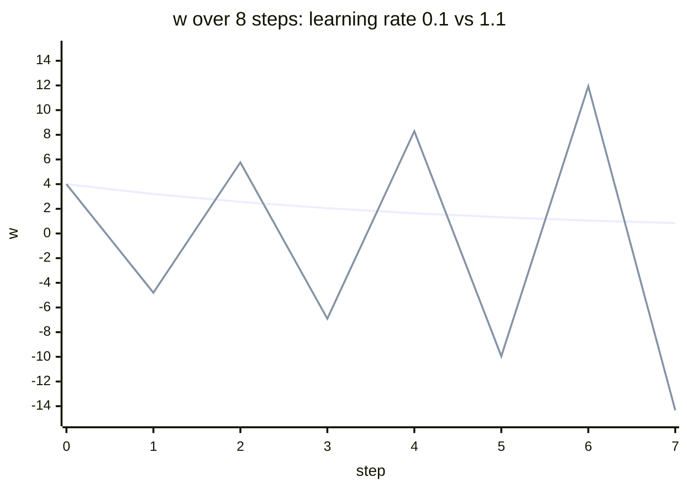

<!-- Written by `npm run lessons` from the lesson data in src/data. Edit the lesson there, not this page. -->

# Gradient descent and the learning rate

**ML Foundations · Unit 1: Math foundations · Lesson 10 of 16**

> **In one line.** Gradient descent makes a function smaller by taking many small steps downhill, against its gradient. The learning rate sets the size of each step.

[Open this lesson on the site](https://learn.hamropedia.com/foundations/gradient-descent-and-the-learning-rate/) for its animation, the practice game and tap-to-explain words.

## The problem it solves

For most models there is no formula that gives the best weights directly, and for neural networks there certainly isn't. But you can always compute the gradient. Gradient descent turns "which way is downhill?" into an algorithm that walks to a minimum one small step at a time. Choosing the step size well is the difference between fast training, slow training and no training at all.

## The idea

To make a loss smaller, take a small step against the gradient (downhill), and repeat. The learning rate is the size of each step.

## How it works, step by step

1. Pick a starting point: w = 4, where f(w) = w² = 16.
2. Compute the gradient there: f′(w) = 2w = 8. It is positive, so downhill is to the left.
3. Step against it, scaled by the learning rate: w ← 4 − 0.1·8 = 3.2.
4. Repeat. Each step here multiplies w by (1 − 2η) = 0.8: 4 → 3.2 → 2.56 → 2.05 → … After 50 steps w ≈ 0.00006.
5. The steps shrink by themselves near the bottom, because the gradient shrinks there.
6. With η = 0.9 the factor is 1 − 1.8 = −0.8: w flips sign every step but still shrinks, a zig-zag that converges.
7. With η = 1.1 the factor is −1.2: every step overshoots further than the last, and w explodes: 4, −4.8, 5.76, −6.91, …

## Picture it



*Minimising w². The smooth line (learning rate 0.1) glides towards 0. The zig-zag (1.1) overshoots further every step and explodes.*

## Analogy

Walking down a mountain in thick fog. You feel the slope under your feet and step downhill.

**Where the analogy breaks.** In fog you might stop in a small valley that is not the lowest one. In very high dimensions, flat 'saddle' areas are usually the bigger problem.

## Worked example

f(w) = w², so the gradient is 2w. Start at w = 4 with learning rate 0.1: 4 → 3.2 → 2.56 → … → close to 0. With learning rate 1.1: 4 → −4.8 → 5.76 → … it explodes.

```python
w, lr = 4.0, 0.1
for step in range(50):
    grad = 2 * w
    w = w - lr * grad
print(w)   # very close to 0
```

## Must know

- Update rule: w ← w − η·∇L(w), for every weight at once.
- η too small: slow. Too large: oscillates or diverges. The best value lies in between.
- For f(w) = w², each step multiplies w by (1 − 2η), so it converges only when 0 &lt; η &lt; 1.
- Stochastic gradient descent (SGD) estimates the gradient from a small random batch: noisier, but far cheaper per step.
- Gradient descent finds a local minimum. For convex functions, that is the global one.
- In practice, try learning rates spaced by factors of 3 to 10 (0.1, 0.03, 0.01, …) and watch the loss curve.

## Common mistakes

- Picking one learning rate and never looking at the loss curve.
- Blaming the model when the real problem is a learning rate far too big or too small.
- Leaving features on wildly different scales. The loss surface becomes a long, thin valley and gradient descent zig-zags. Scale features first.

> **Not true:** Gradient descent works equally well whether or not the features are on similar scales.  
> **In fact:** Features on very different scales turn the loss surface into a long, thin valley, where gradient descent zig-zags and crawls. Scale them first.

> **Not true:** A bigger learning rate always reaches the minimum sooner.  
> **In fact:** Too big a step jumps over the minimum: the weight swings from side to side, or flies away. For f(w) = w², any η above 1 diverges.

## Go deeper (optional): Why the learning rate has a hard upper limit

1. Take a bowl of any steepness: f(w) = (a/2)·w², with a > 0. Its gradient is a·w, and a measures how sharply the bowl curves (it is the second derivative).
2. One step of gradient descent: w ← w − η·a·w = (1 − ηa)·w. Every step multiplies w by the same number, 1 − ηa.
3. After k steps, w = (1 − ηa)ᵏ·w₀. This shrinks to 0 exactly when \|1 − ηa\| &lt; 1.
4. Solve it: −1 &lt; 1 − ηa &lt; 1 gives 0 &lt; η &lt; 2/a. The lesson's f(w) = w² has a = 2, so the limit is η &lt; 1: that is why 0.9 converges and 1.1 explodes.
5. The fastest choice is η = 1/a: the factor is 0 and one step lands on the minimum. Between 1/a and 2/a the factor is negative, so w overshoots and zig-zags but still converges.
6. With many weights, each direction has its own curvature. η must stay below 2 / (the largest curvature), which makes progress slow in the flattest direction. That gap is why badly scaled problems train slowly, and why momentum and Adam help.

**The result.** On a bowl with curvature a, gradient descent converges only for 0 &lt; η &lt; 2/a, and η = 1/a is the fastest. The sharpest direction sets the limit for all the others.

## Practise

Try each one yourself first: on paper, in code or out loud. Then open the answer and compare.

### 1. Derive

f(w) = (w − 3)². Start at w = 0 with learning rate 0.1. Do 3 steps on paper. Where is w going, and why?

<details>
<summary>Show one good answer</summary>

The gradient of f(w) = (w − 3)² is 2(w − 3). The update is w ← w − 0.1·2(w − 3).

Step 1: w = 0 − 0.1·2·(0 − 3) = 0 + 0.6 = 0.6  
Step 2: w = 0.6 − 0.1·2·(0.6 − 3) = 0.6 + 0.48 = 1.08  
Step 3: w = 1.08 − 0.1·2·(1.08 − 3) = 1.08 + 0.384 = 1.464

w is moving towards 3, the minimum, where the gradient is 0.

Why, exactly: subtract 3 from both sides of the update and you get (w − 3) ← (w − 3)·(1 − 2·0.1) = 0.8·(w − 3). So each step removes 20% of the remaining distance: 3 → 2.4 → 1.92 → 1.536 from the target. It gets closer and closer, with steps that shrink as the slope flattens.

</details>

### 2. Build

Write gradient descent for f(w) and plot w over 50 steps. Then use it to fit a straight line to real data (the model from the first lesson; Unit 2 calls it linear regression), and plot the loss.

<details>
<summary>Show one good answer</summary>

The same loop works for any differentiable loss: compute the gradient, step against it, repeat. On (w − 3)², w rises quickly towards 3 and flattens out.

For linear regression on real data, the diabetes dataset (from scikit-learn, only to load it) predicts disease progression from body mass index. Scale the feature first; then gradient descent with a learning rate of 0.1 brings the loss down smoothly, and the weights match the exact least-squares answer from np.polyfit.

```python
import numpy as np
import matplotlib.pyplot as plt
from sklearn.datasets import load_diabetes       # only to load the data

w, ws = 0.0, []
for _ in range(50):
    ws.append(w)
    w -= 0.1 * 2 * (w - 3)

d = load_diabetes(scaled=False)
x = d.data[:, 2]                                  # body mass index
x = (x - x.mean()) / x.std()                      # scale the feature
y = d.target
a, b, losses = 0.0, 0.0, []
for _ in range(200):
    pred = a * x + b
    losses.append(np.mean((pred - y) ** 2))
    a -= 0.1 * np.mean(2 * (pred - y) * x)
    b -= 0.1 * np.mean(2 * (pred - y))
print(round(a, 2), round(b, 2), np.polyfit(x, y, 1).round(2))

fig, axes = plt.subplots(1, 2, figsize=(10, 4))
axes[0].plot(ws); axes[0].set_xlabel("step"); axes[0].set_ylabel("w")
axes[1].plot(losses); axes[1].set_xlabel("step"); axes[1].set_ylabel("loss (MSE)")
plt.tight_layout(); plt.show()
```

</details>

### 3. Break

Try learning rates 0.01, 0.5, 0.9 and 1.1 on f(w) = (w − 3)². Which is slow, which is fastest, which swings from side to side, and which explodes? Use the update rule to explain why.

<details>
<summary>Show one good answer</summary>

The update gives (w − 3) ← (w − 3)·(1 − 2η), so everything depends on the factor 1 − 2η:

• η = 0.01: factor 0.98. Each step removes only 2% of the distance. Slow.  
• η = 0.5: factor 0. It jumps straight to w = 3 in one step. The fastest possible here.  
• η = 0.9: factor −0.8. The sign flips each step, so w jumps to the other side of 3, but each jump is shorter. It swings from side to side and still settles.  
• η = 1.1: factor −1.2. It swings to the other side and lands further away each time: 0 → 6.6 → −1.32 → 8.18 … It explodes.

The general rule for this kind of bowl: the steps shrink only when \|1 − 2η\| &lt; 1, so η must be between 0 and 1. For real losses the limit depends on how curved the loss is, which is why a learning rate that works on one problem can diverge on another.

```python
for lr in [0.01, 0.5, 0.9, 1.1]:
    w, path = 0.0, []
    for _ in range(5):
        path.append(round(w, 2))
        w -= lr * 2 * (w - 3)
    print(lr, path)
# 0.01 [0.0, 0.06, 0.12, 0.18, 0.23]
# 0.5 [0.0, 3.0, 3.0, 3.0, 3.0]
# 0.9 [0.0, 5.4, 1.08, 4.54, 1.77]
# 1.1 [0.0, 6.6, -1.32, 8.18, -3.22]
```

</details>

### 4. Explain

In three sentences, tell a friend why the learning rate matters.

<details>
<summary>Show one good answer</summary>

The learning rate is how big a step the model takes downhill each time it learns. Too small, and training crawls: it may take forever, or stop before it gets anywhere good. Too big, and it overshoots the bottom and lands further up the other side each time, so the loss jumps around or explodes into nan.

</details>

## Check you understood

Answer in your head first, then open each one.

<details>
<summary>&lt;b>f(w) = w², w = 2, η = 0.25. What is w after one step?&lt;/b></summary>

The gradient is 2w = 4, so w = 2 − 0.25·4 = 1.

</details>

<details>
<summary>&lt;b>Why does gradient descent slow down near the minimum, even with a fixed learning rate?&lt;/b></summary>

Each step is η times the gradient, and the gradient shrinks as the slope flattens.

</details>

<details>
<summary>&lt;b>Your loss swings wildly and then becomes NaN. What do you change first?&lt;/b></summary>

Lower the learning rate, by 3 to 10 times.

</details>

<details>
<summary>&lt;b>What is the difference between gradient descent and SGD?&lt;/b></summary>

Gradient descent uses the gradient over all the data for each step; SGD uses a small random batch, which is much cheaper and adds helpful noise.

</details>

## Go further (optional)

The lesson above is enough on its own. These free extras give a second explanation.

- WATCH · [Neural Networks, Ch 2: Gradient descent, how neural networks learn](https://www.3blue1brown.com/lessons/gradient-descent) · 3Blue1Brown
- WATCH · [Gradient Descent, Step-by-Step](https://www.youtube.com/results?search_query=StatQuest+Gradient+Descent%2C+Step-by-Step) · StatQuest (Josh Starmer)
- READ · [Mathematics for Machine Learning, Ch 7 (optimisation with gradient descent)](https://mml-book.github.io/) · Deisenroth, Faisal, Ong · free

---

[← Partial derivatives, gradients and Jacobians](partial-derivatives-gradients-and-jacobians.md) · [All lessons](../../README.md) · [Random variables, distributions, expectation and variance →](random-variables-distributions-expectation-and-variance.md)
