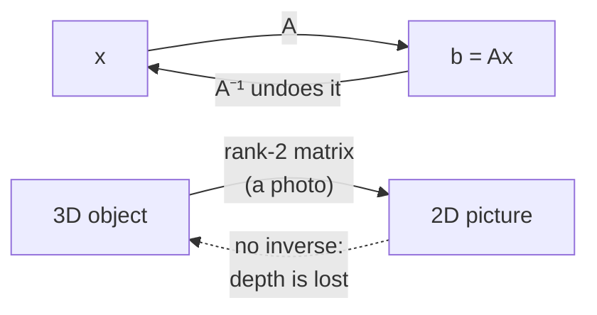

<!-- Written by `npm run lessons` from the lesson data in src/data. Edit the lesson there, not this page. -->

# Inverse, rank and solving Ax = b

**ML Foundations · Unit 1: Math foundations · Lesson 4 of 16**

> **In one line.** The inverse of a matrix undoes what the matrix does. The rank counts how many independent directions survive it, and when the rank is full, Ax = b has exactly one solution.

[Open this lesson on the site](https://learn.hamropedia.com/foundations/inverse-rank-and-solving-ax-b/) for its animation, the practice game and tap-to-explain words.

## The problem it solves

Many ML problems end in "solve these equations": the best weights of linear regression satisfy XᵀX w = Xᵀy. You need to know when there is exactly one answer, when there is none or infinitely many, and how to compute it safely. Rank and the inverse answer exactly those questions.

## The idea

The inverse undoes a matrix. Rank is the number of independent directions that survive the matrix. If the rank is full, Ax = b has exactly one solution, x = A⁻¹b.

## How it works, step by step

1. Write the equations 2x + y = 3 and x + 3y = 5 as a matrix: A = [[2, 1], [1, 3]] and b = [3, 5]. The question becomes: which vector does A move onto b?
2. Check the rank first. The two columns point in different directions, so the rank is 2 (full), and det = 2·3 − 1·1 = 5, not 0.
3. Full rank means A can be undone. For 2 × 2, the inverse is (1/det)·[[d, −b], [−c, a]] = (1/5)·[[3, −1], [−1, 2]].
4. Apply the inverse to b: x = A⁻¹b = (1/5)·[3·3 − 5, −3 + 2·5] = [0.8, 1.4].
5. Check by multiplying back: 2(0.8) + 1.4 = 3 and 0.8 + 3(1.4) = 5.
6. If the rank is not full, as with [[1, 2], [2, 4]] (rank 1), A squashes the plane onto a line. Then b is either off that line (no solution) or on it (infinitely many solutions).
7. In code, call np.linalg.solve(A, b). It uses elimination, which is faster and more accurate than computing inv(A) and multiplying.

## Picture it



*A full-rank matrix can be undone by its inverse. A low-rank one squashes away a direction, so the original can't be recovered.*

## Analogy

The inverse is an undo button. Rank is like taking a photo of a 3D object: the photo keeps only 2 of the 3 directions, so its rank is 2.

**Where the analogy breaks.** In an editor, undo always works. If a matrix squashes space (rank too low), information is lost, and there is no undo.

## Worked example

Solve 2x + y = 3 and x + 3y = 5. The answer is x = 0.8, y = 1.4. Check: 2(0.8) + 1.4 = 3, and 0.8 + 3(1.4) = 5.

```python
A = np.array([[2., 1.], [1., 3.]])
b = np.array([3., 5.])
np.linalg.solve(A, b)        # [0.8, 1.4]
np.linalg.matrix_rank(A)     # 2
# Use solve(), not inv(A) @ b: it is faster and more accurate.
```

## Must know

- Rank = the number of independent columns = the dimension of everything A can reach (its column space).
- Full-rank square matrix: invertible, det ≠ 0, exactly one solution for every b.
- Rank too low: some direction is squashed to zero (the null space). Information is lost, and there is no inverse.
- A⁻¹A = I, the identity matrix, which changes nothing.
- Use np.linalg.solve, not np.linalg.inv(A) @ b.
- With more equations than unknowns (a tall data matrix), there is usually no exact solution. Least squares finds the closest one: that is linear regression.

## Common mistakes

- Computing inv(A) @ b. It is slower and less accurate, especially when A is nearly singular.
- Assuming every square matrix has an inverse. Check the rank or the condition number.
- Mixing up "no solution" and "infinitely many": both come from too low a rank, depending on b.

> **Not true:** The most accurate way to solve Ax = b in code is to compute the inverse of A and multiply it by b.  
> **In fact:** Building the inverse is slower and less accurate, especially when A is nearly singular. np.linalg.solve finds x without ever building it.

> **Not true:** Every square matrix has an inverse.  
> **In fact:** A square matrix that squashes space flat (its rank is too low, its determinant is 0) has no inverse. Check the rank or the condition number first.

## Practise

Try each one yourself first: on paper, in code or out loud. Then open the answer and compare.

### 1. Derive

By hand, find the inverse of [[2, 1], [1, 3]] and use it to solve Ax = b for b = [3, 5]. Check your answer by multiplying back.

<details>
<summary>Show one good answer</summary>

For [[a, b], [c, d]], the inverse is 1/(a·d − b·c) times [[d, −b], [−c, a]].

Here a·d − b·c = 2·3 − 1·1 = 5, so A⁻¹ = (1/5)·[[3, −1], [−1, 2]] = [[0.6, −0.2], [−0.2, 0.4]].

x = A⁻¹b = [0.6·3 − 0.2·5, −0.2·3 + 0.4·5] = [1.8 − 1.0, −0.6 + 2.0] = [0.8, 1.4].

Check by multiplying back: 2·0.8 + 1·1.4 = 3 ✓ and 1·0.8 + 3·1.4 = 5 ✓.

In code you would use np.linalg.solve(A, b) instead of computing the inverse: it is faster and more accurate.

</details>

### 2. Build

Write Gaussian elimination to solve Ax = b, without np.linalg. Compare with np.linalg.solve on random 5 × 5 systems.

<details>
<summary>Show one good answer</summary>

Gaussian elimination has two parts. Forward: for each column, use the row with the biggest value as the pivot (partial pivoting, which avoids dividing by tiny numbers), and subtract multiples of it to make zeros below. Then back-substitution: solve the last equation first, then work upwards.

It matches np.linalg.solve on random 5 × 5 systems to about 1e-12.

```python
import numpy as np

def solve(A, b):
    A, b = A.astype(float).copy(), b.astype(float).copy()
    n = len(b)
    for col in range(n):
        pivot = col + np.argmax(np.abs(A[col:, col]))    # largest value in the column
        if np.isclose(A[pivot, col], 0):
            raise ValueError("matrix is singular")
        A[[col, pivot]], b[[col, pivot]] = A[[pivot, col]], b[[pivot, col]]
        for row in range(col + 1, n):
            factor = A[row, col] / A[col, col]
            A[row, col:] -= factor * A[col, col:]
            b[row] -= factor * b[col]
    x = np.zeros(n)
    for row in range(n - 1, -1, -1):                     # back-substitution
        x[row] = (b[row] - A[row, row + 1:] @ x[row + 1:]) / A[row, row]
    return x

rng = np.random.default_rng(0)
for _ in range(100):
    A, b = rng.normal(size=(5, 5)), rng.normal(size=5)
    assert np.allclose(solve(A, b), np.linalg.solve(A, b))
print(solve(np.array([[2, 1], [1, 3]]), np.array([3, 5])))   # [0.8 1.4]
```

</details>

### 3. Break

Solve a system with the rank-1 matrix [[1, 2], [2, 4]]. What does your code do? What does np.linalg.solve do? What does rank 1 mean for the number of solutions?

<details>
<summary>Show one good answer</summary>

[[1, 2], [2, 4]] has rank 1: the second row is twice the first. After one elimination step the last pivot is 0, so the code above raises "matrix is singular" (code without that check divides by zero and returns inf or nan). np.linalg.solve raises LinAlgError: Singular matrix.

What rank 1 means: both equations say the same thing, so you really have one equation, x + 2y = something, for two unknowns. Then there are two cases:  
• b = [1, 2] fits the pattern: infinitely many solutions, the whole line x + 2y = 1.  
• b = [1, 1] doesn't: the equations contradict each other, so there is no solution at all.

Either way there is never exactly one answer. np.linalg.lstsq gives the best fit instead.

```python
import numpy as np

A = np.array([[1., 2.], [2., 4.]])
print(np.linalg.matrix_rank(A))                  # 1
try:
    np.linalg.solve(A, np.array([1., 2.]))
except np.linalg.LinAlgError as e:
    print(e)                                     # Singular matrix
x, *_ = np.linalg.lstsq(A, np.array([1., 2.]), rcond=None)
print(x.round(3), A @ x)                         # one of the infinitely many solutions
```

</details>

### 4. Explain

Explain rank with the photo-of-a-3D-object picture.

<details>
<summary>Show one good answer</summary>

A photo of a 3D object keeps only 2 of the 3 directions: width and height survive, depth is lost. So the photo has rank 2.

A matrix's rank is the same idea: the number of independent directions that survive the transformation. A 3 × 3 matrix with full rank 3 keeps all three directions, so you can undo it: it has an inverse. A rank-2 matrix flattens space onto a plane, like the photo. You can't undo it, because many different points land on the same spot: from the photo alone, you can't tell how far away something was.

</details>

## Check you understood

Answer in your head first, then open each one.

<details>
<summary>&lt;b>What is the rank of [[1, 2], [2, 4]]?&lt;/b></summary>

1. The second column is 2 times the first, so only one direction survives.

</details>

<details>
<summary>&lt;b>Why can't a rank-deficient matrix be inverted?&lt;/b></summary>

It sends different inputs to the same output, so from the output you can't tell which input it came from.

</details>

<details>
<summary>&lt;b>Solve [[2, 0], [0, 4]] x = [6, 8].&lt;/b></summary>

x = [3, 2]: each equation stands alone, 2x = 6 and 4y = 8.

</details>

<details>
<summary>&lt;b>Why use np.linalg.solve(A, b) instead of np.linalg.inv(A) @ b?&lt;/b></summary>

solve works directly by elimination: less work and fewer rounding errors, which matters when A is nearly singular.

</details>

## Go further (optional)

The lesson above is enough on its own. These free extras give a second explanation.

- WATCH · [Essence of Linear Algebra, Ch 7: Inverse matrices, column space and null space](https://www.3blue1brown.com/lessons/inverse-matrices) · 3Blue1Brown
- READ · [Mathematics for Machine Learning, Ch 2 (solving linear systems, basis and rank)](https://mml-book.github.io/) · Deisenroth, Faisal, Ong · free
- WATCH · [18.06 lecture: Elimination with matrices](https://www.youtube.com/results?search_query=Gilbert+Strang+18.06+elimination+with+matrices) · Gilbert Strang (MIT)

---

[← Determinants](determinants.md) · [All lessons](../../README.md) · [Dot product, projection and orthogonality →](dot-product-projection-and-orthogonality.md)
