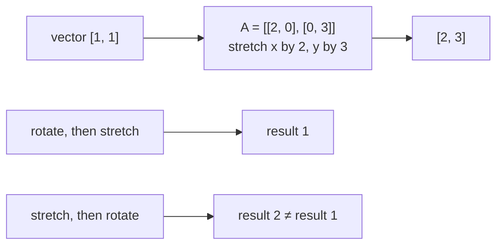

<!-- Written by `npm run lessons` from the lesson data in src/data. Edit the lesson there, not this page. -->

# Matrices as transformations; matrix multiplication

**ML Foundations · Unit 1: Math foundations · Lesson 2 of 16**

> **In one line.** A matrix is a recipe for moving every vector in space at once; multiplying two matrices means doing one movement after the other.

[Open this lesson on the site](https://learn.hamropedia.com/foundations/matrices-as-transformations-matrix-multiplication/) for its animation, the practice game and tap-to-explain words.

## The problem it solves

A neural network layer, a rotation of an image, a change of units, squeezing data down to fewer features: all of these are "do the same linear thing to every vector". A matrix stores that movement in a small grid of numbers, and matrix multiplication lets a computer apply it to millions of vectors, or chain several movements, very fast.

## The idea

A matrix is a machine that moves every vector in space. Its columns show where the basis vectors land. Multiplying two matrices means doing one movement after the other.

## How it works, step by step

1. Watch where the two basis vectors land. A = [[2, 0], [0, 3]] sends [1, 0] to [2, 0], its first column, and [0, 1] to [0, 3], its second column.
2. Every other vector follows, because it is a combination of the basis vectors: [1, 1] = [1, 0] + [0, 1] lands on [2, 0] + [0, 3] = [2, 3].
3. That is matrix-times-vector: Av = v₁·(first column) + v₂·(second column). Grid lines stay straight, parallel and evenly spaced, and the origin stays put.
4. To do B first and then A, multiply AB, read right to left. Each column of AB is A applied to the matching column of B.
5. Order matters. With R a 90° rotation, A·R (rotate, then stretch) is [[0, −2], [3, 0]], but R·A (stretch, then rotate) is [[0, −3], [2, 0]].
6. Shapes must fit: an (m, n) matrix times an (n, p) matrix gives an (m, p) matrix. The two inner sizes must match.

## Picture it



*A matrix moves vectors. Doing two matrices in a different order usually gives a different result, so AB ≠ BA.*

## Analogy

Instructions for a photo editor: rotate, then stretch.

**Where the analogy breaks.** In the analogy the order feels unimportant, but it matters. Rotate-then-stretch is usually different from stretch-then-rotate, so AB ≠ BA.

## Worked example

A = [[2, 0], [0, 3]] stretches x by 2 and y by 3. R = [[0, −1], [1, 0]] rotates by 90°.

```python
A = np.array([[2, 0], [0, 3]])
R = np.array([[0, -1], [1, 0]])   # rotate 90 degrees
A @ R    # [[ 0, -2], [3, 0]]
R @ A    # [[ 0, -3], [2, 0]]   different!
```

## Must know

- The columns of a matrix are where the basis vectors land. Read a matrix column by column.
- A linear transformation keeps grid lines straight, parallel and evenly spaced, and keeps the origin fixed.
- The product AB means "do B, then A". In general AB ≠ BA.
- Shapes: (m, n) @ (n, p) → (m, p). The inner sizes must match.
- A neural network layer is y = Wx + b: a matrix movement, then a shift.
- In NumPy, @ is matrix multiplication. \* multiplies matching entries, which is something else.

## Common mistakes

- Using \* instead of @ in NumPy. A \* B multiplies entries in the same position; it is not the matrix product.
- Reading AB left to right. B happens first.
- Assuming AB = BA. It is rarely true.
- Mixing up the shape: a (3, 2) matrix takes 2-D vectors to 3-D vectors, not the other way round.

> **Not true:** In NumPy, A \* B computes the matrix product of A and B.  
> **In fact:** A \* B multiplies the entries in the same position. The matrix product is written A @ B.

> **Not true:** For two matrices, AB always equals BA.  
> **In fact:** The order matters. AB means do B first, then A, and swapping them usually gives a different result.

## Practise

Try each one yourself first: on paper, in code or out loud. Then open the answer and compare.

### 1. Derive

Find the matrix that rotates by 90° and then doubles x only. Then find the matrix for the opposite order. Draw where the unit square lands in each case.

<details>
<summary>Show one good answer</summary>

Rotate 90° anticlockwise: R = [[0, −1], [1, 0]]. Double x only: S = [[2, 0], [0, 1]].

Rotate first, then double x: the first step is on the right, so the matrix is S·R = [[0, −2], [1, 0]].  
Double x first, then rotate: R·S = [[0, −1], [2, 0]].

Where the unit square lands (its corners (1, 0), (0, 1) and (1, 1)):  
• S·R: (1, 0) → (0, 1), (0, 1) → (−2, 0), (1, 1) → (−2, 1). A rectangle 2 wide and 1 tall, to the left of the y-axis.  
• R·S: (1, 0) → (0, 2), (0, 1) → (−1, 0), (1, 1) → (−1, 2). A rectangle 1 wide and 2 tall.

Both have area 2 (the determinant of each is 2), but they are different shapes in different places. Matrix multiplication depends on the order: S·R ≠ R·S.

</details>

### 2. Build

Write matmul(A, B) with three loops and no @. Test it against A @ B on random matrices. Then plot the unit square before and after a transformation.

<details>
<summary>Show one good answer</summary>

Entry (i, j) of A·B is the dot product of row i of A with column j of B. So: one loop over the rows of A, one over the columns of B, and one inner loop to add up the products. Check it against A @ B with np.allclose on random matrices of matching sizes.

For the picture, put the square's corners as columns of a matrix, multiply by the transformation, and plot both outlines.

```python
import numpy as np
import matplotlib.pyplot as plt

def matmul(A, B):
    n, k = A.shape
    k2, m = B.shape
    assert k == k2, f"inner sizes differ: {k} and {k2}"
    C = np.zeros((n, m))
    for i in range(n):
        for j in range(m):
            for p in range(k):
                C[i, j] += A[i, p] * B[p, j]
    return C

rng = np.random.default_rng(0)
A, B = rng.normal(size=(4, 3)), rng.normal(size=(3, 5))
assert np.allclose(matmul(A, B), A @ B)

square = np.array([[0, 1, 1, 0, 0],      # x of each corner, back to the start
                   [0, 0, 1, 1, 0]])     # y of each corner
T = np.array([[0, -2], [1, 0]])           # rotate 90°, then double x
moved = T @ square
plt.plot(square[0], square[1], label="before")
plt.plot(moved[0], moved[1], label="after")
plt.axis("equal"); plt.legend(); plt.show()
```

</details>

### 3. Break

Try to multiply a (2, 3) matrix by another (2, 3) matrix. Read the error and explain which sizes must match, and why.

<details>
<summary>Show one good answer</summary>

NumPy refuses: "matmul: Input operand 1 has a mismatch in its core dimension 0 … (size 2 is different from 3)".

The rule: for A·B, the number of columns of A must equal the number of rows of B. (2, 3) times (3, 4) works and gives (2, 4); (2, 3) times (2, 3) doesn't.

Why: each entry of the result is a dot product of a row of A with a column of B. A row of a (2, 3) matrix has 3 numbers, but a column of the second (2, 3) matrix has only 2, so there is nothing to pair the third number with. A shortcut: write the shapes side by side, (2, 3)(3, 4). The inner numbers must match, and the outer ones give the result's shape.

```python
import numpy as np

A = np.ones((2, 3))
try:
    A @ np.ones((2, 3))
except ValueError as e:
    print(e)
print((A @ np.ones((3, 4))).shape)    # (2, 4): inner 3s match
```

</details>

### 4. Explain

Explain what the columns of a matrix tell you, using [[2, 0], [0, 3]].

<details>
<summary>Show one good answer</summary>

The columns of a matrix tell you where the basic arrows land. The first column is where the arrow (1, 0) goes, the second is where (0, 1) goes.

For [[2, 0], [0, 3]]: the first column is [2, 0], so the arrow along x is stretched to twice its length. The second column is [0, 3], so the arrow along y is stretched three times. Every other point follows: (x, y) goes to x·[2, 0] + y·[0, 3] = (2x, 3y). So the unit square becomes a 2 × 3 rectangle.

That is why you can read a matrix as a transformation: look at the columns, and you see what it does to space.

</details>

## Check you understood

Answer in your head first, then open each one.

<details>
<summary>&lt;b>Where does [[1, 2], [3, 4]] send the vector [1, 0]?&lt;/b></summary>

To [1, 3], its first column.

</details>

<details>
<summary>&lt;b>What shape is (32, 10) @ (10, 4)?&lt;/b></summary>

(32, 4). The inner 10s match and disappear.

</details>

<details>
<summary>&lt;b>Why does rotate-then-stretch differ from stretch-then-rotate?&lt;/b></summary>

The stretch acts along the fixed x and y directions. Rotating first changes which parts of the shape lie along x and y before the stretch, so the end shapes differ.

</details>

<details>
<summary>&lt;b>What is the difference between A * B and A @ B in NumPy?&lt;/b></summary>

A \* B multiplies entries in the same position. A @ B is the matrix product: rows of A times columns of B.

</details>

## Go further (optional)

The lesson above is enough on its own. These free extras give a second explanation.

- WATCH · [Essence of Linear Algebra, Ch 3–4: Linear transformations and matrices; Matrix multiplication as composition](https://www.3blue1brown.com/lessons/linear-transformations) · 3Blue1Brown  
  **Worth it:** Grid lines bending and stretching on screen: the clearest anyone has ever shown what a matrix does. If you watch one video for linear algebra, make it this one.
- READ · [Mathematics for Machine Learning, Ch 2 (matrices, linear mappings)](https://mml-book.github.io/) · Deisenroth, Faisal, Ong · free

---

[← Vectors, span and basis](vectors-span-and-basis.md) · [All lessons](../../README.md) · [Determinants →](determinants.md)
