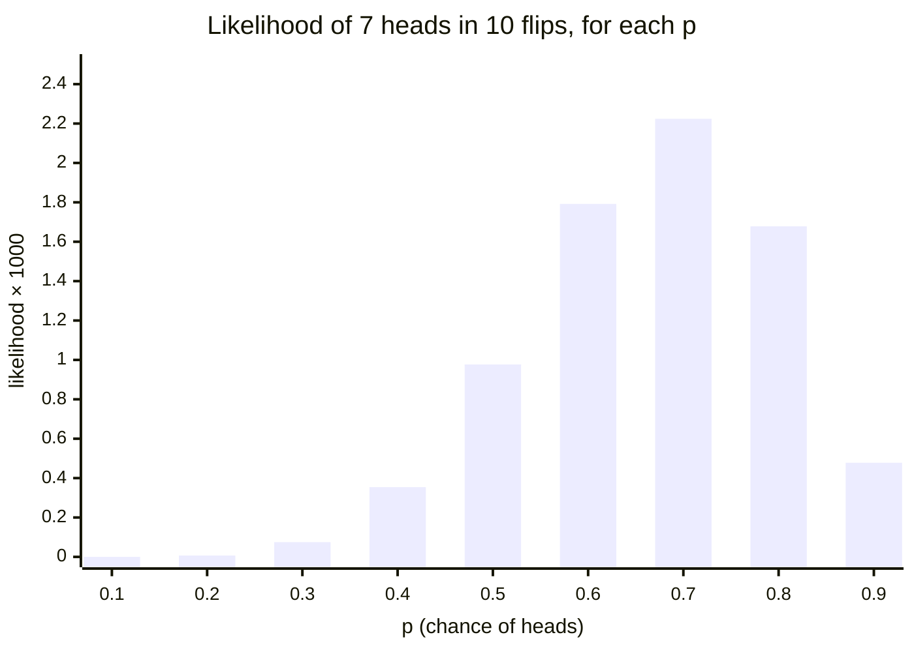

<!-- Written by `npm run lessons` from the lesson data in src/data. Edit the lesson there, not this page. -->

# Maximum likelihood estimation

**ML Foundations · Unit 1: Math foundations · Lesson 13 of 16**

> **In one line.** Maximum likelihood estimation chooses the parameter values that make the data you actually observed as probable as possible.

[Open this lesson on the site](https://learn.hamropedia.com/foundations/maximum-likelihood-estimation/) for its animation, the practice game and tap-to-explain words.

## The problem it solves

A model has unknown parameters: the bias of a coin, the mean of a Gaussian, the weights of a network. You need a principled rule for choosing them from data. Maximum likelihood is that rule, and it explains where the standard loss functions come from: squared error and cross-entropy are both maximum likelihood in disguise.

## The idea

Maximum likelihood: choose the model parameters that make the data you actually saw most probable.

## How it works, step by step

1. Write the probability of the data as a function of the parameter: the likelihood. For 7 heads and 3 tails, L(p) = p⁷(1 − p)³.
2. Try some values: L(0.5) ≈ 0.00098, L(0.7) ≈ 0.00222, L(0.9) ≈ 0.00048. The data is most probable at p = 0.7.
3. Take the log, which turns products into sums and keeps the same peak: log L = 7 log p + 3 log(1 − p).
4. Set the derivative to zero: 7/p − 3/(1 − p) = 0, so p = 7/10. The estimate is just the fraction of heads.
5. In ML you minimise the negative log-likelihood instead of maximising the likelihood. That is your loss.
6. For a Gaussian with fixed spread, maximising the likelihood is the same as minimising squared error, so the best mean is the sample mean. For classification, it is the same as minimising cross-entropy.

## Picture it



*Maximum likelihood picks the p that makes the data you saw most probable: the tallest bar, at p = 0.7.*

## Analogy

A detective picks the story that best explains all the clues.

**Where the analogy breaks.** A detective also uses common sense. MLE uses only the data, so with little data it can be overconfident: 3 heads in 3 flips gives 'this coin always lands heads'.

## Worked example

7 heads in 10 flips. The likelihood p⁷(1 − p)³ is highest at p = 0.7. Two facts to remember: minimising cross-entropy loss is MLE for classification, and minimising squared error is MLE when the noise is Gaussian.

```python
p = np.linspace(0.01, 0.99, 99)
lik = p**7 * (1 - p)**3
p[lik.argmax()]   # ≈ 0.7
```

## Must know

- Likelihood L(θ) = P(data \| θ), seen as a function of the parameters θ.
- Maximise log L instead: products become sums, and tiny numbers don't underflow to 0.
- The negative log-likelihood is the loss you minimise.
- Squared error = Gaussian maximum likelihood. Cross-entropy = maximum likelihood for categories.
- For a coin, the estimate is the fraction of heads; for a Gaussian mean, it is the sample average.
- MAP adds a prior and maximises likelihood × prior. Weight decay is MAP with a Gaussian prior on the weights.

## Common mistakes

- Reading the likelihood as "the probability that the parameter is right". It is the probability of the data, given the parameter.
- Multiplying thousands of small probabilities directly. They underflow to 0; add their logs instead.
- Trusting maximum likelihood on tiny data: 3 heads out of 3 flips gives p = 1.

> **Not true:** Maximum likelihood on 3 coin flips: a trustworthy estimate of p.  
> **In fact:** Three heads out of three gives p = 1: a coin that could never land tails. On tiny data, add a prior or collect more.

> **Not true:** Likelihood L(θ) = the probability that θ is the correct value.  
> **In fact:** It is the probability of the data, given that parameter value. It says how well the value explains what was seen.

## Practise

Try each one yourself first: on paper, in code or out loud. Then open the answer and compare.

### 1. Derive

Derive the MLE of p for coin flips: write the log-likelihood, differentiate, set it to 0. Then do the same for the mean of a Gaussian.

<details>
<summary>Show one good answer</summary>

Coin: h heads and t tails, with P(heads) = p.  
Likelihood: L(p) = pʰ·(1 − p)ᵗ.  
Log-likelihood: ℓ(p) = h·log p + t·log(1 − p).  
Derivative: h/p − t/(1 − p). Set it to 0: h(1 − p) = t·p, so h = p(h + t), and p = h / (h + t).  
The MLE is simply the fraction of heads: 7 heads in 10 flips gives 0.7.

Gaussian mean, with the variance σ² fixed:  
ℓ(μ) = −Σ(xᵢ − μ)² / (2σ²) + a constant.  
Derivative: Σ(xᵢ − μ) / σ². Set it to 0: Σxᵢ = n·μ, so μ = (1/n)·Σxᵢ, the sample mean.  
Notice that maximising this log-likelihood is the same as minimising the squared error Σ(xᵢ − μ)²: that is why MSE goes with Gaussian noise.

</details>

### 2. Build

Fit a Gaussian to real data by maximising the log-likelihood with your own gradient descent. Compare with the formula answer.

<details>
<summary>Show one good answer</summary>

Minimise the negative log-likelihood of a Gaussian with gradient descent. Learn log σ instead of σ, so σ can never go negative.

On Iris sepal lengths it converges to μ ≈ 5.843 and σ ≈ 0.825, the same as the formula answers: the sample mean and the standard deviation that divides by n (np.std with its default ddof = 0).

```python
import numpy as np
from sklearn.datasets import load_iris      # only to load the data

x = load_iris().data[:, 0]                   # sepal length, 150 values
mu, log_sigma, lr = 0.0, 0.0, 0.05
for _ in range(5000):
    sigma = np.exp(log_sigma)
    # gradients of the mean negative log-likelihood
    grad_mu = -np.mean(x - mu) / sigma**2
    grad_log_sigma = 1 - np.mean((x - mu) ** 2) / sigma**2
    mu -= lr * grad_mu
    log_sigma -= lr * grad_log_sigma

print(round(mu, 3), round(np.exp(log_sigma), 3))   # 5.843 0.825
print(round(x.mean(), 3), round(x.std(), 3))       # the formula answers
```

</details>

### 3. Break

Fit the coin with only 3 flips, all heads. What does MLE say? Now pretend you also saw 1 extra head and 1 extra tail, and compare. That is MAP with a simple prior.

<details>
<summary>Show one good answer</summary>

3 heads out of 3: MLE says p = 3/3 = 1. The model is now certain that tails is impossible, after only three flips. That is overconfidence from too little data: MLE fits the data you saw exactly, however little of it there is.

Add one imaginary head and one imaginary tail: p = (3 + 1) / (3 + 2) = 0.8. Much more sensible. Those extra counts are a prior belief that coins are usually fairly balanced, and using them is MAP estimation (with a Beta(2, 2) prior), also called Laplace smoothing.

With lots of data the prior hardly matters: 700 heads in 1,000 flips gives 0.700 by MLE and 0.6996 with the extra counts. It matters most exactly when data is scarce.

</details>

### 4. Explain

Explain, in plain words, why minimising cross-entropy is the same as maximum likelihood.

<details>
<summary>Show one good answer</summary>

Maximum likelihood means choosing the model that makes the training data as probable as possible: the probability the model gives to the right label of every example, all multiplied together.

Multiplying thousands of small numbers is awkward, so take the log, which turns the product into a sum, and maximising a sum of logs is the same as minimising minus that sum. Minus the average log-probability of the right label is exactly the cross-entropy loss. So when you train a classifier by minimising cross-entropy, you are doing maximum likelihood: pushing up the probability the model gives to the right answers.

</details>

## Check you understood

Answer in your head first, then open each one.

<details>
<summary>&lt;b>You saw 2 heads in 8 flips. What is the maximum likelihood estimate of p?&lt;/b></summary>

2/8 = 0.25.

</details>

<details>
<summary>&lt;b>Why maximise the log-likelihood instead of the likelihood?&lt;/b></summary>

The log has the same peak, turns products into sums (easier to differentiate), and avoids numbers too small for a computer.

</details>

<details>
<summary>&lt;b>Which loss is maximum likelihood for regression with Gaussian noise?&lt;/b></summary>

Mean squared error.

</details>

<details>
<summary>&lt;b>How does MAP differ from maximum likelihood?&lt;/b></summary>

MAP also multiplies by a prior over the parameters, which pulls estimates towards sensible values when data is scarce.

</details>

## Go further (optional)

The lesson above is enough on its own. These free extras give a second explanation.

- WATCH · [Maximum Likelihood, clearly explained](https://www.youtube.com/results?search_query=StatQuest+Maximum+Likelihood%2C+clearly+explained) · StatQuest (Josh Starmer)
- READ · [Mathematics for Machine Learning, Ch 8 (parameter estimation: MLE and MAP)](https://mml-book.github.io/) · Deisenroth, Faisal, Ong · free
- READ · [Understanding Deep Learning, Ch 5 (loss functions from maximum likelihood)](https://udlbook.github.io/udlbook/) · Simon Prince · free

---

[← Conditional probability and Bayes’ rule](conditional-probability-and-bayes-rule.md) · [All lessons](../../README.md) · [Statistics: sampling, confidence intervals, hypothesis tests →](statistics-sampling-confidence-intervals-hypothesis-tests.md)
