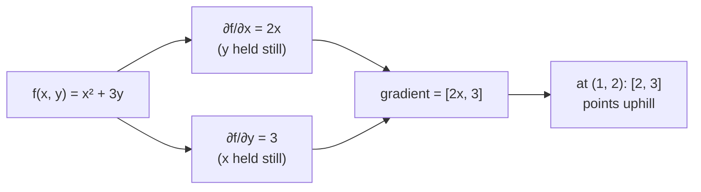

<!-- Written by `npm run lessons` from the lesson data in src/data. Edit the lesson there, not this page. -->

# Partial derivatives, gradients and Jacobians

**ML Foundations · Unit 1: Math foundations · Lesson 9 of 16**

> **In one line.** A partial derivative is the rate of change when you nudge one input and hold the others still. The gradient puts all of them into one vector, which points in the direction of steepest increase.

[Open this lesson on the site](https://learn.hamropedia.com/foundations/partial-derivatives-gradients-and-jacobians/) for its animation, the practice game and tap-to-explain words.

## The problem it solves

A loss depends on many weights at once, often millions. You need to know how it changes with each one, and which combined direction makes it fall fastest. The gradient packages exactly that, and gradient descent simply steps the other way. Jacobians extend the idea to functions with many outputs, like a whole network layer.

## The idea

A partial derivative changes one input and holds the others still. The gradient collects all the partial derivatives into one vector, and it points uphill. The Jacobian is the same idea when the output is a vector too.

## How it works, step by step

1. Take the bowl f(x, y) = x² + 2y² and stand at (1.5, 1), where f = 2.25 + 2 = 4.25.
2. Partial derivative in x: treat y as a constant, so ∂f/∂x = 2x = 3. Stepping east, f rises 3 units per unit step.
3. Partial derivative in y: treat x as a constant, so ∂f/∂y = 4y = 4.
4. The gradient stacks them: ∇f = [3, 4]. It points straight uphill and is at right angles to the contour line through the point.
5. Its length, √(3² + 4²) = 5, is the steepness in that best direction.
6. Gradient descent steps the opposite way, −∇f = [−3, −4]. With learning rate 0.1 the next point is (1.5, 1) − 0.1·[3, 4] = (1.2, 0.6), where f = 2.16.
7. For a function with several outputs, put each output's gradient in its own row: that matrix is the Jacobian. A layer y = Wx has Jacobian W.

## Picture it



*Each partial derivative changes one input only. Put together, they form the gradient, which points uphill.*

## Analogy

Standing on a hill. Step east: how steep is it? Step north: how steep? Those two numbers together are the gradient.

**Where the analogy breaks.** A hill has 2 directions. A network's loss has millions. You cannot picture it, but the maths is exactly the same.

## Worked example

f(x, y) = x² + 3y. ∂f/∂x = 2x and ∂f/∂y = 3. At (1, 2), the gradient is [2, 3]. For g(x, y) = [xy, x + y], the Jacobian is [[y, x], [1, 1]]: one row per output, one column per input.

## Must know

- Partial derivative: vary one input and freeze the rest.
- Gradient ∇f = [∂f/∂x₁, …, ∂f/∂xₙ]: it points towards the steepest increase, and its length is the steepness.
- The gradient is at right angles to contour lines (lines of equal value).
- At a minimum, a maximum or a saddle point, the gradient is zero.
- Jacobian: one row per output, one column per input. For y = Wx it is W.
- The gradient of the loss has the same shape as the weights: one number per weight.

## Common mistakes

- Forgetting to hold the other variables still: ∂/∂x of x²y is 2xy, not 2x.
- Stepping along +∇f when minimising. Descent goes against the gradient.
- Getting the Jacobian sideways. Fix the rule: rows are outputs, columns are inputs.

> **Not true:** In a Jacobian, each row belongs to one input and each column to one output.  
> **In fact:** It is the other way round: one row for each output, one column for each input.

> **Not true:** To make a function smaller, step in the direction of its gradient.  
> **In fact:** The gradient points uphill, the way the function grows fastest. To make it smaller, step against the gradient.

## Practise

Try each one yourself first: on paper, in code or out loud. Then open the answer and compare.

### 1. Derive

By hand, find the gradient of f(x, y) = x²y + 3y², and the Jacobian of g(x, y) = [x + y, xy, x²].

<details>
<summary>Show one good answer</summary>

f(x, y) = x²y + 3y².  
∂f/∂x: treat y as a constant, so 2xy.  
∂f/∂y: treat x as a constant, so x² + 6y.  
Gradient: ∇f = [2xy, x² + 6y]. At (1, 2) that is [4, 13].

g(x, y) = [x + y, xy, x²] has 3 outputs and 2 inputs, so the Jacobian has 3 rows and 2 columns: one row per output, holding its partial derivatives with respect to x and y.  
Row 1, x + y: [1, 1]  
Row 2, xy: [y, x]  
Row 3, x²: [2x, 0]  
J = [[1, 1], [y, x], [2x, 0]]. At (1, 2): [[1, 1], [2, 1], [2, 0]].

</details>

### 2. Build

Write numerical_gradient(f, x) for a vector x and check your hand answers. Keep this function: it becomes your gradient checker for backprop.

<details>
<summary>Show one good answer</summary>

Nudge one input at a time, both up and down by h, and take the central difference. Each nudge gives one entry of the gradient. The same function, applied to each output of g, builds the Jacobian row by row.

At (1, 2) it gives [4, 13] for f and [[1, 1], [2, 1], [2, 0]] for g, matching the hand answers. Later, to check backprop, compare this against the gradient your code computes, using a relative error: below about 1e-6 means your backprop is right.

```python
import numpy as np

def numerical_gradient(f, x, h=1e-5):
    x = np.asarray(x, dtype=float)
    grad = np.zeros_like(x)
    for i in range(x.size):
        step = np.zeros_like(x)
        step[i] = h
        grad[i] = (f(x + step) - f(x - step)) / (2 * h)
    return grad

f = lambda v: v[0]**2 * v[1] + 3 * v[1]**2
print(numerical_gradient(f, [1, 2]).round(6))          # [ 4. 13.]

g = lambda v: np.array([v[0] + v[1], v[0] * v[1], v[0]**2])
J = np.stack([numerical_gradient(lambda v, k=k: g(v)[k], [1, 2]) for k in range(3)])
print(J.round(6))                                       # [[1 1] [2 1] [2 0]]
```

</details>

### 3. Break

Check the gradient of f(x) = \|x\| at x = 0 with your checker. What does it say, and why is the true gradient undefined there?

<details>
<summary>Show one good answer</summary>

The checker says the gradient of \|x\| at 0 is 0: (\|h\| − \|−h\|) / 2h = (h − h) / 2h = 0.

But the true derivative doesn't exist there. Just left of 0 the slope is −1, just right of it the slope is +1, and at 0 there is a sharp corner, so there is no single slope. The central difference averages the two sides and reports 0, which looks like a real answer but isn't.

Why it matters: ReLU has the same corner at 0. Frameworks simply pick a value there (PyTorch uses 0 for ReLU), and in practice inputs rarely land exactly on the corner. But a gradient check run right at a kink can disagree with your backprop for no real reason, so check at random points away from corners.

```python
import numpy as np

f = lambda x: abs(x)
h = 1e-5
print((f(0 + h) - f(0 - h)) / (2 * h))     # 0.0, but the slopes are -1 and +1
print((f(0 + h) - f(0)) / h, (f(0) - f(0 - h)) / h)   # 1.0 and -1.0
```

</details>

### 4. Explain

Explain what the gradient vector means on a hill, and why it points uphill.

<details>
<summary>Show one good answer</summary>

Stand on a hill. Step east: how steeply does the ground rise? Step north: how steeply? Those two slopes, written together, are the gradient vector.

It points uphill, in the steepest direction, because of how slopes combine: the slope in any direction you choose is the gradient dotted with that direction, which is \|gradient\| × cos(angle between them). That is biggest when the angle is 0, when you walk exactly along the gradient. So the gradient points straight up the steepest slope, its length says how steep that is, and walking the opposite way is the fastest way down. That is what gradient descent does.

</details>

## Check you understood

Answer in your head first, then open each one.

<details>
<summary>&lt;b>Find ∇f for f(x, y) = 3x + y² at (2, 1).&lt;/b></summary>

[3, 2]: ∂f/∂x = 3 and ∂f/∂y = 2y = 2.

</details>

<details>
<summary>&lt;b>Why does gradient descent use −∇f?&lt;/b></summary>

The gradient points uphill. To make the loss smaller, you step the opposite way.

</details>

<details>
<summary>&lt;b>What does a zero gradient tell you?&lt;/b></summary>

The surface is flat there: a minimum, a maximum or a saddle point. You need more information to know which.

</details>

<details>
<summary>&lt;b>What is the Jacobian of g(x, y) = [2x, x + y]?&lt;/b></summary>

[[2, 0], [1, 1]]: row 1 is the gradient of 2x, row 2 the gradient of x + y.

</details>

## Go further (optional)

The lesson above is enough on its own. These free extras give a second explanation.

- WATCH · [Gradient and directional derivatives](https://www.khanacademy.org/math/multivariable-calculus) · Khan Academy
- READ · [Mathematics for Machine Learning, Ch 5 (partial derivatives, gradients, Jacobians)](https://mml-book.github.io/) · Deisenroth, Faisal, Ong · free
- READ · [The Matrix Calculus You Need for Deep Learning](https://explained.ai/matrix-calculus/) · Terence Parr and Jeremy Howard · free

---

[← Derivatives and the chain rule](derivatives-and-the-chain-rule.md) · [All lessons](../../README.md) · [Gradient descent and the learning rate →](gradient-descent-and-the-learning-rate.md)
