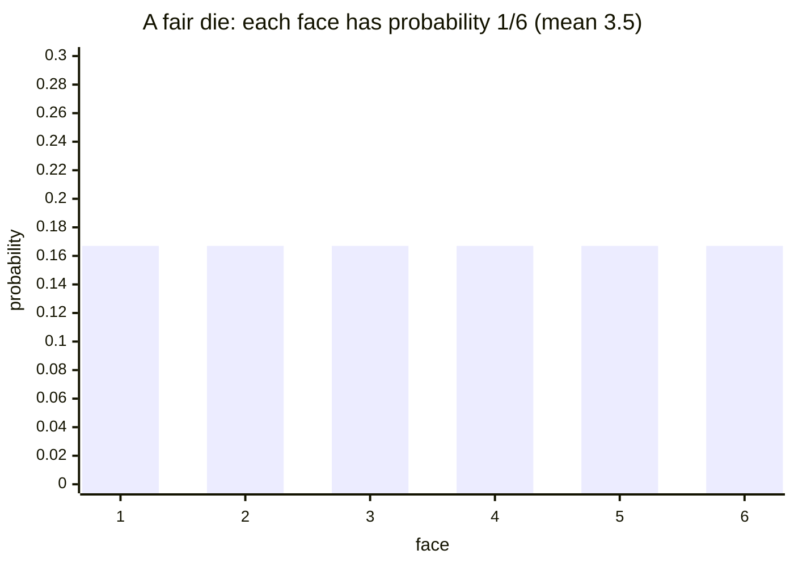

<!-- Written by `npm run lessons` from the lesson data in src/data. Edit the lesson there, not this page. -->

# Random variables, distributions, expectation and variance

**ML Foundations · Unit 1: Math foundations · Lesson 11 of 16**

> **In one line.** A random variable is a number decided by chance; its distribution says how likely each value is, its expectation is the long-run average, and its variance measures how spread out it is.

[Open this lesson on the site](https://learn.hamropedia.com/foundations/random-variables-distributions-expectation-and-variance/) for its animation, the practice game and tap-to-explain words.

## The problem it solves

Data is noisy and models are never certain. Classifiers output probabilities, starting weights are drawn at random, mini-batches are random samples, and generated text is sampled. To reason about any of it — how big an error might be, how much results vary from run to run — you need the language of distributions, averages and spread.

## The idea

A random variable is a number decided by chance. Its distribution says how likely each value is. The expectation is the long-run average. The variance measures how spread out the values are.

## How it works, step by step

1. List the outcomes and their probabilities: a fair die gives 1 to 6, each with probability 1/6. The probabilities always add up to 1.
2. Expectation: weight each value by its probability and add. E[X] = (1 + 2 + … + 6)/6 = 3.5.
3. Variance: the expected squared distance from the mean. Var(X) = E[X²] − E[X]² = 91/6 − 12.25 ≈ 2.92.
4. The standard deviation is its square root, about 1.71: a typical distance from the average, in the same units as X.
5. Simulate to check. The average of many rolls approaches 3.5 (the law of large numbers), and the histogram approaches the flat bars of the distribution.
6. Continuous values, like height, use a density curve instead of a list, and probabilities are areas under the curve. The Gaussian N(μ, σ²) is the bell curve with mean μ and spread σ.

## Picture it



*A distribution lists every possible value and its probability. The expectation, 3.5, is the long-run average, even though you can never roll it.*

## Analogy

Rolling a die. Each face has probability 1/6. The expectation is 3.5: you never roll 3.5, but it is the average over many rolls.

**Where the analogy breaks.** A die has a few possible values. Many things in ML are continuous, like height, so we use a density curve instead of a list.

## Worked example

For a fair die, E[X] = (1 + … + 6)/6 = 3.5, and Var = E[X²] − E[X]² = 91/6 − 12.25 ≈ 2.92.

```python
rolls = np.random.randint(1, 7, size=100_000)
rolls.mean(), rolls.var()   # ≈ 3.5, ≈ 2.92
```

## Must know

- Discrete: a list of values with probabilities (a die, a coin, a class label). Continuous: a density, where probability = area.
- The expectation is E[X] = Σ x·P(x): each value times its probability, added up. It is linear: E[aX + bY] = aE[X] + bE[Y], always.
- Var(X) = E[X²] − E[X]². The standard deviation √Var is in the units of X.
- Var(aX) = a²·Var(X). For independent X and Y, Var(X + Y) = Var(X) + Var(Y).
- Gaussian: about 68% of values lie within 1σ of the mean and about 95% within 2σ.
- Bernoulli (one coin flip that is 1 with probability p): mean p, variance p(1 − p).

## Common mistakes

- Thinking the expectation is the most likely value. For a die, 3.5 is never rolled.
- Adding standard deviations instead of variances for independent variables.
- Reading a density value as a probability. Densities can be bigger than 1; only areas are probabilities.

> **Not true:** Expectation E[X]: the most likely value of X.  
> **In fact:** It is the long-run average, which need not be a possible value at all: a fair die has expectation 3.5 and never rolls 3.5.

> **Not true:** Density: like a probability, it lies between 0 and 1.  
> **In fact:** A density can be bigger than 1. Only areas under the curve are probabilities, and the whole area is 1.

## Practise

Try each one yourself first: on paper, in code or out loud. Then open the answer and compare.

### 1. Derive

By hand, find the expectation and variance of a biased coin that gives 1 with probability 0.3, and of the sum of two fair dice.

<details>
<summary>Show one good answer</summary>

Biased coin: X = 1 with probability 0.3, else 0.  
E[X] = 1·0.3 + 0·0.7 = 0.3.  
E[X²] = 1²·0.3 = 0.3, so Var = E[X²] − E[X]² = 0.3 − 0.09 = 0.21. (The formula for any coin: p(1 − p).)

Sum of two fair dice: one die has E = 3.5 and Var = 91/6 − 3.5² = 35/12 ≈ 2.92.  
Expectations always add: E = 3.5 + 3.5 = 7.  
Variances add when the dice are independent: Var = 35/12 + 35/12 = 35/6 ≈ 5.83.

</details>

### 2. Build

Simulate 100,000 samples each from Bernoulli, Uniform and Gaussian distributions. Check that the sample mean and variance match your formulas.

<details>
<summary>Show one good answer</summary>

Draw 100,000 samples from each and compare with the formulas: Bernoulli(0.3) has mean 0.3 and variance 0.21; Uniform(0, 1) has mean 0.5 and variance 1/12 ≈ 0.0833; the standard Gaussian has mean 0 and variance 1. With 100,000 samples, each match is good to about 2 or 3 decimal places.

```python
import numpy as np

rng = np.random.default_rng(0)
n = 100_000
samples = {
    "Bernoulli(0.3)": (rng.random(n) < 0.3).astype(float),
    "Uniform(0, 1)":  rng.random(n),
    "Gaussian(0, 1)": rng.normal(size=n),
}
formulas = {"Bernoulli(0.3)": (0.3, 0.21), "Uniform(0, 1)": (0.5, 1 / 12), "Gaussian(0, 1)": (0, 1)}
for name, x in samples.items():
    print(name, round(x.mean(), 3), round(x.var(), 3), "expected", formulas[name])
```

</details>

### 3. Break

Compare the average of 10, 100 and 10,000 samples across several runs. Then try np.random.standard_cauchy. Why does its average never settle?

<details>
<summary>Show one good answer</summary>

For normal distributions, the average settles down as you take more samples: the spread of the average shrinks like 1/√n. With 10 samples it jumps around a lot, with 10,000 it barely moves between runs. That is the law of large numbers.

The Cauchy distribution breaks this. Its average never settles: averaging 10,000 samples is as jumpy as a single sample. Why: its tails are so heavy that the expectation doesn't exist. Extreme values, millions of times bigger than usual, turn up often enough that each one drags the average somewhere new. The law of large numbers needs a finite mean, and Cauchy has none.

The lesson for ML: averages, and anything built on them, like a mean loss, can be dominated by rare extreme values. Look at the data, and use robust measures such as the median when outliers are possible.

```python
import numpy as np

rng = np.random.default_rng(0)
for n in [10, 100, 10_000]:
    gauss = [rng.normal(size=n).mean() for _ in range(5)]
    cauchy = [rng.standard_cauchy(size=n).mean() for _ in range(5)]
    print(n, np.round(gauss, 3), np.round(cauchy, 2))
# The Gaussian averages close in on 0; the Cauchy ones stay all over the place.
```

</details>

### 4. Explain

Explain expectation with a die, and why you can never actually roll it.

<details>
<summary>Show one good answer</summary>

A fair die lands on 1, 2, 3, 4, 5 or 6, each with probability 1/6. Its expectation is (1 + 2 + 3 + 4 + 5 + 6) / 6 = 3.5.

You can never actually roll a 3.5. The expectation isn't a likely outcome; it is the long-run average. Roll the die thousands of times and the average of all your rolls gets closer and closer to 3.5. That is what expectation means: the balance point of all the possible outcomes, each weighted by how likely it is.

</details>

## Check you understood

Answer in your head first, then open each one.

<details>
<summary>&lt;b>A coin pays £1 for heads and £0 for tails. What are the expectation and variance?&lt;/b></summary>

Expectation 0.5, variance 0.5·0.5 = 0.25: a Bernoulli with p = 0.5.

</details>

<details>
<summary>&lt;b>X has variance 4. What is the variance of 3X?&lt;/b></summary>

9·4 = 36. Scaling by 3 scales the variance by 3².

</details>

<details>
<summary>&lt;b>What is the expectation of the sum of three fair dice?&lt;/b></summary>

10.5. Expectation is linear, so 3.5 + 3.5 + 3.5.

</details>

<details>
<summary>&lt;b>Roughly what share of a Gaussian lies within 2 standard deviations of the mean?&lt;/b></summary>

About 95%.

</details>

## Go further (optional)

The lesson above is enough on its own. These free extras give a second explanation.

- PLAY · [Seeing Theory: Probability Distributions](https://seeing-theory.brown.edu/probability-distributions/index.html) · Brown University · interactive  
  **Worth it:** Roll dice, draw samples and watch histograms and averages settle, live. Probability you can play with instead of only read.
- WATCH · [The Normal Distribution, Clearly Explained](https://www.youtube.com/results?search_query=StatQuest+The+Normal+Distribution%2C+Clearly+Explained) · StatQuest (Josh Starmer)
- READ · [Mathematics for Machine Learning, Ch 6 (probability and distributions)](https://mml-book.github.io/) · Deisenroth, Faisal, Ong · free

---

[← Gradient descent and the learning rate](gradient-descent-and-the-learning-rate.md) · [All lessons](../../README.md) · [Conditional probability and Bayes’ rule →](conditional-probability-and-bayes-rule.md)
