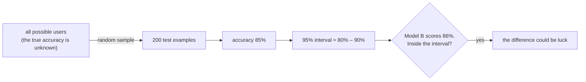

<!-- Written by `npm run lessons` from the lesson data in src/data. Edit the lesson there, not this page. -->

# Statistics: sampling, confidence intervals, hypothesis tests

**ML Foundations · Unit 1: Math foundations · Lesson 14 of 16**

> **In one line.** Statistics measures how far a result from a sample can be trusted. A confidence interval gives a likely range for the true value, and a hypothesis test asks whether a difference could just be luck.

[Open this lesson on the site](https://learn.hamropedia.com/foundations/statistics-sampling-confidence-intervals-hypothesis-tests/) for its animation, the practice game and tap-to-explain words.

## The problem it solves

Every accuracy you report comes from a finite test set, so it is an estimate with noise. Model B beating model A by 1% might be real, or might vanish on another test set. Without confidence intervals and tests you will chase noise, ship worse models and over-claim results.

## The idea

You usually see a sample, not everyone. A confidence interval gives a range that probably contains the true value. A hypothesis test asks: could this result be just luck?

## How it works, step by step

1. Treat the test set as a random sample. Each example is right (1) or wrong (0), so accuracy is a sample mean.
2. The standard error of a proportion is √(p(1 − p)/n) = √(0.85·0.15/200) ≈ 0.025.
3. By the central limit theorem, averages are close to Gaussian, so a 95% interval is about ±1.96 standard errors: 85% ± 4.9%, roughly 80% to 90%.
4. Meaning: if you repeated the whole experiment many times, about 95% of the intervals built this way would contain the true accuracy.
5. Model B scores 86%, well inside A's interval, so this data can't tell the two apart.
6. A hypothesis test makes this formal. Assume there is no real difference (the null hypothesis) and compute the p-value: the chance of a gap at least this big by luck alone. A small p-value, say below 0.05, is evidence of a real difference.
7. To shrink the interval, get more data. The standard error falls like 1/√n, so 4 times more examples halves it.

## Picture it



*A sample gives an estimate with a margin of error. A small difference that sits inside that margin proves nothing.*

## Analogy

Tasting one spoon of soup to judge the whole pot. Stirring first is random sampling.

**Where the analogy breaks.** Soup mixes easily. Real data often does not. If your sample is biased, for example only one type of user, more data will not fix it.

## Worked example

Model A scores 85% and model B 86%, on 200 test examples. The standard error is about √(0.85·0.15/200) ≈ 0.025, so the 95% range is roughly ±5%. The 1% difference could easily be luck. This is why small improvements on small test sets often mean nothing.

## Must know

- The standard error of a mean is σ/√n; of a proportion, such as an accuracy, it is √(p(1 − p)/n).
- A 95% confidence interval is about the estimate ± 1.96 standard errors.
- Central limit theorem: averages of many independent samples are roughly Gaussian, whatever the original distribution.
- A p-value is P(a result at least this extreme \| no real effect). It is not the probability that the effect is real.
- 4 times more data halves the interval width.
- The bootstrap (resample your test set with replacement many times) gives an interval for any metric without formulas.

## Common mistakes

- Reporting one accuracy number with no interval.
- Reading p = 0.04 as "a 96% chance the model is better".
- Trying many variants and reporting only the best: some will look significant by luck alone.
- Assuming a bigger sample fixes a biased one. It doesn't.

> **Not true:** A p-value of 0.04 means there is a 96% chance that the new model really is better.  
> **In fact:** A p-value is the chance of a result at least this extreme if there were no real difference. It is not the probability that the effect is real.

> **Not true:** If the best of 20 model variants passes p &lt; 0.05, its improvement must be real.  
> **In fact:** With many variants, some look significant by luck alone: about 1 in 20 passes p &lt; 0.05 with no real effect. Reporting only the best one hides that.

## Go deeper (optional): Why the standard error falls like 1/√n

1. Take n independent samples X₁, …, Xₙ, each with mean μ and variance σ². Call their average m = (X₁ + … + Xₙ)/n.
2. Two facts about variance: multiplying a variable by c multiplies its variance by c², and for independent variables the variance of a sum is the sum of the variances.
3. So Var(X₁ + … + Xₙ) = nσ², and Var(m) = nσ² / n² = σ²/n.
4. The standard error is the standard deviation of the estimate: √(σ²/n) = σ/√n.
5. For accuracy, each test example scores 1 (right) with probability p or 0 (wrong). That variable has variance p(1 − p), so the standard error is √(p(1 − p)/n): the formula in the lesson.
6. The catch is the word independent. If many test examples are near-copies of each other, the real uncertainty is larger than the formula says.

**The result.** Var(the mean of n independent samples) = σ²/n, so the standard error is σ/√n. Four times the data halves it.

## Practise

Try each one yourself first: on paper, in code or out loud. Then open the answer and compare.

### 1. Derive

A model gets 170 of 200 test examples right. Compute the 95% confidence interval by hand, using the standard error formula.

<details>
<summary>Show one good answer</summary>

Accuracy: p̂ = 170 / 200 = 0.85.

Standard error: √(p̂(1 − p̂) / n) = √(0.85·0.15 / 200) = √(0.1275 / 200) = √0.0006375 ≈ 0.0252.

95% interval: p̂ ± 1.96·SE = 0.85 ± 1.96·0.0252 = 0.85 ± 0.049.

So roughly 80% to 90%. Read it as: on test sets like this one, the true accuracy is plausibly anywhere from 80% to 90%. Another model scoring 86% on these 200 examples would not be clearly better.

</details>

### 2. Build

Write a bootstrap: resample the 200 results with replacement 10,000 times and take the 95% interval. Compare it with your formula.

<details>
<summary>Show one good answer</summary>

The bootstrap needs no formula: resample the 200 right-or-wrong results with replacement, recompute the accuracy, do it 10,000 times, and take the middle 95% of those accuracies. It gives about 80% to 90%, the same as the formula, which is reassuring.

Its strength is that the same recipe works for any metric, such as F1 or a median latency, where there is no simple standard-error formula.

```python
import numpy as np

results = np.array([1] * 170 + [0] * 30)          # 1 = right, 0 = wrong
rng = np.random.default_rng(0)
boots = [rng.choice(results, size=200, replace=True).mean() for _ in range(10_000)]
low, high = np.percentile(boots, [2.5, 97.5])
se = np.sqrt(0.85 * 0.15 / 200)
print(round(low, 3), round(high, 3))                  # about 0.80 0.90
print(round(0.85 - 1.96 * se, 3), round(0.85 + 1.96 * se, 3))   # 0.801 0.899
```

</details>

### 3. Break

Give two models the same accuracy gap on 50 examples, then on 5,000. When is the gap real? Try counting only the examples where the two models disagree.

<details>
<summary>Show one good answer</summary>

The same 4-point gap means very different things at different sizes.

On 50 examples (40 right versus 42 right), each accuracy has a margin of about ±11 points, so a 4-point gap is well inside the noise. On 5,000 examples (4,000 versus 4,200), the margin is about ±1 point, so the same 4-point gap is almost certainly real.

Counting only the examples where the models disagree is sharper, because both models were tested on the same examples. If the gap is just luck, each disagreement is a coin flip for which model wins. With 50 examples, say they disagree on 8, B winning 5 and A winning 3: that is very possible by chance (p ≈ 0.73). With 5,000 examples, disagreeing on 800 with B winning 500: by chance that would almost never happen (p is about 1e-12). This is McNemar's test.

```python
from math import comb, sqrt

def sign_test(wins_b, wins_a):
    n, k = wins_b + wins_a, max(wins_b, wins_a)
    tail = sum(comb(n, i) for i in range(k, n + 1)) / 2**n
    return min(1.0, 2 * tail)                          # two-sided p-value

for n, a, b, b_only, a_only in [(50, 40, 42, 5, 3), (5000, 4000, 4200, 500, 300)]:
    margin = 1.96 * sqrt(0.8 * 0.2 / n)
    print(n, f"gap {(b - a) / n:.0%}, margin ±{margin:.1%}, p = {sign_test(b_only, a_only):.2g}")
```

</details>

### 4. Explain

Explain a confidence interval with the soup picture, and why a biased spoon ruins it.

<details>
<summary>Show one good answer</summary>

You taste one spoonful to judge a whole pot of soup. If you stirred first, one spoonful tells you a lot, but not everything, so you would say "it's about this salty, give or take a bit". That "give or take" range is a confidence interval. A bigger spoon, meaning more test data, gives a narrower range.

A biased spoon ruins it. If you never stir and only skim the top, where the oil floats, your spoonful is unlike the pot, and the interval is narrow and confidently wrong. A confidence interval only covers random luck in which spoonful you took, not a systematic bias in how you took it. In ML, a test set that doesn't look like real users is a biased spoon.

</details>

## Check you understood

Answer in your head first, then open each one.

<details>
<summary>&lt;b>Accuracy is 90% on 100 examples. Roughly what is the 95% interval?&lt;/b></summary>

SE = √(0.9·0.1/100) = 0.03, so 90% ± 5.9%: about 84% to 96%.

</details>

<details>
<summary>&lt;b>How much more data do you need to halve the interval width?&lt;/b></summary>

4 times as much, because the width falls like 1/√n.

</details>

<details>
<summary>&lt;b>What does a p-value of 0.3 mean when comparing two models?&lt;/b></summary>

A gap this big would happen 30% of the time by luck alone, so there is no good evidence of a real difference.

</details>

<details>
<summary>&lt;b>What does the central limit theorem say?&lt;/b></summary>

The average of many independent samples is approximately Gaussian, whatever the shape of the original distribution.

</details>

## Go further (optional)

The lesson above is enough on its own. These free extras give a second explanation.

- WATCH · [Confidence Intervals, Clearly Explained](https://www.youtube.com/results?search_query=StatQuest+Confidence+Intervals%2C+Clearly+Explained) · StatQuest (Josh Starmer)
- WATCH · [p-values: What they are and how to interpret them](https://www.youtube.com/results?search_query=StatQuest+p-values%3A+What+they+are+and+how+to+interpret+them) · StatQuest (Josh Starmer)
- WATCH · [But what is the Central Limit Theorem?](https://www.3blue1brown.com/lessons/clt) · 3Blue1Brown
- PLAY · [Seeing Theory: Frequentist Inference](https://seeing-theory.brown.edu/frequentist-inference/index.html) · Brown University · interactive

---

[← Maximum likelihood estimation](maximum-likelihood-estimation.md) · [All lessons](../../README.md) · [Entropy, cross-entropy and KL divergence →](entropy-cross-entropy-and-kl-divergence.md)
