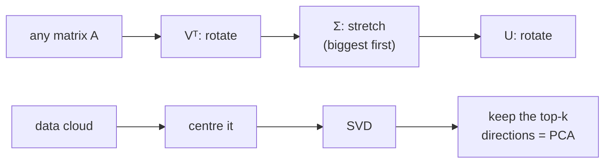

<!-- Written by `npm run lessons` from the lesson data in src/data. Edit the lesson there, not this page. -->

# SVD, and the maths behind PCA

**ML Foundations · Unit 1: Math foundations · Lesson 7 of 16**

> **In one line.** SVD splits any matrix into three simple moves: rotate, stretch, rotate. PCA uses it to find the directions in which data varies most, so you can keep a few and drop the rest.

[Open this lesson on the site](https://learn.hamropedia.com/foundations/svd-and-the-maths-behind-pca/) for its animation, the practice game and tap-to-explain words.

## The problem it solves

Real data has many features, and many move together: height and weight, or neighbouring pixels. Working in fewer dimensions is faster, easier to plot and often less noisy. PCA finds the few directions that keep most of the information, and SVD is the reliable way to compute them for any matrix, square or not.

## The idea

SVD splits any matrix into three simple steps: rotate, stretch, rotate (A = UΣVᵀ). The biggest stretch values show the most important directions. PCA keeps only those directions of the data.

## How it works, step by step

1. Centre the data: subtract the mean of each feature, so the cloud sits around the origin. PCA measures spread around the mean, so this step is essential.
2. Run SVD on the centred data matrix X (n samples × d features): X = UΣVᵀ.
3. The rows of Vᵀ are the principal directions, ordered from most to least spread. The first points along the long axis of the cloud.
4. The singular values in Σ say how much spread each direction has: the variance along direction k is σₖ² / (n − 1).
5. The share of variance explained by direction k is σₖ² / Σσ². If the first two directions explain 95%, two numbers per sample keep almost everything.
6. Project onto the top k directions: Z = X·Vₖ. Each sample is now k numbers instead of d.
7. To go back approximately, compute Z·Vₖᵀ and add the mean. What is lost is exactly the spread along the dropped directions.

## Picture it



*SVD breaks any matrix into rotate → stretch → rotate. PCA keeps only the directions with the biggest stretch.*

## Analogy

A cloud of points shaped like a rugby ball has a long axis, a medium axis and a short axis. PCA keeps the long axes and drops the short ones.

**Where the analogy breaks.** PCA only finds straight directions. If the data lies on a curve, like a spiral, PCA misses the real shape.

## Worked example

If points lie close to the line y = x, the first PCA direction is about [0.71, 0.71], and it carries almost all the variance.

```python
Xc = X - X.mean(axis=0)                 # always centre first
U, S, Vt = np.linalg.svd(Xc, full_matrices=False)
Z = Xc @ Vt[:k].T                       # data in the top-k directions
explained = S**2 / (S**2).sum()         # share of variance per direction
```

## Must know

- Every matrix has an SVD; not every matrix has an eigendecomposition.
- Principal directions = right singular vectors of the centred data = eigenvectors of the covariance matrix.
- Explained variance ratio = σₖ² / Σσ². Plot it to choose k: look for the "elbow".
- Always centre. Usually also scale features to similar ranges, or the feature with the biggest units dominates.
- Truncated SVD gives the best possible rank-k approximation of a matrix. Weight compression and LoRA build on this idea.
- PCA is linear: it only finds straight directions.

## Common mistakes

- Forgetting to centre. The first "direction" then mostly points at the mean.
- Not scaling features. Income in pounds swamps age in years.
- Reading principal directions as causes. They are directions of spread, nothing more.
- Fitting PCA on all the data, test set included. Fit it on the training data, then apply it to the test data.

> **Not true:** PCA finds the same directions whether or not you subtract the mean first.  
> **In fact:** PCA measures spread around the mean. Without centring, the first direction mostly points from the origin towards the mean of the data.

> **Not true:** Principal directions = the causes behind the data.  
> **In fact:** They are only the directions along which the data spreads out most. PCA says nothing about what causes what.

## Go deeper (optional): Why the direction of most variance is an eigenvector

1. Centre the data and call its covariance matrix C = XᵀX / (n − 1). Take any direction u of length 1.
2. Project every sample onto u: the scores are Xu. Their variance is (Xu)ᵀ(Xu) / (n − 1) = uᵀCu.
3. PCA asks for the u that makes uᵀCu as large as possible, under the constraint uᵀu = 1. Without the constraint you could simply make u longer.
4. Use a Lagrange multiplier (the last lesson of this unit): L = uᵀCu − λ(uᵀu − 1). Setting the gradient with respect to u to zero gives 2Cu − 2λu = 0, so Cu = λu.
5. So the best u has to be an eigenvector of C. Which one? Put Cu = λu back into the variance: uᵀCu = λ·uᵀu = λ.
6. The variance along an eigenvector equals its eigenvalue, so the largest eigenvalue wins. Ask again for the best direction at 90° to the ones already chosen, and you get the second eigenvector, then the third.

**The result.** The principal directions are the eigenvectors of the covariance matrix, and the variance along each one is its eigenvalue, λₖ = σₖ² / (n − 1).

## Practise

Try each one yourself first: on paper, in code or out loud. Then open the answer and compare.

### 1. Derive

For centred data X, show on paper that the right singular vectors of X are the eigenvectors of XᵀX, and how the singular values relate to the eigenvalues.

<details>
<summary>Show one good answer</summary>

Write the SVD of the centred data: X = U·Σ·Vᵀ, where U and V have orthonormal columns (UᵀU = I) and Σ is diagonal with the singular values σᵢ.

Then XᵀX = (UΣVᵀ)ᵀ(UΣVᵀ) = V·Σ·Uᵀ·U·Σ·Vᵀ = V·Σ²·Vᵀ.

Multiply both sides by V: XᵀX·V = V·Σ². Read it column by column: XᵀX·vᵢ = σᵢ²·vᵢ. So each right singular vector vᵢ is an eigenvector of XᵀX, with eigenvalue σᵢ².

The covariance matrix is C = XᵀX / (n − 1), so its eigenvalues are λᵢ = σᵢ² / (n − 1), with the same eigenvectors. That is why PCA can be done with SVD on X, which is more accurate than forming XᵀX first.

</details>

### 2. Build

Implement PCA with SVD on a real dataset (Iris or MNIST). Plot the data in the top 2 components, and plot the explained-variance curve.

<details>
<summary>Show one good answer</summary>

Centre the data (subtract each column's mean), take the SVD, and the rows of Vᵀ are the principal directions. Project onto the first two to plot, and the explained-variance ratio is σᵢ² / Σσ².

On Iris, the first component alone keeps about 92% of the variance and the first two about 98%. In the 2-D plot, the three species separate clearly along the first component.

Scikit-learn is only used to load the data. The PCA itself is NumPy.

```python
import numpy as np
import matplotlib.pyplot as plt
from sklearn.datasets import load_iris      # only to load the data

iris = load_iris()
X, y = iris.data, iris.target                # (150, 4)

Xc = X - X.mean(axis=0)                      # centre first
U, S, Vt = np.linalg.svd(Xc, full_matrices=False)
ratio = S**2 / np.sum(S**2)
Z = Xc @ Vt[:2].T                            # coordinates in the top 2 components
print(ratio.round(3))                        # [0.925 0.053 0.017 0.005]

fig, axes = plt.subplots(1, 2, figsize=(10, 4))
axes[0].scatter(Z[:, 0], Z[:, 1], c=y, s=12)
axes[0].set_xlabel("PC 1"); axes[0].set_ylabel("PC 2")
axes[1].plot(np.arange(1, 5), np.cumsum(ratio), marker="o")
axes[1].set_xlabel("number of components"); axes[1].set_ylabel("variance kept")
plt.tight_layout(); plt.show()
```

</details>

### 3. Break

Run PCA without centring the data first. Compare the first component with the centred version. Why is it wrong?

<details>
<summary>Show one good answer</summary>

Without centring, the first "component" points from the origin towards the middle of the data cloud, instead of along the cloud's longest axis. On Iris it lines up almost exactly with the mean vector (cosine about 0.99), while the true first component is a different direction.

Why it is wrong: PCA is meant to find the directions in which the data varies. Variance is measured around the mean. Without centring, the SVD also "explains" the distance from the origin to the data, which is not variation at all, just where the cloud happens to sit. So always subtract the mean (and, if features use very different units, divide by their standard deviation too).

```python
import numpy as np
from sklearn.datasets import load_iris

X = load_iris().data
mean = X.mean(axis=0)
first_raw = np.linalg.svd(X, full_matrices=False)[2][0]
first_centred = np.linalg.svd(X - mean, full_matrices=False)[2][0]

cos = lambda a, b: abs(a @ b) / (np.linalg.norm(a) * np.linalg.norm(b))
print(round(cos(first_raw, mean), 3))           # ≈ 0.99: it just found the mean
print(round(cos(first_raw, first_centred), 3))  # a different direction
```

</details>

### 4. Explain

Explain PCA with the rugby-ball picture, and give one case where PCA fails.

<details>
<summary>Show one good answer</summary>

Picture a cloud of points shaped like a rugby ball. It has a long axis, a medium one and a short one. PCA finds those axes, longest first, and lets you keep only the long ones. Describing each point by where it sits along the long axis (and maybe the medium one) loses very little, because the points barely spread along the short axis anyway. That is how PCA turns many features into a few, while keeping most of the information.

One case where it fails: when the data lies on a curve, like points along a spiral or a bent sheet. PCA only finds straight axes, so it squashes the curve flat and points that were far apart along the curve land on top of each other. Another: when the direction that separates two classes has small variance, PCA may throw exactly that direction away.

</details>

## Check you understood

Answer in your head first, then open each one.

<details>
<summary>&lt;b>Why must you centre data before PCA?&lt;/b></summary>

PCA finds directions of spread around the mean. Without centring, the first direction mostly points from the origin to the middle of the data.

</details>

<details>
<summary>&lt;b>The singular values are [4, 2, 1]. What share of the variance does the first direction explain?&lt;/b></summary>

16 / (16 + 4 + 1) = 16/21 ≈ 76%.

</details>

<details>
<summary>&lt;b>How is PCA related to eigenvectors?&lt;/b></summary>

The principal directions are the eigenvectors of the covariance matrix XᵀX/(n − 1), and its eigenvalues are the variances along them.

</details>

<details>
<summary>&lt;b>When would PCA give a poor summary of the data?&lt;/b></summary>

When the structure is curved, like a spiral, or when the important differences have small variance compared with noisy features.

</details>

## Go further (optional)

The lesson above is enough on its own. These free extras give a second explanation.

- PLAY · [Principal Component Analysis, explained visually](https://setosa.io/ev/principal-component-analysis/) · Setosa · drag the points yourself  
  **Worth it:** Drag the data points and watch the principal directions swing round to follow them. PCA clicks in a couple of minutes.
- WATCH · [Principal Component Analysis (PCA), Step-by-Step](https://www.youtube.com/results?search_query=StatQuest+Principal+Component+Analysis+%28PCA%29%2C+Step-by-Step) · StatQuest (Josh Starmer)
- WATCH · [Singular Value Decomposition (SVD): Overview](https://www.youtube.com/results?search_query=Steve+Brunton+Singular+Value+Decomposition+overview) · Steve Brunton
- READ · [Mathematics for Machine Learning, Ch 4 (SVD) and Ch 10 (PCA)](https://mml-book.github.io/) · Deisenroth, Faisal, Ong · free

---

[← Eigenvalues and eigenvectors](eigenvalues-and-eigenvectors.md) · [All lessons](../../README.md) · [Derivatives and the chain rule →](derivatives-and-the-chain-rule.md)
