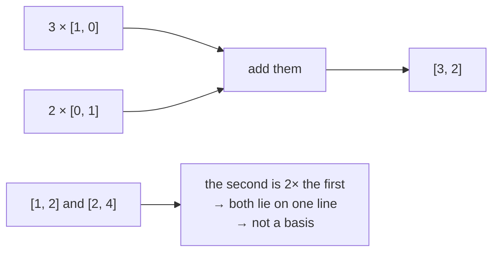

<!-- Written by `npm run lessons` from the lesson data in src/data. Edit the lesson there, not this page. -->

# Vectors, span and basis

**ML Foundations · Unit 1: Math foundations · Lesson 1 of 16**

> **In one line.** A vector is a list of numbers that you can draw as an arrow. The span of some vectors is every point you can reach by scaling and adding them, and a basis is the smallest set that reaches the whole space.

[Open this lesson on the site](https://learn.hamropedia.com/foundations/vectors-span-and-basis/) for its animation, the practice game and tap-to-explain words.

## The problem it solves

Every piece of data in ML becomes a vector: a house is [size, rooms, age], a word is a list of 768 numbers, an image is a long list of pixel values. To reason about data you need to know what you can build from a few vectors, and whether a feature carries new information or just repeats what you already have.

## The idea

A vector is an arrow, or a list of numbers. The span is every point you can reach by scaling and adding your vectors. A basis is the smallest set of vectors that can reach every point in the space.

## How it works, step by step

1. A vector [3, 2] means "3 steps along x, then 2 steps along y". Drawn from the origin it is an arrow; written down it is just two numbers.
2. Scaling multiplies every entry: 3·[1, 0] = [3, 0]. A negative number flips the arrow round.
3. Adding goes tip to tail, entry by entry: [3, 0] + [0, 2] = [3, 2]. A sum of scaled vectors is called a linear combination.
4. The span of some vectors is every linear combination of them. [1, 0] and [0, 1] can reach any point in 2-D, so their span is the whole plane.
5. Vectors are linearly independent if none of them can be made from the others. [1, 2] and [2, 4] are not: [2, 4] = 2·[1, 2], so together they only span one line.
6. A basis is a set of independent vectors that spans the space. Every basis of 2-D has exactly 2 vectors; that number is the dimension of the space.
7. In code, stack the vectors as the columns of a matrix and ask for its rank with np.linalg.matrix_rank. If the rank equals the number of vectors, they are independent.

## Picture it



*Scaling and adding basis vectors reaches any point. Two vectors on the same line can only ever reach that line.*

## Analogy

Two ingredients, flour and water. Every mix you can make is the span. A third ingredient that is only 'flour plus water' adds nothing new.

**Where the analogy breaks.** Ingredient amounts cannot be negative. Vector weights can be negative.

## Worked example

In 2D, [1, 0] and [0, 1] form a basis: [3, 2] = 3·[1, 0] + 2·[0, 1]. But [1, 2] and [2, 4] are not a basis. The second is 2 times the first, so together they only reach points on one line. In ML, an embedding is a vector, and each feature is one coordinate.

## Must know

- Two views of the same thing: an arrow (geometry) and a list of numbers (data).
- Linear combination: scale each vector, then add. Almost everything in linear algebra is built from this.
- The span is all the linear combinations. It is always a line, a plane or a higher-dimensional flat space through the origin.
- Independent: no vector is a combination of the others. A dependent vector adds nothing new to the span.
- Basis: independent and spans the space. In n dimensions every basis has exactly n vectors.
- In ML, a duplicated or derived feature (a price in pounds and in dollars) is a dependent direction: no new information, and it can make some models numerically unstable.

## Common mistakes

- Thinking more vectors always means a bigger span. Extra dependent vectors add nothing.
- Forgetting that every span passes through the origin: scale everything by 0 and you are there.
- Testing independence with an exact "== 0" check on decimals. Use the rank with a tolerance, or look at the singular values.

> **Not true:** Adding one more vector to a set always makes its span bigger.  
> **In fact:** Only an independent vector adds something. A vector that is a combination of the others, like [2, 4] next to [1, 2], reaches nothing new.

> **Not true:** Span of two vectors: a line or a plane, which may miss the origin.  
> **In fact:** Every span contains the origin: scale all the vectors by 0 and you are there.

## Practise

Try each one yourself first: on paper, in code or out loud. Then open the answer and compare.

### 1. Derive

Are [1, 2, 3], [0, 1, 1] and [1, 3, 4] a basis of 3D space? Decide by hand, and show which vector (if any) is a combination of the others.

<details>
<summary>Show one good answer</summary>

No, they are not a basis.

Look for one vector made from the others: [1, 2, 3] + [0, 1, 1] = [1, 3, 4]. The third vector adds no new direction, so the three only span a flat plane through the origin, not all of 3D space.

Check with the determinant of the matrix whose rows are the three vectors:  
1·(1·4 − 1·3) − 2·(0·4 − 1·1) + 3·(0·3 − 1·1) = 1 + 2 − 3 = 0.  
A determinant of 0 means the vectors are dependent. A basis of 3D needs 3 independent vectors.

</details>

### 2. Build

Write is_independent(vectors) using the rank of the stacked matrix. Test it on the example above and on the standard basis.

<details>
<summary>Show one good answer</summary>

Stack the vectors as rows of a matrix. Its rank is the number of truly independent directions, so the vectors are independent exactly when the rank equals how many vectors there are.

The example from the derive step gives rank 2, so it is False; the standard basis gives rank 3, so True.

```python
import numpy as np

def is_independent(vectors):
    M = np.stack(vectors)                       # one vector per row
    return np.linalg.matrix_rank(M) == len(vectors)

print(is_independent([np.array([1, 2, 3]), np.array([0, 1, 1]), np.array([1, 3, 4])]))  # False
print(is_independent(list(np.eye(3))))                                                # True
print(is_independent([np.array([1, 2]), np.array([2, 4])]))                           # False
```

</details>

### 3. Break

Test two almost-parallel vectors, like [1, 0] and [1, 1e-12]. Does your function call them independent? What does this teach you about floating point?

<details>
<summary>Show one good answer</summary>

[1, 0] and [1, 1e-12] come out as independent: the rank is 2. Mathematically that is correct, since they are not exactly parallel. But in practice they point in almost the same direction, and any real data with a tiny bit of noise would look the same.

What this teaches about floating point: computers can't tell "exactly 0" from "very small", so rank is decided with a tolerance. np.linalg.matrix_rank counts singular values bigger than a tiny cutoff (about 1e-16 times the largest). 1e-12 is above that cutoff, so it counts. With [1, 1e-17], the rank drops to 1.

So "independent or not" is really a question of degree. The ratio of the largest to the smallest singular value, called the condition number, tells you how close to dependent a set of vectors is. Here it is about 10¹²: almost dependent, and any calculation that relies on them being independent will be unstable.

```python
import numpy as np

M = np.array([[1, 0], [1, 1e-12]])
print(np.linalg.matrix_rank(M))                     # 2: counted as independent
print(np.linalg.matrix_rank(np.array([[1, 0], [1, 1e-17]])))   # 1
print(f"{np.linalg.cond(M):.1e}")                   # 2.0e+12: almost dependent
```

</details>

### 4. Explain

Explain span and basis using a map and two directions of travel.

<details>
<summary>Show one good answer</summary>

On a map you can walk east and you can walk north. By combining some amount of east with some amount of north, you can reach every point on the map: the span of those two directions is the whole map.

A basis is a set of directions that reaches everywhere with nothing wasted. East and north are a basis: you need both, and neither can be made from the other. Add "north-east" and you still reach the same places, because north-east is just some east plus some north, so it adds nothing new. And if both your directions were "north" and "a bit more north", you could only ever walk along one line: their span is a line, not the map.

</details>

## Check you understood

Answer in your head first, then open each one.

<details>
<summary>&lt;b>Do [1, 0] and [3, 0] form a basis of 2-D space?&lt;/b></summary>

No. [3, 0] = 3·[1, 0], so both lie on the x-axis. Their span is a line, not the whole plane.

</details>

<details>
<summary>&lt;b>How many vectors are in a basis of 3-D space?&lt;/b></summary>

Exactly 3. Fewer can't reach every point; more can't all be independent.

</details>

<details>
<summary>&lt;b>Write [5, −1] as a combination of [1, 0] and [0, 1].&lt;/b></summary>

5·[1, 0] + (−1)·[0, 1].

</details>

<details>
<summary>&lt;b>A dataset has height in centimetres and height in inches as two features. Why is that a problem?&lt;/b></summary>

One is a fixed multiple of the other, so they are dependent. The second adds no information and can make the maths of some models unstable.

</details>

## Go further (optional)

The lesson above is enough on its own. These free extras give a second explanation.

- WATCH · [Essence of Linear Algebra, Ch 1–2: Vectors; Linear combinations, span and basis vectors](https://www.3blue1brown.com/lessons/span) · 3Blue1Brown
- READ · [Mathematics for Machine Learning, Ch 2 (vector spaces, linear independence, basis)](https://mml-book.github.io/) · Deisenroth, Faisal, Ong · free

---

[← Testing numerical code (np.allclose, pytest)](../unit-0-toolkit/testing-numerical-code-np-allclose-pytest.md) · [All lessons](../../README.md) · [Matrices as transformations; matrix multiplication →](matrices-as-transformations-matrix-multiplication.md)
