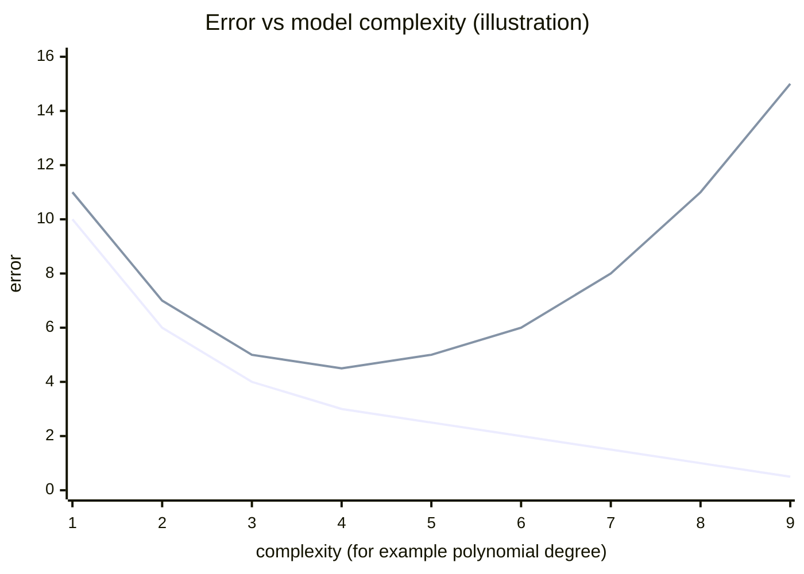

<!-- Written by `npm run lessons` from the lesson data in src/data. Edit the lesson there, not this page. -->

# Bias–variance trade-off and overfitting

**ML Foundations · Unit 2: Classical ML, built by you · Lesson 5 of 17**

> **In one line.** Bias is error from a model too simple to capture the pattern. Variance is error from a model so flexible that it chases the noise in its training data. Good models balance the two.

[Open this lesson on the site](https://learn.hamropedia.com/foundations/bias-variance-trade-off-and-overfitting/) for its animation, the practice game and tap-to-explain words.

## The problem it solves

Every model choice — degree, depth, number of features, k — moves you between underfitting and overfitting. Without this picture you can't tell whether to make a model bigger or smaller, or whether to collect more data. The bias–variance trade-off is the map for those decisions.

## The idea

Bias is error from a model that is too simple. Variance is error from a model that is too sensitive to the training data. Overfitting means low training error but high test error.

## How it works, step by step

1. Take 12 noisy points from a smooth curve, and fit polynomials of growing degree.
2. Degree 1 (a line) can't bend: it misses the shape on training and validation data alike. That is high bias, or underfitting.
3. Degree 3 follows the real shape: training and validation errors are both low.
4. Degree 9 bends through almost every training point, but swings wildly in between: tiny training error, large validation error. That is high variance, or overfitting.
5. Plot both errors against degree. Training error keeps falling; validation error falls and then rises, a U shape. Choose the bottom of the U.
6. More data reduces variance, because a flexible model has less room to chase noise. A simpler model or regularisation reduces it too.
7. Formally: expected error = bias² + variance + irreducible noise. You can trade the first two, but never beat the noise.

## Picture it



*Training error (the line that keeps falling) always improves with complexity. Validation error falls, then rises again: the bottom of that U is the sweet spot; to the right is overfitting.*

## Analogy

Two students. One memorises every answer and fails on new questions (high variance). One only learns 'the answer is usually C' (high bias). You want the one who learns the ideas.

**Where the analogy breaks.** With very large deep learning models, more size can sometimes reduce overfitting ('double descent'). The simple trade-off picture is not the whole story.

## Worked example

Fit points from a curve with polynomials of degree 1, 3 and 15. Degree 1 underfits. Degree 15 passes through every training point but swings wildly between them.

```python
for deg in [1, 3, 15]:
    coef = np.polyfit(x_train, y_train, deg)
    print(deg, np.mean((np.polyval(coef, x_val) - y_val)**2))
```

## Must know

- High bias: bad on training data too. Fix: a bigger model, better features, less regularisation.
- High variance: good on training data, bad on validation. Fix: more data, regularisation, a simpler model, early stopping.
- Training error alone can't tell you which problem you have. Compare it with validation error.
- Learning curves (error against training-set size) also show it: a big, stable gap means variance.
- Very large neural networks can break the simple U shape ("double descent", later in this unit).

## Common mistakes

- Picking the model with the lowest training error.
- Adding complexity when the model is already overfitting.
- Collecting more data to fix bias. It won't help a model that is too simple.

> **Not true:** Collecting more data is the reliable fix for a model that is too simple.  
> **In fact:** More data reduces variance, not bias. A model too simple for the pattern stays wrong however much data it sees: make the model or its features richer.

> **Not true:** The model with the lowest training error is the best one to choose.  
> **In fact:** A model can reach a low training error by memorising. Choose by validation error, which shows how it does on data it has not seen.

## Go deeper (optional): Proving that expected error = bias² + variance + noise

1. Set-up: the data follows y = f(x) + ε, where the noise ε has mean 0 and variance σ². A model trained on a random training set predicts f̂(x). Fix one point x. Write f for the true value, f̂ for the prediction, and m = E[f̂] for the prediction averaged over every possible training set.
2. Split the error into three pieces: y − f̂ = ε + (f − m) + (m − f̂). They are the noise, how far the average model is from the truth, and how far this model is from the average model.
3. Square it and take the expectation. The three squares give E[ε²] = σ², (f − m)² and E[(m − f̂)²].
4. The cross terms all vanish. The noise ε has mean 0 and is independent of the training set, so every term containing ε averages to 0. And E[m − f̂] = m − m = 0, so the term 2(f − m)·E[m − f̂] is 0 as well.
5. Name what is left: (f − m)² is the bias squared, E[(f̂ − m)²] is the variance of the model, and σ² is the noise.

**The result.** E[(y − f̂)²] = (f − E[f̂])² + E[(f̂ − E[f̂])²] + σ² = bias² + variance + noise. The noise term does not depend on the model at all.

## Practise

Try each one yourself first: on paper, in code or out loud. Then open the answer and compare.

### 1. Derive

Write the decomposition: expected error = bias² + variance + noise. Say in words what each term means.

<details>
<summary>Show one good answer</summary>

For a point x with true value y = f(x) + noise, averaged over many possible training sets:

E[(y − f̂(x))²] = (E[f̂(x)] − f(x))² + E[(f̂(x) − E[f̂(x)])²] + σ²  
                       bias²                    variance                noise

Bias²: how far the average model is from the truth. If you could train on many different datasets and average the models, how wrong would that average still be? This is error from assumptions that are too simple, like a straight line for a curve.

Variance: how much the model jumps around between different training sets. This is error from being too sensitive to the particular sample you happened to get.

Noise (σ²): randomness in y itself that no model can predict. It is the floor: no model can do better than this.

</details>

### 2. Build

Fit polynomials of degree 1 to 15 on 30 noisy points. Plot train and validation error against degree, and mark the best degree.

<details>
<summary>Show one good answer</summary>

Generate 30 training points from y = sin(2πx) plus noise, and 200 validation points the same way. Fit polynomials of degree 1 to 15 and record both errors.

Training error keeps falling as the degree rises, because a bigger polynomial can always bend closer to the training points. Validation error falls at first, reaches its lowest at a middle degree (3 to 5 on this data), then rises as the model starts chasing the noise. Choose the bottom of that U.

np.polynomial.Polynomial.fit rescales x internally, which keeps high degrees numerically stable.

```python
import numpy as np
import matplotlib.pyplot as plt

rng = np.random.default_rng(0)
truth = lambda x: np.sin(2 * np.pi * x)
x_tr, x_va = rng.random(30), rng.random(200)
y_tr = truth(x_tr) + rng.normal(0, 0.3, 30)
y_va = truth(x_va) + rng.normal(0, 0.3, 200)

degrees = range(1, 16)
train_err, val_err = [], []
for d in degrees:
    model = np.polynomial.Polynomial.fit(x_tr, y_tr, d)
    train_err.append(np.mean((model(x_tr) - y_tr) ** 2))
    val_err.append(np.mean((model(x_va) - y_va) ** 2))
best = degrees[int(np.argmin(val_err))]
print("best degree:", best)

plt.plot(degrees, train_err, label="train")
plt.plot(degrees, val_err, label="validation")
plt.axvline(best, linestyle=":", color="grey")
plt.yscale("log"); plt.xlabel("degree"); plt.ylabel("mean squared error")
plt.legend(); plt.show()
```

</details>

### 3. Break

Repeat with 3,000 points instead of 30. Does the best degree change? Explain why more data reduces variance.

<details>
<summary>Show one good answer</summary>

With 3,000 points, the validation curve barely rises at high degrees, and the best degree moves up (to around 6 to 10 on this data). The extra flexibility no longer hurts much.

Why more data reduces variance: a wiggly model overfits by bending to fit the noise in the few points it saw. With 30 points there is room between them to bend wildly. With 3,000, every bit of the curve is pinned down by many nearby points whose noise averages out, so the fitted curve hardly changes from one training set to the next. Variance shrinks roughly like 1/n, while bias doesn't change, so the best balance shifts towards more complex models.

```python
import numpy as np

rng = np.random.default_rng(0)
truth = lambda x: np.sin(2 * np.pi * x)
x_va = rng.random(2000)
y_va = truth(x_va) + rng.normal(0, 0.3, 2000)
for n in [30, 3000]:
    x_tr = rng.random(n)
    y_tr = truth(x_tr) + rng.normal(0, 0.3, n)
    errs = [np.mean((np.polynomial.Polynomial.fit(x_tr, y_tr, d)(x_va) - y_va) ** 2) for d in range(1, 16)]
    print(n, "points: best degree", int(np.argmin(errs)) + 1, "| error at degree 15:", round(errs[-1], 3))
```

</details>

### 4. Explain

Explain overfitting with the two-students picture.

<details>
<summary>Show one good answer</summary>

Two students prepare for an exam. The first memorises every answer in the practice book word for word. They score 100% on those exact questions, but a new question throws them completely: that is overfitting, or high variance. The second only learns "the answer is usually C". They do equally badly on old and new questions: that is underfitting, or high bias.

You want a third student, who learns the ideas behind the answers, so they do well on questions they have never seen. In ML, a model overfits when it learns the noise and quirks of its training data instead of the real pattern, and the sign is a big gap between training and validation scores.

</details>

## Check you understood

Answer in your head first, then open each one.

<details>
<summary>&lt;b>Training error 2%, validation error 25%. Bias or variance problem?&lt;/b></summary>

Variance: overfitting. Add data, regularise or simplify.

</details>

<details>
<summary>&lt;b>Training error 20%, validation error 21%. Bias or variance?&lt;/b></summary>

Bias: the model is too simple. Make it more flexible or add better features.

</details>

<details>
<summary>&lt;b>Why does more data reduce variance?&lt;/b></summary>

With more points, the noise averages out and a flexible model can't bend to every random wiggle.

</details>

<details>
<summary>&lt;b>What part of the error can never be removed?&lt;/b></summary>

The irreducible noise in the labels themselves.

</details>

## Go further (optional)

The lesson above is enough on its own. These free extras give a second explanation.

- PLAY · [The Bias Variance Tradeoff](https://mlu-explain.github.io/bias-variance/) · MLU-Explain (Amazon) · animated, scroll through it  
  **Worth it:** Models of growing complexity wobble and settle on screen as you scroll, with the error curves drawn alongside. Exactly this topic, as moving pictures.
- WATCH · [Machine Learning Fundamentals: Bias and Variance](https://www.youtube.com/results?search_query=StatQuest+Machine+Learning+Fundamentals%3A+Bias+and+Variance) · StatQuest (Josh Starmer)
- READ · [ISLP, Ch 2 (the bias–variance trade-off)](https://www.statlearning.com/) · free book
- WATCH · [Bias–variance trade-off lecture](https://www.youtube.com/results?search_query=Kilian+Weinberger+CS4780+bias+variance+tradeoff) · Kilian Weinberger, Cornell CS4780

---

[← Regularisation: L1 and L2](regularisation-l1-and-l2.md) · [All lessons](../../README.md) · [Metrics: precision, recall, F1, ROC-AUC, confusion matrix →](metrics-precision-recall-f1-roc-auc-confusion-matrix.md)
