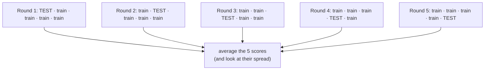

<!-- Written by `npm run lessons` from the lesson data in src/data. Edit the lesson there, not this page. -->

# Cross-validation and data leakage

**ML Foundations · Unit 2: Classical ML, built by you · Lesson 7 of 17**

> **In one line.** Cross-validation scores a model by rotating which slice of the data is held out, so every row is tested once. Data leakage is any way that information from the held-out data sneaks into training.

[Open this lesson on the site](https://learn.hamropedia.com/foundations/cross-validation-and-data-leakage/) for its animation, the practice game and tap-to-explain words.

## The problem it solves

One train/validation split can be lucky or unlucky, especially with small datasets, so a single score can mislead you by several percent. Cross-validation gives a steadier score and tells you how much it wobbles. Leakage is the most common reason a model that looked brilliant in testing fails in real use, so you need to know where it hides.

## The idea

Cross-validation splits the data into k parts: train on k − 1 parts, test on the last one, and rotate. Data leakage is when information from the test data sneaks into training, so results look better than they really are.

## How it works, step by step

1. Shuffle the rows and cut them into k equal folds, for example k = 5.
2. Round 1: train on folds 2–5, score on fold 1. Round 2: train on folds 1, 3, 4 and 5, score on fold 2. And so on.
3. After k rounds every row has been scored exactly once, by a model that never saw it.
4. Report the mean of the k scores and their spread (standard deviation). A big spread means one split could have misled you.
5. Every preprocessing step that learns from data (scaling, filling missing values, picking features) must be fitted inside each round, on that round's training folds only.
6. Group related rows: all scans of one patient must sit in the same fold. For time series, always train on earlier data and test on later data.

## Picture it



*5-fold cross-validation: every part of the data is used for testing exactly once, giving a more reliable score than one split.*

## Analogy

Leakage is like a student seeing the exam answers the night before. The high score is real, but it means nothing.

**Where the analogy breaks.** Cheating is on purpose. Leakage is usually an accident, hidden in preprocessing, so you must hunt for it.

## Worked example

There are three common leaks. Scaling with the mean of all the data, test rows included. The same patient in both train and test, with two scans: split by patient, not by scan. And, in time series, using the future to predict the past.

```python
mu, sd = X_train.mean(0), X_train.std(0)   # training rows only
X_train = (X_train - mu) / sd
X_test  = (X_test  - mu) / sd              # reuse the SAME mu and sd
```

## Must know

- k-fold: k models, k scores; report mean ± spread.
- k = 5 or 10 is typical; leave-one-out (k = n) is costly and noisy.
- Stratified folds keep the class balance the same in every fold.
- Group k-fold keeps related rows together; time-series splits only look forwards.
- Leakage: anything at training time that would not be known at prediction time.
- Suspiciously good results are a reason to hunt for leakage, not to celebrate.

## Common mistakes

- Scaling or selecting features on the full dataset before splitting.
- The same person, house or document in both training and test folds.
- A feature computed from the label, or from the future (a "days until churn" column).
- Using cross-validation to choose settings and then reporting that same score as final.

> **Not true:** It is safe to scale the features on the whole dataset before splitting it into folds.  
> **In fact:** The scaler then learns the mean and spread of the test rows too, which is leakage. Fit it inside each fold, on the training part only.

> **Not true:** The cross-validation score used to choose the settings is also a fair final score.  
> **In fact:** Choosing settings by that score fits them to those folds, so the score is too optimistic. Report the final score on data that was never used for any choice.

## Practise

Try each one yourself first: on paper, in code or out loud. Then open the answer and compare.

### 1. Derive

Draw 5-fold cross-validation for 10 rows: which rows train and which rows test in each fold.

<details>
<summary>Show one good answer</summary>

Split the 10 rows (after shuffling) into 5 folds of 2 rows each. In each round, one fold is the test fold and the other four train the model:

Fold 1: test rows 1–2, train rows 3–10  
Fold 2: test rows 3–4, train rows 1–2 and 5–10  
Fold 3: test rows 5–6, train rows 1–4 and 7–10  
Fold 4: test rows 7–8, train rows 1–6 and 9–10  
Fold 5: test rows 9–10, train rows 1–8

Every row is tested exactly once and used for training four times. You get 5 scores, and report their mean and spread.

```text
rows:     1  2  3  4  5  6  7  8  9  10
fold 1:   T  T  .  .  .  .  .  .  .  .
fold 2:   .  .  T  T  .  .  .  .  .  .
fold 3:   .  .  .  .  T  T  .  .  .  .
fold 4:   .  .  .  .  .  .  T  T  .  .
fold 5:   .  .  .  .  .  .  .  .  T  T
T = test,  . = train
```

</details>

### 2. Build

Write k_fold(n, k, seed) and use it to report the mean and spread of a model's score.

<details>
<summary>Show one good answer</summary>

k_fold shuffles the row numbers once and cuts them into k nearly equal folds; each fold takes a turn as the test set. Here it scores a simple nearest-centroid classifier (predict the class whose average is closest) on the breast-cancer data, with scaling fitted inside each fold on that fold's training rows only.

Report the mean and the spread across folds, such as 0.93 ± 0.03. The spread tells you how much the score depends on which rows ended up in the test set.

```python
import numpy as np
from sklearn.datasets import load_breast_cancer     # only to load the data

def k_fold(n, k, seed=0):
    folds = np.array_split(np.random.default_rng(seed).permutation(n), k)
    for i in range(k):
        yield np.concatenate(folds[:i] + folds[i + 1:]), folds[i]

data = load_breast_cancer()
X, y = data.data, data.target
scores = []
for train, test in k_fold(len(X), 5):
    mean, std = X[train].mean(axis=0), X[train].std(axis=0)   # fit on training rows only
    Xtr, Xte = (X[train] - mean) / std, (X[test] - mean) / std
    centres = np.stack([Xtr[y[train] == c].mean(axis=0) for c in (0, 1)])
    pred = np.argmin(((Xte[:, None, :] - centres) ** 2).sum(-1), axis=1)
    scores.append((pred == y[test]).mean())
print(f"{np.mean(scores):.3f} ± {np.std(scores):.3f}", np.round(scores, 3))
```

</details>

### 3. Break

Create leakage on purpose: scale with all the data, or add a feature built from the label. Measure how much the score inflates. Then remove it.

<details>
<summary>Show one good answer</summary>

Two leaks, measured with 5-fold cross-validation on data that has no real pattern at all (random features, random labels), so the honest score should be about 50%:

1. A feature built from the label (a noisy copy of y): the score jumps to almost 100%. In real life this looks like "refund issued" when predicting fraud, or a date that is only filled in after the outcome.

2. Choosing features using all the data: pick the 20 features, out of 10,000, most correlated with the labels on the full dataset, then cross-validate. The score rises to roughly 80% or more, on pure noise. Doing the selection inside each fold, on training rows only, brings it back to about 50%.

Scaling with all the data is the same kind of mistake, but its effect is usually small; it is still wrong. The general rule: anything learned from data, whether scaling, feature selection or filling in missing values, must be fitted on the training rows only, inside each fold.

```python
import numpy as np

rng = np.random.default_rng(0)
n = 100
X, y = rng.normal(size=(n, 10_000)), rng.integers(0, 2, n)     # pure noise

def cv_accuracy(X, y, select=None, k=5):
    folds = np.array_split(rng.permutation(n), k)
    scores = []
    for i in range(k):
        test = folds[i]
        train = np.concatenate(folds[:i] + folds[i + 1:])
        cols = select(X[train], y[train]) if select else slice(None)
        Xtr, Xte = X[train][:, cols], X[test][:, cols]
        centres = np.stack([Xtr[y[train] == c].mean(axis=0) for c in (0, 1)])
        pred = np.argmin(((Xte[:, None, :] - centres) ** 2).sum(-1), axis=1)
        scores.append((pred == y[test]).mean())
    return np.mean(scores)

top20 = lambda X, y: np.argsort(-np.abs(np.corrcoef(X.T, y)[-1, :-1]))[:20]

label_feature = np.column_stack([y + rng.normal(0, 0.1, n)])
print("feature built from the label:", cv_accuracy(label_feature, y))
print("features chosen on ALL data:", cv_accuracy(X[:, top20(X, y)], y))
print("features chosen inside each fold:", cv_accuracy(X, y, select=top20))
```

</details>

### 4. Explain

Explain data leakage with the exam-answers picture.

<details>
<summary>Show one good answer</summary>

Data leakage is like a student who saw the exam answers the night before. Their score is real, but it tells you nothing about what they know, and in the next exam, without the answers, they fail.

A model leaks when information it won't have at prediction time sneaks into training or evaluation: the test rows' statistics used for scaling, a feature that is really a consequence of the label, or future data used to predict the past. The model then looks brilliant in testing and disappoints in real use.

</details>

## Check you understood

Answer in your head first, then open each one.

<details>
<summary>&lt;b>Why use cross-validation instead of one validation split?&lt;/b></summary>

The score no longer depends on one lucky or unlucky split, every row is used for testing once, and you also learn how much the score varies.

</details>

<details>
<summary>&lt;b>Give an example of data leakage.&lt;/b></summary>

Standardising with the mean of all rows, test rows included; or the same patient's scans in both training and test data.

</details>

<details>
<summary>&lt;b>How should you split time-series data?&lt;/b></summary>

By time: train on earlier periods and test on later ones, never shuffled.

</details>

<details>
<summary>&lt;b>Your model scores 99.9% on a hard problem. What should you suspect?&lt;/b></summary>

Leakage: some feature or preprocessing step is giving away the answer.

</details>

## Go further (optional)

The lesson above is enough on its own. These free extras give a second explanation.

- PLAY · [Cross-Validation](https://mlu-explain.github.io/cross-validation/) · MLU-Explain (Amazon) · animated, scroll through it  
  **Worth it:** Folds slide into place and rotate as you scroll, with k-fold, leave-one-out and grouped versions side by side.
- WATCH · [Machine Learning Fundamentals: Cross Validation](https://www.youtube.com/results?search_query=StatQuest+Machine+Learning+Fundamentals%3A+Cross+Validation) · StatQuest (Josh Starmer)
- READ · [ISLP, Ch 5 (cross-validation and the bootstrap)](https://www.statlearning.com/) · free book
- READ · [Intermediate Machine Learning: data leakage](https://www.kaggle.com/learn/intermediate-machine-learning) · Kaggle Learn

---

[← Metrics: precision, recall, F1, ROC-AUC, confusion matrix](metrics-precision-recall-f1-roc-auc-confusion-matrix.md) · [All lessons](../../README.md) · [Feature scaling and encoding →](feature-scaling-and-encoding.md)
