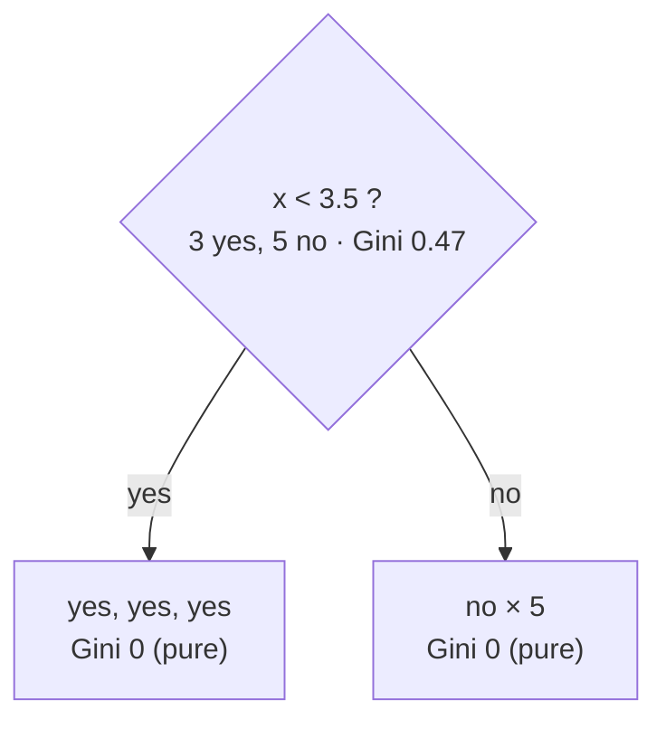

<!-- Written by `npm run lessons` from the lesson data in src/data. Edit the lesson there, not this page. -->

# Decision trees: entropy and Gini

**ML Foundations · Unit 2: Classical ML, built by you · Lesson 10 of 17**

> **In one line.** A decision tree predicts by asking a sequence of yes/no questions about single features, each chosen to make the resulting groups as pure as possible.

[Open this lesson on the site](https://learn.hamropedia.com/foundations/decision-trees-entropy-and-gini/) for its animation, the practice game and tap-to-explain words.

## The problem it solves

Many real datasets are tables with mixed feature types and rules like "if income is low and the loan is large, risk is high". Trees learn such rules automatically, need no feature scaling, and can be read by a person. They are also the building block of random forests and gradient boosting, which win most competitions on tabular data.

## The idea

A decision tree asks a series of yes/no questions about features, like 'age &lt; 30?'. At each step it picks the question that makes the groups purest. Purity is measured with Gini impurity or entropy.

## How it works, step by step

1. Start with all the training points in one node and measure how mixed it is with Gini impurity, 1 − Σ pₖ², or with entropy.
2. Try every feature and every possible threshold, for example "x &lt; 3?".
3. Score each split by the impurity of the two sides, weighted by how many points each side holds. Keep the split with the lowest score.
4. Repeat inside each side, and keep splitting.
5. Stop when a node is pure, too small, or the tree reaches its maximum depth.
6. To predict, follow the questions from the root down to a leaf, and answer with that leaf's majority class (or, for regression, its average value).

## Picture it



*A tree picks the question that makes each side as pure as possible. This split separates the two classes perfectly.*

## Analogy

The game '20 Questions'. Good questions split the possibilities in useful ways.

**Where the analogy breaks.** In 20 Questions you can ask anything. A tree asks about one feature and one threshold at a time, so a diagonal boundary needs many steps, like a staircase.

## Worked example

A node with 5 'yes' and 5 'no' has Gini = 1 − (0.5² + 0.5²) = 0.5, the worst for two classes. A split into [5 yes, 0 no] and [0 yes, 5 no] gives Gini 0 in each: perfect.

```python
def gini(y):
    p = np.bincount(y) / len(y)
    return 1 - np.sum(p**2)
```

## Must know

- Gini impurity = 1 − Σ pₖ². 0 is pure; 0.5 is the worst for two classes.
- Each split looks at one feature and one threshold, so boundaries are made of axis-aligned steps.
- No feature scaling needed; mixed feature types are easy.
- A tree grown without limits memorises the training data. Limit the depth or the leaf size, or prune.
- Small changes in the data can change the whole tree: high variance. Forests fix this (next topic).
- Feature importance comes from how much each feature reduces impurity across the tree.

## Common mistakes

- Growing trees with no depth limit and trusting the training accuracy.
- Expecting a smooth diagonal boundary from a single tree.
- Reading a tree's splits as causes. A split shows that a feature helps to predict, not that it causes the outcome.

> **Not true:** A tree grown until it fits its training data perfectly is equally accurate on new data.  
> **In fact:** A tree with no depth limit memorises the training data, noise included. Limit its depth or its leaf size, or prune it.

> **Not true:** A single decision tree can draw a smooth diagonal boundary.  
> **In fact:** Each split tests one feature against one threshold, so the boundary is made of steps along the axes. A diagonal becomes a staircase.

## Practise

Try each one yourself first: on paper, in code or out loud. Then open the answer and compare.

### 1. Derive

Labels [yes, yes, yes, no, no, no, no, no] for x = 1 to 8. Compute the Gini impurity before splitting, then after splitting at x &lt; 3.5 and at x &lt; 5.5. Which split is better?

<details>
<summary>Show one good answer</summary>

Gini impurity = 1 − Σ pᵢ², where pᵢ is the share of each class in the node.

Before splitting: 3 yes and 5 no out of 8.  
Gini = 1 − ((3/8)² + (5/8)²) = 1 − (9 + 25)/64 = 30/64 ≈ 0.469.

Split at x &lt; 3.5: left is x = 1, 2, 3, all yes, so Gini 0. Right is x = 4 to 8, all no, so Gini 0.  
Weighted Gini = (3/8)·0 + (5/8)·0 = 0. A perfect split.

Split at x &lt; 5.5: left is x = 1 to 5, 3 yes and 2 no, so Gini = 1 − (0.6² + 0.4²) = 0.48. Right is x = 6, 7, 8, all no, so Gini 0.  
Weighted Gini = (5/8)·0.48 + (3/8)·0 = 0.30.

x &lt; 3.5 is better: it lowers the impurity from 0.469 to 0, while x &lt; 5.5 only lowers it to 0.30.

</details>

### 2. Build

Build a decision tree from scratch with a depth limit. Train it on a real dataset and print it as nested if-statements.

<details>
<summary>Show one good answer</summary>

The tree, recursively: at each node try every feature and every threshold, keep the split with the lowest weighted Gini, and recurse on both sides. Stop when the node is pure, too small, or at the depth limit, and predict the majority class.

On Iris with a depth limit of 2 it gets about 90% on the 40 held-out flowers, and printing it as nested if-statements shows the questions it learned, mainly about petal length and width.

```python
import numpy as np
from sklearn.datasets import load_iris      # only to load the data

def gini(y):
    _, counts = np.unique(y, return_counts=True)
    return 1 - np.sum((counts / len(y)) ** 2)

def best_split(X, y):
    best = (None, None, gini(y))
    for f in range(X.shape[1]):
        for t in np.unique(X[:, f])[:-1]:
            left = X[:, f] <= t
            score = (left.sum() * gini(y[left]) + (~left).sum() * gini(y[~left])) / len(y)
            if score < best[2]:
                best = (f, t, score)
    return best

def build(X, y, depth, max_depth):
    feature, threshold, _ = best_split(X, y)
    if depth == max_depth or feature is None or gini(y) == 0:
        return {"leaf": np.bincount(y).argmax()}
    left = X[:, feature] <= threshold
    return {"feature": feature, "threshold": threshold,
            "left": build(X[left], y[left], depth + 1, max_depth),
            "right": build(X[~left], y[~left], depth + 1, max_depth)}

def predict(node, x):
    while "leaf" not in node:
        node = node["left"] if x[node["feature"]] <= node["threshold"] else node["right"]
    return node["leaf"]

def show(node, names, classes, indent=""):
    if "leaf" in node:
        print(indent + "return " + classes[node["leaf"]]); return
    print(f"{indent}if {names[node['feature']]} <= {node['threshold']}:")
    show(node["left"], names, classes, indent + "    ")
    print(indent + "else:")
    show(node["right"], names, classes, indent + "    ")

iris = load_iris()
order = np.random.default_rng(0).permutation(150)
X, y = iris.data[order], iris.target[order]
tree = build(X[:110], y[:110], 0, max_depth=2)
show(tree, iris.feature_names, iris.target_names)
print("held-out accuracy:", np.mean([predict(tree, x) == t for x, t in zip(X[110:], y[110:])]))
```

</details>

### 3. Break

Grow the tree with no depth limit and compare train and validation accuracy. Then rotate the data 45° and count the splits the diagonal boundary needs.

<details>
<summary>Show one good answer</summary>

With no depth limit the tree keeps splitting until every leaf is pure, so training accuracy reaches 100%, while validation accuracy is lower: it has memorised the noise, which is overfitting. A depth limit, a minimum number of examples per leaf, or pruning fixes it.

Rotating the data shows a different weakness. Trees can only ask "is feature ≤ threshold?", so every boundary is made of straight lines parallel to the axes. A boundary along x₁ (label = x₁ > 0) needs a single split. Rotate it 45° (label = x₁ + x₂ > 0) and the tree has to build a staircase out of many small steps to follow the diagonal, dozens of splits for the same simple rule, and it is still jagged. Linear models get this in one line; trees need tricks such as rotating the features first.

```python
import numpy as np

def gini(y):
    p = np.bincount(y, minlength=2) / len(y)
    return 1 - np.sum(p**2)

def count_splits(X, y):
    if gini(y) == 0:
        return 0
    best = None
    for f in range(X.shape[1]):
        for t in np.unique(X[:, f])[:-1]:
            left = X[:, f] <= t
            score = left.sum() * gini(y[left]) + (~left).sum() * gini(y[~left])
            if best is None or score < best[0]:
                best = (score, f, t)
    left = X[:, best[1]] <= best[2]
    return 1 + count_splits(X[left], y[left]) + count_splits(X[~left], y[~left])

X = np.random.default_rng(0).uniform(-1, 1, size=(300, 2))
print("axis-aligned boundary:", count_splits(X, (X[:, 0] > 0).astype(int)), "split")
print("diagonal boundary:", count_splits(X, (X[:, 0] + X[:, 1] > 0).astype(int)), "splits")
```

</details>

### 4. Explain

Explain how a tree picks its question, with the 20 Questions picture.

<details>
<summary>Show one good answer</summary>

In 20 Questions you try to guess a thing by asking yes/no questions. A good first question, like "is it alive?", splits the possibilities into two useful groups; a bad one, like "is it a left-handed violinist?", tells you almost nothing.

A decision tree plays the same game with data. At each step it tries every possible question of the form "is feature ≤ some value?", and picks the one that makes the groups as pure as possible, measured by Gini impurity or entropy. Then it asks the next question within each group, until the groups are pure enough to answer.

</details>

## Check you understood

Answer in your head first, then open each one.

<details>
<summary>&lt;b>What is the Gini impurity of a node with 5 yes and 5 no?&lt;/b></summary>

1 − (0.5² + 0.5²) = 0.5, the worst possible for two classes.

</details>

<details>
<summary>&lt;b>How does a tree choose its next question?&lt;/b></summary>

It tries every feature and threshold and keeps the split whose two sides have the lowest weighted impurity.

</details>

<details>
<summary>&lt;b>Why do deep trees overfit?&lt;/b></summary>

With enough splits a tree can give every training point its own leaf, memorising noise.

</details>

<details>
<summary>&lt;b>Do trees need scaled features?&lt;/b></summary>

No. Splits only compare one feature with a threshold, so scaling doesn't change them.

</details>

## Go further (optional)

The lesson above is enough on its own. These free extras give a second explanation.

- PLAY · [Decision Trees](https://mlu-explain.github.io/decision-tree/) · MLU-Explain (Amazon) · animated, scroll through it  
  **Worth it:** A tree grows split by split on screen while the data is carved into regions. The clearest moving picture of how trees choose questions.
- PLAY · [A Visual Introduction to Machine Learning](https://r2d3.us/visual-intro-to-machine-learning-part-1/) · R2D3 · an animated story you scroll through
- WATCH · [Decision and Classification Trees, Clearly Explained](https://www.youtube.com/results?search_query=StatQuest+Decision+and+Classification+Trees%2C+Clearly+Explained) · StatQuest (Josh Starmer)
- READ · [ISLP, Ch 8 (the basics of decision trees)](https://www.statlearning.com/) · free book

---

[← k-nearest neighbours](k-nearest-neighbours.md) · [All lessons](../../README.md) · [Ensembles: bagging, random forests, gradient boosting →](ensembles-bagging-random-forests-gradient-boosting.md)
