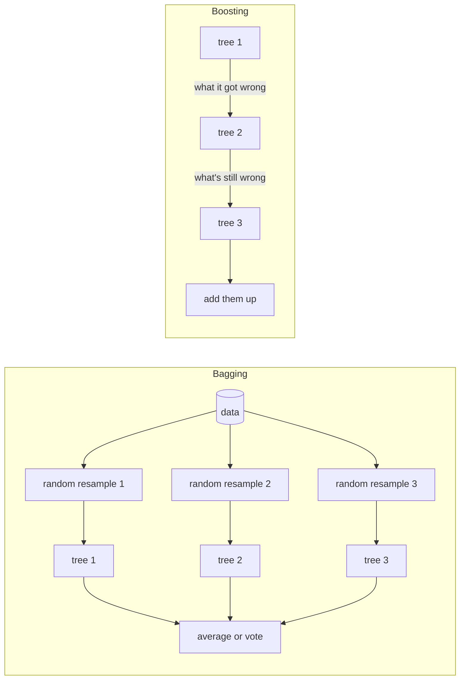

<!-- Written by `npm run lessons` from the lesson data in src/data. Edit the lesson there, not this page. -->

# Ensembles: bagging, random forests, gradient boosting

**ML Foundations · Unit 2: Classical ML, built by you · Lesson 11 of 17**

> **In one line.** An ensemble combines many models. Bagging and random forests average trees trained on random resamples, which cuts variance. Boosting adds small trees one after another, each fixing the errors left so far, which cuts bias.

[Open this lesson on the site](https://learn.hamropedia.com/foundations/ensembles-bagging-random-forests-gradient-boosting/) for its animation, the practice game and tap-to-explain words.

## The problem it solves

A single deep tree is unstable: change a few rows and it changes completely. A single shallow tree is too simple. Ensembles get the best of both, and gradient-boosted trees (XGBoost, LightGBM) and random forests are still the strongest models for most tabular data in industry.

## The idea

Ensembles combine many models. Bagging and random forests train many trees on random samples of the data and features, then average them (this reduces variance). Boosting trains trees one after another, each one fixing the errors of the ones before (this reduces bias).

## How it works, step by step

1. Bagging: draw a bootstrap sample (n rows chosen at random, with repeats) and grow a deep tree on it. Repeat to get, say, 100 different trees.
2. Random forest: also let each split consider only a random subset of the features, so the trees differ even more.
3. Predict by averaging the trees (regression) or by majority vote (classification). Their different mistakes cancel out, so variance drops.
4. Boosting starts from a simple prediction, such as the average.
5. Compute what is still wrong: the residuals y − prediction.
6. Fit a small tree to those residuals and add a small step of it (the learning rate, often 0.1) to the prediction.
7. Repeat hundreds of times. Each tree fixes what the ones before got wrong. Stop when validation error stops improving.

## Picture it



*Bagging trains trees side by side and averages them (less variance). Boosting trains them one after another, each fixing the last (less bias).*

## Analogy

Random forest: ask 100 people to guess the number of sweets in a jar, and average the guesses. Boosting: one student corrects their homework again and again, focusing on the questions they got wrong.

**Where the analogy breaks.** Averaging only helps if people make different mistakes. If every tree were the same, the forest would be no better than one tree. That is why forests also pick random features.

## Worked example

Gradient boosting for regression: tree 1 predicts y. Tree 2 predicts what is left over, y − prediction. Final prediction = tree 1 + a small step × tree 2 + …

```python
pred = np.full(len(y), y.mean())
for m in range(100):
    residual = y - pred
    tree = fit_small_tree(X, residual)   # your own tree from the build
    pred += 0.1 * tree.predict(X)
```

## Must know

- Bagging and forests: parallel, deep trees, averaged → lower variance.
- Boosting: sequential, shallow trees, added up → lower bias.
- Averaging only helps if the models make different mistakes, which is why forests also randomise features.
- Forests are hard to overfit by adding trees; boosting can overfit if it runs too long or with too high a learning rate.
- Out-of-bag rows (the ones left out of each bootstrap sample) give a free validation score for forests.
- Gradient boosting is gradient descent in "function space": each tree is a step along the negative gradient of the loss.

## Common mistakes

- Using identical trees: no randomness means no benefit from averaging.
- Boosting with a large learning rate and many rounds, without early stopping.
- Expecting an ensemble to be as easy to explain as one tree.

> **Not true:** Gradient boosting can run for as many rounds as you like without overfitting.  
> **In fact:** Each round fits the errors that remain, noise included. With many rounds and a large learning rate it overfits, so stop early using validation data.

> **Not true:** Averaging many identical trees gives a better model than any one of them.  
> **In fact:** Identical trees make identical mistakes, so their average is the same tree. Averaging helps only when the trees differ, which is why forests add randomness.

## Practise

Try each one yourself first: on paper, in code or out loud. Then open the answer and compare.

### 1. Derive

25 independent trees are each right 60% of the time. Is their majority vote right more or less often? Reason it out, then check with a quick simulation.

<details>
<summary>Show one good answer</summary>

More often, about 85% of the time.

Reasoning: the majority vote is right when at least 13 of the 25 trees are right. Each tree is right with probability 0.6, so on average 15 are right, and with independent trees the number right varies only a little around 15 (the standard deviation is √(25·0.6·0.4) ≈ 2.4). Falling all the way to 12 or fewer is unlikely.

Exactly: P(at least 13 right) = Σ from k = 13 to 25 of C(25, k)·0.6ᵏ·0.4²⁵⁻ᵏ ≈ 0.846.

The big condition is independence. Real trees trained on the same data make similar mistakes, so the gain is smaller. That is why random forests deliberately make their trees different.

```python
import numpy as np
from math import comb

exact = sum(comb(25, k) * 0.6**k * 0.4**(25 - k) for k in range(13, 26))
votes = np.random.default_rng(0).random((100_000, 25)) < 0.6     # True = this tree is right
print(round(exact, 3), round((votes.sum(axis=1) >= 13).mean(), 3))   # 0.846 and about the same
```

</details>

### 2. Build

Build a random forest on your tree: bootstrap samples plus random features at each split. Then build simple gradient boosting for regression.

<details>
<summary>Show one good answer</summary>

Both reuse one small tree builder.

Random forest: train each tree on a bootstrap sample (rows drawn with replacement) and let each split look at only √d random features, then take a majority vote. On breast cancer, 25 trees beat one tree on held-out data (about 95% against 94% on this split; the gap is bigger when single trees are less stable).

Gradient boosting for regression: start by predicting the mean; then repeatedly fit a small tree to the residuals, y minus the current prediction, and add a small fraction (the learning rate) of it. On the diabetes data the validation error falls as trees are added.

Scikit-learn only loads the data; the trees are written here.

```python
import numpy as np
from sklearn.datasets import load_breast_cancer, load_diabetes   # only to load data

def build(X, y, depth, max_depth, n_features, rng, regression=False, min_leaf=5):
    if regression:
        impurity, leaf = (lambda v: v.var() * len(v)), (lambda v: v.mean())
    else:
        impurity = lambda v: len(v) * (1 - np.sum((np.bincount(v, minlength=2) / len(v)) ** 2))
        leaf = lambda v: np.bincount(v).argmax()
    if depth == max_depth or len(y) < 2 * min_leaf or impurity(y) == 0:
        return leaf(y)
    best = None
    for f in rng.choice(X.shape[1], n_features, replace=False):
        for t in np.quantile(X[:, f], np.linspace(0.05, 0.95, 19)):
            left = X[:, f] <= t
            if min_leaf <= left.sum() <= len(y) - min_leaf:
                score = impurity(y[left]) + impurity(y[~left])
                if best is None or score < best[0]:
                    best = (score, f, t)
    if best is None:
        return leaf(y)
    _, f, t = best
    left = X[:, f] <= t
    return (f, t, build(X[left], y[left], depth + 1, max_depth, n_features, rng, regression, min_leaf),
                  build(X[~left], y[~left], depth + 1, max_depth, n_features, rng, regression, min_leaf))

def predict(node, x):
    while isinstance(node, tuple):
        f, t, left, right = node
        node = left if x[f] <= t else right
    return node

rng = np.random.default_rng(0)
bc = load_breast_cancer()
order = rng.permutation(len(bc.target))
X, y = bc.data[order], bc.target[order]
Xtr, ytr, Xva, yva = X[:400], y[:400], X[400:], y[400:]

one = build(Xtr, ytr, 0, 8, X.shape[1], rng)
forest = []
for _ in range(25):
    rows = rng.integers(0, len(ytr), len(ytr))               # bootstrap sample
    forest.append(build(Xtr[rows], ytr[rows], 0, 8, int(np.sqrt(X.shape[1])), rng))
votes = np.array([[predict(t, x) for t in forest] for x in Xva])
print("one tree:", np.mean([predict(one, x) for x in Xva] == yva).round(3),
      "forest:", np.mean((votes.mean(axis=1) > 0.5) == yva).round(3))

db = load_diabetes()
Xd, yd = db.data[order[:442] % 442], db.target[order[:442] % 442]
Xtr, ytr, Xva, yva = Xd[:330], yd[:330], Xd[330:], yd[330:]
pred_tr, pred_va = np.full(len(ytr), ytr.mean()), np.full(len(yva), ytr.mean())
for m in range(1, 101):
    tree = build(Xtr, ytr - pred_tr, 0, 2, Xd.shape[1], rng, regression=True)
    pred_tr += 0.1 * np.array([predict(tree, x) for x in Xtr])
    pred_va += 0.1 * np.array([predict(tree, x) for x in Xva])
    if m in (1, 10, 100):
        print(f"boosting, {m} trees: validation MSE {np.mean((pred_va - yva) ** 2):.0f}")
```

</details>

### 3. Break

Make every tree identical (no bootstrap, all features). Does the forest still beat one tree? Then run boosting with learning rate 1.0 and 500 trees and watch validation error.

<details>
<summary>Show one good answer</summary>

Identical trees: with no bootstrap and every feature allowed at every split, all 25 trees are built from the same data in the same way, so they are the same tree. The vote is unanimous every time, and the forest scores exactly what one tree scores. Averaging only helps when the members make different mistakes: the randomness is the point, not a side effect.

Boosting with learning rate 1.0 and 500 trees: validation error drops quickly for the first trees, then starts climbing as later trees fit the noise left in the residuals. With learning rate 0.1 the fall is slower and smoother and the climb comes much later. The fixes are a small learning rate and early stopping: keep the number of trees where validation error was lowest.

```python
import numpy as np
from sklearn.datasets import load_diabetes          # only to load the data

def stump_fit(X, r):                                 # depth-1 regression tree
    best = None
    for f in range(X.shape[1]):
        for t in np.quantile(X[:, f], np.linspace(0.05, 0.95, 19)):
            left = X[:, f] <= t
            pred = np.where(left, r[left].mean(), r[~left].mean())
            err = np.sum((r - pred) ** 2)
            if best is None or err < best[0]:
                best = (err, f, t, r[left].mean(), r[~left].mean())
    _, f, t, a, b = best
    return lambda X: np.where(X[:, f] <= t, a, b)

d = load_diabetes()
order = np.random.default_rng(0).permutation(442)
X, y = d.data[order], d.target[order]
Xtr, ytr, Xva, yva = X[:330], y[:330], X[330:], y[330:]
for lr in [1.0, 0.1]:
    ptr, pva, errs = np.full(330, ytr.mean()), np.full(112, ytr.mean()), []
    for _ in range(500):
        stump = stump_fit(Xtr, ytr - ptr)
        ptr, pva = ptr + lr * stump(Xtr), pva + lr * stump(Xva)
        errs.append(np.mean((pva - yva) ** 2))
    print(f"lr {lr}: best {min(errs):.0f} at {int(np.argmin(errs)) + 1} trees, after 500: {errs[-1]:.0f}")
```

</details>

### 4. Explain

Explain bagging and boosting with the jar-of-sweets and homework pictures.

<details>
<summary>Show one good answer</summary>

Bagging, as in a random forest, is like asking 100 people to guess how many sweets are in a jar and averaging their guesses. Each person is wrong in their own way, some too high and some too low, and the errors largely cancel, so the average is better than almost anyone alone. It works best when the guessers are independent, which is why each tree gets different data and features.

Boosting is like one student correcting their homework again and again. Each pass focuses on the questions still wrong, fixing a little more each time. Bagging mostly reduces variance (wobbly individual guesses); boosting mostly reduces bias (systematic mistakes), and needs a brake (small steps, early stopping) so it doesn't start "correcting" noise.

</details>

## Check you understood

Answer in your head first, then open each one.

<details>
<summary>&lt;b>Which part of the error does bagging reduce, and which does boosting reduce?&lt;/b></summary>

Bagging reduces variance; boosting mainly reduces bias.

</details>

<details>
<summary>&lt;b>Why does a random forest pick random features at each split?&lt;/b></summary>

So the trees are less alike. Averaging similar trees barely helps; averaging different ones cancels their errors.

</details>

<details>
<summary>&lt;b>In gradient boosting for regression, what does each new tree learn?&lt;/b></summary>

The residuals: what the current ensemble still gets wrong.

</details>

<details>
<summary>&lt;b>What stops boosting from overfitting?&lt;/b></summary>

A small learning rate, shallow trees, and early stopping on validation error.

</details>

## Go further (optional)

The lesson above is enough on its own. These free extras give a second explanation.

- PLAY · [Random Forest](https://mlu-explain.github.io/random-forest/) · MLU-Explain (Amazon) · animated, scroll through it  
  **Worth it:** Bootstrap samples, many trees and their vote, animated step by step. It shows exactly why averaging different trees works.
- WATCH · [Random Forests Part 1](https://www.youtube.com/results?search_query=StatQuest+Random+Forests+Part+1) · StatQuest (Josh Starmer)
- WATCH · [Gradient Boost Part 1](https://www.youtube.com/results?search_query=StatQuest+Gradient+Boost+Part+1) · StatQuest (Josh Starmer)
- READ · [ISLP, Ch 8 (bagging, random forests, boosting)](https://www.statlearning.com/) · free book

---

[← Decision trees: entropy and Gini](decision-trees-entropy-and-gini.md) · [All lessons](../../README.md) · [Support vector machines: margin and hinge loss →](support-vector-machines-margin-and-hinge-loss.md)
