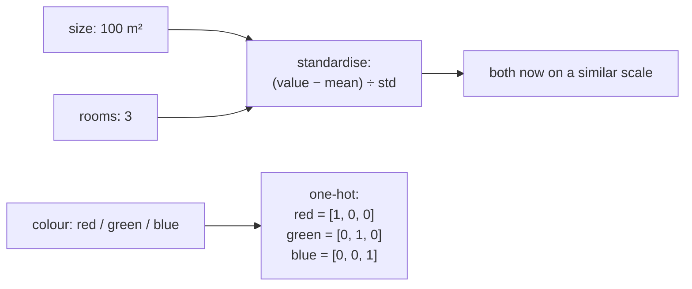

<!-- Written by `npm run lessons` from the lesson data in src/data. Edit the lesson there, not this page. -->

# Feature scaling and encoding

**ML Foundations · Unit 2: Classical ML, built by you · Lesson 8 of 17**

> **In one line.** Feature scaling puts numeric features on similar ranges, and encoding turns categories into numbers, so that models treat every feature fairly and don't invent orders that aren't there.

[Open this lesson on the site](https://learn.hamropedia.com/foundations/feature-scaling-and-encoding/) for its animation, the practice game and tap-to-explain words.

## The problem it solves

Models only see numbers. A feature measured in thousands outweighs one measured in single digits, in any distance or gradient. And coding "red, green, blue" as 1, 2, 3 tells the model that green sits between the other two. Getting this wrong quietly ruins k-NN, SVMs, regularised models and neural networks, while trees barely notice.

## The idea

Put features on similar scales so no feature dominates just because of its units. Turn categories into numbers with one-hot encoding.

## How it works, step by step

1. Standardisation: for each numeric feature, subtract the training mean and divide by the training standard deviation. The result has mean 0 and spread 1.
2. Min–max scaling squeezes values into 0 to 1 instead. It is handy for pixel values, but sensitive to outliers.
3. Fit the scaler on the training rows only, then apply the same mean and standard deviation to validation and test rows.
4. After scaling, the loss surface is rounder, so gradient descent heads straight for the minimum instead of zig-zagging.
5. One-hot encoding: give each category its own 0/1 column. red = [1, 0, 0], green = [0, 1, 0], blue = [0, 0, 1].
6. Plan for categories you have never seen: map them to an "unknown" column, or all zeros.
7. For categories with a real order (small &lt; medium &lt; large), ordinal numbers 0, 1, 2 are fine.

## Picture it



*Scaling stops big-unit features from outweighing small ones. One-hot encoding turns categories into numbers without inventing an order.*

## Analogy

Describing a house by size (100 m²) and rooms (3). Without scaling, the model 'hears' size shouting and rooms whispering.

**Where the analogy breaks.** Tree models, like decision trees and random forests, do not care about scale. Scaling matters most for distance-based and gradient-based methods.

## Worked example

colour ∈ {red, green, blue} becomes red = [1, 0, 0], green = [0, 1, 0], blue = [0, 0, 1]. Do not use red = 1, green = 2, blue = 3: that invents an order that does not exist.

```python
cats = np.array(["red", "blue", "red"])
names = np.unique(cats)                         # ['blue', 'red']
onehot = (cats[:, None] == names).astype(float)
# [[0, 1], [1, 0], [0, 1]]
```

## Must know

- Distance-based and gradient-based models need scaling. Trees and forests don't.
- Standardise: (x − mean) / std, with statistics from the training rows only.
- One-hot for categories with no order; ordinal numbers only for real orders.
- Categories with thousands of values (postcodes, user ids) need other tricks: hashing, frequency or learned embeddings (Unit 3).
- Log-transform heavily skewed values like prices or incomes before scaling.
- Keep the fitted scaler and encoder with the model: they are part of it.

## Common mistakes

- Fitting the scaler on all the data: leakage.
- Coding unordered categories (red, green, blue) as 1, 2, 3, which tells the model that blue is "more" than red.
- Forgetting to apply the same scaling at prediction time.
- One-hot encoding a feature with 50,000 values into 50,000 columns.

> **Not true:** At prediction time: new data goes into the model as it is, without the scaler.  
> **In fact:** The model learned from scaled numbers, so new inputs must go through the same scaler, using the mean and spread of the training data.

> **Not true:** Red, green, blue coded as 1, 2, 3: a neutral choice that tells the model nothing false.  
> **In fact:** The numbers tell the model that blue is more than red, and that green lies between them. For categories with no order, use one-hot encoding.

## Practise

Try each one yourself first: on paper, in code or out loud. Then open the answer and compare.

### 1. Derive

Standardise [10, 20, 30] by hand (subtract the mean, divide by the standard deviation). Then one-hot encode ['cat', 'dog', 'cat', 'bird'].

<details>
<summary>Show one good answer</summary>

Standardise [10, 20, 30]:  
Mean = 20.  
Standard deviation (dividing by n, as scalers do) = √(((10 − 20)² + 0² + (30 − 20)²) / 3) = √(200/3) ≈ 8.165.  
Result: [(10 − 20)/8.165, 0, (30 − 20)/8.165] ≈ [−1.225, 0, 1.225].  
(Dividing by n − 1 instead gives a standard deviation of 10 and the result [−1, 0, 1]. Either is fine if you are consistent.)

One-hot ['cat', 'dog', 'cat', 'bird'], with the categories in alphabetical order [bird, cat, dog]:  
cat → [0, 1, 0]  
dog → [0, 0, 1]  
cat → [0, 1, 0]  
bird → [1, 0, 0]  
Each category gets its own column, so no false order like bird &lt; cat &lt; dog is invented.

</details>

### 2. Build

Write a StandardScaler class with fit and transform, and a one-hot encoder. Fit both on training data only.

<details>
<summary>Show one good answer</summary>

Both have the same two-step shape: fit learns from the training data only (the means and standard deviations, or the list of categories), and transform applies what was learned to any data, including validation and test data. Fitting on all the data would leak information from the test set.

The tests check that the scaled training data has mean 0 and standard deviation 1, that test data is scaled with the training numbers, and that one-hot rows each contain a single 1.

```python
import numpy as np

class StandardScaler:
    def fit(self, X):
        self.mean_, self.std_ = X.mean(axis=0), X.std(axis=0)
        self.std_[self.std_ == 0] = 1.0                 # constant column: leave it
        return self
    def transform(self, X):
        return (X - self.mean_) / self.std_

class OneHotEncoder:
    def fit(self, values):
        self.categories_ = sorted(set(values))
        return self
    def transform(self, values):
        index = {c: i for i, c in enumerate(self.categories_)}
        out = np.zeros((len(values), len(self.categories_)))
        for row, v in enumerate(values):
            out[row, index[v]] = 1
        return out

X_train, X_test = np.array([[10.], [20.], [30.]]), np.array([[40.]])
scaler = StandardScaler().fit(X_train)
assert np.allclose(scaler.transform(X_train).mean(), 0)
assert np.allclose(scaler.transform(X_train).std(), 1)
print(scaler.transform(X_test).round(3))               # [[2.449]]: uses the training mean and std

enc = OneHotEncoder().fit(["cat", "dog", "cat", "bird"])
print(enc.categories_, enc.transform(["cat", "bird"]))
```

</details>

### 3. Break

Train k-NN with and without scaling on data where one feature is in thousands and one in decimals. Then give your encoder a category it never saw.

<details>
<summary>Show one good answer</summary>

k-NN without scaling: when one feature is in thousands (say, salary) and the other in decimals (say, a 0–1 score that really decides the label), the distance is almost entirely the salary difference. The useful feature hardly counts, and accuracy falls to about chance (around 50%). With both features standardised, accuracy jumps back up (above 90% here).

A category the encoder never saw: the code above raises a KeyError. In production that crashes on the first new value, such as a new country or product. Decide on purpose: either map unknown values to an all-zeros row (or an "other" column) and log them so you notice, or fail loudly if an unknown value means bad data. Either way, it should be a choice, not a surprise.

```python
import numpy as np

rng = np.random.default_rng(0)
n = 400
score = rng.random(n)                                  # decides the label
salary = rng.normal(40_000, 10_000, n)                 # big numbers, no signal
y = (score > 0.5).astype(int)
X = np.column_stack([salary, score])
tr, te = np.arange(300), np.arange(300, n)

def knn_accuracy(X, k=5):
    d = ((X[te][:, None, :] - X[tr][None, :, :]) ** 2).sum(-1)
    nearest = np.argsort(d, axis=1)[:, :k]
    pred = (y[tr][nearest].mean(axis=1) > 0.5).astype(int)
    return (pred == y[te]).mean()

Xs = (X - X[tr].mean(axis=0)) / X[tr].std(axis=0)
print(f"unscaled {knn_accuracy(X):.0%}, scaled {knn_accuracy(Xs):.0%}")

index = {"bird": 0, "cat": 1, "dog": 2}
try:
    index["fish"]
except KeyError as e:
    print("unknown category:", e)
```

</details>

### 4. Explain

Explain why unscaled features confuse distance-based models, with the shouting-and-whispering picture.

<details>
<summary>Show one good answer</summary>

Describe a house by its size in square metres (100) and its number of rooms (3). A distance-based model, like k-NN, compares houses by adding up the differences. A difference of 20 m² and a difference of 2 rooms are both big for a house, but the model just sees 20 and 2.

It is as if size is shouting and rooms are whispering: the model hears only the loudest feature, whatever its units happen to be. Scaling puts every feature at the same volume, so the model listens to all of them according to what they actually tell it.

</details>

## Check you understood

Answer in your head first, then open each one.

<details>
<summary>&lt;b>A feature has training mean 50 and standard deviation 10. What does the value 70 become after standardising?&lt;/b></summary>

(70 − 50) / 10 = 2: two standard deviations above the mean.

</details>

<details>
<summary>&lt;b>Why don't decision trees need scaling?&lt;/b></summary>

They only compare a feature with a threshold. Stretching the feature moves the threshold, but the split stays the same.

</details>

<details>
<summary>&lt;b>Why is red = 1, green = 2, blue = 3 a bad encoding?&lt;/b></summary>

It invents an order and distances: the model would think green is "between" red and blue, and that blue is twice as far from red as green is.

</details>

<details>
<summary>&lt;b>What should the encoder do with a colour it never saw in training?&lt;/b></summary>

Map it to an "unknown" column (or all zeros) instead of crashing or guessing.

</details>

## Go further (optional)

The lesson above is enough on its own. These free extras give a second explanation.

- READ · [Working with numerical data (normalisation)](https://developers.google.com/machine-learning/crash-course/numerical-data) · Google ML Crash Course
- READ · [Working with categorical data (one-hot encoding)](https://developers.google.com/machine-learning/crash-course/categorical-data) · Google ML Crash Course
- READ · [Intermediate Machine Learning: categorical variables](https://www.kaggle.com/learn/intermediate-machine-learning) · Kaggle Learn

---

[← Cross-validation and data leakage](cross-validation-and-data-leakage.md) · [All lessons](../../README.md) · [k-nearest neighbours →](k-nearest-neighbours.md)
