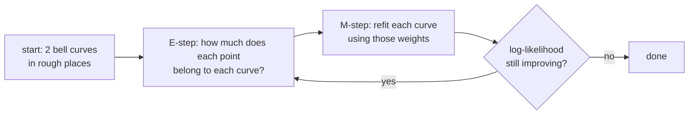

<!-- Written by `npm run lessons` from the lesson data in src/data. Edit the lesson there, not this page. -->

# Gaussian mixture models and EM

**ML Foundations · Unit 2: Classical ML, built by you · Lesson 16 of 17**

> **In one line.** A Gaussian mixture model describes data as a blend of several bell curves, and the EM algorithm fits it by alternating soft assignment of points (E-step) with refitting each curve (M-step).

[Open this lesson on the site](https://learn.hamropedia.com/foundations/gaussian-mixture-models-and-em/) for its animation, the practice game and tap-to-explain words.

## The problem it solves

Real data is often a mix of hidden groups: delivery times from two routes, heights of two populations, colours in an image. You don't know which group each point came from, and the groups overlap, so hard clustering is too crude.

A mixture model gives each point a probability of belonging to each group, and EM is the classic way to fit models with hidden variables like this.

## The idea

A Gaussian mixture model says the data comes from several bell curves mixed together. The EM algorithm finds them by repeating two steps. E-step: work out how much each point belongs to each bell curve (its 'responsibilities'). M-step: refit each bell curve using those responsibilities as weights.

## How it works, step by step

1. Choose the number of components, and start each with a rough mean, spread and weight.
2. E-step: for each point, compute how much each component explains it: rₖ = πₖ·N(x \| μₖ, σₖ) / Σⱼ πⱼ·N(x \| μⱼ, σⱼ). These shares are the responsibilities.
3. M-step: refit each component as a weighted average, using the responsibilities as weights: new mean, new spread, and new weight πₖ = the average responsibility.
4. Compute the log-likelihood. EM guarantees it never goes down.
5. Repeat until it stops improving.
6. Like k-means, the result depends on the start, so run it several times. k-means is EM with hard 0/1 assignments and equal round spreads.

## Picture it



*EM alternates between soft-assigning points and refitting the curves. Each round can only improve the fit.*

## Analogy

Sorting a pile of socks from two families by size. First guess which family each sock belongs to, then update your idea of each family's typical size, then guess again.

**Where the analogy breaks.** You would give each sock to exactly one family. EM gives soft answers, like 70% family A and 30% family B. That is exactly how it differs from k-means, which is the hard-assignment version of the same idea.

## Worked example

Delivery times come from two routes: a fast one around 20 minutes and a slow one around 45. A two-component mixture recovers both means, both spreads and the share of each route, without ever being told which route a delivery took.

```python
# E-step: responsibilities for 2 components in 1D
p1 = pi1 * gauss(x, mu1, s1)
p2 = pi2 * gauss(x, mu2, s2)
r1 = p1 / (p1 + p2)                  # how much each point belongs to component 1
# M-step: refit component 1 using those weights
mu1 = (r1 * x).sum() / r1.sum()
pi1 = r1.mean()
```

## Must know

- Soft clustering: each point belongs partly to every component.
- E-step: responsibilities. M-step: weighted means, spreads and mixing weights.
- The log-likelihood rises every round, but may stop at a local optimum.
- A component can collapse onto a single point, its spread shrinking to 0 and the likelihood growing without limit. Put a floor on the variance.
- It also gives a density: you can ask how likely a new point is, which helps anomaly detection.
- Choose the number of components with a criterion such as BIC, or with validation likelihood.

## Common mistakes

- Starting every component at the same place: they never separate.
- Setting no floor on the variance, so a component collapses onto a single point and the likelihood grows without limit.
- Reading responsibilities as certainty about hidden truth. They are model-based guesses.

> **Not true:** EM separates the components even when they all start in the same place.  
> **In fact:** Components that start identical get identical responsibilities and identical updates, so they stay identical. Start them in different places.

> **Not true:** Responsibility 0.9: the point really did come from that component.  
> **In fact:** A responsibility is the model's guess, based on its current means and spreads. A different or better model would give a different number.

## Go deeper (optional): Why EM can never make the likelihood worse

1. Call the hidden information z (which component made each point) and the parameters θ (the means, spreads and weights). For any guess q(z) about the hidden part, the log-likelihood splits in two: log p(x \| θ) = F(q, θ) + KL(q ‖ p(z \| x, θ)).
2. Here F(q, θ) = E_q[log p(x, z \| θ)] − E_q[log q(z)]. Because a KL divergence is never negative, F is a lower bound on the log-likelihood.
3. E-step: set q to the responsibilities under the current parameters, q = p(z \| x, θ_old). The KL term becomes 0, so the bound touches the likelihood: F(q, θ_old) = log p(x \| θ_old).
4. M-step: keep q fixed and choose the parameters that make F as large as possible. So F(q, θ_new) ≥ F(q, θ_old).
5. Chain the three facts: log p(x \| θ_new) ≥ F(q, θ_new) ≥ F(q, θ_old) = log p(x \| θ_old).
6. F is the same lower bound a VAE maximises, where it is called the ELBO (Unit 7).

**The result.** Each E-step lifts the lower bound up to the likelihood, and each M-step pushes the bound higher, so the log-likelihood never goes down. It can still stop at a local optimum.

## Practise

Try each one yourself first: on paper, in code or out loud. Then open the answer and compare.

### 1. Derive

Write the E-step and M-step for a 1D mixture of two Gaussians from memory: the responsibilities, then the new means, variances and mixing weights.

<details>
<summary>Show one good answer</summary>

Two components, with weights π₁, π₂, means μ₁, μ₂ and variances σ₁², σ₂². N(x \| μ, σ²) is the normal density.

E-step: how much does each component explain each point? The responsibility of component k for point i:  
rᵢₖ = πₖ·N(xᵢ \| μₖ, σₖ²) / (π₁·N(xᵢ \| μ₁, σ₁²) + π₂·N(xᵢ \| μ₂, σ₂²))  
For each point, the two responsibilities add up to 1.

M-step: refit each component as a weighted average, using the responsibilities as weights. With Nₖ = Σᵢ rᵢₖ, the "effective number of points" in component k:  
μₖ = Σᵢ rᵢₖ·xᵢ / Nₖ  
σₖ² = Σᵢ rᵢₖ·(xᵢ − μₖ)² / Nₖ  
πₖ = Nₖ / n

Repeat E and M until the log-likelihood stops increasing. It can never go down from one iteration to the next.

</details>

### 2. Build

Implement EM for a 2D Gaussian mixture from scratch. Draw the ellipses after each iteration, and plot the log-likelihood rising.

<details>
<summary>Show one good answer</summary>

The 2-D version uses full covariance matrices, so each component is an ellipse. Each iteration: E-step responsibilities from the multivariate normal density (computed in logs for safety), then the M-step weighted means, covariances and weights. A tiny amount (1e-6) is added to each covariance's diagonal to keep it invertible.

The log-likelihood rises at every iteration and flattens when it has converged, and the ellipses move from their starting guesses onto the true clusters.

```python
import numpy as np
import matplotlib.pyplot as plt

def log_gauss(X, mean, cov):
    d = X - mean
    inv, (_, logdet) = np.linalg.inv(cov), np.linalg.slogdet(cov)
    return -0.5 * (np.sum(d @ inv * d, axis=1) + logdet + X.shape[1] * np.log(2 * np.pi))

def ellipse(ax, mean, cov, colour):
    vals, vecs = np.linalg.eigh(cov)
    t = np.linspace(0, 2 * np.pi, 100)
    pts = mean + (vecs @ (2 * np.sqrt(vals)[:, None] * np.array([np.cos(t), np.sin(t)]))).T
    ax.plot(pts[:, 0], pts[:, 1], color=colour)

rng = np.random.default_rng(0)
X = np.vstack([rng.multivariate_normal([0, 0], [[1, 0.8], [0.8, 1]], 200),
               rng.multivariate_normal([4, 1], [[0.5, 0], [0, 1.5]], 150)])
k = 2
means, covs, weights = X[rng.choice(len(X), k, replace=False)], [np.eye(2)] * k, np.full(k, 1 / k)
logliks, snapshots = [], []
for it in range(30):
    logp = np.column_stack([np.log(weights[j]) + log_gauss(X, means[j], covs[j]) for j in range(k)])
    total = np.logaddexp.reduce(logp, axis=1)
    logliks.append(total.sum())
    r = np.exp(logp - total[:, None])                         # E-step
    Nk = r.sum(axis=0)                                        # M-step
    means = (r.T @ X) / Nk[:, None]
    covs = [((r[:, j, None] * (X - means[j])).T @ (X - means[j])) / Nk[j] + 1e-6 * np.eye(2) for j in range(k)]
    weights = Nk / len(X)
    if it in (0, 2, 29):
        snapshots.append((it, means.copy(), [c.copy() for c in covs]))

assert all(b >= a - 1e-6 for a, b in zip(logliks, logliks[1:]))   # never goes down
print("weights:", weights.round(2), "means:", means.round(2).tolist())
fig, axes = plt.subplots(1, 4, figsize=(16, 3.5))
for ax, (it, m, c) in zip(axes, snapshots):
    ax.scatter(X[:, 0], X[:, 1], s=5, c="grey")
    for j, colour in enumerate(["C0", "C1"]):
        ellipse(ax, m[j], c[j], colour)
    ax.set_title(f"iteration {it + 1}")
axes[3].plot(logliks); axes[3].set_title("log-likelihood")
plt.tight_layout(); plt.show()
```

</details>

### 3. Break

Start both components at exactly the same place. What happens? Then let one component sit on a single point. Why does its variance shrink to zero, and how do you stop it?

<details>
<summary>Show one good answer</summary>

Both components starting at exactly the same place: they stay identical forever. In the E-step each one takes exactly half of every point (identical formulas give identical numbers), so the M-step computes the same new mean and variance for both. Nothing ever breaks the tie. Start them at different random points, or from k-means.

A component sitting on a single point: the log-likelihood can be made as large as you like by shrinking that component's variance towards 0, because a normal density squeezed onto one point becomes infinitely tall there. EM happily follows, the variance collapses to 0, and the likelihood goes to infinity. It is a useless solution: one component "explains" one point perfectly.

How to stop it: add a small constant to every variance (the 1e-6 on the covariance diagonal in the build above), put a prior on the variances, or restart any component whose variance gets too small or that owns almost no points.

```python
import numpy as np

x0 = 2.0
for sigma in [1.0, 0.1, 0.01, 0.001]:
    density = np.exp(-0.5 * ((x0 - x0) / sigma) ** 2) / (sigma * np.sqrt(2 * np.pi))
    print(f"sigma {sigma}: density at the point {density:,.2f}, log {np.log(density):.1f}")
# the likelihood grows without limit as the variance shrinks to 0
```

</details>

### 4. Explain

Explain EM with the socks picture, and how it differs from k-means.

<details>
<summary>Show one good answer</summary>

You have a pile of socks from two families, and you want to know each family's typical sock size, but nobody has labelled which sock belongs to whom.

EM goes back and forth. First guess each family's typical size. Then, for every sock, estimate how likely it is to belong to each family: a large sock is probably 80% the dad's family, 20% the other one (the E-step). Then update each family's typical size using those shares, so each sock counts partly towards both (the M-step). Repeat until the guesses settle.

The difference from k-means: k-means makes hard choices (each sock goes entirely to one family) and only learns centres. EM makes soft choices (probabilities) and also learns each family's spread and share, so clusters can be different sizes and shapes.

</details>

## Check you understood

Answer in your head first, then open each one.

<details>
<summary>&lt;b>What is a responsibility?&lt;/b></summary>

The probability that a given component generated a given point, computed in the E-step.

</details>

<details>
<summary>&lt;b>How does a GMM differ from k-means?&lt;/b></summary>

Points belong softly to every cluster, and clusters can have different spreads and sizes. k-means uses hard assignments and assumes equal round clusters.

</details>

<details>
<summary>&lt;b>What does the M-step compute?&lt;/b></summary>

Each component's new mean, spread and weight, as averages weighted by the responsibilities.

</details>

<details>
<summary>&lt;b>Why can a component's variance collapse to zero?&lt;/b></summary>

If it sits on a single point, shrinking its spread makes that point's likelihood grow without limit. A variance floor prevents it.

</details>

## Go further (optional)

The lesson above is enough on its own. These free extras give a second explanation.

- WATCH · [EM algorithm: how it works](https://www.youtube.com/results?search_query=Victor+Lavrenko+EM+algorithm+how+it+works) · Victor Lavrenko
- READ · [Mathematics for Machine Learning, Ch 11 (Gaussian mixture models)](https://mml-book.github.io/) · Deisenroth, Faisal, Ong · free
- READ · [Pattern Recognition and Machine Learning, Ch 9 (mixture models and EM)](https://www.google.com/search?q=Bishop+Pattern+Recognition+and+Machine+Learning+free+pdf+Microsoft) · Christopher Bishop · free PDF

---

[← PCA in practice](pca-in-practice.md) · [All lessons](../../README.md) · [Generalisation: VC dimension and double descent →](generalisation-vc-dimension-and-double-descent.md)
