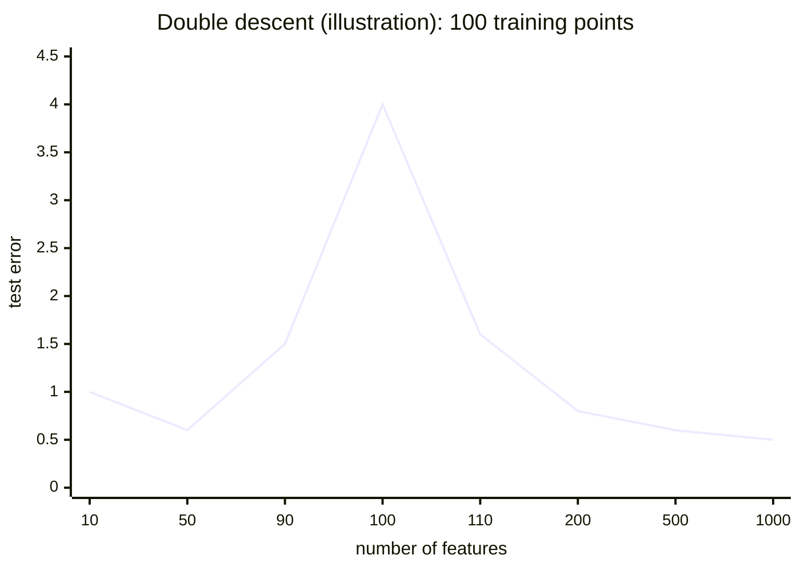

<!-- Written by `npm run lessons` from the lesson data in src/data. Edit the lesson there, not this page. -->

# Generalisation: VC dimension and double descent

**ML Foundations · Unit 2: Classical ML, built by you · Lesson 17 of 17**

> **In one line.** Generalisation is doing well on unseen data. The VC dimension measures how much a family of models is able to fit. Double descent is the surprise that test error can fall again once models grow big enough to fit the training data exactly.

[Open this lesson on the site](https://learn.hamropedia.com/foundations/generalisation-vc-dimension-and-double-descent/) for its animation, the practice game and tap-to-explain words.

## The problem it solves

Classical theory says bigger models need more data or they overfit. Yet today's best models have far more parameters than training examples and still generalise well. To reason about model size and data size — and to read modern research — you need both the classical picture and the newer one.

## The idea

Generalisation means doing well on data you have never seen. Classical theory says bigger models need more data. The VC dimension measures how many points a family of models can fit in every possible way. But deep networks break the simple story: as models grow past the point where they fit the training data perfectly, test error can go down again. This is called double descent.

## How it works, step by step

1. Capacity: a family of models "shatters" a set of points if it can separate every possible labelling of them.
2. Lines in 2-D can shatter 3 points in general position (all 8 labellings), but no set of 4: the XOR pattern always defeats them. So their VC dimension is 3.
3. Classical bound: the gap between training and test error grows with capacity and shrinks with the amount of data. More capacity needs more data.
4. That predicts a U-shaped test error as models grow, and it holds while models are smaller than the data.
5. At the "interpolation threshold", where the number of parameters roughly equals the number of training points, the model can just about fit every point, and test error spikes.
6. Past that point, among all the many perfect fits, training methods tend to find smooth, small-norm ones, and test error falls again: double descent.

## Picture it



*Test error spikes where the number of features equals the number of training points, then falls again as the model keeps growing.*

## Analogy

A student who can memorise any answer sheet has high capacity. Classical theory says: give them more exercises than they can memorise, so they are forced to learn the ideas.

**Where the analogy breaks.** The student picture predicts that huge models must overfit. In practice, very large networks trained with SGD often generalise well. The theory is still catching up with that.

## Worked example

A straight line in 2D can separate 3 points (not all in a line) in every possible labelling, but it cannot separate one labelling of 4 points: the XOR pattern. So the VC dimension of a 2D linear classifier is 3.

## Must know

- Generalisation gap = test error − training error.
- VC dimension = the largest number of points the model family can shatter.
- Classical regime: more parameters → more overfitting risk.
- Modern regime: very over-parameterised models trained with (S)GD often generalise well.
- The error peak sits where parameters ≈ training points, and label noise makes it worse.
- Practical lesson: when overfitting, "bigger model plus more data plus regularisation" can beat "smaller model".

## Common mistakes

- Assuming more parameters always means worse generalisation.
- Assuming bigger is always better: near the interpolation threshold it can be worse.
- Treating VC bounds as accurate predictions. They are loose worst-case guarantees.

> **Not true:** Adding parameters always makes a model generalise worse.  
> **In fact:** Past the point where a model can fit its training data exactly, test error often falls again as the model grows: double descent.

> **Not true:** Model size: test error falls steadily as parameters are added, with no peak on the way.  
> **In fact:** Near the interpolation threshold, where the model can only just fit the training data, test error peaks. Bigger helps again only past that point.

## Go deeper (optional): Where a generalisation bound comes from

1. Fix one model, chosen before seeing the data. Its training error is an average of n independent 0-or-1 mistakes, so it lands close to its true error (its error on new data). Hoeffding's inequality says how close: P(\|true error − training error\| > ε) ≤ 2·e^(−2nε²).
2. But training picks the best of many models after seeing the data, and the best-looking one may just be lucky. Suppose the family has M models. The chance that at least one of them is off by more than ε is at most the sum of the separate chances: 2M·e^(−2nε²).
3. Call that chance δ and solve for ε: ε = √(ln(2M/δ) / (2n)).
4. So with probability at least 1 − δ, every model in the family, including the one training picks, satisfies: true error ≤ training error + √(ln(2M/δ) / (2n)).
5. Read the formula. The gap grows with ln M, the capacity of the family, and shrinks like 1/√n. With M = 1,000 models, n = 10,000 examples and δ = 0.05, the gap is at most about 2.3 percentage points.
6. Real model families are infinite, so ln M is replaced by a measure such as the VC dimension. For networks with millions of weights these bounds come out above 100% and say nothing, which is exactly the puzzle that double descent points at.

**The result.** With probability 1 − δ: true error ≤ training error + √(ln(2M/δ) / (2n)). More capacity loosens the bound; more data tightens it like 1/√n.

## Practise

Try each one yourself first: on paper, in code or out loud. Then open the answer and compare.

### 1. Derive

Show on paper that a line can split 3 points in all 8 labellings, but fails on one labelling of 4 points.

<details>
<summary>Show one good answer</summary>

Three points (not in a line), say at the corners of a triangle. There are 2³ = 8 ways to label them + or −:  
• All the same (2 labellings): put the line off to one side of all three.  
• One point different from the other two (6 labellings): any single corner of a triangle can be cut off from the other two by a straight line.  
So a line can produce all 8 labellings: it "shatters" 3 points.

Four points, say the corners of a square. Label opposite corners alike: top-left and bottom-right +, top-right and bottom-left − (the XOR pattern). A line would need both + points on one side and both − points on the other. But the segment joining the two + points crosses the segment joining the two − points, and a line can't separate two segments that cross. So at least one labelling of 4 points fails. (In fact no set of 4 points in the plane can be shattered by a line.)

That makes the VC dimension of a straight-line classifier in 2D equal to 3.

</details>

### 2. Build

Reproduce double descent: fit polynomial or random-feature regression with the minimum-norm solution (np.linalg.lstsq) on 100 noisy points, with 10 to 1,000 features. Plot test error against the number of features.

<details>
<summary>Show one good answer</summary>

Use random ReLU features: draw a fixed random projection for each feature, apply ReLU, and fit a linear model on top with np.linalg.lstsq, which returns the minimum-norm solution once there are more features than points. Here the inputs have 10 dimensions and there are 100 noisy training points.

The test error first falls (best around 25 features), then climbs to a sharp peak at exactly 100 features, the number of training points, where it is about 90 times worse, then falls again and keeps improving all the way to 2,000 features, ending close to the first dip. That second fall is double descent.

At the peak there is exactly one way to fit every noisy point, and it is a wild one. With many more features there are endless ways to fit the data, and the minimum-norm one is smooth.

```python
import numpy as np
import matplotlib.pyplot as plt

rng = np.random.default_rng(0)
d, n = 10, 100
beta = rng.normal(size=d) / np.sqrt(d)
truth = lambda X: np.tanh(2 * X @ beta)
X_tr, X_te = rng.normal(size=(n, d)), rng.normal(size=(2000, d))
W = rng.normal(size=(d, 2000)) / np.sqrt(d)               # 2,000 random features, fixed
features = lambda X, p: np.maximum(0, X @ W[:, :p])

ps = [10, 25, 50, 75, 90, 100, 110, 125, 150, 200, 400, 1000, 2000]
errors = []
for p in ps:
    errs = []
    for seed in range(5):                                  # median over 5 noise draws
        y = truth(X_tr) + np.random.default_rng(seed).normal(0, 0.2, n)
        w = np.linalg.lstsq(features(X_tr, p), y, rcond=None)[0]   # minimum-norm fit
        errs.append(np.mean((features(X_te, p) @ w - truth(X_te)) ** 2))
    errors.append(np.median(errs))
print([(p, round(float(e), 3)) for p, e in zip(ps, errors)])
# [(10, 0.338), (25, 0.164), ... (100, 14.477), ... (2000, 0.222)]
plt.plot(ps, errors, marker="o"); plt.axvline(n, linestyle=":", color="grey")
plt.xscale("log"); plt.yscale("log"); plt.xlabel("number of features"); plt.ylabel("test error")
plt.show()
```

</details>

### 3. Break

Add more label noise and repeat. What happens to the error peak near 'number of features = number of training points'?

<details>
<summary>Show one good answer</summary>

With more label noise, the peak at "number of features = number of training points" gets much taller: in the run below, about 5 with no noise, 14 with noise 0.2 and 74 with noise 0.5. Far to the right, the error still comes back down.

Why: at that point the model has just enough freedom to pass exactly through every training point, noise included, and there is only one way to do it. To hit every noisy point it must swing wildly between them, and the more noise there is, the wilder the swings. Below the peak the model can't fit the noise; far above it, the minimum-norm solution spreads the noise thinly across many features.

Even with no label noise there is still a peak here, because these features can't represent the target exactly, and that mismatch acts like noise. The fix is the usual one: a little regularisation. In this setup, ridge with a small λ (0.01) instead of the exact minimum-norm fit brings the error at 100 features down from tens to about 0.2, flattening the peak.

```python
import numpy as np

rng = np.random.default_rng(0)
d, n = 10, 100
beta = rng.normal(size=d) / np.sqrt(d)
truth = lambda X: np.tanh(2 * X @ beta)
X_tr, X_te = rng.normal(size=(n, d)), rng.normal(size=(2000, d))
W = rng.normal(size=(d, 2000)) / np.sqrt(d)
features = lambda X, p: np.maximum(0, X @ W[:, :p])
for noise in [0.0, 0.2, 0.5]:
    row = []
    for p in [25, 100, 2000]:
        errs = []
        for seed in range(5):
            y = truth(X_tr) + np.random.default_rng(seed).normal(0, noise, n)
            w = np.linalg.lstsq(features(X_tr, p), y, rcond=None)[0]
            errs.append(np.mean((features(X_te, p) @ w - truth(X_te)) ** 2))
        row.append(round(float(np.median(errs)), 2))
    print(f"noise {noise}: test error at 25 / 100 / 2000 features = {row}")
```

</details>

### 4. Explain

Explain double descent in plain words, and why it surprised people.

<details>
<summary>Show one good answer</summary>

The classic picture says: a model that is too simple underfits, a model that is too big overfits, and the best is in between, so test error is a U shape. Double descent says that if you keep making the model bigger, past the point where it can fit every training example perfectly, test error can come down again, often lower than before.

It surprised people because classical theory said a model that fits every training point, noise and all, must generalise badly. But modern neural networks are exactly that: huge, fitting their training data almost perfectly, and still working well. The explanation is that when there are many ways to fit the data, training tends to find a simple, smooth one, and the worst behaviour happens only at the in-between size where there is just one way to fit.

</details>

## Check you understood

Answer in your head first, then open each one.

<details>
<summary>&lt;b>What is the VC dimension of a linear classifier in 2-D?&lt;/b></summary>

3: lines can separate every labelling of 3 points, but not the XOR labelling of 4.

</details>

<details>
<summary>&lt;b>Where does the double-descent peak occur?&lt;/b></summary>

Near the interpolation threshold, where the number of parameters is about the number of training examples.

</details>

<details>
<summary>&lt;b>Why did double descent surprise people?&lt;/b></summary>

Classical theory says error keeps rising once a model can fit the training data perfectly, but it falls again as models keep growing.

</details>

<details>
<summary>&lt;b>Does double descent mean you should ignore overfitting?&lt;/b></summary>

No. It means model size interacts with data and training in more complicated ways; you still measure on validation data.

</details>

## Go further (optional)

The lesson above is enough on its own. These free extras give a second explanation.

- PLAY · [Double Descent](https://mlu-explain.github.io/double-descent/) · MLU-Explain (Amazon) · animated, scroll through it  
  **Worth it:** The error curve rises, peaks at the interpolation threshold and falls again, animated alongside the fitted models. It makes a strange result intuitive.
- READ · [Understanding Deep Learning, Ch 8 (double descent) and Ch 20 (why does deep learning work?)](https://udlbook.github.io/udlbook/) · Simon Prince · free
- READ · [Understanding Machine Learning, Ch 2–6 (PAC learning, VC dimension)](https://www.google.com/search?q=Understanding+Machine+Learning+Shalev-Shwartz+Ben-David+free+pdf) · Shalev-Shwartz and Ben-David · free
- PAPER · [Deep Double Descent (2019)](https://arxiv.org/abs/1912.02292) · Nakkiran et al. · arXiv

---

[← Gaussian mixture models and EM](gaussian-mixture-models-and-em.md) · [All lessons](../../README.md) · [The neuron and the multi-layer perceptron →](../unit-3-deep-learning/the-neuron-and-the-multi-layer-perceptron.md)
