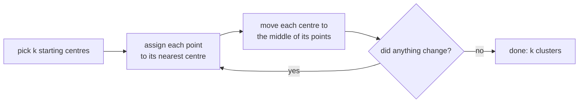

<!-- Written by `npm run lessons` from the lesson data in src/data. Edit the lesson there, not this page. -->

# k-means clustering

**ML Foundations · Unit 2: Classical ML, built by you · Lesson 14 of 17**

> **In one line.** k-means groups unlabelled points into k clusters by repeating two steps: assign every point to its nearest centre, then move each centre to the average of its points.

[Open this lesson on the site](https://learn.hamropedia.com/foundations/k-means-clustering/) for its animation, the practice game and tap-to-explain words.

## The problem it solves

Often there are no labels at all: customers, documents or images that you want to group by similarity. k-means is the simplest and fastest clustering method, a standard first look at unlabelled data, and a building block elsewhere: compressing colours, initialising other models, and building the codebooks behind vector quantisation.

## The idea

k-means groups points into k clusters by repeating two steps: assign each point to its nearest centre, then move each centre to the average of its points.

## How it works, step by step

1. Choose k and place k starting centres (k-means++ spreads them out sensibly).
2. Assign step: every point joins the cluster of its nearest centre.
3. Move step: every centre moves to the mean of the points assigned to it.
4. Repeat assign and move until no point changes cluster.
5. Each step can only lower the total squared distance from points to their centres, so it always stops.
6. It may stop in a poor arrangement, depending on the start, so run it several times and keep the lowest total distance.
7. Choose k with the "elbow" of total distance against k, or with a silhouette score.

## Picture it



*k-means repeats two simple steps until the clusters stop moving.*

## Analogy

Placing k ice-cream vans on a beach. Each customer walks to the nearest van. Each van moves to the middle of its customers. Repeat until nobody moves.

**Where the analogy breaks.** Vans placed badly at the start can get stuck in a poor arrangement. k-means depends on its starting centres, so run it several times. It also assumes round clusters of similar size.

## Worked example

Points 1, 2, 6 and 7 on a line, k = 2, starting centres at 1 and 2. Assign: 1 goes to centre 1; 2, 6 and 7 go to centre 2. Move: the centres become 1 and 5. Assign again: 1 and 2 join the first centre, 6 and 7 the second. Move: 1.5 and 6.5. Nothing changes after that, so it stops.

```python
for _ in range(20):
    d = np.linalg.norm(X[:, None, :] - C[None, :, :], axis=2)   # shape (n, k)
    labels = d.argmin(axis=1)
    C = np.array([X[labels == j].mean(axis=0) for j in range(k)])
```

## Must know

- Objective: minimise the sum of squared distances from each point to its centre.
- Assign = nearest centre; move = mean of members. Alternate until stable.
- Assumes round clusters of similar size; struggles with long, curved or uneven clusters.
- Scale features first: k-means uses distances, so a feature with large numbers would decide the clusters.
- Results depend on the start: use k-means++ and several restarts.
- It is the "hard" version of a Gaussian mixture with EM (later in this unit).

## Common mistakes

- Running it once from random starts and trusting the result.
- Forgetting to scale features, so the clusters are decided by whichever feature has the largest numbers.
- Using it on shapes like two interlocking moons.
- Treating the number of clusters k as known when it isn't. Try several values and compare the results.

> **Not true:** Starting centres: they do not affect the clusters k-means ends with.  
> **In fact:** The result depends on the starting centres and can be a poor one. Run it several times, or choose the start with k-means++.

> **Not true:** Cluster shape: k-means handles long, curved shapes (two interlocking moons) as well as round ones.  
> **In fact:** k-means assumes round clusters of similar size. On long, curved or interlocking shapes it cuts straight across them.

## Practise

Try each one yourself first: on paper, in code or out loud. Then open the answer and compare.

### 1. Derive

Points 1, 2, 3, 10, 11, 12 on a line, k = 2, starting centres at 1 and 2. Do the assign and move steps by hand until nothing changes.

<details>
<summary>Show one good answer</summary>

Points 1, 2, 3, 10, 11, 12. Start: centre A = 1, centre B = 2.

Round 1, assign each point to the nearer centre: 1 → A. 2 → B (distance 0). 3 → B (1 away, versus 2 from A). 10, 11, 12 → B.  
Groups: A = {1}, B = {2, 3, 10, 11, 12}.  
Move each centre to the mean of its group: A = 1, B = (2 + 3 + 10 + 11 + 12)/5 = 7.6.

Round 2, assign: 1 → A. 2 → A (1 from A, 5.6 from B). 3 → A (2 versus 4.6). 10, 11, 12 → B.  
Groups: A = {1, 2, 3}, B = {10, 11, 12}. Move: A = 2, B = 11.

Round 3, assign: the same groups again, so the centres don't move. Stop.

Final clusters {1, 2, 3} and {10, 11, 12}, with centres 2 and 11. Even with a bad start (both centres inside the left group), it recovered in two rounds.

</details>

### 2. Build

Implement k-means with k-means++ starting points. Run it on 2D blobs and plot the clusters after each step.

<details>
<summary>Show one good answer</summary>

k-means++ picks starting centres spread out: the first at random, then each next one with probability proportional to its squared distance from the nearest centre already chosen. Then the usual loop: assign every point to its nearest centre, move each centre to the mean of its points, until nothing changes.

On three 2-D blobs it converges in a few steps; the plots show the centres jumping to the middle of each blob and the colours settling.

```python
import numpy as np
import matplotlib.pyplot as plt

def kmeans_pp_init(X, k, rng):
    centres = [X[rng.integers(len(X))]]
    for _ in range(k - 1):
        d2 = np.min(((X[:, None, :] - np.array(centres)[None]) ** 2).sum(-1), axis=1)
        centres.append(X[rng.choice(len(X), p=d2 / d2.sum())])
    return np.array(centres)

def kmeans(X, k, seed=0, max_steps=20):
    rng = np.random.default_rng(seed)
    centres, history = kmeans_pp_init(X, k, rng), []
    for _ in range(max_steps):
        labels = np.argmin(((X[:, None, :] - centres[None]) ** 2).sum(-1), axis=1)
        history.append((centres.copy(), labels))
        new = np.array([X[labels == j].mean(axis=0) for j in range(k)])
        if np.allclose(new, centres):
            break
        centres = new
    return centres, labels, history

rng = np.random.default_rng(1)
X = np.vstack([rng.normal(c, 0.6, (60, 2)) for c in ([0, 0], [4, 1], [2, 4])])
centres, labels, history = kmeans(X, 3)
print("steps:", len(history), "centres:", centres.round(2).tolist())

fig, axes = plt.subplots(1, len(history), figsize=(4 * len(history), 3.5))
for ax, (c, lab) in zip(np.atleast_1d(axes), history):
    ax.scatter(X[:, 0], X[:, 1], c=lab, s=10)
    ax.scatter(c[:, 0], c[:, 1], c="red", marker="x", s=150)
plt.tight_layout(); plt.show()
```

</details>

### 3. Break

Run plain k-means with random starts 20 times and record the final loss each time. Then try data shaped like two moons. Why does k-means fail there?

<details>
<summary>Show one good answer</summary>

Random starts: across 20 runs the final loss (the total squared distance of points to their centres) is not always the same. Most runs find the right three blobs, but some get stuck with two centres sharing one blob and one centre covering two blobs, at a clearly higher loss. k-means only finds a local minimum, which is why you run it several times, or use k-means++, and keep the lowest loss.

Two moons: k-means cuts each moon in half with a straight line, even with the best start. It assumes clusters are round blobs around a centre, because every point simply joins its nearest centre, so the boundary between two clusters is always a straight line halfway between their centres. Curved or stretched clusters need other methods, such as DBSCAN or spectral clustering.

```python
import numpy as np
from sklearn.datasets import make_moons        # only to make the toy data

def kmeans(X, k, rng, steps=50):
    centres = X[rng.choice(len(X), k, replace=False)]      # plain random start
    for _ in range(steps):
        labels = np.argmin(((X[:, None] - centres[None]) ** 2).sum(-1), axis=1)
        centres = np.array([X[labels == j].mean(0) if np.any(labels == j) else centres[j] for j in range(k)])
    return labels, ((X - centres[labels]) ** 2).sum()

rng = np.random.default_rng(3)
blobs = np.vstack([rng.normal(c, 0.5, (50, 2)) for c in ([0, 0], [3, 0], [0, 3], [3, 3])])
losses = sorted(round(kmeans(blobs, 4, rng)[1]) for _ in range(20))
print("final loss over 20 runs:", losses)

X, moon = make_moons(300, noise=0.05, random_state=0)
labels, _ = kmeans(X, 2, rng)
agree = max(np.mean(labels == moon), np.mean(labels != moon))
print(f"k-means matches the two moons on only {agree:.0%} of points")
```

</details>

### 4. Explain

Explain k-means with the ice-cream-vans picture.

<details>
<summary>Show one good answer</summary>

Place k ice-cream vans on a beach. Each customer walks to the nearest van. Then each van drives to the middle of its own customers, to be closer to them. Now some customers find a different van is nearest, so they switch. Repeat: customers pick the nearest van, vans move to the middle of their customers, until nobody switches. The vans' final spots are the cluster centres, and each van's customers are a cluster.

Where you first park the vans matters: start two vans next to each other and they may end up splitting one crowd while another crowd shares one van. That is why k-means is run several times, or started with k-means++.

</details>

## Check you understood

Answer in your head first, then open each one.

<details>
<summary>&lt;b>What are the two steps of k-means?&lt;/b></summary>

Assign each point to its nearest centre; move each centre to the mean of its points.

</details>

<details>
<summary>&lt;b>Why can k-means give different answers on different runs?&lt;/b></summary>

It depends on the starting centres and can settle in a local minimum.

</details>

<details>
<summary>&lt;b>What shape of clusters does k-means assume?&lt;/b></summary>

Roughly round (spherical) and of similar size, because it uses distance to a single centre.

</details>

<details>
<summary>&lt;b>How do you choose k?&lt;/b></summary>

Plot total within-cluster distance against k and look for the elbow, or use a silhouette score.

</details>

## Go further (optional)

The lesson above is enough on its own. These free extras give a second explanation.

- PLAY · [Visualizing K-Means Clustering](https://www.naftaliharris.com/blog/visualizing-k-means-clustering/) · Naftali Harris · interactive  
  **Worth it:** Pick a dataset, drop the centres yourself, and step through assign and move. You will also see exactly where k-means fails.
- WATCH · [K-means clustering](https://www.youtube.com/results?search_query=StatQuest+K-means+clustering) · StatQuest (Josh Starmer)
- READ · [ISLP, Ch 12 (k-means clustering)](https://www.statlearning.com/) · free book

---

[← Naive Bayes](naive-bayes.md) · [All lessons](../../README.md) · [PCA in practice →](pca-in-practice.md)
