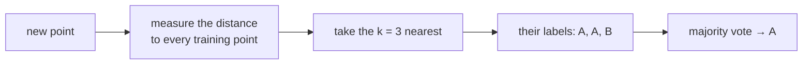

<!-- Written by `npm run lessons` from the lesson data in src/data. Edit the lesson there, not this page. -->

# k-nearest neighbours

**ML Foundations · Unit 2: Classical ML, built by you · Lesson 9 of 17**

> **In one line.** k-nearest neighbours predicts by finding the k training points closest to a new point and letting them vote (or averaging their values, for regression).

[Open this lesson on the site](https://learn.hamropedia.com/foundations/k-nearest-neighbours/) for its animation, the practice game and tap-to-explain words.

## The problem it solves

Sometimes the simplest idea is enough: things that are close together tend to be alike. k-NN needs no training, adapts to any shape of boundary, and makes a strong baseline. Learning it also teaches you why distances, scaling and the curse of dimensionality matter for every method that compares points, including vector search for LLMs.

## The idea

To classify a new point, find the k closest training points and take a vote. There is no training step at all.

## How it works, step by step

1. Store all the training points. That is the whole "training".
2. For a new point, measure its distance to every training point, usually straight-line (Euclidean) distance.
3. Sort, and take the k nearest.
4. Classification: majority vote among those k labels. Regression: the average of their values.
5. Choose k with validation data. k = 1 follows every quirk of the data (high variance); a large k smooths everything out (high bias).
6. Scale the features first, or the feature with the largest units decides every distance.

## Picture it



*k-nearest neighbours has no training step: it just looks at the closest examples and lets them vote.*

## Analogy

New in a town? Ask your 5 nearest neighbours which restaurant is best, and go with the majority.

**Where the analogy breaks.** In very high dimensions, all points are almost equally far apart (the 'curse of dimensionality'), so 'nearest' stops meaning much.

## Worked example

Class A sits at (1, 1) and (2, 1); class B at (3.5, 2) and (4, 4). The new point (2.5, 2) is 1.0 from (3.5, 2), 1.12 from (2, 1) and 1.80 from (1, 1). With k = 1 the answer is B; with k = 3 the vote is A, A, B, so the answer is A. The choice of k changes the prediction.

```python
d = np.linalg.norm(X_train - x_new, axis=1)   # distance to every training point
nearest = np.argsort(d)[:k]
pred = np.bincount(y_train[nearest]).argmax()
```

## Must know

- No training step; all the work happens at prediction time, so prediction is slow on big data.
- Small k: wiggly boundaries, overfits. Large k: smooth boundaries, underfits.
- Use an odd k for two classes, to avoid ties.
- Feature scaling is essential for k-NN: without it, the feature with the biggest numbers decides every distance.
- Curse of dimensionality: with hundreds of features, all points are nearly the same distance apart.
- Fast approximate nearest-neighbour search (Unit 5) makes this idea work at the scale of millions of vectors.

## Common mistakes

- Forgetting to scale features, so one feature with large numbers decides which neighbours count as nearest.
- Choosing k on the test set. Choose it on validation data, and keep the test set for the final score.
- Using it with many irrelevant features: noise dimensions outweigh the useful ones.
- Expecting fast predictions on millions of rows without an index.

> **Not true:** k-nearest neighbours improves as you add more features, even irrelevant ones.  
> **In fact:** Irrelevant features add noise to every distance, and with many of them the useful features hardly count: the curse of dimensionality.

> **Not true:** k-NN has no training step: so it also predicts quickly on millions of rows.  
> **In fact:** No training means all the work happens at prediction time: each prediction compares the new point with the stored rows. Large data needs an index.

## Practise

Try each one yourself first: on paper, in code or out loud. Then open the answer and compare.

### 1. Derive

Class A at (2, 3) and (0, 0). Class B at (5, 3) and (3, 5.5). Classify the point (3, 3) by hand with k = 1 and with k = 3.

<details>
<summary>Show one good answer</summary>

Distances from the new point (3, 3):  
A (2, 3): √(1² + 0²) = 1.0  
A (0, 0): √(3² + 3²) ≈ 4.24  
B (5, 3): √(2² + 0²) = 2.0  
B (3, 5.5): √(0² + 2.5²) = 2.5

k = 1: the single nearest is A at (2, 3), distance 1.0. Answer: A.  
k = 3: the three nearest are A (1.0), B (2.0) and B (2.5). The vote is 2 to 1 for B. Answer: B.

The choice of k changed the answer. Small k follows the closest point exactly, so it is sensitive to noise; larger k smooths things out.

</details>

### 2. Build

Implement k-NN with vectorised distances. Plot validation accuracy for k = 1 to 30 on a real dataset.

<details>
<summary>Show one good answer</summary>

Vectorised distances use the same trick as the toolkit unit: ‖a − b‖² = ‖a‖² + ‖b‖² − 2a·b for all pairs at once. Then sort each row, take the k nearest labels, and vote.

On the standardised breast-cancer data, validation accuracy stays around 94 to 97% across most k, so the curve is fairly flat. When it is this flat, prefer a moderate k (say 5 to 10) over a lucky peak at k = 1: small k follows single noisy points, and very large k gets too smooth. Pick k from the validation curve, never from the test set.

```python
import numpy as np
import matplotlib.pyplot as plt
from sklearn.datasets import load_breast_cancer     # only to load the data

data = load_breast_cancer()
order = np.random.default_rng(0).permutation(len(data.target))
X, y = data.data[order], data.target[order]
tr, va = slice(0, 400), slice(400, None)
mean, std = X[tr].mean(axis=0), X[tr].std(axis=0)
X = (X - mean) / std

def knn_predict(X_train, y_train, X_new, k):
    d = (X_new**2).sum(1)[:, None] + (X_train**2).sum(1)[None, :] - 2 * X_new @ X_train.T
    nearest = np.argsort(d, axis=1)[:, :k]
    return (y_train[nearest].mean(axis=1) > 0.5).astype(int)

ks = range(1, 31)
acc = [(knn_predict(X[tr], y[tr], X[va], k) == y[va]).mean() for k in ks]
print("best k:", ks[int(np.argmax(acc))], "accuracy:", round(max(acc), 3))
plt.plot(ks, acc, marker="o"); plt.xlabel("k"); plt.ylabel("validation accuracy"); plt.show()
```

</details>

### 3. Break

Add 50 random noise features to the data and run it again. What happens to accuracy? Connect this to the curse of dimensionality.

<details>
<summary>Show one good answer</summary>

With 50 extra columns of random noise, accuracy drops clearly (on this run from about 96% to the low 90s or below). The neighbours are no longer the truly similar patients.

Why: distance adds up differences across every feature. 30 useful features and 50 noise features means most of the distance is now noise, so "nearest" mostly means "luckiest noise". That is the curse of dimensionality: in many dimensions, every point is roughly as far from every other point, so nearest neighbours stop being meaningfully near. k-NN needs a few relevant, scaled features; feature selection or a learned embedding helps.

```python
import numpy as np
from sklearn.datasets import load_breast_cancer     # only to load the data

data = load_breast_cancer()
rng = np.random.default_rng(0)
order = rng.permutation(len(data.target))
X, y = data.data[order], data.target[order]
X = (X - X[:400].mean(axis=0)) / X[:400].std(axis=0)

def accuracy(X, k=7):
    d = ((X[400:][:, None, :] - X[:400][None, :, :]) ** 2).sum(-1)
    pred = (y[:400][np.argsort(d, axis=1)[:, :k]].mean(axis=1) > 0.5)
    return (pred == y[400:]).mean()

noisy = np.column_stack([X, rng.normal(size=(len(X), 50))])
print(f"30 real features: {accuracy(X):.1%}, plus 50 noise features: {accuracy(noisy):.1%}")
```

</details>

### 4. Explain

Explain k-NN with the neighbours-and-restaurants picture.

<details>
<summary>Show one good answer</summary>

You are new in town and want a good restaurant. You ask your 5 nearest neighbours where they eat, and go with the most popular answer. That is k-nearest neighbours with k = 5: to label something new, find the k most similar examples you already know, and take a vote.

There is no training at all: the model is the whole set of examples. The work happens when you ask: measure the distance to everything and find the closest. Ask just 1 neighbour and you may get one odd opinion; ask the whole town and you just get the most popular place overall.

</details>

## Check you understood

Answer in your head first, then open each one.

<details>
<summary>&lt;b>What does k-NN learn during training?&lt;/b></summary>

Nothing: it just stores the data. All the work happens when predicting.

</details>

<details>
<summary>&lt;b>What happens with k = 1?&lt;/b></summary>

Each prediction copies its single nearest neighbour, so the model follows every noisy point: low bias, high variance.

</details>

<details>
<summary>&lt;b>Why scale features for k-NN?&lt;/b></summary>

Distances add up feature differences, so a feature in large units would decide every distance on its own.

</details>

<details>
<summary>&lt;b>How would you use k-NN for regression?&lt;/b></summary>

Average the values of the k nearest neighbours instead of voting.

</details>

## Go further (optional)

The lesson above is enough on its own. These free extras give a second explanation.

- WATCH · [K-nearest neighbors, Clearly Explained](https://www.youtube.com/results?search_query=StatQuest+K-nearest+neighbors%2C+Clearly+Explained) · StatQuest (Josh Starmer)
- READ · [ISLP, Ch 2 and Ch 4 (k-nearest neighbours)](https://www.statlearning.com/) · free book
- WATCH · [k-nearest neighbours and the curse of dimensionality](https://www.youtube.com/results?search_query=Kilian+Weinberger+CS4780+k+nearest+neighbors+curse+of+dimensionality) · Kilian Weinberger, Cornell CS4780

---

[← Feature scaling and encoding](feature-scaling-and-encoding.md) · [All lessons](../../README.md) · [Decision trees: entropy and Gini →](decision-trees-entropy-and-gini.md)
