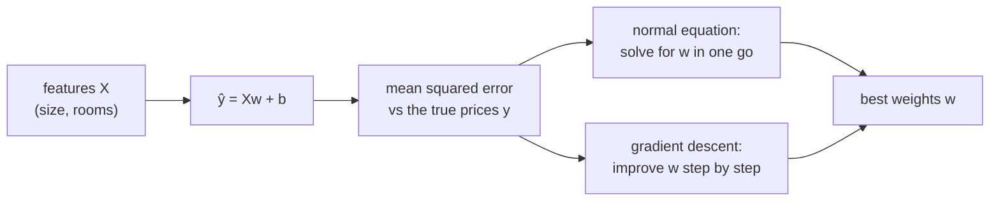

<!-- Written by `npm run lessons` from the lesson data in src/data. Edit the lesson there, not this page. -->

# Linear regression: normal equation and gradient descent

**ML Foundations · Unit 2: Classical ML, built by you · Lesson 2 of 17**

> **In one line.** Linear regression predicts a number as a weighted sum of the features. It chooses the weights that make the mean squared error as small as possible.

[Open this lesson on the site](https://learn.hamropedia.com/foundations/linear-regression-normal-equation-and-gradient-descent/) for its animation, the practice game and tap-to-explain words.

## The problem it solves

Many questions ask for a number: a price, a temperature, a delivery time. Linear regression is the simplest model that learns how each feature pushes the answer up or down. It trains in a fraction of a second, its weights are easy to read, and it is the baseline every fancier model must beat.

Its two training routes, a formula and gradient descent, are the same two routes used everywhere else in ML.

## The idea

Predict with a weighted sum, ŷ = Xw + b, and choose the weights that make the squared errors smallest. There are two ways: a direct formula (the normal equation), or gradient descent step by step.

## How it works, step by step

1. Put the examples in a matrix X (one row each) and add a column of 1s, so the bias b becomes just another weight.
2. The prediction for every row at once is ŷ = Xw.
3. The loss is the mean squared error: the average of (ŷ − y)². Squaring makes big misses count much more than small ones.
4. Route 1, the normal equation: set the gradient to zero and solve XᵀX w = Xᵀy in one step. For x = [1, 2, 3, 4, 5] and y = [2, 4, 5, 4, 6] this gives ŷ = 1.8 + 0.8x.
5. Route 2, gradient descent: the gradient is (2/n)·Xᵀ(Xw − y). Step against it, again and again, and w walks to the same answer.
6. The normal equation is exact and fast for a few thousand features. Gradient descent scales to huge data and is how every neural network trains.
7. Read the weights: 0.8 means "one more unit of x adds 0.8 to the prediction, holding the other features fixed".

## Picture it



*Linear regression predicts with a weighted sum. Two routes lead to the same best weights: one formula, or many small steps.*

## Analogy

Placing a ruler across dots on a page so it is as close as possible to all of them.

**Where the analogy breaks.** A ruler is straight. If the true pattern curves, linear regression cannot follow it, unless you add curved features such as x².

## Worked example

Five points: x = [1, 2, 3, 4, 5], y = [2, 4, 5, 4, 6]. The best straight line is ŷ = 1.8 + 0.8x, with mean squared error 0.48. No other line has a smaller total of squared errors.

```python
Xb = np.c_[np.ones(len(X)), X]             # add a column of 1s for the bias
w = np.linalg.solve(Xb.T @ Xb, Xb.T @ y)    # normal equation

# gradient descent version, one step:
grad = 2 / len(y) * Xb.T @ (Xb @ w - y)
w = w - lr * grad
```

## Must know

- Model ŷ = Xw + b; loss = mean squared error.
- Normal equation: w = (XᵀX)⁻¹Xᵀy. In code, solve the system (np.linalg.solve or lstsq); never form the inverse.
- The gradient of the mean squared error with respect to the weights is (2/n)·Xᵀ(Xw − y).
- Minimising squared error is maximum likelihood when the noise is Gaussian.
- Curves need curved features: add x², x³ or interactions, and the model is still "linear" in its weights.
- Check the residuals (y − ŷ): a pattern in them means the model is missing something.

## Common mistakes

- Using it when the relationship is strongly curved, without adding features.
- Reading a weight as a cause. It only says how the prediction moves, with the other features held still.
- Duplicated or near-duplicate features: XᵀX becomes nearly singular and the weights become huge.
- Forgetting the bias column, which forces the line through the origin.

> **Not true:** A large weight in a linear regression shows that its feature causes the outcome.  
> **In fact:** A weight only says how the prediction moves when that feature changes and the others stay still. It shows an association, not a cause.

> **Not true:** Without a bias term: the fitted line can still cross the y-axis where the data needs it to.  
> **In fact:** Without the bias, the line is forced through the origin. The bias (a column of ones) lets the line sit at any height.

## Practise

Try each one yourself first: on paper, in code or out loud. Then open the answer and compare.

### 1. Derive

Derive the normal equation w = (XᵀX)⁻¹Xᵀy from the squared-error loss, on paper.

<details>
<summary>Show one good answer</summary>

The loss is the squared error L(w) = ‖Xw − y‖² = (Xw − y)ᵀ(Xw − y).

Expand it: L = wᵀXᵀXw − 2yᵀXw + yᵀy.

Take the gradient with respect to w (using ∇(wᵀAw) = 2Aw for a symmetric A, and ∇(bᵀw) = b):  
∇L = 2XᵀXw − 2Xᵀy.

At the minimum the gradient is 0: XᵀXw = Xᵀy. These are the "normal equations".

If XᵀX is invertible: w = (XᵀX)⁻¹Xᵀy.

Two notes: put a column of 1s in X so the model has a bias term; and in code use np.linalg.solve(X.T @ X, X.T @ y), or better np.linalg.lstsq, rather than computing the inverse.

</details>

### 2. Build

Fit linear regression on real data three ways: the normal equation, gradient descent, and np.linalg.lstsq. Check that all three agree.

<details>
<summary>Show one good answer</summary>

On the diabetes data (four features, standardised, plus a column of 1s for the bias), all three methods give the same weights to 4 decimal places: the normal equation, gradient descent after a few thousand steps, and np.linalg.lstsq.

They trade off differently. The normal equation is exact but needs XᵀX to be invertible and costs about d³ for d features. lstsq is exact and the most robust. Gradient descent is approximate, but it scales to huge datasets and is the same idea that trains neural networks.

```python
import numpy as np
from sklearn.datasets import load_diabetes      # only to load the data

d = load_diabetes(scaled=False)
X = d.data[:, [0, 2, 3, 8]]                      # age, bmi, blood pressure, s5
X = (X - X.mean(axis=0)) / X.std(axis=0)
X = np.column_stack([np.ones(len(X)), X])        # bias column
y = d.target

w_normal = np.linalg.solve(X.T @ X, X.T @ y)
w_lstsq = np.linalg.lstsq(X, y, rcond=None)[0]
w_gd = np.zeros(X.shape[1])
for _ in range(5000):
    w_gd -= 0.05 * 2 * X.T @ (X @ w_gd - y) / len(y)

print(w_normal.round(4))
assert np.allclose(w_normal, w_lstsq) and np.allclose(w_normal, w_gd, atol=1e-4)
```

</details>

### 3. Break

Add a column that is an exact copy of another feature. What happens to the normal equation? What does gradient descent do instead?

<details>
<summary>Show one good answer</summary>

With an exact copy of a column, XᵀX is singular: two columns carry the same information, so infinitely many weight pairs fit equally well (for example w₁ = 10, w₂ = 0, or 5 and 5, or 105 and −95). The normal equation has no unique answer. Depending on rounding, np.linalg.solve either raises "Singular matrix" or returns huge, meaningless weights.

Gradient descent still works. Both copies get exactly the same gradient at every step, so starting from zero they stay equal, and each ends up with half of the original weight. The predictions are the same as without the copy. np.linalg.lstsq gives that same "split it evenly" answer, because it returns the smallest weights that fit.

The practical lesson: correlated or duplicated features make the weights unstable and hard to interpret, even when predictions are fine. Remove duplicates, or add L2 regularisation, which makes XᵀX + λI invertible.

```python
import numpy as np

rng = np.random.default_rng(0)
x = rng.normal(size=100)
y = 3 * x + rng.normal(scale=0.1, size=100)
X = np.column_stack([x, x])                       # an exact copy
print(np.linalg.matrix_rank(X.T @ X))             # 1, not 2: singular
try:
    print(np.linalg.solve(X.T @ X, X.T @ y))      # huge numbers, or an error
except np.linalg.LinAlgError as e:
    print("solve:", e)

w = np.zeros(2)
for _ in range(2000):
    w -= 0.05 * 2 * X.T @ (X @ w - y) / len(y)
print(w.round(3), np.linalg.lstsq(X, y, rcond=None)[0].round(3))   # both ≈ [1.5 1.5]
```

</details>

### 4. Explain

Explain least squares with the ruler-through-the-dots picture.

<details>
<summary>Show one good answer</summary>

Picture dots scattered on a page, and you lay a ruler across them so it runs as close as possible to all of them. For each dot, measure the vertical gap between the dot and the ruler, square it, and add the squares up. Least squares is the position of the ruler that makes that total as small as possible.

Squaring does two things: gaps above and below can't cancel out, and big misses count far more than small ones. That second part is also its weakness: one far-away dot pulls the ruler strongly towards itself.

</details>

## Check you understood

Answer in your head first, then open each one.

<details>
<summary>&lt;b>What does the weight 0.8 mean in ŷ = 1.8 + 0.8x?&lt;/b></summary>

Each extra unit of x raises the prediction by 0.8.

</details>

<details>
<summary>&lt;b>Why square the errors instead of just adding them up?&lt;/b></summary>

Positive and negative errors would cancel out, and squaring punishes big misses more. It is also smooth, so it is easy to differentiate.

</details>

<details>
<summary>&lt;b>When would you use gradient descent instead of the normal equation?&lt;/b></summary>

When there are very many features or rows, or when the data doesn't fit in memory. Solving XᵀX gets expensive as the number of features grows.

</details>

<details>
<summary>&lt;b>Can linear regression fit a curve?&lt;/b></summary>

Yes, if you add curved features like x². It stays linear in the weights, so the same maths works.

</details>

## Go further (optional)

The lesson above is enough on its own. These free extras give a second explanation.

- PLAY · [Linear Regression](https://mlu-explain.github.io/linear-regression/) · MLU-Explain (Amazon) · animated, scroll through it  
  **Worth it:** Watch the line, the residuals and the error update as you scroll. A visual version of this whole lesson.
- WATCH · [Linear Regression, Clearly Explained](https://www.youtube.com/results?search_query=StatQuest+Linear+Regression%2C+Clearly+Explained) · StatQuest (Josh Starmer)
- READ · [ISLP, Ch 3 (linear regression)](https://www.statlearning.com/) · free book
- READ · [Mathematics for Machine Learning, Ch 9 (linear regression)](https://mml-book.github.io/) · Deisenroth, Faisal, Ong · free

---

[← The ML setup: features, labels, loss, train/validation/test](the-ml-setup-features-labels-loss-train-validation-test.md) · [All lessons](../../README.md) · [Logistic regression and the sigmoid →](logistic-regression-and-the-sigmoid.md)
