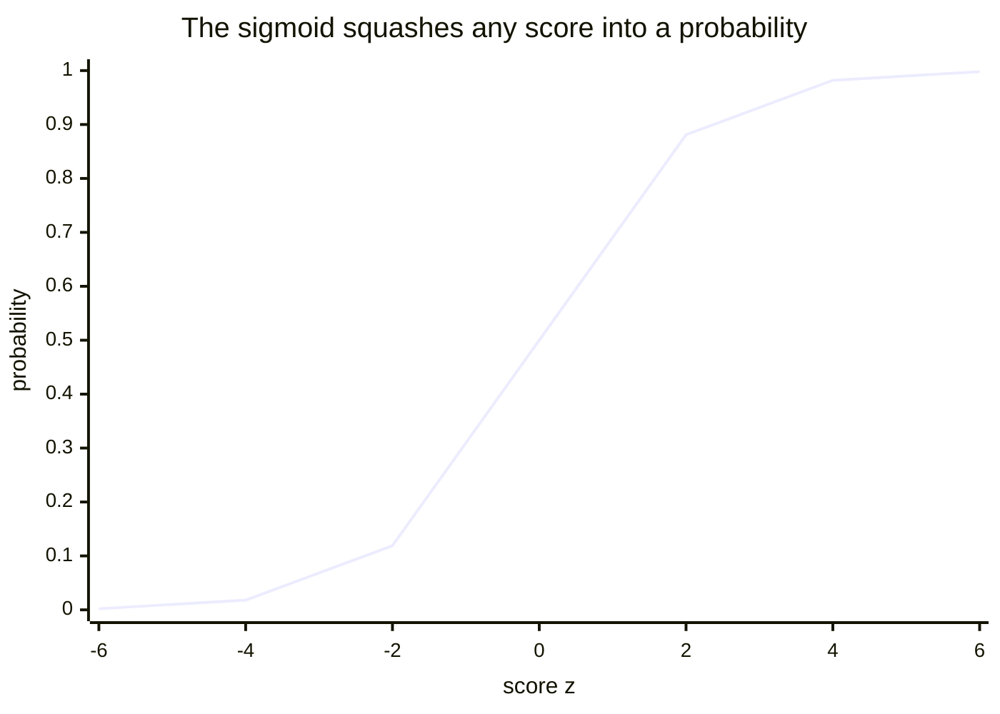

<!-- Written by `npm run lessons` from the lesson data in src/data. Edit the lesson there, not this page. -->

# Logistic regression and the sigmoid

**ML Foundations · Unit 2: Classical ML, built by you · Lesson 3 of 17**

> **In one line.** Logistic regression answers yes/no questions. It computes a score, squashes it into a probability with the sigmoid, and is trained with cross-entropy loss.

[Open this lesson on the site](https://learn.hamropedia.com/foundations/logistic-regression-and-the-sigmoid/) for its animation, the practice game and tap-to-explain words.

## The problem it solves

Many questions have a yes/no answer: spam or not, fraud or not, pass or fail. A straight line gives numbers below 0 and above 1, which can't be probabilities. Logistic regression keeps the simple weighted sum but squashes it into a probability, so it can say "83% likely". It is the standard first model for classification, and the single neuron at the heart of every neural network.

## The idea

For yes/no questions. Compute a score z = Xw + b, then squash it into a probability with the sigmoid, σ(z) = 1 / (1 + e⁻ᶻ). Train with cross-entropy loss.

## How it works, step by step

1. Compute a score for each example, exactly as in linear regression: z = Xw + b.
2. Squash it: p = σ(z) = 1 / (1 + e⁻ᶻ). A score of 0 gives 0.5, z = 2 gives 0.88, and z = −2 gives 0.12.
3. Measure the error with binary cross-entropy: −[y log p + (1 − y) log(1 − p)]. Confident mistakes cost the most.
4. The gradient comes out beautifully simple: Xᵀ(p − y)/n for the weights and the mean of (p − y) for the bias.
5. Train with gradient descent. There is no closed-form answer, but the loss is convex, so gradient descent finds the best weights.
6. To decide, pick a threshold (usually 0.5). p > 0.5 exactly when z > 0, so the decision boundary is the line (or plane) where Xw + b = 0.

## Picture it



*A big negative score becomes almost 0, a big positive one almost 1, and a score of 0 sits exactly at 0.5.*

## Analogy

A dimmer switch. The score turns the dial, and the sigmoid keeps the light between 0 (off) and 1 (fully on).

**Where the analogy breaks.** The decision boundary is still a straight line (a flat plane). It cannot separate data shaped like circles unless you add new features.

## Worked example

z = 0 gives 0.5. z = 2 gives 0.88. z = −2 gives 0.12. So an email with score z = 2 is spam with probability 0.88, and with a threshold of 0.5 the model says spam. If it really is spam, the loss is −log(0.88) ≈ 0.13. If it is not, the loss is −log(0.12) ≈ 2.13: a confident mistake costs far more.

```python
p = 1 / (1 + np.exp(-(X @ w + b)))
grad_w = X.T @ (p - y) / len(y)   # the gradient is beautifully simple
grad_b = (p - y).mean()
```

## Must know

- σ(z) = 1/(1 + e⁻ᶻ) maps any number to between 0 and 1; σ(0) = 0.5.
- Train with binary cross-entropy, not squared error.
- Gradient: Xᵀ(p − y)/n. Remember it — it appears again in neural networks.
- The boundary is linear. Curved boundaries need extra features.
- The weights are log-odds: one more unit of a feature adds w to log(p/(1 − p)).
- More than two classes: replace the sigmoid with softmax (Unit 3).

## Common mistakes

- Training with squared error. The loss becomes non-convex and learning is slow.
- Reading the output as certain truth. The probabilities are only as good as the model and the data.
- Perfectly separable data with no regularisation: the weights grow forever. Add L2.
- Always using 0.5 as the threshold, even when one kind of mistake costs much more.

> **Not true:** A threshold of 0.5 is the right cut-off even when one kind of mistake costs far more.  
> **In fact:** The threshold should follow the costs. When missing a positive is much worse than a false alarm, a lower threshold is better.

> **Not true:** Loss for logistic regression: squared error works as well as cross-entropy.  
> **In fact:** With a sigmoid, squared error makes the loss non-convex and learning slow. Binary cross-entropy is convex, and its gradient is the simple Xᵀ(p − y)/n.

## Practise

Try each one yourself first: on paper, in code or out loud. Then open the answer and compare.

### 1. Derive

Derive the gradient of binary cross-entropy for logistic regression, and show it simplifies to Xᵀ(p − y) / n.

<details>
<summary>Show one good answer</summary>

For one example: z = wᵀx, p = σ(z), and the loss is L = −[y·log p + (1 − y)·log(1 − p)].

Chain rule in three pieces:  
1. ∂L/∂p = −y/p + (1 − y)/(1 − p) = (p − y) / (p(1 − p)).  
2. ∂p/∂z = σ(z)(1 − σ(z)) = p(1 − p). (The sigmoid's famous derivative.)  
3. ∂z/∂w = x.

Multiply: ∂L/∂w = (p − y)/(p(1 − p)) · p(1 − p) · x = (p − y)·x. The p(1 − p) cancels.

Averaging over n examples and writing it with matrices: ∇L = Xᵀ(p − y) / n.

In words: each example pushes the weights by its error (p − y) times its features. It is the same shape as linear regression's gradient, which is why the update rule looks identical.

</details>

### 2. Build

Train logistic regression from scratch on a real binary dataset. Plot the loss, and the decision boundary for 2 features.

<details>
<summary>Show one good answer</summary>

On the breast-cancer data with two standardised features (mean radius and mean texture), gradient descent drives the loss down smoothly from 0.693 (that is ln 2, a model that says 50% for everything) to about 0.24, with about 84% validation accuracy using only those two features.

The decision boundary is the line where p = 0.5, which is where w₀ + w₁x₁ + w₂x₂ = 0, so you can solve it for x₂ and draw it.

```python
import numpy as np
import matplotlib.pyplot as plt
from sklearn.datasets import load_breast_cancer     # only to load the data

data = load_breast_cancer()
X = data.data[:, [0, 1]]                             # mean radius, mean texture
X = (X - X.mean(axis=0)) / X.std(axis=0)
X = np.column_stack([np.ones(len(X)), X])
y = data.target.astype(float)
order = np.random.default_rng(0).permutation(len(X))
tr, va = order[:450], order[450:]

sigmoid = lambda z: 1 / (1 + np.exp(-z))
w, losses = np.zeros(3), []
for _ in range(2000):
    p = sigmoid(X[tr] @ w)
    losses.append(-np.mean(y[tr] * np.log(p) + (1 - y[tr]) * np.log(1 - p)))
    w -= 0.1 * X[tr].T @ (p - y[tr]) / len(tr)
acc = ((sigmoid(X[va] @ w) > 0.5) == y[va]).mean()
print(round(losses[0], 3), round(losses[-1], 3), f"validation accuracy {acc:.0%}")

fig, axes = plt.subplots(1, 2, figsize=(10, 4))
axes[0].plot(losses); axes[0].set_xlabel("step"); axes[0].set_ylabel("loss")
axes[1].scatter(X[:, 1], X[:, 2], c=y, s=8)
xs = np.linspace(-2.5, 4, 50)
axes[1].plot(xs, -(w[0] + w[1] * xs) / w[2], "k")   # where p = 0.5
axes[1].set_xlabel("radius"); axes[1].set_ylabel("texture")
plt.tight_layout(); plt.show()
```

</details>

### 3. Break

Train on data that is perfectly separable and watch the weights. Why do they keep growing, and what stops them?

<details>
<summary>Show one good answer</summary>

When a straight line can separate the classes perfectly, the weights never stop growing. Any separating line can be made "more confident" by multiplying all its weights by 2: every correct p moves closer to 1 or 0, so the loss keeps shrinking towards 0, but never reaches it. Gradient descent keeps following that, and the size of w keeps rising (slowly, roughly like the log of the number of steps).

The result is a model that claims 99.99% certainty near the boundary, which is badly overconfident on new data.

What stops it: L2 regularisation (a penalty on ‖w‖² balances the push, so the weights level off), early stopping, or simply a fixed number of steps. In the run below, without regularisation ‖w‖ keeps climbing; with a small λ it settles.

```python
import numpy as np

x = np.array([-3., -2., -1., 1., 2., 3.])          # perfectly separable at 0
y = (x > 0).astype(float)
sigmoid = lambda z: 1 / (1 + np.exp(-z))
for lam in [0.0, 0.01]:
    w = 0.0
    for step in range(1, 100_001):
        p = sigmoid(w * x)
        w -= 0.5 * (np.mean((p - y) * x) + lam * w)
        if step in (100, 1_000, 10_000, 100_000):
            print(f"lambda {lam}: step {step}, w = {w:.2f}")
```

</details>

### 4. Explain

Explain why we need the sigmoid, with the dimmer-switch picture.

<details>
<summary>Show one good answer</summary>

A linear model gives a score, wᵀx, that can be any number: −50, 3, 1,000. But for a yes/no question we want a probability between 0 and 1.

The sigmoid is a dimmer switch. The score turns the dial, and the light always stays between fully off (0) and fully on (1). A score of 0 puts the light at half (0.5); big positive scores push it close to fully on, big negative scores close to off, and it never goes past either end. That makes the output usable as a probability, and it changes smoothly, so gradient descent can learn it.

</details>

## Check you understood

Answer in your head first, then open each one.

<details>
<summary>&lt;b>What is σ(0), and what does it mean?&lt;/b></summary>

0.5: a score of 0 means the model is undecided, exactly on the boundary.

</details>

<details>
<summary>&lt;b>Why not train logistic regression with squared error?&lt;/b></summary>

With the sigmoid inside, squared error is non-convex and its gradients become tiny when the model is confidently wrong. Cross-entropy is convex and punishes confident mistakes strongly.

</details>

<details>
<summary>&lt;b>Where is the decision boundary?&lt;/b></summary>

Where p = 0.5, which is where z = Xw + b = 0: a straight line in 2-D.

</details>

<details>
<summary>&lt;b>What is the gradient of the loss with respect to the weights?&lt;/b></summary>

Xᵀ(p − y)/n: the features weighted by how wrong each prediction was.

</details>

## Go further (optional)

The lesson above is enough on its own. These free extras give a second explanation.

- PLAY · [Logistic Regression](https://mlu-explain.github.io/logistic-regression/) · MLU-Explain (Amazon) · animated, scroll through it  
  **Worth it:** The sigmoid, the decision boundary and the log-loss drawn and redrawn as you scroll. The best picture of this model on the web.
- WATCH · [Logistic Regression](https://www.youtube.com/results?search_query=StatQuest+Logistic+Regression) · StatQuest (Josh Starmer)
- READ · [ISLP, Ch 4 (logistic regression)](https://www.statlearning.com/) · free book
- READ · [CS229 main lecture notes (classification and logistic regression)](https://cs229.stanford.edu/) · Stanford

---

[← Linear regression: normal equation and gradient descent](linear-regression-normal-equation-and-gradient-descent.md) · [All lessons](../../README.md) · [Regularisation: L1 and L2 →](regularisation-l1-and-l2.md)
