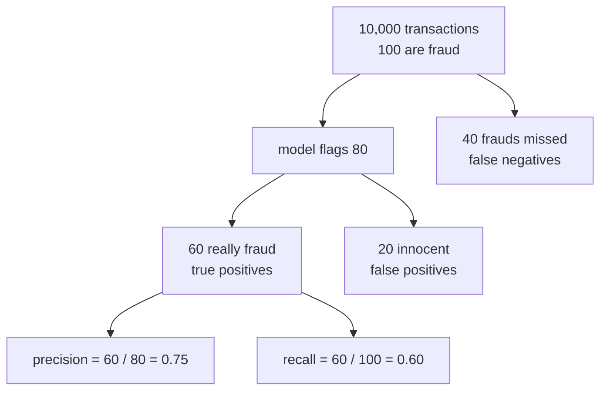

<!-- Written by `npm run lessons` from the lesson data in src/data. Edit the lesson there, not this page. -->

# Metrics: precision, recall, F1, ROC-AUC, confusion matrix

**ML Foundations · Unit 2: Classical ML, built by you · Lesson 6 of 17**

> **In one line.** Classification metrics count the four outcomes (true and false positives and negatives) and summarise them: precision, recall, F1, accuracy, and ROC-AUC across all thresholds.

[Open this lesson on the site](https://learn.hamropedia.com/foundations/metrics-precision-recall-f1-roc-auc-confusion-matrix/) for its animation, the practice game and tap-to-explain words.

## The problem it solves

Accuracy can lie. If 1% of transactions are fraud, a model that never flags anything is 99% accurate and completely useless. Different jobs care about different mistakes: a cancer screen must not miss cases (recall), a spam filter must not bin real email (precision). The right metric is what tells you whether a model does the job.

## The idea

A confusion matrix counts true positives, false positives, false negatives and true negatives. Precision = TP/(TP + FP): of the items you flagged, how many were right? Recall = TP/(TP + FN): of the real ones, how many did you find? F1 balances the two. ROC-AUC measures how well scores rank positives above negatives.

## How it works, step by step

1. Pick a threshold and turn scores into yes/no predictions.
2. Count the four outcomes in a confusion matrix: TP (flagged, really positive), FP (flagged, really negative), FN (missed positive), TN (correctly left alone).
3. Precision = TP / (TP + FP): of everything flagged, how much was right?
4. Recall = TP / (TP + FN): of everything really positive, how much did we find?
5. F1 = 2·P·R / (P + R): one number that is only high when both are high.
6. Move the threshold: lower it and recall rises while precision usually falls; raise it and the reverse happens.
7. ROC curve: plot recall (true positive rate) against false positive rate for every threshold. The area under it (AUC) is the chance a random positive scores above a random negative: 0.5 is guessing, 1.0 is perfect.

## Picture it



*Precision asks 'of what I flagged, how much was right?'; recall asks 'of what was really there, how much did I find?'.*

## Analogy

Fishing with a net. Precision: how much of your catch is fish, not old boots? Recall: how many of the fish in the lake did you catch?

**Where the analogy breaks.** In fishing you can see your catch. In ML, the threshold you choose changes both numbers, so always say which threshold you used.

## Worked example

10,000 transactions, 100 are fraud. The model flags 80, and 60 of those are fraud. Precision = 60/80 = 0.75. Recall = 60/100 = 0.60. F1 ≈ 0.67.

```python
tp = np.sum((pred == 1) & (y == 1))
fp = np.sum((pred == 1) & (y == 0))
fn = np.sum((pred == 0) & (y == 1))
precision, recall = tp / (tp + fp), tp / (tp + fn)
```

## Must know

- Accuracy = (TP + TN) / everything. Misleading when classes are imbalanced.
- Precision: "when it says yes, is it right?" Recall: "does it find them all?"
- There is always a trade-off between them, controlled by the threshold.
- ROC-AUC doesn't depend on the threshold. With very rare positives, the precision–recall curve is more telling.
- Always report the threshold you used, and compare against a dumb baseline.
- Choose the metric from the cost of each mistake, before you train.

## Common mistakes

- Reporting accuracy on imbalanced data: with 1% positives, always answering "no" scores 99%.
- Quoting precision without recall, or the other way round.
- Choosing the threshold on the test set.
- Mixing up FP and FN. Write out the 2 × 2 table every time.

> **Not true:** A model with high precision must also have high recall.  
> **In fact:** They pull against each other. A model that says yes only when it is very sure has high precision but misses many positives, so its recall is low.

> **Not true:** With 1% positives, an accuracy of 99% shows that a model is good.  
> **In fact:** A model that always answers "no" also scores 99%, and finds nothing. On imbalanced data, look at precision and recall.

## Practise

Try each one yourself first: on paper, in code or out loud. Then open the answer and compare.

### 1. Derive

From TP = 40, FP = 10, FN = 20, TN = 930, compute accuracy, precision, recall and F1 by hand.

<details>
<summary>Show one good answer</summary>

TP = 40, FP = 10, FN = 20, TN = 930, so 1,000 cases in total.

Accuracy = (TP + TN) / total = (40 + 930) / 1,000 = 0.97.  
Precision = TP / (TP + FP) = 40 / 50 = 0.80. Of the 50 flagged, 40 were right.  
Recall = TP / (TP + FN) = 40 / 60 ≈ 0.667. Of the 60 real positives, 40 were found.  
F1 = 2·P·R / (P + R) = 2·0.8·0.667 / 1.467 ≈ 0.727. (Or directly: 2TP / (2TP + FP + FN) = 80 / 110.)

Notice that accuracy, 97%, looks far better than the model really is: it misses a third of the positives. Accuracy is flattered by the 930 easy negatives.

</details>

### 2. Build

Write precision, recall, F1 and ROC-AUC from scratch. For AUC, sort by score and use the trapezoid rule.

<details>
<summary>Show one good answer</summary>

Precision, recall and F1 come straight from the counts. For ROC-AUC, sort by score from high to low and walk down the list, lowering the threshold one example at a time: each positive moves the curve up (true positive rate), each negative moves it right (false positive rate). The area under that curve, by the trapezoid rule, is the AUC.

Check it with its meaning: AUC is the chance that a random positive gets a higher score than a random negative, which you can count directly by comparing every pair. Both give the same number. (Ties in scores need care; this version assumes distinct scores.)

```python
import numpy as np

def precision(y, pred):
    tp, fp = np.sum((pred == 1) & (y == 1)), np.sum((pred == 1) & (y == 0))
    return tp / (tp + fp) if tp + fp else 0.0

def recall(y, pred):
    tp, fn = np.sum((pred == 1) & (y == 1)), np.sum((pred == 0) & (y == 1))
    return tp / (tp + fn) if tp + fn else 0.0

def f1(y, pred):
    p, r = precision(y, pred), recall(y, pred)
    return 2 * p * r / (p + r) if p + r else 0.0

def roc_auc(y, scores):
    y = y[np.argsort(-scores)]                        # highest score first
    tpr = np.concatenate([[0], np.cumsum(y) / y.sum()])
    fpr = np.concatenate([[0], np.cumsum(1 - y) / (1 - y).sum()])
    return np.trapezoid(tpr, fpr)

rng = np.random.default_rng(0)
y = rng.integers(0, 2, 500)
scores = y + rng.normal(0, 0.8, 500)                  # noisy but useful scores
pairs = np.mean(scores[y == 1][:, None] > scores[y == 0][None, :])
print(round(roc_auc(y, scores), 4), round(pairs, 4))   # the same
pred = (scores > 0.5).astype(int)
print(round(precision(y, pred), 3), round(recall(y, pred), 3), round(f1(y, pred), 3))
```

</details>

### 3. Break

Make a 'model' that always predicts 'not fraud' on data with 1% fraud. What are its accuracy, precision and recall? Which metric exposes it?

<details>
<summary>Show one good answer</summary>

On 10,000 transactions with 100 frauds, "always not fraud" gets:  
• accuracy 99%, which looks excellent;  
• recall 0: it finds none of the 100 frauds;  
• precision undefined (0 / 0, because it flags nothing), usually reported as 0.

Recall exposes it immediately, and so do F1 (0) and the confusion matrix, which shows TP = 0. Accuracy hides it because 99% of the answers are "not fraud" anyway.

The rule: on imbalanced data, never report accuracy alone. Report precision and recall for the rare class, or the precision–recall curve.

```python
import numpy as np

y = np.array([1] * 100 + [0] * 9900)          # 1% fraud
pred = np.zeros_like(y)                       # always "not fraud"
tp = np.sum((pred == 1) & (y == 1))
print("accuracy", (pred == y).mean())          # 0.99
print("recall", tp / y.sum())                  # 0.0
print("flagged", pred.sum())                   # 0: precision is 0 / 0
```

</details>

### 4. Explain

Explain precision and recall with the fishing-net picture.

<details>
<summary>Show one good answer</summary>

Fishing with a net. Precision asks: of everything in your net, how much is actually fish, and not old boots? Recall asks: of all the fish in the lake, how many did you catch?

A huge net catches nearly every fish (high recall) but also lots of boots (low precision). A small, careful net catches only fish (high precision) but misses most of them (low recall). You choose the net by what a mistake costs: for a disease screening test, missing a sick person is worse, so you want high recall; for a spam filter, losing a real email is worse, so you want high precision.

</details>

## Check you understood

Answer in your head first, then open each one.

<details>
<summary>&lt;b>TP = 60, FP = 20, FN = 40. Precision and recall?&lt;/b></summary>

Precision = 60/80 = 0.75. Recall = 60/100 = 0.60.

</details>

<details>
<summary>&lt;b>For cancer screening, which matters more: precision or recall?&lt;/b></summary>

Recall. Missing a real case is far worse than a false alarm that a follow-up test can clear.

</details>

<details>
<summary>&lt;b>What does an AUC of 0.5 mean?&lt;/b></summary>

The model ranks positives above negatives no better than a coin flip.

</details>

<details>
<summary>&lt;b>You lower the threshold. What usually happens to precision and recall?&lt;/b></summary>

Recall goes up (more positives caught) and precision goes down (more false alarms).

</details>

## Go further (optional)

The lesson above is enough on its own. These free extras give a second explanation.

- PLAY · [ROC & AUC](https://mlu-explain.github.io/roc-auc/) · MLU-Explain (Amazon) · animated, interactive  
  **Worth it:** Drag the threshold and watch the confusion matrix and the ROC curve change together. The trade-off becomes something you can feel.
- PLAY · [Precision & Recall](https://mlu-explain.github.io/precision-recall/) · MLU-Explain (Amazon) · animated, interactive
- WATCH · [ROC and AUC, Clearly Explained](https://www.youtube.com/results?search_query=StatQuest+ROC+and+AUC%2C+Clearly+Explained) · StatQuest (Josh Starmer)
- READ · [Classification: accuracy, recall, precision and related metrics](https://developers.google.com/machine-learning/crash-course/classification/accuracy-precision-recall) · Google ML Crash Course

---

[← Bias–variance trade-off and overfitting](bias-variance-trade-off-and-overfitting.md) · [All lessons](../../README.md) · [Cross-validation and data leakage →](cross-validation-and-data-leakage.md)
