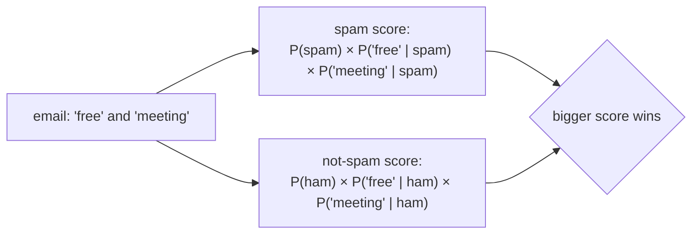

<!-- Written by `npm run lessons` from the lesson data in src/data. Edit the lesson there, not this page. -->

# Naive Bayes

**ML Foundations · Unit 2: Classical ML, built by you · Lesson 13 of 17**

> **In one line.** Naive Bayes classifies with Bayes' rule, assuming the features are independent once you know the class, so each feature's evidence can simply be multiplied in.

[Open this lesson on the site](https://learn.hamropedia.com/foundations/naive-bayes/) for its animation, the practice game and tap-to-explain words.

## The problem it solves

Text has thousands of word features but often little labelled data. Naive Bayes trains in a single counting pass, works well with small datasets, and makes a hard-to-beat baseline for spam filtering and document classification. It is also the clearest real use of Bayes' rule in ML.

## The idea

Naive Bayes uses Bayes' rule to classify, with a 'naive' shortcut: it assumes features are independent once you know the class. Then you just multiply probabilities.

## How it works, step by step

1. From the training data, count the prior: P(spam) = the share of emails that are spam.
2. For each word, count how often it appears in spam and in ham (not spam): P(word \| spam) and P(word \| ham).
3. For a new email, start each class at its prior and multiply in P(word \| class) for every word in it.
4. The bigger product wins. Divide each by their sum to get probabilities.
5. In practice, add logs instead of multiplying, because a product of hundreds of small numbers rounds to 0.
6. Add-one (Laplace) smoothing: add 1 to every count, so a word never seen in spam doesn't force P(spam) to exactly 0.

## Picture it



*Naive Bayes multiplies the evidence from each word separately (in practice it adds logs), then picks the class with the bigger score.*

## Analogy

A spam filter reading one word at a time. 'free' makes spam more likely, 'meeting' makes it less likely. It adds up the evidence from each word separately.

**Where the analogy breaks.** Words are not really independent: 'New' and 'York' appear together. The probabilities come out wrong, but the ranking of classes is often still right.

## Worked example

P(spam) = 0.4. P('free' \| spam) = 0.3, P('free' \| not spam) = 0.02. For an email with 'free': 0.4 × 0.3 = 0.12 versus 0.6 × 0.02 = 0.012. Spam is 10 times more likely.

```python
# add logs instead of multiplying: 1,000 tiny probabilities would round to 0
log_spam = np.log(0.4) + np.log(0.3)
log_ham  = np.log(0.6) + np.log(0.02)
```

## Must know

- Naive Bayes scores each class as prior × Π P(featureᵢ \| class): how common the class is, times the probability of each feature given that class.
- The "naive" assumption is false for real text, yet the ranking of classes is often still right.
- Training is just counting: very fast, works on small data.
- Always add log-probabilities instead of multiplying probabilities, and use smoothing so that one unseen word can't make the whole product zero.
- Words that are equally common in both classes add no evidence.
- The probabilities it outputs are badly calibrated (too extreme); trust the ranking more than the numbers.

## Common mistakes

- Multiplying raw probabilities, which underflow to 0 on long documents.
- No smoothing: one unseen word sends a class to probability 0.
- Treating its probabilities as well calibrated.

> **Not true:** Naive Bayes gives well-calibrated probabilities: when it says 0.99, it is right 99% of the time.  
> **In fact:** Treating the features as independent counts the same evidence several times, which pushes its probabilities towards 0 and 1. Trust its ranking of the classes, not the numbers.

> **Not true:** Naive Bayes only works when the features really are independent.  
> **In fact:** The assumption is false for real text, where words depend on each other, yet the ranking of the classes is often still right. That makes it a useful baseline.

## Practise

Try each one yourself first: on paper, in code or out loud. Then open the answer and compare.

### 1. Derive

P(spam) = 0.3, P('win' \| spam) = 0.2, P('win' \| ham) = 0.01, P('meeting' \| spam) = 0.01, P('meeting' \| ham) = 0.1. Score an email containing both words, by hand.

<details>
<summary>Show one good answer</summary>

Multiply the prior by each word's probability, for each class (the naive assumption: words are independent given the class).

Spam: P(spam)·P(win \| spam)·P(meeting \| spam) = 0.3 × 0.2 × 0.01 = 0.0006  
Ham: P(ham)·P(win \| ham)·P(meeting \| ham) = 0.7 × 0.01 × 0.1 = 0.0007

Normalise: P(spam \| both words) = 0.0006 / (0.0006 + 0.0007) ≈ 0.46.

So it is slightly more likely to be ham. The two words pull in opposite directions: "win" is 20 times more common in spam, "meeting" is 10 times more common in ham, and the prior already favours ham, 0.7 to 0.3. Overall odds: (0.3/0.7) × 20 × (1/10) ≈ 0.86, a little under even.

</details>

### 2. Build

Build a Naive Bayes spam filter from scratch on a real SMS or email spam dataset, with log probabilities and add-one smoothing.

<details>
<summary>Show one good answer</summary>

Train: count how often each word appears in spam and in ham messages. Predict: for each class, add up log P(class) and log P(word \| class) for every word in the message, and pick the bigger total. Logs turn a product of many small probabilities into a sum, so nothing underflows to 0. Add-one smoothing adds 1 to every word count, so no probability is ever exactly 0.

On the UCI SMS Spam Collection (5,574 real text messages), this simple filter gets about 98% accuracy on held-out messages, and catches most spam.

```python
import io, re, urllib.request, zipfile
from collections import Counter
import numpy as np

url = "https://archive.ics.uci.edu/static/public/228/sms+spam+collection.zip"
raw = zipfile.ZipFile(io.BytesIO(urllib.request.urlopen(url).read())).read("SMSSpamCollection")
rows = [line.split("\t", 1) for line in raw.decode("utf-8").strip().split("\n")]
labels = np.array([r[0] == "spam" for r in rows])
texts = [set(re.findall(r"[a-z']+", r[1].lower())) for r in rows]

order = np.random.default_rng(0).permutation(len(rows))
train, test = order[:4500], order[4500:]
counts = {c: Counter() for c in (True, False)}
for i in train:
    counts[labels[i]].update(texts[i])
vocab = set(counts[True]) | set(counts[False])
n_class = {c: np.sum(labels[train] == c) for c in (True, False)}

def log_score(words, c):
    total = sum(counts[c].values()) + len(vocab)          # add-one smoothing
    score = np.log(n_class[c] / len(train))
    for w in words & vocab:
        score += np.log((counts[c][w] + 1) / total)
    return score

pred = np.array([log_score(texts[i], True) > log_score(texts[i], False) for i in test])
print(f"accuracy {np.mean(pred == labels[test]):.1%}, spam caught {pred[labels[test]].mean():.0%}")
```

</details>

### 3. Break

Remove the smoothing and test an email with a word never seen in spam. What happens to its spam probability? Why is that a disaster?

<details>
<summary>Show one good answer</summary>

Without smoothing, a word that never appeared in any spam message gets P(word \| spam) = 0. Because the probabilities are multiplied, one zero makes the whole spam score 0 (in logs, −infinity), whatever else the message says.

So "WIN a FREE prize, claim now" plus one harmless word the filter never saw in spam is scored as certainly not spam: probability exactly 0. That is a disaster for two reasons: one word vetoes all the other evidence, and spammers can exploit it on purpose by adding an unusual word. It also breaks for new legitimate words.

Add-one smoothing fixes it: every word gets a small non-zero probability in every class, so an unseen word only nudges the score instead of ending the argument.

```python
import numpy as np

spam_counts = {"win": 30, "free": 40, "prize": 25, "claim": 20}     # words seen in spam
total = sum(spam_counts.values())
message = ["win", "free", "prize", "claim", "giraffe"]           # "giraffe": never seen in spam

no_smoothing = np.prod([spam_counts.get(w, 0) / total for w in message])
vocab = 5_000
smoothed = np.prod([(spam_counts.get(w, 0) + 1) / (total + vocab) for w in message])
print(no_smoothing, f"{smoothed:.2e}")    # 0.0 versus a small but non-zero number
```

</details>

### 4. Explain

Explain the 'naive' assumption, and why it still works, with the spam-filter picture.

<details>
<summary>Show one good answer</summary>

A spam filter reads an email one word at a time. "Free" makes spam more likely, "meeting" makes it less likely, and it adds up the evidence from each word as if each one were a separate, independent clue. That is the naive assumption: once you know whether an email is spam, each word tells you something on its own, unrelated to the others.

It is clearly false: "free" and "prize" tend to come together. So the probabilities it outputs are overconfident. But to classify, it only needs the right class to come out on top, and adding up many weak, partly overlapping clues usually still points the right way. It is fast, needs little data, and is a strong baseline for text.

</details>

## Check you understood

Answer in your head first, then open each one.

<details>
<summary>&lt;b>What is "naive" about Naive Bayes?&lt;/b></summary>

It assumes features are independent given the class. Words like "New" and "York" clearly aren't, but it often still works.

</details>

<details>
<summary>&lt;b>Why add logs instead of multiplying?&lt;/b></summary>

The product of many small probabilities is too small for a computer and becomes 0. Sums of logs stay in a safe range.

</details>

<details>
<summary>&lt;b>What does add-one smoothing prevent?&lt;/b></summary>

A single unseen word making a class impossible (probability 0).

</details>

<details>
<summary>&lt;b>A word appears in 5% of spam and 5% of ham. How does it change the decision?&lt;/b></summary>

Not at all: it multiplies both classes by the same number.

</details>

## Go further (optional)

The lesson above is enough on its own. These free extras give a second explanation.

- WATCH · [Naive Bayes, Clearly Explained](https://www.youtube.com/results?search_query=StatQuest+Naive+Bayes%2C+Clearly+Explained) · StatQuest (Josh Starmer)
- READ · [ISLP, Ch 4 (naive Bayes)](https://www.statlearning.com/) · free book
- READ · [Speech and Language Processing: the Naive Bayes chapter](https://web.stanford.edu/~jurafsky/slp3/) · Jurafsky and Martin · free

---

[← Support vector machines: margin and hinge loss](support-vector-machines-margin-and-hinge-loss.md) · [All lessons](../../README.md) · [k-means clustering →](k-means-clustering.md)
