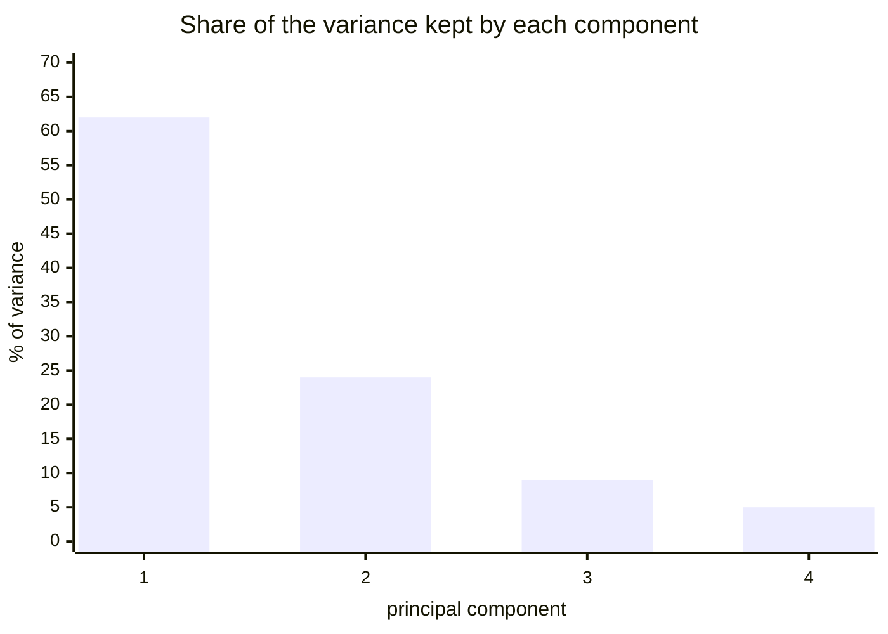

<!-- Written by `npm run lessons` from the lesson data in src/data. Edit the lesson there, not this page. -->

# PCA in practice

**ML Foundations · Unit 2: Classical ML, built by you · Lesson 15 of 17**

> **In one line.** In practice, PCA is used to compress features, remove noise, speed up other models and plot high-dimensional data, keeping just enough components to hold most of the variance.

[Open this lesson on the site](https://learn.hamropedia.com/foundations/pca-in-practice/) for its animation, the practice game and tap-to-explain words.

## The problem it solves

You now know how PCA works; the hard part is using it well. How many components should you keep? Should you scale first? When does it help a downstream model, and when does it throw away the very signal you need? Those practical choices decide whether PCA helps or hurts.

## The idea

Use PCA to compress data, remove noise, or plot high-dimensional data in 2D. Always centre the data first, and scale it if features use different units.

## How it works, step by step

1. Fit on training data only: compute the mean (and, if units differ, the standard deviation) from the training rows.
2. Centre (and scale) the data, then run SVD.
3. Plot the explained-variance ratio per component (a scree plot) and its running total.
4. Pick k where the running total reaches your target, often 90–99%, or at the elbow of the scree plot.
5. Transform: keep the top-k component scores as the new features. Apply the same transform to validation and test data.
6. For visualisation, plot the first two or three components, coloured by label.
7. To check what was lost, reconstruct the data from k components and compare it with the original.

## Picture it



*The first few components usually hold most of the spread. Keep enough to reach your target (often around 95%) and drop the rest.*

## Analogy

Photographing a 3D object from the angle that shows the most detail.

**Where the analogy breaks.** The angle with the most spread is not always the most useful one. PCA ignores the labels, so the direction that separates your classes might be dropped.

## Worked example

MNIST images have 784 pixels. About 150 principal components keep around 95% of the variance.

```python
explained = S**2 / np.sum(S**2)
k = np.searchsorted(np.cumsum(explained), 0.95) + 1   # components for 95%
```

## Must know

- Centre always; standardise when features have different units.
- Choose the number of components k from the cumulative explained variance: keep enough to reach, say, 95%.
- PCA ignores labels: maximum spread is not always maximum usefulness.
- It removes correlated, redundant features and can denoise data.
- Non-linear structure needs other tools (t-SNE or UMAP for plotting, autoencoders in Unit 7).
- For MNIST digits, about 150 of 784 components keep around 95% of the variance.

## Common mistakes

- Fitting PCA on the full dataset, test set included.
- Not scaling features that have different units: the one with the largest numbers becomes the first component.
- Assuming components have a human meaning.
- Dropping low-variance components that actually separate the classes.

> **Not true:** Each principal component stands for one real-world quantity, such as income or age.  
> **In fact:** A component is a mix of all the original features, chosen because the data spreads out along it. It usually has no simple meaning.

> **Not true:** Low-variance components: they carry no information that separates the classes.  
> **In fact:** PCA ignores the labels. A direction with little spread can be exactly the one that separates the classes, so check before dropping it.

## Practise

Try each one yourself first: on paper, in code or out loud. Then open the answer and compare.

### 1. Derive

The covariance eigenvalues are [5, 3, 1.5, 0.5]. What fraction of the variance do the top 2 components keep?

<details>
<summary>Show one good answer</summary>

The eigenvalues of the covariance matrix are the variances along each principal direction, so the share of variance a component keeps is its eigenvalue divided by the total.

Total: 5 + 3 + 1.5 + 0.5 = 10.  
Top two: 5 + 3 = 8.  
Fraction kept: 8 / 10 = 80%.

The first component alone keeps 50%, and adding the third would bring it to 95%.

</details>

### 2. Build

Compress MNIST digits to 10, 50 and 150 components and reconstruct them. Show the images side by side with their explained variance.

<details>
<summary>Show one good answer</summary>

Flatten each 28 × 28 image into 784 numbers, centre the data, take the SVD, keep the top k directions, and reconstruct each image as mean + (coordinates × directions).

On 10,000 MNIST training images, 10 components keep about half the variance and give blurry but recognisable shapes; 50 keep about 80% and the digits are clear; 150 keep about 95% and look almost like the originals, from 784 numbers down to 150.

```python
import numpy as np
import matplotlib.pyplot as plt
from torchvision import datasets             # only to download MNIST

mnist = datasets.MNIST("data", train=True, download=True)
X = mnist.data[:10_000].numpy().reshape(10_000, -1) / 255.0      # (10000, 784)
mean = X.mean(axis=0)
U, S, Vt = np.linalg.svd(X - mean, full_matrices=False)
ratio = np.cumsum(S**2) / np.sum(S**2)

ks = [10, 50, 150]
fig, axes = plt.subplots(4, len(ks) + 1, figsize=(8, 8))
for row in range(4):
    axes[row, 0].imshow(X[row].reshape(28, 28), cmap="gray")
    for col, k in enumerate(ks, start=1):
        recon = mean + (X[row] - mean) @ Vt[:k].T @ Vt[:k]
        axes[row, col].imshow(recon.reshape(28, 28), cmap="gray")
for col, k in enumerate(ks, start=1):
    axes[0, col].set_title(f"{k}: {ratio[k - 1]:.0%}")
axes[0, 0].set_title("original")
for ax in axes.flat:
    ax.axis("off")
plt.show()
print({k: round(float(ratio[k - 1]), 3) for k in ks})
```

</details>

### 3. Break

Make a dataset where the class difference lies in a low-variance direction. Show that PCA to 1 component destroys the separation.

<details>
<summary>Show one good answer</summary>

Make two features: x₁ varies a lot (standard deviation 10) but is the same for both classes, and x₂ varies little (standard deviation 0.5) but its mean is −1 for one class and +1 for the other. All the class information is in the small, quiet direction.

PCA keeps the direction with the most variance, so with one component it keeps x₁ and throws x₂ away. A simple classifier on that one component does no better than a coin flip, about 50%, while the same classifier on x₂ alone gets about 98%.

The lesson: PCA is unsupervised. It looks for spread, not for what predicts the label, and "most variance" is not the same as "most useful". Check how a downstream model performs after reducing dimensions.

```python
import numpy as np

rng = np.random.default_rng(0)
n = 1000
y = rng.integers(0, 2, n)
X = np.column_stack([rng.normal(0, 10, n),                      # big spread, no signal
                     np.where(y == 1, 1.0, -1.0) + rng.normal(0, 0.5, n)])   # small spread, all signal
Xc = X - X.mean(axis=0)
first = np.linalg.svd(Xc, full_matrices=False)[2][0]
z = Xc @ first
print("first component:", first.round(3))                     # ≈ [±1, 0]: it kept x₁
accuracy = lambda feature: max(np.mean((feature > 0) == y), np.mean((feature < 0) == y))
print(f"on the PCA component: {accuracy(z):.0%}, on x₂: {accuracy(Xc[:, 1]):.0%}")
```

</details>

### 4. Explain

Explain when PCA helps and when it hurts, with the camera-angle picture.

<details>
<summary>Show one good answer</summary>

Photographing a 3D object: you get to keep only a 2D picture, so you choose the angle that shows the most detail. A teapot photographed from the side shows its spout and handle; from directly above, it looks like a circle. PCA chooses the camera angle that keeps the most spread in the data, so the flattened picture loses as little as possible.

It helps when most of the spread is the interesting part: compressing images, removing near-duplicate features, speeding up a model, or plotting high-dimensional data. It hurts when the important detail is small: if the one thing you care about is a tiny mark on the teapot's lid, the "best" side view hides it. PCA keeps the biggest variation, not the most useful one.

</details>

## Check you understood

Answer in your head first, then open each one.

<details>
<summary>&lt;b>The eigenvalues are [6, 2, 1, 1]. What share do the top 2 components keep?&lt;/b></summary>

(6 + 2) / 10 = 80%.

</details>

<details>
<summary>&lt;b>Why might PCA hurt a classifier?&lt;/b></summary>

It keeps the directions of largest spread, ignoring labels. If the classes differ along a low-variance direction, that difference can be thrown away.

</details>

<details>
<summary>&lt;b>When must you standardise before PCA?&lt;/b></summary>

When features are in different units or scales; otherwise the one with the largest numbers dominates the first component.

</details>

<details>
<summary>&lt;b>Should PCA be fitted before or after splitting the data?&lt;/b></summary>

After: fit it on the training rows only, then apply it to the rest.

</details>

## Go further (optional)

The lesson above is enough on its own. These free extras give a second explanation.

- PLAY · [Principal Component Analysis, explained visually](https://setosa.io/ev/principal-component-analysis/) · Setosa · drag the points yourself
- WATCH · [PCA - Practical Tips](https://www.youtube.com/results?search_query=StatQuest+PCA+-+Practical+Tips) · StatQuest (Josh Starmer)
- READ · [ISLP, Ch 12 (principal components analysis)](https://www.statlearning.com/) · free book
- READ · [Mathematics for Machine Learning, Ch 10 (PCA)](https://mml-book.github.io/) · Deisenroth, Faisal, Ong · free

---

[← k-means clustering](k-means-clustering.md) · [All lessons](../../README.md) · [Gaussian mixture models and EM →](gaussian-mixture-models-and-em.md)
