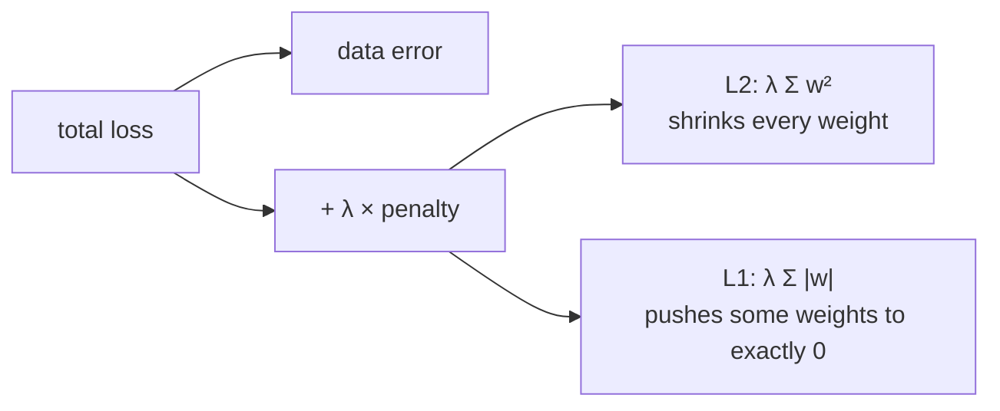

<!-- Written by `npm run lessons` from the lesson data in src/data. Edit the lesson there, not this page. -->

# Regularisation: L1 and L2

**ML Foundations · Unit 2: Classical ML, built by you · Lesson 4 of 17**

> **In one line.** Regularisation adds a penalty for large weights to the loss. L2 shrinks every weight, while L1 pushes the weak ones to exactly zero.

[Open this lesson on the site](https://learn.hamropedia.com/foundations/regularisation-l1-and-l2/) for its animation, the practice game and tap-to-explain words.

## The problem it solves

A flexible model with many features can fit the training data too well, using huge weights that balance each other out on noise. It then does badly on new data. Regularisation tells the model "simple explanations are better": it trades a little training error for much smaller weights, which usually generalise better. L1 also picks features for you.

## The idea

Add a penalty for large weights to the loss. L2 adds λΣw² and shrinks all weights a little. L1 adds λΣ\|w\| and pushes some weights to exactly zero.

## How it works, step by step

1. Start from the normal loss, for example mean squared error.
2. Add a penalty: L2 adds λΣw², L1 adds λΣ\|w\|. λ (lambda) sets how strongly simplicity is preferred.
3. L2's gradient adds 2λw to each weight's gradient, so every step also shrinks each weight a little, in proportion to its size. This is "weight decay".
4. With uncorrelated, equally scaled features, L2 simply divides every weight by (1 + λ): smaller, but never exactly zero.
5. L1 pulls every weight towards zero by the same fixed amount, λ/2 in that simple case. Weights smaller than that land on exactly 0.
6. Choose λ with the validation set: try values like 0.001, 0.01, 0.1, 1 and 10, and keep the one with the best validation score.
7. Never penalise the bias, and scale the features first, so the penalty treats them fairly.

## Picture it



*Regularisation adds a cost for large weights. L2 makes all weights small; L1 switches the weak ones off completely.*

## Analogy

A spending budget. L2 is a tax that grows fast for big spending, so you spend a little on everything. L1 is a flat fee per pound, so it is often best to spend nothing at all on weak items.

**Where the analogy breaks.** The 'cost' here is not money but model complexity. The right λ must be found with validation data, not guessed.

## Worked example

L2 adds 2λw to the gradient, so every step shrinks w a bit. This is called weight decay. L1 adds λ·sign(w): the same push however small w is, so small weights reach zero.

```python
loss = mse + lam * np.sum(w**2)      # L2
grad = grad_mse + 2 * lam * w
```

## Must know

- Loss = data error + λ × penalty. λ = 0 means no regularisation.
- L2 (ridge, weight decay): small weights everywhere; smooth; has a closed form w = (XᵀX + λI)⁻¹Xᵀy.
- L1 (lasso): many weights exactly 0, so it selects features.
- Too big a λ underfits; too small overfits. Tune it on validation data.
- Regularisation reduces variance at the cost of a little bias.
- In deep learning, weight decay, dropout, data augmentation and early stopping all play this role (Unit 3).

## Common mistakes

- Regularising without scaling features: features measured in small units need big weights, so they get punished unfairly.
- Penalising the bias term as well. Regularise only the weights: shrinking the bias just shifts every prediction.
- Picking λ by looking at the test set.
- Expecting L2 to remove features. It only shrinks them.

> **Not true:** A penalty on the weights treats every feature fairly, whatever units the features are measured in.  
> **In fact:** A feature measured in small units needs a big weight, so the penalty punishes it more. Scale the features before regularising.

> **Not true:** L2 regularisation removes unneeded features by setting their weights exactly to 0.  
> **In fact:** L2 only shrinks weights towards 0; they rarely reach it. L1 is the penalty that sets weights exactly to 0.

## Go deeper (optional): Why L2 regularisation is a Gaussian prior on the weights

1. Maximum likelihood picks the weights that make the data most probable: maximise P(data \| w). MAP also uses a belief about the weights before seeing data, the prior P(w): maximise P(data \| w)·P(w).
2. Take logs and flip the sign, so that we minimise: −log P(data \| w) − log P(w). With Gaussian noise of variance σ², the first term is the squared error: Σ (y − ŷ)² / (2σ²).
3. Choose the prior "weights are probably small": each weight is Gaussian with mean 0 and variance τ². Then −log P(w) = Σ w² / (2τ²), plus a constant.
4. Add the two and multiply through by 2σ²: the objective is Σ (y − ŷ)² + (σ²/τ²)·Σ w².
5. That is squared error plus an L2 penalty, with λ = σ²/τ². A stronger belief that weights are small (small τ), or noisier data (large σ), means a larger λ.
6. Use a Laplace prior instead, whose −log is \|w\|/b, and the penalty becomes λΣ\|w\|: L1.

**The result.** L2 regularisation is MAP estimation with a Gaussian prior on the weights, with λ = σ²/τ². L1 is MAP with a Laplace prior.

## Practise

Try each one yourself first: on paper, in code or out loud. Then open the answer and compare.

### 1. Derive

Add λ‖w‖² to the squared-error loss and derive the new closed-form solution (ridge regression).

<details>
<summary>Show one good answer</summary>

New loss: L(w) = ‖Xw − y‖² + λ‖w‖².

Gradient: ∇L = 2Xᵀ(Xw − y) + 2λw.

Set it to 0: XᵀXw − Xᵀy + λw = 0, so (XᵀX + λI)w = Xᵀy, and  
w = (XᵀX + λI)⁻¹Xᵀy.

The only change from plain least squares is the +λI. It adds λ to every diagonal entry, which does two things: it shrinks the weights towards 0, and it makes the matrix always invertible for λ > 0, even with duplicate or highly correlated features. (Usually the bias is not penalised: centre y, or leave the bias column out of the λI.)

</details>

### 2. Build

Fit ridge and L1 regression for λ from 0.001 to 100. Plot each weight against λ.

<details>
<summary>Show one good answer</summary>

Ridge has the closed form above. L1 (the lasso) has no closed form because \|w\| has a corner at 0, so use proximal gradient descent: a normal gradient step on the squared error, then "soft-thresholding", which moves each weight towards 0 by λ times the step size and sets it to exactly 0 if it would cross.

On the standardised diabetes data the two plots look very different. Ridge weights shrink smoothly and all of them are still non-zero at λ = 100. Lasso weights drop to exactly 0 one by one as λ grows, and all ten are zero once λ passes about 45 (the largest \|Xᵀy\| / n: no feature is worth its fee beyond that). That is L1's feature selection.

```python
import numpy as np
import matplotlib.pyplot as plt
from sklearn.datasets import load_diabetes       # only to load the data

d = load_diabetes(scaled=False)
X = (d.data - d.data.mean(axis=0)) / d.data.std(axis=0)
y = d.target - d.target.mean()                    # centre y: no bias to penalise
n, p = X.shape
lams = np.logspace(-3, 2, 30)

def ridge(lam):                                   # minimises mean sq. error + lam·‖w‖²
    return np.linalg.solve(X.T @ X / n + lam * np.eye(p), X.T @ y / n)

def lasso(lam, steps=3000):                       # minimises ½·mean sq. error + lam·‖w‖₁
    w, lr = np.zeros(p), 1 / np.linalg.eigvalsh(X.T @ X / n).max()
    for _ in range(steps):
        w = w - lr * X.T @ (X @ w - y) / n
        w = np.sign(w) * np.maximum(np.abs(w) - lr * lam, 0)   # soft-threshold
    return w

R = np.array([ridge(l) for l in lams])
L = np.array([lasso(l) for l in lams])
print("non-zero weights at lambda = 100:", (np.abs(R[-1]) > 1e-8).sum(), (np.abs(L[-1]) > 1e-8).sum())

fig, axes = plt.subplots(1, 2, figsize=(11, 4), sharey=True)
for ax, W, name in [(axes[0], R, "ridge (L2)"), (axes[1], L, "lasso (L1)")]:
    ax.plot(lams, W); ax.set_xscale("log"); ax.set_title(name); ax.set_xlabel("λ")
axes[0].set_ylabel("weight")
plt.tight_layout(); plt.show()
```

</details>

### 3. Break

Use a huge λ and look at the predictions. Then forget to scale the features before using L2. Which features get punished unfairly?

<details>
<summary>Show one good answer</summary>

With a huge λ, every weight is squashed to almost 0, so the model predicts nearly the same number, the average of y, for every input. It is a flat line: massive underfitting.

Forgetting to scale before L2 punishes features with small units unfairly. The penalty is on the size of the weights, not the size of the effect. Say a house's size is given in metres in one column and in millimetres in another. The millimetre column needs a weight 1,000 times smaller for the same effect, so the penalty barely touches it, while the metre column, needing a big weight, gets shrunk hard. The model ends up preferring features just because of their units.

In the demo, the same feature with the same true effect keeps almost all of its effect in millimetres but loses much of it in metres. Standardise first, so every feature competes fairly.

```python
import numpy as np

rng = np.random.default_rng(0)
size_m = rng.normal(2.0, 0.5, 200)                  # one feature, two units
other = rng.normal(0, 1, 200)
y = 3 * size_m + 3 * other + rng.normal(0, 0.1, 200)

def ridge(X, y, lam):
    return np.linalg.solve(X.T @ X / len(y) + lam * np.eye(X.shape[1]), X.T @ y / len(y))

for name, col in [("metres", size_m), ("millimetres", size_m * 1000)]:
    X = np.column_stack([col - col.mean(), other])
    w = ridge(X, y - y.mean(), lam=1.0)
    print(name, "effect of 1 metre:", round(w[0] * (1 if name == "metres" else 1000), 2))
# the true effect is 3 per metre in both cases
```

</details>

### 4. Explain

Explain why L1 gives exact zeros but L2 does not, with the budget picture.

<details>
<summary>Show one good answer</summary>

Think of the weights as a spending budget, and the penalty as the cost of spending.

L2 is a tax that grows with the square of what you spend: spending a little costs almost nothing, spending a lot is very expensive. So it is best to spread the budget thinly across every item: each weight is shrunk, but small weights cost so little that there is no reason to cut them all the way to 0.

L1 is a flat fee per pound, however small the amount. Even a tiny bit of spending on a weak item costs the full rate, so it often makes sense to spend nothing on it at all. That is why L1 sets weak features exactly to 0, while L2 only makes them small.

</details>

## Check you understood

Answer in your head first, then open each one.

<details>
<summary>&lt;b>Why does L1 give exact zeros, but L2 doesn't?&lt;/b></summary>

L1 pushes with the same force however small a weight is, so small weights reach 0. L2's push is proportional to the weight, so it fades as the weight shrinks and never quite reaches 0.

</details>

<details>
<summary>&lt;b>What happens with a huge λ?&lt;/b></summary>

All weights are squeezed towards 0 and the model underfits, predicting little more than the average.

</details>

<details>
<summary>&lt;b>What is another name for L2 regularisation in neural networks?&lt;/b></summary>

Weight decay.

</details>

<details>
<summary>&lt;b>How do you choose λ?&lt;/b></summary>

Try a range of values spaced by factors of 10 and keep the one with the best validation score.

</details>

## Go further (optional)

The lesson above is enough on its own. These free extras give a second explanation.

- WATCH · [Regularization Part 1: Ridge (L2) Regression](https://www.youtube.com/results?search_query=StatQuest+Regularization+Part+1%3A+Ridge+%28L2%29+Regression) · StatQuest (Josh Starmer)
- WATCH · [Regularization Part 2: Lasso (L1) Regression](https://www.youtube.com/results?search_query=StatQuest+Regularization+Part+2%3A+Lasso+%28L1%29+Regression) · StatQuest (Josh Starmer)
- READ · [ISLP, Ch 6 (shrinkage methods: ridge and lasso)](https://www.statlearning.com/) · free book

---

[← Logistic regression and the sigmoid](logistic-regression-and-the-sigmoid.md) · [All lessons](../../README.md) · [Bias–variance trade-off and overfitting →](bias-variance-trade-off-and-overfitting.md)
