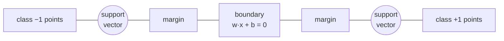

<!-- Written by `npm run lessons` from the lesson data in src/data. Edit the lesson there, not this page. -->

# Support vector machines: margin and hinge loss

**ML Foundations · Unit 2: Classical ML, built by you · Lesson 12 of 17**

> **In one line.** A support vector machine separates two classes with the line (or plane) that leaves the widest possible margin to the nearest points, trained with the hinge loss.

[Open this lesson on the site](https://learn.hamropedia.com/foundations/support-vector-machines-margin-and-hinge-loss/) for its animation, the practice game and tap-to-explain words.

## The problem it solves

Many lines can separate two classes, but the one that hugs some points will misclassify slightly different new points. The SVM picks the boundary with the most room to spare, which tends to generalise well. Its maths — margins, hinge loss, the dual problem and kernels — also introduced ideas used all over ML.

## The idea

An SVM finds the separating line (or plane) with the widest gap, the margin, to the nearest points of each class. Those nearest points are the support vectors. It uses the hinge loss, max(0, 1 − y·score).

## How it works, step by step

1. Use labels −1 and +1, and a score s = w·x + b. The boundary is where s = 0.
2. The margin lines are where s = +1 and s = −1. Their distance apart is 2/‖w‖, so a smaller ‖w‖ means a wider street.
3. Hard margin: make every point satisfy y·s ≥ 1 (on the right side, outside the street) while keeping ‖w‖ as small as possible.
4. Only the points lying on the margin lines decide the answer: the support vectors. Move any other point slightly and nothing changes.
5. Soft margin: real data overlaps, so allow violations and pay for them with the hinge loss, max(0, 1 − y·s).
6. Minimise (λ/2)‖w‖² + average hinge loss with subgradient descent. C = 1/λ: a big C punishes violations hard (narrow street); a small C allows more (wide street).
7. Kernels replace dot products with a similarity function, giving curved boundaries without building the curved features by hand.

## Picture it



*An SVM puts the boundary in the middle of the widest possible gap. Only the closest points — the support vectors — decide where it goes.*

## Analogy

Building a road between two villages. You want the widest road possible that does not touch any house.

**Where the analogy breaks.** Real data is messy: some houses sit on the wrong side. Soft-margin SVMs allow a few violations, at a cost set by C.

## Worked example

Labels are −1 or +1. With y = +1: score 2 gives loss 0 (safe); score 0.5 gives loss 0.5 (inside the margin); score −1 gives loss 2 (wrong side).

```python
loss = np.maximum(0, 1 - y * (X @ w + b)).mean() + lam * (w @ w)
```

## Must know

- The margin is 2/‖w‖ wide, so a smaller ‖w‖ means a wider margin.
- Hinge loss max(0, 1 − y·s): 0 for confident correct points, growing linearly for violations.
- Support vectors are the only points that matter for the final boundary.
- C trades margin width against training mistakes.
- The problem is convex, so there is one best answer.
- Scale features first: margins are measured in distances.

## Common mistakes

- Using 0/1 labels with the ±1 formulas.
- Forgetting to scale features. The margin is a distance, so a feature with large numbers dominates it.
- Reading SVM scores as probabilities. They are distances, not probabilities.

> **Not true:** An SVM's score for a point is the probability that the point belongs to the positive class.  
> **In fact:** The score is a signed distance from the boundary, not a probability. Turning it into a probability needs a separate calibration step.

> **Not true:** The SVM formulas work unchanged with labels of 0 and 1.  
> **In fact:** The margin and the hinge loss use y·s, which needs labels of −1 and +1. With a label of 0, y·s is always 0 and the formulas break.

## Go deeper (optional): Why the margin is exactly 2/‖w‖

1. The two margin lines are w·x + b = +1 and w·x + b = −1. The vector w points straight across the street: it is at 90° to both lines.
2. Take any point x₁ on the −1 line and walk along w until you hit the +1 line. Walking a distance d in the direction of w takes you to x₂ = x₁ + d·w/‖w‖.
3. x₂ is on the +1 line, so w·x₂ + b = 1. Substitute x₂: (w·x₁ + b) + d·(w·w)/‖w‖ = 1.
4. Since w·x₁ + b = −1 and w·w = ‖w‖², this reads −1 + d·‖w‖ = 1. So d = 2/‖w‖.
5. To make the street as wide as possible, make ‖w‖ as small as possible while every point stays on its own side: y·(w·x + b) ≥ 1. Minimising ‖w‖²/2 gives the same answer and is easier to differentiate.

**The result.** The margin lines are 2/‖w‖ apart, so "maximise the margin" becomes "minimise ‖w‖² subject to y·(w·x + b) ≥ 1": a convex problem with one best answer.

## Practise

Try each one yourself first: on paper, in code or out loud. Then open the answer and compare.

### 1. Derive

True labels [+1, +1, +1, −1] and scores [2, 0.5, −0.5, −3]. Compute each hinge loss by hand.

<details>
<summary>Show one good answer</summary>

Hinge loss = max(0, 1 − y·score). It is 0 only when the point is on the right side with a margin of at least 1.

Point 1: y = +1, score 2: 1 − 2 = −1, so max(0, −1) = 0. Correct and safely outside the margin.  
Point 2: y = +1, score 0.5: 1 − 0.5 = 0.5. Correct side, but inside the margin, so a small loss.  
Point 3: y = +1, score −0.5: 1 + 0.5 = 1.5. Wrong side: a bigger loss, growing the further it is wrong.  
Point 4: y = −1, score −3: 1 − 3 = −2, so 0. Correct and safe.

Total 2.0, mean 0.5. Only points 2 and 3, the ones inside the margin or wrong, affect training; that is why SVMs depend only on the "support vectors".

</details>

### 2. Build

Train a linear SVM with subgradient descent on the hinge loss. Plot the boundary, the margin lines, and circle the support vectors.

<details>
<summary>Show one good answer</summary>

Minimise λ/2·‖w‖² + mean(hinge loss). The hinge has a corner, so use a subgradient: for points with y·score &lt; 1 the gradient of their loss is −y·x (and −y for the bias); for the others it is 0.

On two blobs, the learned boundary sits in the gap, with the margin lines (score = +1 and −1) touching the closest points of each class. Those closest points, with y·score ≤ 1, are the support vectors: circle them. Moving any other point wouldn't change the boundary.

```python
import numpy as np
import matplotlib.pyplot as plt

rng = np.random.default_rng(0)
X = np.vstack([rng.normal([2, 2], 0.7, (50, 2)), rng.normal([-2, -2], 0.7, (50, 2))])
y = np.array([1] * 50 + [-1] * 50)
w, b, lam = np.zeros(2), 0.0, 0.01
for step in range(1, 5001):
    lr = 1 / (lam * step + 100)
    inside = y * (X @ w + b) < 1                     # in the margin, or wrong
    grad_w = lam * w - (y[inside, None] * X[inside]).sum(axis=0) / len(y)
    grad_b = -y[inside].sum() / len(y)
    w, b = w - lr * grad_w, b - lr * grad_b

support = y * (X @ w + b) <= 1 + 1e-3
print("support vectors:", support.sum(), "| margin width:", round(2 / np.linalg.norm(w), 2))
xs = np.linspace(-4, 4, 50)
plt.scatter(X[:, 0], X[:, 1], c=y, s=15)
for level, style in [(0, "k-"), (1, "k--"), (-1, "k--")]:
    plt.plot(xs, (level - b - w[0] * xs) / w[1], style)
plt.scatter(X[support, 0], X[support, 1], s=120, facecolors="none", edgecolors="r")
plt.ylim(-5, 5); plt.show()
```

</details>

### 3. Break

Add one outlier on the wrong side. Train with a very large C and a small C. How does the boundary move?

<details>
<summary>Show one good answer</summary>

C is the weight on the errors (C is like 1/λ): a large C says "mistakes are very expensive", a small C says "a wide road matters more".

With one outlier on the wrong side:  
• Very large C: the SVM bends over backwards to reduce the outlier's loss. The boundary shifts and tilts towards it, and the margin becomes narrow. One bad point has reshaped the whole model, which usually hurts on new data.  
• Small C: the SVM accepts the outlier as an error, and the boundary stays almost where it was, with a wide margin.

That is the soft-margin trade-off: C controls how much the model trusts every single training point. Choose it on the validation set.

```python
import numpy as np

def train_svm(X, y, C, steps=20_000):
    w, b = np.zeros(2), 0.0
    for step in range(1, steps + 1):
        lr = 0.01 / np.sqrt(step)
        inside = y * (X @ w + b) < 1
        w -= lr * (w - C * (y[inside, None] * X[inside]).sum(axis=0))
        b -= lr * (-C * y[inside].sum())
    return w, b

rng = np.random.default_rng(0)
X = np.vstack([rng.normal([2, 2], 0.7, (50, 2)), rng.normal([-2, -2], 0.7, (50, 2)), [[-1.5, -1.5]]])
y = np.array([1] * 50 + [-1] * 50 + [1])            # last point: +1 deep in the -1 blob
for C in [100.0, 0.01]:
    w, b = train_svm(X, y, C)
    print(f"C = {C}: margin width {2 / np.linalg.norm(w):.2f}, outlier score {X[-1] @ w + b:+.2f}")
```

</details>

### 4. Explain

Explain the margin with the road-between-villages picture.

<details>
<summary>Show one good answer</summary>

Two villages sit on either side of a plain, and you must build a straight road between them that touches no house. Many roads would work, but the best is the widest one: the road whose edges are as far as possible from the nearest houses on each side.

That road is the SVM's boundary, and its width is the margin. Only the houses right at the edge of the road decide where it goes; those are the support vectors. A wide road is safer: a new house built a little off-pattern is still on the right side.

</details>

## Check you understood

Answer in your head first, then open each one.

<details>
<summary>&lt;b>What are support vectors?&lt;/b></summary>

The training points lying on the edges of the margin. They alone fix where the boundary goes.

</details>

<details>
<summary>&lt;b>Hinge loss for y = +1 and score 0.2?&lt;/b></summary>

max(0, 1 − 0.2) = 0.8: right side, but well inside the margin.

</details>

<details>
<summary>&lt;b>What does a very large C do?&lt;/b></summary>

It punishes every violation heavily, giving a narrow margin that bends around outliers: more variance.

</details>

<details>
<summary>&lt;b>Why does a smaller ‖w‖ mean a wider margin?&lt;/b></summary>

The margin lines are at s = ±1, and their distance apart is 2/‖w‖.

</details>

## Go further (optional)

The lesson above is enough on its own. These free extras give a second explanation.

- WATCH · [Support Vector Machines Part 1 (of 3): Main Ideas](https://www.youtube.com/results?search_query=StatQuest+Support+Vector+Machines+Part+1+%28of+3%29%3A+Main+Ideas) · StatQuest (Josh Starmer)
- WATCH · [Learning: Support Vector Machines](https://www.youtube.com/results?search_query=Patrick+Winston+MIT+6.034+support+vector+machines) · Patrick Winston, MIT 6.034
- READ · [ISLP, Ch 9 (support vector machines)](https://www.statlearning.com/) · free book

---

[← Ensembles: bagging, random forests, gradient boosting](ensembles-bagging-random-forests-gradient-boosting.md) · [All lessons](../../README.md) · [Naive Bayes →](naive-bayes.md)
