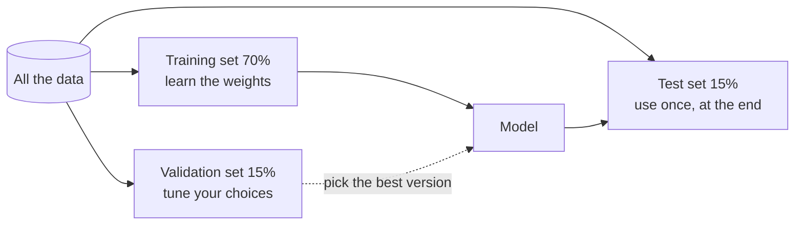

<!-- Written by `npm run lessons` from the lesson data in src/data. Edit the lesson there, not this page. -->

# The ML setup: features, labels, loss, train/validation/test

**ML Foundations · Unit 2: Classical ML, built by you · Lesson 1 of 17**

> **In one line.** Supervised learning turns examples, each with features and a label, into a model. You fit it on a training set, make your choices on a validation set, and measure the final result once on a test set.

[Open this lesson on the site](https://learn.hamropedia.com/foundations/the-ml-setup-features-labels-loss-train-validation-test/) for its animation, the practice game and tap-to-explain words.

## The problem it solves

A model that scores well on the data it learned from may still fail on anything new; it may simply have memorised. To know how it will really behave, you must measure it on data it never saw, and you must not let that data influence any of your choices. The three-way split is the simplest honest way to do that.

## The idea

Features are the inputs (house size, number of rooms). The label is the answer (price). The loss measures how wrong the model is. Train on one part of the data, tune on the validation set, and use the test set only once, at the end.

## How it works, step by step

1. Decide what one example is (a house), its features (size, rooms, age) and its label (price). Every row of X is one example; y holds the labels.
2. Pick a loss that says how wrong a prediction is: squared error for numbers, cross-entropy for categories.
3. Shuffle the rows, then split them, for example 70% training, 15% validation and 15% test. No row may appear in two sets.
4. Fit the model's weights on the training set only.
5. Use the validation set to compare models and settings (learning rate, tree depth, k) and keep the best one.
6. When every choice is final, score the chosen model once on the test set. That number is your honest estimate for new data.
7. If you go back and change things after looking at the test score, the test set has become a second validation set, and you need fresh test data.

## Picture it



*Learn on the training set, make decisions with the validation set, and keep the test set untouched until the final score.*

## Analogy

Studying for an exam. Training data is textbook exercises. The validation set is practice exams. The test set is the real exam, seen once.

**Where the analogy breaks.** If you studied the real exam paper beforehand, your score would mean nothing. It is the same when you use the test set for tuning: your result becomes a lie.

## Worked example

Predicting house prices from 1,000 sales. Features: size, rooms, age. Label: price. Loss: mean squared error. Shuffle, then 700 rows train the weights, 150 rows pick the best settings, and the last 150 rows give one final score.

```python
idx = np.random.permutation(len(X))       # shuffle first
tr, va, te = idx[:700], idx[700:850], idx[850:]   # 70/15/15 of 1,000 rows
X_train, y_train = X[tr], y[tr]
```

## Must know

- Feature = input; label = the answer; example = one row of both.
- Training set: learn weights. Validation set: make choices. Test set: report the final score, once.
- Shuffle before splitting, unless the data has an order that matters (time series: train on the past, test on the future).
- With little data, use cross-validation instead of a single validation set.
- Keep the class balance similar in every split (a "stratified" split) when one class is rare.
- Always compare against a simple baseline, such as predicting the average or the most common class.

## Common mistakes

- Tuning on the test set, even "just a little". The final score then over-promises.
- Splitting rows that belong together (several photos of the same person) across train and test.
- Shuffling time-series data, so the model trains on the future.
- Reporting training accuracy as if it were real-world accuracy.

> **Not true:** Several photos of the same person can safely be spread across the training set and the test set.  
> **In fact:** The model is then tested on a face it has already seen, so the score is too good. Keep rows that belong together on the same side of the split.

> **Not true:** Tuning a model on the test set just a little does no harm to the final score.  
> **In fact:** Every choice made by looking at the test set fits the model to it, so the final score over-promises. Make choices on the validation set, and use the test set once.

## Practise

Try each one yourself first: on paper, in code or out loud. Then open the answer and compare.

### 1. Derive

For a house-price problem, write down 3 features, the label, a loss, and what goes into the train, validation and test sets.

<details>
<summary>Show one good answer</summary>

Features (inputs): floor area in m², number of bedrooms, age of the house (others: distance to the station, postcode).  
Label (the answer to predict): the sale price.  
Loss: mean squared error between predicted and real prices. (Many people predict log(price), so a £20,000 miss on a cheap house counts more than on a mansion.)

The split, for example 1,000 past sales:  
• Train, 70%: the model learns its weights from these.  
• Validation, 15%: used again and again to choose settings, such as which features or how much regularisation.  
• Test, 15%: used once, at the very end, for an honest final number.

Two things to check: if a house was sold twice, keep both sales in the same set; and if the model will predict future sales, split by date (train on older sales, test on the newest) instead of at random.

</details>

### 2. Build

Write train_val_test_split(X, y, fractions, seed). Make it reproducible, and check that no row appears in two sets.

<details>
<summary>Show one good answer</summary>

Shuffle the row numbers once with a seeded random generator, then cut the shuffled list at the fraction boundaries. The same seed always gives the same split, which makes results reproducible.

Check two things: no row number is in two sets, and together the sets contain every row exactly once.

```python
import numpy as np

def train_val_test_split(X, y, fractions=(0.7, 0.15, 0.15), seed=0):
    assert np.isclose(sum(fractions), 1.0)
    order = np.random.default_rng(seed).permutation(len(X))
    cut1 = int(fractions[0] * len(X))
    cut2 = cut1 + int(fractions[1] * len(X))
    parts = np.split(order, [cut1, cut2])
    return [(X[idx], y[idx], idx) for idx in parts]

X, y = np.arange(1000).reshape(-1, 1), np.arange(1000)
(Xtr, ytr, a), (Xva, yva, b), (Xte, yte, c) = train_val_test_split(X, y)
assert not (set(a) & set(b) or set(a) & set(c) or set(b) & set(c))   # no overlap
assert sorted(np.concatenate([a, b, c])) == list(range(1000))        # every row once
again = train_val_test_split(X, y)[0][2]
assert (again == a).all()                                            # reproducible
print(len(a), len(b), len(c))                                        # 700 150 150
```

</details>

### 3. Break

Tune a model on the test set 20 times and report the best score. Then score it on fresh data. How big is the drop?

<details>
<summary>Show one good answer</summary>

Try 20 "models" that are secretly guessing at random on a test set of 200 examples. Each one should score about 50%, but by luck some score higher, and if you keep the best you report something like 55%. Score that same model on fresh data and it drops back to about 50%.

That drop is the cost of choosing on the test set: you didn't find a better model, you found the luckiest one on these particular 200 examples. The more often you look at the test set, the more optimistic its score becomes. This is why choices are made on the validation set, and the test set is used once.

```python
import numpy as np

rng = np.random.default_rng(0)
y_test = rng.integers(0, 2, 200)
# 20 "models" that are really coin flips: each one's guesses on the test set
guesses = rng.integers(0, 2, (20, 200))
scores = (guesses == y_test).mean(axis=1)
print(f"best of 20 on the test set: {scores.max():.0%}")

y_fresh = rng.integers(0, 2, 2000)            # new data: the "best" model guesses again
fresh = (rng.integers(0, 2, 2000) == y_fresh).mean()
print(f"the same model on fresh data: {fresh:.0%}")
```

</details>

### 4. Explain

Explain train, validation and test sets with the exam picture.

<details>
<summary>Show one good answer</summary>

Think of studying for an exam. The training set is the textbook exercises: you learn from them. The validation set is the practice papers: you take them again and again to decide how to study and when you are ready. The test set is the real exam: you sit it once.

If you peek at the real exam while you are still studying, your final grade no longer tells anyone what you actually know. That is why the test set stays locked away until the end.

</details>

## Check you understood

Answer in your head first, then open each one.

<details>
<summary>&lt;b>Why do you need a validation set as well as a test set?&lt;/b></summary>

You make many choices using the validation score, which slowly fits it. The test set stays untouched, so it still gives an honest final number.

</details>

<details>
<summary>&lt;b>You have 1,000 rows. How many go to each set in a 70/15/15 split?&lt;/b></summary>

700 for training, 150 for validation and 150 for test.

</details>

<details>
<summary>&lt;b>Why not shuffle a stock-price dataset before splitting?&lt;/b></summary>

The model would train on later days and be tested on earlier ones: it would be using the future to predict the past, which never happens in real use.

</details>

<details>
<summary>&lt;b>What is a baseline, and why bother?&lt;/b></summary>

A trivial predictor, such as always guessing the average. If your model can't beat it, it hasn't learned anything useful.

</details>

## Go further (optional)

The lesson above is enough on its own. These free extras give a second explanation.

- PLAY · [Train, Test, and Validation Sets](https://mlu-explain.github.io/train-test-validation/) · MLU-Explain (Amazon) · animated, scroll through it  
  **Worth it:** A short, colourful scroll-through story of why the data is split three ways and what goes wrong when it isn't.
- WATCH · [A Gentle Introduction to Machine Learning](https://www.youtube.com/results?search_query=StatQuest+A+Gentle+Introduction+to+Machine+Learning) · StatQuest (Josh Starmer)
- READ · [An Introduction to Statistical Learning (Python), Ch 2](https://www.statlearning.com/) · James, Witten, Hastie, Tibshirani, Taylor · free
- READ · [Machine Learning Crash Course](https://developers.google.com/machine-learning/crash-course) · Google

---

[← Convex optimisation: constraints, Lagrange multipliers and duality](../unit-1-math/convex-optimisation-constraints-lagrange-multipliers-and-duality.md) · [All lessons](../../README.md) · [Linear regression: normal equation and gradient descent →](linear-regression-normal-equation-and-gradient-descent.md)
