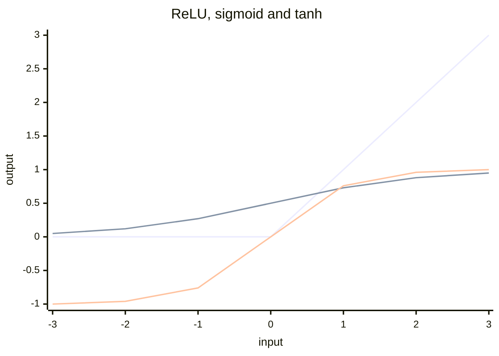

<!-- Written by `npm run lessons` from the lesson data in src/data. Edit the lesson there, not this page. -->

# Activation functions, and why non-linearity matters

**ML Foundations · Unit 3: Deep learning foundations · Lesson 2 of 16**

> **In one line.** An activation function is the non-linear step applied after each layer's weighted sum; without it, any number of layers collapses into a single linear layer.

[Open this lesson on the site](https://learn.hamropedia.com/foundations/activation-functions-and-why-non-linearity-matters/) for its animation, the practice game and tap-to-explain words.

## The problem it solves

The whole point of depth is to build curved, complicated functions. But a matrix times a matrix is just another matrix, so stacked linear layers can never do more than one linear layer. The activation is the small non-linear bend that makes depth useful. Your choice also decides whether gradients flow well through many layers.

## The idea

Without a non-linear activation, stacking layers is useless: two linear layers equal one linear layer. ReLU(x) = max(0, x) is the default. Sigmoid and tanh squash values. GELU is a smooth ReLU used in transformers.

## How it works, step by step

1. Two linear layers: W2(W1x) = (W2W1)x, which is one matrix. No matter how many you stack, the result is a straight-line model.
2. Put a ReLU between them: W2·ReLU(W1x). Each hidden neuron now switches on only above its own threshold, adding one bend where it does.
3. Add more neurons, get more bends. With enough of them, a network can follow almost any smooth curve: the universal approximation idea.
4. ReLU(z) = max(0, z): cheap, with slope exactly 1 when active, so gradients pass straight through. The default for hidden layers.
5. Sigmoid squashes into 0 to 1, and tanh into −1 to 1. Both flatten at the ends, where their slope is nearly 0, so stacking many of them makes gradients vanish. They survive as gates (LSTMs) and as output squashers.
6. GELU and SiLU are smooth versions of ReLU that let small negative values through. Transformers use them.

## Picture it



*ReLU is 0 then a straight line; sigmoid squashes into 0 to 1; tanh squashes into −1 to 1. The bends are what let networks learn curves.*

## Analogy

Straight Lego bricks can only build straight walls. Activations are the hinged pieces that let you build curves.

**Where the analogy breaks.** Lego hinges are few and fixed. A network learns where to bend, and with enough neurons it can approximate almost any shape.

## Worked example

W2(W1x) = (W2W1)x, which is just one matrix. A ReLU in between stops this collapse. A warning: the sigmoid's slope is at most 0.25, so ten sigmoid layers can shrink a gradient by 0.25¹⁰ ≈ 0.000001.

## Must know

- No activation means no depth: the whole stack is one linear map.
- ReLU is the default for hidden layers. GELU or SiLU in transformers.
- Sigmoid for yes/no outputs and gates; softmax for picking one of several classes.
- Saturating functions (sigmoid, tanh) give tiny gradients at their ends.
- "Dead ReLUs": a neuron whose input is always negative outputs 0 and gets no gradient, so it never recovers. Big learning rates make this more likely.
- Each ReLU neuron adds a hinge, so the network's output is a piecewise-linear function.

## Common mistakes

- Using sigmoid in every hidden layer of a deep network.
- Forgetting the activation in a hand-written layer.
- Putting ReLU on a regression output that should be able to go negative.

> **Not true:** A ReLU on the last layer suits a regression output that can be negative.  
> **In fact:** ReLU cannot output a negative number, so a target that can be negative could never be predicted. Leave the last layer of a regression without an activation.

> **Not true:** Hidden layers of a deep network: sigmoid is a sound default.  
> **In fact:** Sigmoid saturates: at its two ends the gradient is tiny, and through many layers it vanishes. ReLU is the default for hidden layers.

## Practise

Try each one yourself first: on paper, in code or out loud. Then open the answer and compare.

### 1. Derive

Write the derivatives of ReLU, sigmoid and tanh. What is the largest possible value of each?

<details>
<summary>Show one good answer</summary>

ReLU: relu(x) = max(0, x). Derivative: 1 if x > 0, 0 if x &lt; 0 (undefined at exactly 0; frameworks use 0). Largest value: 1.

Sigmoid: σ(x) = 1/(1 + e⁻ˣ). Derivative: σ(x)(1 − σ(x)). It is largest at x = 0, where σ = 0.5, giving 0.5 × 0.5 = 0.25.

Tanh: derivative 1 − tanh²(x). Largest at x = 0, where tanh = 0, giving 1.

Why it matters: in backprop the gradient is multiplied by these at every layer. With sigmoid, each layer multiplies by at most 0.25, so ten layers shrink it by at least 0.25¹⁰ ≈ 0.000001. ReLU passes 1 for active units, which is why deep networks use ReLU-like activations.

</details>

### 2. Build

Train the same small MLP on a curved 2D dataset (like two moons) with no activation, with ReLU, and with tanh. Plot the three decision boundaries.

<details>
<summary>Show one good answer</summary>

Same MLP (2 → 32 → 32 → 1), same training, three activations, on the two-moons data.

With no activation, the whole network is one linear function, so its boundary is a straight line, and it gets about 88% because a line can't follow the curve. With ReLU and with tanh, the boundary bends around the moons and accuracy reaches 100%. ReLU's boundary is made of straight pieces with corners; tanh's is smoother.

```python
import numpy as np
import torch
import torch.nn as nn
import matplotlib.pyplot as plt
from sklearn.datasets import make_moons           # only to make the toy data

X, y = make_moons(500, noise=0.1, random_state=0)
X, y = torch.tensor(X, dtype=torch.float32), torch.tensor(y, dtype=torch.float32)
grid = torch.tensor(np.stack(np.meshgrid(np.linspace(-1.5, 2.5, 200), np.linspace(-1, 1.5, 200)), -1).reshape(-1, 2), dtype=torch.float32)

fig, axes = plt.subplots(1, 3, figsize=(13, 4))
for ax, (name, act) in zip(axes, [("none", nn.Identity()), ("ReLU", nn.ReLU()), ("tanh", nn.Tanh())]):
    torch.manual_seed(0)
    model = nn.Sequential(nn.Linear(2, 32), act, nn.Linear(32, 32), act, nn.Linear(32, 1))
    opt = torch.optim.Adam(model.parameters(), lr=0.01)
    for _ in range(1000):
        opt.zero_grad()
        nn.functional.binary_cross_entropy_with_logits(model(X).squeeze(1), y).backward()
        opt.step()
    with torch.no_grad():
        acc = ((model(X).squeeze(1) > 0) == y.bool()).float().mean().item()
        ax.contourf(grid[:, 0].reshape(200, 200), grid[:, 1].reshape(200, 200),
                    (model(grid) > 0).reshape(200, 200), alpha=0.3)
    ax.scatter(X[:, 0], X[:, 1], c=y, s=6); ax.set_title(f"{name}: {acc:.0%}")
    print(name, f"{acc:.0%}")
plt.tight_layout(); plt.show()
```

</details>

### 3. Break

Stack 20 sigmoid layers and print the gradient size at each layer. Then count dead ReLU units after training with a huge learning rate.

<details>
<summary>Show one good answer</summary>

20 sigmoid layers: the gradient that reaches the first layer is tiny, about 10¹⁷ times smaller than at the last layer in the run below, shrinking by a factor of about 8 per layer, because every layer multiplies it by σ′ ≤ 0.25 (and by weights smaller than 1). The early layers effectively stop learning: vanishing gradients.

Dead ReLUs: train with a huge learning rate and one big update can push a unit's bias so negative that its input is below 0 for every example. Then it always outputs 0, its gradient is always 0, and it never recovers. In the run below, about a quarter of the hidden units are dead after 50 steps with a learning rate of 10, against none with 0.1. Fixes: a sensible learning rate, good initialisation, or Leaky ReLU / GELU, which keep a small slope below 0.

```python
import torch
import torch.nn as nn

torch.manual_seed(0)
layers = []
for _ in range(20):
    layers += [nn.Linear(64, 64), nn.Sigmoid()]
deep = nn.Sequential(*layers, nn.Linear(64, 1))
deep(torch.randn(128, 64)).pow(2).mean().backward()
norms = [deep[i].weight.grad.norm().item() for i in range(0, 40, 2)]
print(f"gradient at layer 20: {norms[-1]:.1e}, at layer 1: {norms[0]:.1e}")

X = torch.randn(512, 10)
y = (X[:, 0] > 0).long()
for lr in [0.1, 10.0]:
    torch.manual_seed(0)
    net = nn.Sequential(nn.Linear(10, 100), nn.ReLU(), nn.Linear(100, 2))
    opt = torch.optim.SGD(net.parameters(), lr=lr)
    for _ in range(50):
        opt.zero_grad(); nn.functional.cross_entropy(net(X), y).backward(); opt.step()
    with torch.no_grad():
        dead = (net[1](net[0](X)).max(dim=0).values == 0).float().mean().item()
    print(f"lr {lr}: {dead:.0%} of hidden units dead")
```

</details>

### 4. Explain

Explain why a network with no activations is just one linear layer.

<details>
<summary>Show one good answer</summary>

A layer with no activation computes W·x + b, a linear function. Feed that into another linear layer and you get W₂(W₁x + b₁) + b₂ = (W₂W₁)x + (W₂b₁ + b₂). That is again just one matrix times x plus one bias: a single linear layer.

However many linear layers you stack, they collapse into one, so the network can only ever draw straight lines (or flat planes) between classes. A non-linear activation between the layers, like ReLU, stops the collapse: each layer can now bend the space, and stacking them builds complicated curved shapes.

</details>

## Check you understood

Answer in your head first, then open each one.

<details>
<summary>&lt;b>Why does W2(W1x) gain nothing over a single layer?&lt;/b></summary>

It equals (W2W1)x, which is just another single matrix applied to x.

</details>

<details>
<summary>&lt;b>What is ReLU(−3), and what is its slope there?&lt;/b></summary>

0, and the slope is 0 too: no gradient flows through an inactive ReLU.

</details>

<details>
<summary>&lt;b>Why are sigmoids rarely used in deep hidden layers?&lt;/b></summary>

Their slope is small everywhere and almost zero at the ends, so gradients shrink layer after layer.

</details>

<details>
<summary>&lt;b>What is a "dead" ReLU?&lt;/b></summary>

A neuron whose input is negative for every example, so it always outputs 0, gets zero gradient and never changes.

</details>

## Go further (optional)

The lesson above is enough on its own. These free extras give a second explanation.

- PLAY · [A Neural Network Playground](https://playground.tensorflow.org/) · TensorFlow · runs in the browser  
  **Worth it:** Switch between linear, ReLU, tanh and sigmoid and watch the decision boundary bend (or stay stubbornly straight) as the network trains, live.
- WATCH · [Neural Networks Pt. 3: ReLU In Action](https://www.youtube.com/results?search_query=StatQuest+Neural+Networks+Pt.+3%3A+ReLU+In+Action) · StatQuest (Josh Starmer)
- READ · [CS231n: Neural Networks Part 1 (activation functions)](https://cs231n.github.io/neural-networks-1/) · Stanford
- READ · [Understanding Deep Learning, Ch 3 (activation functions)](https://udlbook.github.io/udlbook/) · Simon Prince · free

---

[← The neuron and the multi-layer perceptron](the-neuron-and-the-multi-layer-perceptron.md) · [All lessons](../../README.md) · [Backpropagation by hand →](backpropagation-by-hand.md)
