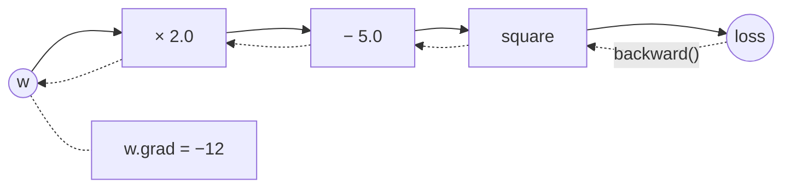

<!-- Written by `npm run lessons` from the lesson data in src/data. Edit the lesson there, not this page. -->

# Autograd and computational graphs

**ML Foundations · Unit 3: Deep learning foundations · Lesson 4 of 16**

> **In one line.** Autograd records every operation into a computational graph as your code runs, then loss.backward() walks the graph in reverse to fill in every gradient automatically.

[Open this lesson on the site](https://learn.hamropedia.com/foundations/autograd-and-computational-graphs/) for its animation, the practice game and tap-to-explain words.

## The problem it solves

Writing backward passes by hand is slow and error-prone, and real models have thousands of operations. Autograd removes that work: you write only the forward computation and get exact gradients for free. Knowing how it works explains PyTorch's rules — why gradients add up, why you call zero_grad(), why no_grad() saves memory.

## The idea

Autograd records every operation in a graph while you compute. Calling backward() walks the graph in reverse and applies the chain rule for you.

## How it works, step by step

1. Mark the tensors that need gradients (requires_grad=True); model parameters already are.
2. As each operation runs, autograd creates a node that remembers its inputs and how to compute its local derivative.
3. For L = (a·b + c)·f with a = 2, b = −3, c = 10, f = −2: e = a·b = −6, d = e + c = 4, L = d·f = −8. Each line adds a node to the graph.
4. loss.backward() starts at L with gradient 1 and visits the nodes in reverse order.
5. Multiplication gives each input the other input's value times the incoming gradient: d gets f = −2 and f gets d = 4.
6. Addition passes the gradient through unchanged: e and c both get −2. Then a gets −2·b = 6 and b gets −2·a = −4.
7. Each result lands in the tensor's .grad, and is added to whatever is already there.

## Picture it



*Autograd records every operation as a graph while computing, then walks it backwards to fill in each gradient.*

## Analogy

Breadcrumbs. On the way forward you drop a crumb at each step. On the way back you follow them home.

**Where the analogy breaks.** Breadcrumbs cost nothing. The graph costs memory: every intermediate value is stored until backward(). That is why training needs much more memory than inference.

## Worked example

L = (a·b + c)·f with a = 2, b = −3, c = 10, f = −2 gives L = −8. After L.backward(): f.grad = 4, c.grad = −2, a.grad = 6 and b.grad = −4, all without writing a single derivative by hand.

```python
import torch
w = torch.tensor(1.0, requires_grad=True)
loss = (w * 2.0 - 5.0) ** 2
loss.backward()
w.grad    # tensor(-12.)  the same as the hand calculation
```

## Must know

- The graph is rebuilt on every forward pass, so ordinary Python if-statements and loops just work.
- .grad accumulates, so call optimizer.zero_grad() once per step.
- with torch.no_grad(): stops recording. Use it for evaluation and inference: less memory, faster.
- tensor.detach() cuts a value out of the graph.
- The memory cost of training comes largely from the activations saved for backward.
- micrograd (Karpathy) is a complete autograd engine in about 100 lines of Python. Building one is the best way to understand it.

## Common mistakes

- Forgetting zero_grad(), so gradients from earlier batches add up.
- Evaluating without no_grad(), wasting memory on a graph you never use.
- Calling .numpy() or .item() in the middle of a computation, which breaks the graph.
- Changing a tensor in place that autograd still needs, which causes an error during backward.

> **Not true:** Gradients still flow through a value after .item() or .numpy() has been called on it.  
> **In fact:** Those calls leave PyTorch and return plain numbers, so the graph is cut there and nothing before that point receives a gradient.

> **Not true:** PyTorch clears the old gradients by itself before each backward pass.  
> **In fact:** Gradients accumulate: each backward pass adds to .grad. Call optimizer.zero_grad() once per step, or the old gradients add up.

## Practise

Try each one yourself first: on paper, in code or out loud. Then open the answer and compare.

### 1. Derive

Draw the computational graph for L = (a · b + c)², and write the local derivative on every edge.

<details>
<summary>Show one good answer</summary>

Break L = (a·b + c)² into simple steps, each one a node:  
m = a·b  
s = m + c  
L = s²

Local derivative on each edge:  
L ← s: ∂L/∂s = 2s  
s ← m: ∂s/∂m = 1  
s ← c: ∂s/∂c = 1  
m ← a: ∂m/∂a = b  
m ← b: ∂m/∂b = a

Multiply along each path from L back to an input:  
∂L/∂a = 2s · 1 · b, ∂L/∂b = 2s · 1 · a, ∂L/∂c = 2s · 1.

With a = 2, b = −3, c = 10: m = −6, s = 4, L = 16, so ∂L/∂a = 8 × (−3) = −24, ∂L/∂b = 8 × 2 = 16 and ∂L/∂c = 8.

```text
a ──┐
    (×) ── m ──┐            each edge carries its local derivative:
b ──┘          (+) ── s ── (²) ── L      L←s: 2s,  s←m: 1,  s←c: 1
c ─────────────┘                         m←a: b,   m←b: a
```

</details>

### 2. Build

Rebuild micrograd: a Value class with +, \*, tanh, exp and backward(). Train a tiny MLP with it.

<details>
<summary>Show one good answer</summary>

A Value holds a number, its gradient, the Values it was made from, and a small function that knows how to pass gradient back to them. backward() sorts the graph so every node comes after the nodes that use it, sets the output's gradient to 1, and calls each node's function in reverse order.

The gradients use += so that a Value used in several places adds up all of its contributions (see the break exercise). A tiny MLP built from Values learns four points; its loss drops close to 0.

```python
import math
import random

class Value:
    def __init__(self, data, parents=()):
        self.data, self.grad, self._parents, self._back = data, 0.0, parents, lambda: None
    def __add__(self, other):
        other = other if isinstance(other, Value) else Value(other)
        out = Value(self.data + other.data, (self, other))
        def back():
            self.grad += out.grad
            other.grad += out.grad
        out._back = back
        return out
    def __mul__(self, other):
        other = other if isinstance(other, Value) else Value(other)
        out = Value(self.data * other.data, (self, other))
        def back():
            self.grad += other.data * out.grad
            other.grad += self.data * out.grad
        out._back = back
        return out
    def tanh(self):
        t = math.tanh(self.data)
        out = Value(t, (self,))
        def back():
            self.grad += (1 - t * t) * out.grad
        out._back = back
        return out
    def exp(self):
        out = Value(math.exp(self.data), (self,))
        def back():
            self.grad += out.data * out.grad
        out._back = back
        return out
    __radd__, __rmul__ = __add__, __mul__
    def __neg__(self): return self * -1
    def __sub__(self, other): return self + (-other)
    def backward(self):
        order, seen = [], set()
        def visit(v):
            if v not in seen:
                seen.add(v)
                for p in v._parents:
                    visit(p)
                order.append(v)
        visit(self)
        self.grad = 1.0
        for v in reversed(order):
            v._back()

random.seed(0)
neuron = lambda n: [Value(random.uniform(-1, 1)) for _ in range(n + 1)]
hidden = [neuron(3) for _ in range(4)]
out_neuron = neuron(4)
params = [p for n in hidden + [out_neuron] for p in n]
def mlp(x):
    h = [sum((w * xi for w, xi in zip(n[:-1], x)), n[-1]).tanh() for n in hidden]
    return sum((w * hi for w, hi in zip(out_neuron[:-1], h)), out_neuron[-1]).tanh()

xs = [[2, 3, -1], [3, -1, 0.5], [0.5, 1, 1], [1, 1, -1]]
ys = [1, -1, -1, 1]
for step in range(100):
    loss = sum(((mlp(x) - y) * (mlp(x) - y) for x, y in zip(xs, ys)), Value(0))
    for p in params:
        p.grad = 0.0
    loss.backward()
    for p in params:
        p.data -= 0.05 * p.grad
print(round(loss.data, 4), [round(mlp(x).data, 2) for x in xs])
```

</details>

### 3. Break

Use the same Value twice, as in y = x \* x. Does backward give 2x? If not, you are overwriting gradients instead of adding them. Fix it.

<details>
<summary>Show one good answer</summary>

For y = x · x the gradient should be 2x: at x = 3, 6. If the backward function assigns (self.grad = ...) instead of adding (self.grad += ...), it gives 3.

Why: x appears twice, as both inputs of the multiplication. The backward step writes "other.data × out.grad" into x.grad for the first input (3), then writes it again for the second input (3) and overwrites the first. The true gradient is the sum of both paths: 3 + 3 = 6.

The rule: when a value is used in several places, its gradient is the sum of the gradients from every use. Always accumulate with +=, and reset gradients to 0 before each backward pass. That is exactly why PyTorch makes you call zero_grad().

```python
class Broken:
    def __init__(self, data): self.data, self.grad = data, 0.0
    def __mul__(self, other):
        out = Broken(self.data * other.data)
        def back():
            self.grad = other.data * out.grad       # BUG: = overwrites
            other.grad = self.data * out.grad
        out.back = back
        return out

x = Broken(3.0); y = x * x; y.grad = 1.0; y.back()
print(x.grad)       # 3.0, wrong

import torch
xt = torch.tensor(3.0, requires_grad=True); (xt * xt).backward()
print(xt.grad.item())   # 6.0, right: both uses add up
```

</details>

### 4. Explain

Explain autograd with the breadcrumbs picture, and why it costs memory.

<details>
<summary>Show one good answer</summary>

On the way forward, autograd drops a breadcrumb at every step: "here I multiplied a by b, and these were the numbers". That trail is the computational graph. When you call backward(), it follows the breadcrumbs home in reverse order, and at each crumb applies the chain rule using the numbers it saved, so every input ends up knowing its gradient, without you writing a single derivative.

It costs memory because the breadcrumbs have to be kept until the backward pass: every intermediate result of the forward pass, for every example in the batch. That is why training uses far more memory than running the model, and why torch.no_grad() during evaluation saves memory: it tells autograd not to drop crumbs.

</details>

## Check you understood

Answer in your head first, then open each one.

<details>
<summary>&lt;b>What does loss.backward() do?&lt;/b></summary>

It walks the recorded graph from the loss backwards, applying the chain rule, and adds each gradient into the .grad of the tensors that need one.

</details>

<details>
<summary>&lt;b>Why does PyTorch need optimizer.zero_grad()?&lt;/b></summary>

Because .grad accumulates. Without clearing it, each step would use the sum of every earlier batch's gradients.

</details>

<details>
<summary>&lt;b>What does torch.no_grad() change?&lt;/b></summary>

Operations are no longer recorded, so no graph is kept: less memory and faster, but no gradients.

</details>

<details>
<summary>&lt;b>For d = e + c, what gradient does c receive?&lt;/b></summary>

Exactly the gradient arriving at d: addition passes it through unchanged.

</details>

## Go further (optional)

The lesson above is enough on its own. These free extras give a second explanation.

- WATCH · [The spelled-out intro to neural networks and backpropagation: building micrograd](https://karpathy.ai/zero-to-hero.html) · Andrej Karpathy  
  **Worth it:** Builds a complete autograd engine from scratch, live, in plain Python. Long, but after it loss.backward() holds no mystery at all.
- READ · [Calculus on Computational Graphs: Backpropagation](https://colah.github.io/posts/2015-08-Backprop/) · Chris Olah
- READ · [Dive into Deep Learning, Ch 2 (automatic differentiation)](https://d2l.ai/) · d2l.ai · free

---

[← Backpropagation by hand](backpropagation-by-hand.md) · [All lessons](../../README.md) · [Softmax and cross-entropy loss →](softmax-and-cross-entropy-loss.md)
