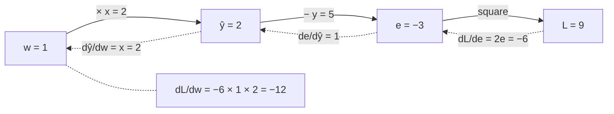

<!-- Written by `npm run lessons` from the lesson data in src/data. Edit the lesson there, not this page. -->

# Backpropagation by hand

**ML Foundations · Unit 3: Deep learning foundations · Lesson 3 of 16**

> **In one line.** Backpropagation computes the gradient of the loss with respect to every weight by applying the chain rule from the output backwards, reusing each intermediate result.

[Open this lesson on the site](https://learn.hamropedia.com/foundations/backpropagation-by-hand/) for its animation, the practice game and tap-to-explain words.

## The problem it solves

Gradient descent needs one gradient per weight, and a network can have billions of weights. Nudging each weight separately to measure its effect would need billions of forward passes. Backprop gets every gradient at the cost of about one extra pass, which is what makes training deep networks possible at all.

## The idea

Backprop computes the gradient of the loss for every weight, using the chain rule from the output backwards. Each step passes back: (gradient from above) × (its own local derivative).

## How it works, step by step

1. Forward pass: compute and remember every intermediate value. For L = (w·x − y)² with w = 1, x = 2 and y = 5: ŷ = 2, e = ŷ − y = −3, L = 9.
2. Start at the end: dL/dL = 1.
3. Each operation passes back (the gradient arriving from above) × (its own local derivative). L = e², whose local derivative is 2e = −6, so dL/de = −6.
4. e = ŷ − y has local derivative 1 with respect to ŷ, so dL/dŷ = −6.
5. ŷ = w·x has local derivative x = 2 with respect to w, so dL/dw = −6 × 2 = −12.
6. When one value feeds several later operations, the gradients coming back along each path are added together.
7. Gradient descent then uses it: w ← w − η·(−12), so w increases, which lowers the loss.

## Picture it



*Solid arrows are the forward pass; dotted arrows carry gradients backwards. Multiplying them along the path is the chain rule.*

## Analogy

A factory makes a faulty product. You trace back station by station, asking how much each one contributed to the fault.

**Where the analogy breaks.** In a factory, blame often goes to one station. In backprop, blame is shared, and it is added up across every path.

## Worked example

L = (wx − y)², with x = 2, y = 5, w = 1. Forward: ŷ = 2, error e = ŷ − y = −3, L = 9. Backward: dL/de = 2e = −6, de/dŷ = 1, dŷ/dw = x = 2. So dL/dw = −6 × 2 = −12. The gradient is negative, so increasing w lowers the loss.

## Must know

- Every node only needs its local derivative; the chain rule glues them together.
- Gradients flowing into the same value from different paths are summed.
- A forward pass saves activations, and the backward pass reuses them: that is why training needs more memory than inference.
- In matrix form, for a layer y = xW: the gradient for the weights is dL/dW = xᵀ·(dL/dy), and the gradient passed back is dL/dx = (dL/dy)·Wᵀ.
- Always verify hand-written gradients with a numerical gradient check.
- The cost of a backward pass is roughly twice a forward pass.

## Common mistakes

- Overwriting a gradient instead of adding to it when a value is used twice.
- Missing a transpose in the matrix version: the shapes usually tell you.
- Forgetting that the local derivative uses the values saved from the forward pass.

> **Not true:** Backpropagation needs one separate forward pass for every weight in the network.  
> **In fact:** One forward pass and one backward pass give the gradient for every weight at once. That is what makes training large networks possible.

> **Not true:** When a value is used in two places, only the last gradient that reaches it counts.  
> **In fact:** Gradients that reach the same value along different paths are added together. Overwriting instead of adding is a classic backprop bug.

## Go deeper (optional): Backprop in matrix form: where the transposes come from

1. Set-up: a batch X (n rows, d columns) goes through weights W (d × k) to give Y = XW (n × k). Backprop has already produced G = dL/dY, a grid the same shape as Y. We want dL/dW and dL/dX.
2. Write one entry of the product: Yᵢⱼ = Σₘ Xᵢₘ·Wₘⱼ. The weight Wₘⱼ appears only in column j of Y, once for each row i, and its local derivative there is ∂Yᵢⱼ/∂Wₘⱼ = Xᵢₘ.
3. The chain rule adds up every path from Wₘⱼ to the loss: ∂L/∂Wₘⱼ = Σᵢ Gᵢⱼ·Xᵢₘ.
4. That sum is entry (m, j) of the product Xᵀ·G, because row m of Xᵀ is column m of X. So dL/dW = Xᵀ·G.
5. Do the same for an input. Xᵢₘ appears only in row i of Y, with local derivative Wₘⱼ. So ∂L/∂Xᵢₘ = Σⱼ Gᵢⱼ·Wₘⱼ, which is entry (i, m) of G·Wᵀ. So dL/dX = G·Wᵀ.
6. Check the shapes. Xᵀ·G is (d × n)(n × k) = d × k, the shape of W. G·Wᵀ is (n × k)(k × d) = n × d, the shape of X. A gradient always has the shape of the thing it belongs to, and that rule alone tells you where the transposes go.

**The result.** For Y = XW: dL/dW = Xᵀ·(dL/dY) and dL/dX = (dL/dY)·Wᵀ. Every layer of a network is this rule, plus the slope of its activation.

## Practise

Try each one yourself first: on paper, in code or out loud. Then open the answer and compare.

### 1. Derive

For y = w2 · relu(w1 · x), with x = 2, w1 = 0.5, w2 = −1, target 3 and loss (y − target)², compute every gradient by hand.

<details>
<summary>Show one good answer</summary>

Forward pass, keeping every value:  
a = w1·x = 0.5 × 2 = 1  
h = relu(a) = 1 (a > 0, so ReLU passes it)  
y = w2·h = −1 × 1 = −1  
L = (y − target)² = (−1 − 3)² = 16

Backward pass, from the loss back:  
∂L/∂y = 2(y − target) = 2 × (−4) = −8  
∂L/∂w2 = ∂L/∂y × h = −8 × 1 = −8  
∂L/∂h = ∂L/∂y × w2 = −8 × (−1) = 8  
∂L/∂a = ∂L/∂h × relu′(a) = 8 × 1 = 8  
∂L/∂w1 = ∂L/∂a × x = 8 × 2 = 16  
(and ∂L/∂x = ∂L/∂a × w1 = 4, if you need it)

Sanity check: y = −1 is far below the target 3, so we want y bigger. ∂L/∂w2 &lt; 0 says "increase w2", which raises y. ∂L/∂w1 > 0 says "decrease w1": since w2 is negative, a smaller h makes y less negative. Both make sense.

```python
import torch
w1 = torch.tensor(0.5, requires_grad=True)
w2 = torch.tensor(-1.0, requires_grad=True)
L = (w2 * torch.relu(w1 * 2.0) - 3.0) ** 2
L.backward()
print(L.item(), w1.grad.item(), w2.grad.item())     # 16.0 16.0 -8.0
```

</details>

### 2. Build

Write the full backward pass for a 2-layer MLP with softmax and cross-entropy in NumPy. Check every gradient with your gradient checker. One fact to use now and derive two lessons later: with softmax and cross-entropy together, the gradient of the loss with respect to the scores is (p − y)/n.

<details>
<summary>Show one good answer</summary>

Forward: z1 = X·W1 + b1, h = relu(z1), z2 = h·W2 + b2, p = softmax(z2), loss = mean of −log p[correct class].

Backward, in reverse:  
dz2 = (p − Y) / n (softmax and cross-entropy together, Y one-hot)  
dW2 = hᵀ·dz2, db2 = sum of dz2 over the batch  
dh = dz2·W2ᵀ  
dz1 = dh × (z1 > 0)  
dW1 = Xᵀ·dz1, db1 = sum of dz1

The gradient checker nudges every parameter by ±h and compares with these formulas. The relative error is around 1e-7 or smaller for all four parameter arrays, so the backward pass is right.

```python
import numpy as np

rng = np.random.default_rng(0)
n, d, hidden, k = 8, 5, 6, 3
X, labels = rng.normal(size=(n, d)), rng.integers(0, k, n)
Y = np.eye(k)[labels]
params = {"W1": rng.normal(0, 0.5, (d, hidden)), "b1": np.zeros(hidden),
          "W2": rng.normal(0, 0.5, (hidden, k)), "b2": np.zeros(k)}

def loss_and_grads(P):
    z1 = X @ P["W1"] + P["b1"]; h = np.maximum(0, z1)
    z2 = h @ P["W2"] + P["b2"]
    z2 = z2 - z2.max(axis=1, keepdims=True)
    p = np.exp(z2) / np.exp(z2).sum(axis=1, keepdims=True)
    loss = -np.mean(np.log(p[np.arange(n), labels]))
    dz2 = (p - Y) / n
    dh = dz2 @ P["W2"].T
    dz1 = dh * (z1 > 0)
    return loss, {"W1": X.T @ dz1, "b1": dz1.sum(0), "W2": h.T @ dz2, "b2": dz2.sum(0)}

_, grads = loss_and_grads(params)
for name in params:
    numeric = np.zeros_like(params[name])
    for i in np.ndindex(params[name].shape):
        old = params[name][i]
        params[name][i] = old + 1e-5; up = loss_and_grads(params)[0]
        params[name][i] = old - 1e-5; down = loss_and_grads(params)[0]
        params[name][i] = old
        numeric[i] = (up - down) / 2e-5
    rel = np.abs(numeric - grads[name]).max() / (np.abs(numeric).max() + 1e-12)
    print(name, f"relative error {rel:.1e}")
```

</details>

### 3. Break

Plant a bug on purpose: forget one transpose in the backward pass. Does your gradient checker catch it? How big is the error?

<details>
<summary>Show one good answer</summary>

Yes, the checker catches it, and loudly. With dW2 = dz2ᵀ·h instead of hᵀ·dz2, the shape is wrong, (3, 6) instead of (6, 3), so the comparison crashes at once. With square matrices a missing transpose doesn't crash, and that is the dangerous case: the gradient has the right shape but the wrong values. The relative error is then large, around 1 (100%), compared with about 1e-7 for correct code.

That gap is what makes gradient checking so useful: correct backprop agrees to about 7 digits; a bug disagrees in the first digit. A relative error above about 1e-4 almost always means a bug.

```python
import numpy as np

rng = np.random.default_rng(0)
X, W = rng.normal(size=(4, 4)), rng.normal(size=(4, 4))   # square: no shape error to save you
loss = lambda W: np.sum((X @ W) ** 2) / 2
right = X.T @ (X @ W)                                     # dL/dW
wrong = (X @ W).T @ X                                     # the forgotten transpose: same shape!
numeric = np.zeros_like(W)
for i in np.ndindex(W.shape):
    E = np.zeros_like(W); E[i] = 1e-5
    numeric[i] = (loss(W + E) - loss(W - E)) / 2e-5
rel = lambda g: np.abs(g - numeric).max() / np.abs(numeric).max()
print(f"correct: {rel(right):.1e}, missing transpose: {rel(wrong):.1e}")
```

</details>

### 4. Explain

Explain backprop with the factory-fault picture, and say where the blame gets shared.

<details>
<summary>Show one good answer</summary>

A factory turns out a faulty product. You don't blame everyone equally: you trace back station by station. The last station asks "how much of the fault came from my step?", keeps that share of the blame, and passes the rest back to the station that fed it, scaled by how strongly that station's work affects its own. Every station does the same, all the way to the start.

That is backprop: the loss is the fault, each layer is a station, and the "how much did this step affect the next?" is the local derivative. The blame gets shared at every point where one output fed several things, or several inputs fed one thing: a weight's gradient is its input times the blame arriving from above, and a neuron that feeds several later neurons adds up the blame from all of them.

</details>

## Check you understood

Answer in your head first, then open each one.

<details>
<summary>&lt;b>In one sentence, what does each node do in the backward pass?&lt;/b></summary>

It multiplies the gradient arriving from above by its own local derivative and passes the result to its inputs.

</details>

<details>
<summary>&lt;b>A value feeds two later operations. How do you combine the gradients coming back?&lt;/b></summary>

Add them: the total effect is the sum of its effects along each path.

</details>

<details>
<summary>&lt;b>For y = xW, what is dL/dW?&lt;/b></summary>

xᵀ times dL/dy.

</details>

<details>
<summary>&lt;b>Why does backprop need to store the forward pass?&lt;/b></summary>

The local derivatives depend on the forward values, for example the x in d(wx)/dw.

</details>

## Go further (optional)

The lesson above is enough on its own. These free extras give a second explanation.

- WATCH · [Neural Networks, Ch 3: What is backpropagation really doing?](https://www.3blue1brown.com/lessons/backpropagation) · 3Blue1Brown  
  **Worth it:** Shows each weight being pulled up or down by the error, layer by layer, as moving pictures. The intuition behind every equation in this lesson.
- WATCH · [Neural Networks, Ch 4: Backpropagation calculus](https://www.3blue1brown.com/lessons/backpropagation-calculus) · 3Blue1Brown
- READ · [CS231n: Backpropagation, Intuitions](https://cs231n.github.io/optimization-2/) · Stanford
- WATCH · [Building makemore Part 4: Becoming a Backprop Ninja](https://karpathy.ai/zero-to-hero.html) · Andrej Karpathy

---

[← Activation functions, and why non-linearity matters](activation-functions-and-why-non-linearity-matters.md) · [All lessons](../../README.md) · [Autograd and computational graphs →](autograd-and-computational-graphs.md)
