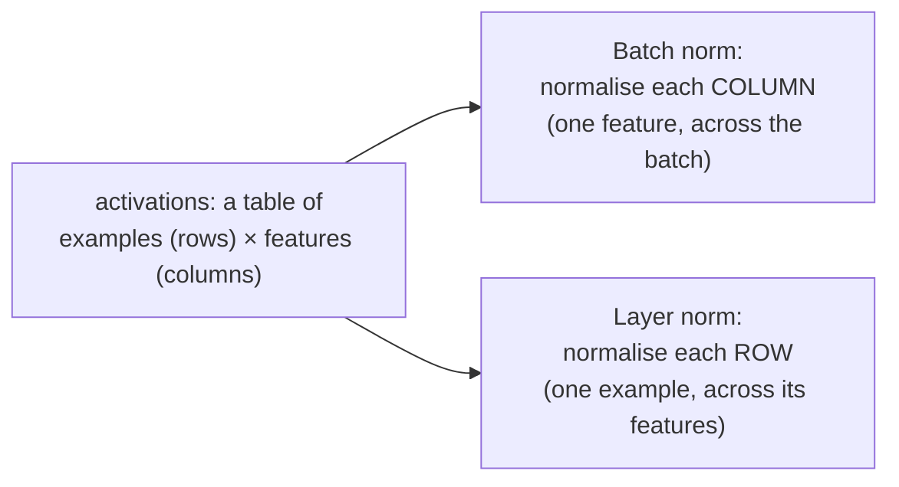

<!-- Written by `npm run lessons` from the lesson data in src/data. Edit the lesson there, not this page. -->

# Batch norm and layer norm

**ML Foundations · Unit 3: Deep learning foundations · Lesson 8 of 16**

> **In one line.** A normalisation layer rescales activations to mean 0 and variance 1, then lets the network scale and shift them again. Batch norm does this for each feature across the batch; layer norm does it for each example across its features.

[Open this lesson on the site](https://learn.hamropedia.com/foundations/batch-norm-and-layer-norm/) for its animation, the practice game and tap-to-explain words.

## The problem it solves

As earlier layers learn, the values reaching later layers keep changing scale, so each layer chases a moving target and training needs tiny learning rates. Normalisation keeps activations in a steady range, which allows bigger learning rates, makes deep networks far easier to train, and reduces sensitivity to initialisation. Every modern architecture uses one of these layers.

## The idea

Normalisation rescales activations to mean 0 and variance 1, then lets the network rescale them with learned γ and β. Batch norm averages over the batch, for each feature. Layer norm averages over the features, for each example.

## How it works, step by step

1. Take a batch of activations with shape (batch, features).
2. Batch norm: for each feature (column), compute its mean and variance over the batch.
3. Subtract the mean and divide by √(variance + ε): every column now has mean 0 and spread 1.
4. Multiply by a learned γ and add a learned β, so the network can undo the normalisation if that helps.
5. At test time, batch norm uses running averages of the mean and variance saved during training, so model.eval() matters.
6. Layer norm: for each example (row), use the mean and variance over its own features. No batch statistics, so training and test behave the same, and batch size doesn't matter.
7. Transformers use layer norm (or RMSNorm, which skips subtracting the mean). CNNs traditionally use batch norm.

## Picture it



*The two norms do the same maths in different directions. Layer norm doesn't depend on the batch, which is why transformers use it.*

## Analogy

Grading on a curve. Batch norm curves each exam question across all students. Layer norm curves each student across all of their questions.

**Where the analogy breaks.** A curve is set once. Batch norm behaves differently at test time (it uses saved running averages), which is a common source of bugs. Layer norm does not depend on the batch, which is why transformers use it.

## Worked example

A batch of 4 examples with 5 features. Feature 2 has the values [1, 5, 3, 7]: mean 4, standard deviation √5 ≈ 2.24. Batch norm turns it into about [−1.34, 0.45, −0.45, 1.34]. Layer norm instead normalises each example's own 5 values, so example 1, [4, 1, 2, 3, 0], becomes about [1.41, −0.71, 0, 0.71, −1.41].

```python
# x has shape (batch, features)
bn = (x - x.mean(axis=0)) / np.sqrt(x.var(axis=0) + 1e-5)
ln = (x - x.mean(axis=1, keepdims=True)) / np.sqrt(x.var(axis=1, keepdims=True) + 1e-5)
```

## Must know

- Batch norm: statistics over the batch, per feature. Layer norm: statistics over the features, per example.
- γ and β keep the layer flexible: it can learn any scale and shift.
- Batch norm needs reasonable batch sizes and behaves differently in train and eval modes.
- Layer norm is independent of the batch, ideal for variable-length sequences and transformers.
- Normalisation allows higher learning rates and speeds up training.
- Pre-norm transformers apply layer norm before each sub-layer, which trains more stably.

## Common mistakes

- Forgetting model.eval() with batch norm, so test predictions depend on the batch.
- Using batch norm with a batch size of 1 or 2.
- Normalising over the wrong axis: features versus batch.

> **Not true:** Layer norm needs a large batch to work well.  
> **In fact:** Layer norm uses only the features of one example, so the batch size makes no difference. It is batch norm that needs a reasonable batch.

> **Not true:** Batch norm behaves the same in training and at test time.  
> **In fact:** In training it uses the statistics of the current batch. At test time it uses running averages saved during training: call model.eval() to switch.

## Practise

Try each one yourself first: on paper, in code or out loud. Then open the answer and compare.

### 1. Derive

For one feature with batch values [1, 2, 3], compute the batch-norm output by hand (ignore ε, with γ = 1 and β = 0).

<details>
<summary>Show one good answer</summary>

Batch values [1, 2, 3].

Mean: (1 + 2 + 3) / 3 = 2.  
Variance (batch norm divides by n): ((1 − 2)² + 0² + (3 − 2)²) / 3 = 2/3. Standard deviation √(2/3) ≈ 0.816.

Normalise: (x − 2) / 0.816 gives [−1.225, 0, 1.225].

With γ = 1 and β = 0 that is also the output. The result has mean 0 and variance 1 across the batch. During training, γ and β are learned, so the layer can rescale and shift the output if that helps.

</details>

### 2. Build

Add batch norm to your deep MLP and compare training speed with and without it. Then write layer norm and check it against torch.nn.LayerNorm.

<details>
<summary>Show one good answer</summary>

A 10-layer MLP on 10,000 MNIST images, trained with plain SGD for two epochs, with and without a BatchNorm1d after each linear layer.

Without batch norm, this 10-layer network barely learns at all in two epochs: the loss is still about 2.30, the value for pure guessing. With batch norm, at the same learning rate, it is down to about 0.14. Each layer's inputs keep a steady scale, so a bigger learning rate is safe and the deep stack trains like a shallow one.

Layer norm normalises each example across its own features: subtract that row's mean, divide by its standard deviation, then scale and shift. With the same γ, β and ε it matches torch.nn.LayerNorm to within about 1e-6.

```python
import torch
import torch.nn as nn
from torchvision import datasets

mnist = datasets.MNIST("data", train=True, download=True)
X = mnist.data[:10_000].reshape(-1, 784).float() / 255.0
y = mnist.targets[:10_000]

def deep_mlp(batch_norm):
    layers, width = [], 784
    for _ in range(10):
        layers += [nn.Linear(width, 128)] + ([nn.BatchNorm1d(128)] if batch_norm else []) + [nn.ReLU()]
        width = 128
    return nn.Sequential(*layers, nn.Linear(128, 10))

for bn in [False, True]:
    torch.manual_seed(0)
    model = deep_mlp(bn)
    opt = torch.optim.SGD(model.parameters(), lr=0.05)
    for epoch in range(2):
        for idx in torch.randperm(10_000).split(64):
            opt.zero_grad()
            loss = nn.functional.cross_entropy(model(X[idx]), y[idx])
            loss.backward(); opt.step()
    model.eval()
    with torch.no_grad():
        print(f"batch norm {bn}: loss {nn.functional.cross_entropy(model(X), y).item():.3f}")

def layer_norm(x, gamma, beta, eps=1e-5):
    mean = x.mean(dim=-1, keepdim=True)
    var = x.var(dim=-1, unbiased=False, keepdim=True)
    return gamma * (x - mean) / torch.sqrt(var + eps) + beta

x = torch.randn(4, 16)
ln = nn.LayerNorm(16)
print(torch.allclose(layer_norm(x, ln.weight, ln.bias), ln(x), atol=1e-6))   # True
```

</details>

### 3. Break

Run your batch-norm model with batch size 1 in training mode. What goes wrong? Fix it with eval mode and running statistics.

<details>
<summary>Show one good answer</summary>

With batch size 1 in training mode, batch norm computes the mean and variance of a single value. The mean is that value and the variance is 0, so the output is (x − x) / √ε = 0 for every input. Every example looks the same to the rest of the network. PyTorch refuses outright for fully connected batch norm: "Expected more than 1 value per channel when training".

The fix for prediction is model.eval(). In eval mode, batch norm uses the running mean and variance it averaged during training instead of the batch's own statistics, so a single example is fine, and the output no longer depends on what else is in the batch.

If you must train with tiny batches, use layer norm or group norm instead, which don't depend on the batch at all.

```python
import torch
import torch.nn as nn

bn = nn.BatchNorm1d(4)
for _ in range(100):                          # learn running statistics from real batches
    bn(torch.randn(32, 4) * 3 + 5)
one = torch.randn(1, 4) * 3 + 5
try:
    bn.train(); bn(one)
except ValueError as e:
    print(e)
bn.eval()
print(bn(one))                                 # fine: uses the running mean and variance
print(bn.running_mean.round(decimals=1))       # close to 5
```

</details>

### 4. Explain

Explain batch norm and layer norm with the grading-on-a-curve picture.

<details>
<summary>Show one good answer</summary>

Grading on a curve: instead of using raw marks, you rescale them so the average becomes 0 and the spread becomes 1.

Batch norm curves each exam question across all the students who sat it today: for one feature, it uses the mean and spread of that feature across the batch. That works well with a big class, but it is odd with only one or two students, and it needs a remembered average for later exams (eval mode).

Layer norm curves each student across all of their own questions: for one example, it uses the mean and spread of that example's features. It doesn't care who else is in the room, which is why it suits transformers, small batches and text of any length.

</details>

## Check you understood

Answer in your head first, then open each one.

<details>
<summary>&lt;b>For a batch of shape (32, 64), which axis does batch norm average over? Layer norm?&lt;/b></summary>

Batch norm averages over the 32 examples (per feature); layer norm averages over the 64 features (per example).

</details>

<details>
<summary>&lt;b>Why do transformers use layer norm instead of batch norm?&lt;/b></summary>

It doesn't depend on the batch, works for any sequence length and batch size, and behaves the same in training and inference.

</details>

<details>
<summary>&lt;b>What are γ and β for?&lt;/b></summary>

They let the network learn the best scale and shift after normalising, including undoing it.

</details>

<details>
<summary>&lt;b>What goes wrong if you leave batch norm in training mode at test time?&lt;/b></summary>

Each prediction depends on the other examples in the batch, and on tiny batches the statistics are noisy, so results change randomly.

</details>

## Go further (optional)

The lesson above is enough on its own. These free extras give a second explanation.

- WATCH · [Building makemore Part 3 (the BatchNorm section)](https://karpathy.ai/zero-to-hero.html) · Andrej Karpathy
- READ · [Understanding Deep Learning, Ch 11 (batch normalisation)](https://udlbook.github.io/udlbook/) · Simon Prince · free
- PAPER · [Layer Normalization (2016)](https://arxiv.org/abs/1607.06450) · Ba, Kiros, Hinton · arXiv

---

[← Weight initialisation; vanishing and exploding gradients](weight-initialisation-vanishing-and-exploding-gradients.md) · [All lessons](../../README.md) · [Regularisation: dropout, weight decay, augmentation, early stopping →](regularisation-dropout-weight-decay-augmentation-early-stopping.md)
