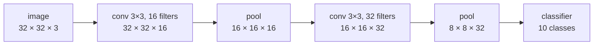

<!-- Written by `npm run lessons` from the lesson data in src/data. Edit the lesson there, not this page. -->

# Convolutional networks: convolution, pooling, receptive field

**ML Foundations · Unit 3: Deep learning foundations · Lesson 11 of 16**

> **In one line.** A convolutional layer slides small learned filters across an image, computing a dot product at every position, so the same pattern detector is reused everywhere. Stacking layers builds up from edges to whole objects.

[Open this lesson on the site](https://learn.hamropedia.com/foundations/convolutional-networks-convolution-pooling-receptive-field/) for its animation, the practice game and tap-to-explain words.

## The problem it solves

A fully connected layer on a 224 × 224 colour image would need about 150,000 weights per neuron, and would have to learn "cat" separately in every corner. Convolutions share a few weights across all positions, which saves enormous numbers of parameters and builds in the fact that a pattern means the same thing wherever it appears.

## The idea

A convolution slides a small filter, like 3×3, over the image and computes a dot product at each position. The same filter is used everywhere, so a cat is a cat in any corner. Pooling shrinks the image. The receptive field is how much of the original image one output can see, and it grows with depth.

## How it works, step by step

1. A filter (kernel) is a small grid of weights, for example 3 × 3.
2. Place it on the top-left patch of the image, multiply matching numbers and add them up: one output value.
3. Slide it across and down (by the stride) to fill a feature map. Big values mean "this pattern is here".
4. A layer has many filters, each producing its own feature map, so the output has many channels.
5. Output size = (W − K + 2P)/S + 1, for an input W wide, a filter K wide, padding P and stride S. With padding P = 1, a 3 × 3 filter at stride 1 keeps the size the same.
6. Pooling (for example 2 × 2 max pooling) shrinks the maps by keeping the strongest response in each patch.
7. Deeper layers combine earlier maps, and each output sees a bigger patch of the original image: its receptive field grows from 3 × 3 to 5 × 5 to 7 × 7 …

## Picture it



*Each convolution finds patterns; each pooling step shrinks the image. Deeper layers see bigger areas and more complex patterns.*

## Analogy

Scanning a page with a magnifying glass for one pattern, like an edge. Deeper layers look for patterns made of patterns: edges, then corners, then eyes, then faces.

**Where the analogy breaks.** A magnifying glass is one tool. A CNN layer has many filters at once, and they are learned from data, not designed by hand.

## Worked example

Output size = (W − K + 2P) / S + 1, where W is the input width, K the filter width, P the padding and S the stride. A 32×32 image with a 3×3 filter, padding 1 and stride 1 stays 32×32: (32 − 3 + 2·1)/1 + 1 = 32.

## Must know

- Weight sharing: the same filter at every position, so far fewer parameters.
- Shift equivariance: move the input and the feature map moves too.
- Parameters of a conv layer = K × K × C_in × C_out + C_out, whatever the image size.
- Output size = (W − K + 2P)/S + 1, for an input W wide, a filter K wide, padding P and stride S.
- Receptive field grows with depth, stride and pooling.
- Vision transformers (Unit 4) now rival CNNs, but convolutions remain everywhere in vision, audio and on-device models.

## Common mistakes

- Getting the output size wrong, then hitting shape errors at the first linear layer.
- Confusing channels-first (N, C, H, W, PyTorch) with channels-last (N, H, W, C).
- Forgetting padding, so the feature maps shrink at every layer.

> **Not true:** Without padding, a 3 × 3 convolution keeps the feature map the same size.  
> **In fact:** Without padding the map shrinks by 2 in each direction at every layer. A padding of 1 keeps the size for a 3 × 3 filter.

> **Not true:** A convolutional layer needs more parameters when the image is larger.  
> **In fact:** The same small filters slide over the whole image, so the count is K × K × C_in × C_out + C_out, whatever the image size.

## Practise

Try each one yourself first: on paper, in code or out loud. Then open the answer and compare.

### 1. Derive

Apply a 3 × 3 vertical-edge filter by hand to a 5 × 5 image that is dark on the left and bright on the right. Also work out the output size with padding 0 and stride 2.

<details>
<summary>Show one good answer</summary>

Take a 5 × 5 image where columns 1 and 2 are dark (0) and columns 3 to 5 are bright (1). Every row is [0, 0, 1, 1, 1].

Use the vertical-edge filter  
[−1, 0, 1]  
[−1, 0, 1]  
[−1, 0, 1]  
which computes (right column − left column) of each 3 × 3 patch, summed over its 3 rows.

With no padding and stride 1 the output is 3 × 3. For the patch starting at column j, the answer is 3 × (pixel in column j + 2 − pixel in column j):  
j = 1 (columns 1–3): 3 × (1 − 0) = 3  
j = 2 (columns 2–4): 3 × (1 − 0) = 3  
j = 3 (columns 3–5): 3 × (1 − 1) = 0  
Every row of the output is [3, 3, 0]: strong responses exactly where the patch covers the dark-to-bright edge, and 0 in the flat bright area.

With padding 0 and stride 2: output size = (5 − 3 + 2·0) / 2 + 1 = 2, so 2 × 2, keeping the patches at columns 1 and 3: each row is [3, 0].

```python
import numpy as np
import torch
import torch.nn.functional as F

image = np.tile([0, 0, 1, 1, 1], (5, 1)).astype(np.float32)
kernel = np.array([[-1, 0, 1]] * 3, dtype=np.float32)
t = lambda a: torch.tensor(a)[None, None]
print(F.conv2d(t(image), t(kernel))[0, 0])               # every row [3, 3, 0]
print(F.conv2d(t(image), t(kernel), stride=2)[0, 0])     # 2 x 2, every row [3, 0]
```

</details>

### 2. Build

Write a 2D convolution with loops in NumPy, then a vectorised one. Check both against torch.nn.functional.conv2d. Then train a small CNN on CIFAR-10.

<details>
<summary>Show one good answer</summary>

The loop version slides the filter over every position and sums the elementwise products. The vectorised version cuts out every patch at once (NumPy's sliding_window_view), then uses one einsum. Both match torch.nn.functional.conv2d exactly (deep learning "convolution" doesn't flip the filter, unlike the maths definition).

The small CNN (two conv-ReLU-pool blocks, then a linear layer) on CIFAR-10 reaches about 60% test accuracy after two epochs on the CPU (54% after one). Random guessing is 10%. More epochs, more channels and augmentation push a CNN past 80%.

```python
import numpy as np
import torch
import torch.nn as nn
import torch.nn.functional as F
from numpy.lib.stride_tricks import sliding_window_view
from torchvision import datasets

def conv2d_loops(x, w):                              # x: (C, H, W), w: (O, C, k, k)
    O, C, k, _ = w.shape
    H, W = x.shape[1] - k + 1, x.shape[2] - k + 1
    out = np.zeros((O, H, W), dtype=np.float32)
    for o in range(O):
        for i in range(H):
            for j in range(W):
                out[o, i, j] = np.sum(x[:, i:i + k, j:j + k] * w[o])
    return out

def conv2d_fast(x, w):
    patches = sliding_window_view(x, w.shape[2:], axis=(1, 2))   # (C, H, W, k, k)
    return np.einsum("chwij,ocij->ohw", patches, w)

rng = np.random.default_rng(0)
x, w = rng.normal(size=(3, 8, 8)).astype(np.float32), rng.normal(size=(4, 3, 3, 3)).astype(np.float32)
ref = F.conv2d(torch.tensor(x)[None], torch.tensor(w))[0].numpy()
assert np.allclose(conv2d_loops(x, w), ref, atol=1e-4) and np.allclose(conv2d_fast(x, w), ref, atol=1e-4)

train, test = datasets.CIFAR10("data", train=True, download=True), datasets.CIFAR10("data", train=False, download=True)
Xtr = torch.tensor(train.data).permute(0, 3, 1, 2).float() / 255.0
Xte = torch.tensor(test.data).permute(0, 3, 1, 2).float() / 255.0
ytr, yte = torch.tensor(train.targets), torch.tensor(test.targets)
torch.manual_seed(0)
cnn = nn.Sequential(nn.Conv2d(3, 32, 3, padding=1), nn.ReLU(), nn.MaxPool2d(2),
                    nn.Conv2d(32, 64, 3, padding=1), nn.ReLU(), nn.MaxPool2d(2),
                    nn.Flatten(), nn.Linear(64 * 8 * 8, 10))
opt = torch.optim.Adam(cnn.parameters(), lr=1e-3)
for epoch in range(2):
    for idx in torch.randperm(50_000).split(128):
        opt.zero_grad(); F.cross_entropy(cnn(Xtr[idx]), ytr[idx]).backward(); opt.step()
    with torch.no_grad():
        acc = (cnn(Xte).argmax(1) == yte).float().mean().item()
    print(f"epoch {epoch + 1}: CIFAR-10 test accuracy {acc:.1%}")
```

</details>

### 3. Break

Shift the test images by a few pixels and compare how an MLP and a CNN cope. Then remove pooling and see what happens to the receptive field.

<details>
<summary>Show one good answer</summary>

Shifting the test digits by 3 pixels: the MLP's accuracy falls sharply (from about 94% to about 49% here), because each of its weights is tied to one exact pixel position, so a shifted "7" lands on weights that never saw a "7" there. The CNN falls much less (from about 97% to about 72%), because the same filter is applied at every position, so a shifted edge is still detected, just shifted; pooling then adds a little tolerance to small shifts. It still drops, because the final linear layer is tied to positions; global average pooling or training with shifted images closes most of the gap.

Removing pooling shrinks the receptive field. Each 3 × 3 convolution only adds 2 pixels to what a unit can see; each 2 × 2 pooling doubles the step size for every later layer. With four 3 × 3 convolutions, a unit at the top sees a 9 × 9 patch without pooling, but a 38 × 38 patch with pooling after the first three. Without pooling, the top layer can't relate parts of the image that are far apart, unless you add many more layers, or use stride or dilation.

```python
import torch
import torch.nn as nn
import torch.nn.functional as F
from torchvision import datasets

mnist, test = datasets.MNIST("data", train=True, download=True), datasets.MNIST("data", train=False, download=True)
X, y = mnist.data[:20_000].float().unsqueeze(1) / 255.0, mnist.targets[:20_000]
Xte, yte = test.data.float().unsqueeze(1) / 255.0, test.targets
models = {
    "MLP": nn.Sequential(nn.Flatten(), nn.Linear(784, 256), nn.ReLU(), nn.Linear(256, 10)),
    "CNN": nn.Sequential(nn.Conv2d(1, 16, 3, padding=1), nn.ReLU(), nn.MaxPool2d(2),
                         nn.Conv2d(16, 32, 3, padding=1), nn.ReLU(), nn.MaxPool2d(2),
                         nn.Flatten(), nn.Linear(32 * 7 * 7, 10)),
}
for name, model in models.items():
    torch.manual_seed(0)
    opt = torch.optim.Adam(model.parameters(), lr=1e-3)
    for _ in range(2):
        for idx in torch.randperm(20_000).split(64):
            opt.zero_grad(); F.cross_entropy(model(X[idx]), y[idx]).backward(); opt.step()
    with torch.no_grad():
        normal = (model(Xte).argmax(1) == yte).float().mean().item()
        shifted = (model(torch.roll(Xte, shifts=3, dims=3)).argmax(1) == yte).float().mean().item()
    print(f"{name}: {normal:.1%} normally, {shifted:.1%} shifted 3 pixels right")

def receptive_field(layers):                        # each layer: (kernel, stride)
    field, jump = 1, 1
    for k, s in layers:
        field, jump = field + (k - 1) * jump, jump * s
    return field
print(receptive_field([(3, 1)] * 4), receptive_field([(3, 1), (2, 2)] * 3 + [(3, 1)]))   # 9 38
```

</details>

### 4. Explain

Explain convolution with the magnifying-glass picture.

<details>
<summary>Show one good answer</summary>

Scan a page with a magnifying glass, looking for one particular pattern, say a vertical edge. At each spot you note how strongly the pattern appears there, and the notes form a new, smaller "page" that shows where the pattern is. That magnifying glass is a filter, and sliding it everywhere is convolution: the same small set of weights is reused at every position, so it finds the pattern wherever it is.

A layer has many glasses, each looking for a different pattern. The next layer scans the notes from the first, so it finds patterns made of patterns: edges, then corners and textures, then eyes and wheels, then faces and cars.

</details>

## Check you understood

Answer in your head first, then open each one.

<details>
<summary>&lt;b>A 28 × 28 image, a 5 × 5 filter, no padding, stride 1. Output size?&lt;/b></summary>

(28 − 5)/1 + 1 = 24, so 24 × 24.

</details>

<details>
<summary>&lt;b>Why does a CNN need far fewer weights than an MLP on images?&lt;/b></summary>

Each filter is a few weights reused at every position, instead of a separate weight for every pixel in every neuron.

</details>

<details>
<summary>&lt;b>What does 2 × 2 max pooling do to a 4 × 4 map?&lt;/b></summary>

It keeps the largest value in each 2 × 2 block, giving a 2 × 2 map.

</details>

<details>
<summary>&lt;b>How does stacking two 3 × 3 convolutions change the receptive field?&lt;/b></summary>

Each output then sees a 5 × 5 patch of the input.

</details>

## Go further (optional)

The lesson above is enough on its own. These free extras give a second explanation.

- PLAY · [CNN Explainer](https://poloclub.github.io/cnn-explainer/) · Georgia Tech Polo Club · interactive  
  **Worth it:** Click any neuron of a real CNN and watch its filter slide across the image, step by step, with every number shown. The best way to see convolution happen.
- WATCH · [But what is a convolution?](https://www.3blue1brown.com/lessons/convolutions) · 3Blue1Brown
- READ · [CS231n: Convolutional Neural Networks](https://cs231n.github.io/convolutional-networks/) · Stanford
- READ · [Understanding Deep Learning, Ch 10 (convolutional networks)](https://udlbook.github.io/udlbook/) · Simon Prince · free

---

[← PyTorch: nn.Module, DataLoader and the training loop](pytorch-nn-module-dataloader-and-the-training-loop.md) · [All lessons](../../README.md) · [Residual connections (ResNet) →](residual-connections-resnet.md)
