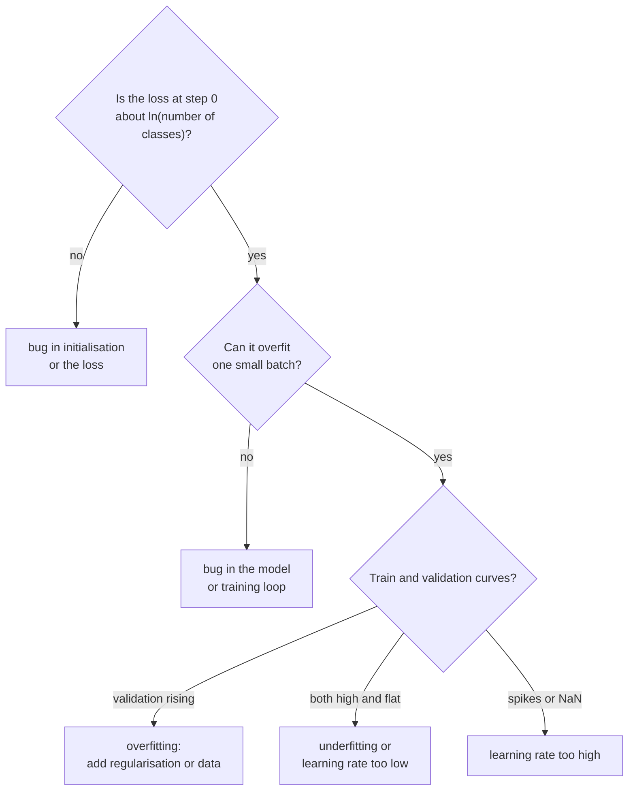

<!-- Written by `npm run lessons` from the lesson data in src/data. Edit the lesson there, not this page. -->

# Debugging training: overfit one batch, read loss curves

**ML Foundations · Unit 3: Deep learning foundations · Lesson 15 of 16**

> **In one line.** Debugging training means checking, in a fixed order, that the model can learn at all — sensible starting loss, overfitting one small batch — before reading the loss curves of real runs.

[Open this lesson on the site](https://learn.hamropedia.com/foundations/debugging-training-overfit-one-batch-read-loss-curves/) for its animation, the practice game and tap-to-explain words.

## The problem it solves

Neural network bugs rarely crash. A shuffled label, a missing zero_grad or a wrong axis gives code that runs, prints a falling loss and quietly produces a worse model. Without a routine you can lose days tuning hyperparameters on top of a bug. A few cheap checks catch most problems in minutes.

## The idea

First, make the model overfit one small batch: the loss should go close to 0. If it cannot, you have a bug. Then watch the training and validation loss curves together.

## How it works, step by step

1. Look at the data first: print a few examples with their labels, and check shapes, ranges and class balance.
2. Check the loss at step 0. With K classes and random weights it should be about ln K: ln 10 ≈ 2.30 for 10 classes. A very different number means an initialisation or loss bug.
3. Overfit one small batch (say 8 examples): turn regularisation off and train on just that batch. The loss should go close to 0. If it can't, there is a bug.
4. Start from a simple baseline (a tiny model, a known learning rate) and change one thing at a time.
5. Run a short learning-rate sweep (factors of 3 to 10) and pick the largest rate that still trains smoothly.
6. Read the curves. Train down and validation up: overfitting. Both high and flat: underfitting, or the learning rate is too low. Spikes or NaN: the learning rate is too high, or there is a numerical bug.
7. Watch gradient norms per layer: zeros mean a broken graph or dead units; huge values mean explosion.

## Picture it



*A checklist to work through in order. Each question rules out a whole class of bugs before you look at the next.*

## Analogy

A mechanic tests the engine on a stand before driving it on the road.

**Where the analogy breaks.** An engine test is quick and clear. Training bugs can be silent: the code runs and the loss drops a bit, but the result is wrong. So also check the loss at step 0.

## Worked example

With 10 classes and random weights, the loss at step 0 should be about ln 10 ≈ 2.30. If it is 15, your initialisation or softmax is wrong. Train loss down and validation loss up means overfitting. Both high and flat means underfitting or a learning rate that is too low. Spikes or NaN usually mean the learning rate is too high.

## Must know

- Initial loss ≈ ln(number of classes) for a classifier.
- Can't overfit one batch → bug, not a hyperparameter problem.
- Change one thing at a time, and keep a log of runs.
- Visualise predictions on real examples, not just the loss.
- Fix the random seed while debugging.
- Karpathy's "A Recipe for Training Neural Networks" is the classic checklist.

## Common mistakes

- Tuning hyperparameters before confirming the model can overfit one batch.
- Trusting a falling loss without looking at predictions.
- Changing several things between runs, so you can't tell what helped.
- Comparing runs with different seeds and treating small differences as real.

> **Not true:** A loss that keeps falling proves the model is learning the right thing.  
> **In fact:** A loss can fall while the predictions are useless, for example when the labels leak into the inputs. Always look at real predictions as well.

> **Not true:** Hyperparameter tuning is the first thing to try when a model won't learn.  
> **In fact:** First check that the model can overfit one small batch. If it can't, there is a bug, and no hyperparameter will fix it.

## Practise

Try each one yourself first: on paper, in code or out loud. Then open the answer and compare.

### 1. Derive

Write down the expected loss at step 0, with random weights, for 10, 100 and 50,000 classes.

<details>
<summary>Show one good answer</summary>

With random weights, a classifier's predictions are close to uniform: each of C classes gets probability about 1/C. Cross-entropy is −log(probability of the correct class) = −log(1/C) = ln C.

10 classes: ln 10 ≈ 2.30  
100 classes: ln 100 ≈ 4.61  
50,000 classes (a language model's vocabulary): ln 50,000 ≈ 10.82

If your first loss is far above this, something is wrong: weights initialised too large (very confident wrong guesses), softmax applied twice, or a bug in the labels. Checking it takes seconds and catches a whole family of bugs.

</details>

### 2. Build

Write a debugging checklist script: check the initial loss, overfit one batch, plot train and validation curves, print gradient norms per layer.

<details>
<summary>Show one good answer</summary>

The checklist runs four checks in order, cheapest first, and stops at the first failure:  
1. The first loss is close to ln(number of classes).  
2. A copy of the model can overfit one small batch: the loss on 32 examples falls almost to 0 within a few hundred steps. If not, the bug is in the code, not the data.  
3. The gradient norm of every layer printed once, to spot layers with zero or huge gradients.  
4. Train and validation losses, both recorded and plotted per epoch.

Keep it as a script and run it on every new model before any long training run.

```python
import copy
import math
import torch
import torch.nn as nn
import torch.nn.functional as F
import matplotlib.pyplot as plt
from torchvision import datasets

def check_training(model, X, y, Xva, yva, n_classes, lr=1e-3):
    first = F.cross_entropy(model(X[:256]), y[:256]).item()
    print(f"1. first loss {first:.2f}, expected about {math.log(n_classes):.2f}")
    assert abs(first - math.log(n_classes)) < 1.0, "first loss is off: check init, softmax, labels"

    probe = copy.deepcopy(model)                     # a throwaway copy for the one-batch test
    opt = torch.optim.Adam(probe.parameters(), lr=lr)
    for _ in range(300):
        opt.zero_grad(); loss = F.cross_entropy(probe(X[:32]), y[:32]); loss.backward(); opt.step()
    print(f"2. loss on one batch of 32 after 300 steps: {loss.item():.4f}")
    assert loss.item() < 0.05, "cannot overfit one batch: there is a bug in the model or loop"

    F.cross_entropy(model(X[:256]), y[:256]).backward()
    for name, p in model.named_parameters():
        print(f"3. gradient norm {name:10s} {p.grad.norm().item():.2e}")

    opt = torch.optim.Adam(model.parameters(), lr=lr)
    train_curve, val_curve = [], []
    for epoch in range(3):
        for idx in torch.randperm(len(X)).split(128):
            opt.zero_grad(); F.cross_entropy(model(X[idx]), y[idx]).backward(); opt.step()
        with torch.no_grad():
            train_curve.append(F.cross_entropy(model(X), y).item())
            val_curve.append(F.cross_entropy(model(Xva), yva).item())
    print("4. train", [round(v, 3) for v in train_curve], "validation", [round(v, 3) for v in val_curve])
    plt.plot(train_curve, label="train"); plt.plot(val_curve, label="validation"); plt.legend(); plt.show()

mnist = datasets.MNIST("data", train=True, download=True)
X, y = mnist.data.reshape(-1, 784).float() / 255.0, mnist.targets
torch.manual_seed(0)
model = nn.Sequential(nn.Linear(784, 128), nn.ReLU(), nn.Linear(128, 10))
check_training(model, X[:10_000], y[:10_000], X[50_000:], y[50_000:], n_classes=10)
```

</details>

### 3. Break

Plant 3 bugs in a working training script (labels shifted by one, no shuffling, learning rate × 10). Put it away for a week, then find them.

<details>
<summary>Show one good answer</summary>

What each planted bug looks like, and which check finds it.

1. Labels shifted by one (each image paired with the next image's label). The labels are now effectively random. The first-loss check passes, and the model can still overfit one batch (it can memorise anything), so those checks don't catch it. The giveaway is the curves: the training loss falls only slowly, by memorising, and validation accuracy stays near 10%, chance. The fastest check of all: plot a few images with their labels and look.

2. No shuffling. If the data is sorted by class (all 0s, then all 1s…), each stretch of batches teaches the model "everything is a 3", then "everything is a 4". The loss curve is a sawtooth, jumping every time the class changes, and the final model is biased towards the last classes it saw. Plot the loss per step, not just per epoch, and check that one batch contains a mix of labels.

3. Learning rate × 10. The loss is spiky, may rise, or turns into nan within a few hundred steps; gradient norms are large. A short learning-rate sweep (try a few values across powers of 10) shows it at once.

The point of waiting a week is that you can't remember where you put them, which is what real bugs are like. The habit to build: look at the data, check the first loss, overfit one batch, and always plot both curves.

</details>

### 4. Explain

Explain 'overfit one batch first' with the engine-on-a-stand picture.

<details>
<summary>Show one good answer</summary>

A mechanic who has rebuilt an engine tests it on a stand before putting it back in the car. On the stand there is no road, no weather and no traffic, so if it won't run there, the problem is the engine itself, and you have learned that cheaply.

Overfitting one batch is the engine stand for a training script. Take 32 examples and train only on them. A working model and training loop must be able to memorise them, so the loss should drop almost to 0. If it can't, the bug is in your code: the model, the loss, the labels or the update. You find that in a minute, instead of after a ten-hour run on the full dataset.

</details>

## Check you understood

Answer in your head first, then open each one.

<details>
<summary>&lt;b>Your 10-class classifier starts at loss 15. What does that suggest?&lt;/b></summary>

The initial predictions are wildly over-confident: bad initialisation (outputs far too large) or a bug in the softmax or loss.

</details>

<details>
<summary>&lt;b>Why overfit a single batch first?&lt;/b></summary>

A working model and pipeline can always memorise a tiny batch. If it can't, something is broken, and no tuning will fix it.

</details>

<details>
<summary>&lt;b>Train loss falls steadily, validation loss rises after epoch 5. Diagnosis?&lt;/b></summary>

Overfitting after epoch 5: use early stopping, more regularisation or more data.

</details>

<details>
<summary>&lt;b>The loss is flat from the very first step. Name two likely causes.&lt;/b></summary>

The learning rate is far too small, or gradients aren't flowing (no backward, a detached graph, zero_grad in the wrong place).

</details>

## Go further (optional)

The lesson above is enough on its own. These free extras give a second explanation.

- READ · [A Recipe for Training Neural Networks](https://karpathy.github.io/2019/04/25/recipe/) · Andrej Karpathy  
  **Worth it:** The most useful blog post on training neural networks ever written: the exact step-by-step routine experts follow. Read it twice, and keep it open.
- READ · [CS231n: Neural Networks Part 3 (gradient checks, babysitting training)](https://cs231n.github.io/neural-networks-3/) · Stanford
- READ · [Deep Learning Tuning Playbook](https://github.com/google-research/tuning_playbook) · Google Research

---

[← Embeddings: representing things as vectors](embeddings-representing-things-as-vectors.md) · [All lessons](../../README.md) · [LSTMs and GRUs: gates for long memory →](lstms-and-grus-gates-for-long-memory.md)
